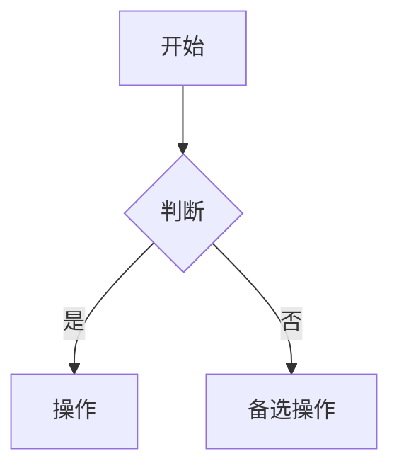

# 模板 — 功能规格说明

> 当单项功能所需的 UX/逻辑细节比 FR 区块提供的内容更深入（界面、状态、验证规则、流程图）时使用。一个功能对应一份文件。

```markdown
---
doc_id: FEAT-NNN
title: "FEAT-NNN — <功能名称>"
type: feature
status: draft
version: 0.1.0
updated: YYYY-MM-DD
owner: <团队>
implements: [FR-XXX-000]
---

# FEAT-NNN — <功能名称>

## 1. 概览
说明此功能的用途及其实现的需求。

## 2. 用户流程


## 3. UI / 交互状态
| 状态 | 触发条件 | 系统行为 | 空状态 / 错误处理 |
|------|----------|----------|-------------------|

## 4. 业务与验证规则
| 规则 ID | 规则 | 适用对象 | 错误消息 |
|---------|------|----------|----------|

## 5. 使用的数据与 API
- 实体：DM-…    端点：API-…

## 6. 验收标准（Gherkin）

## 7. 边界情况与错误处理

## 版本历史
| 版本 | 日期 | 作者 | 变更 |
|------|------|------|------|
```

## 版本历史

| 版本 | 日期 | 作者 | 变更 |
|------|------|------|------|
| 1.0.2 | 2026-10-02 | Product Engineering | 完成模板面向读者内容的第二轮中文化 |
| 1.0.1 | 2026-10-02 | Product Engineering | 将人类可读内容翻译为简体中文 |
| 1.0.0 | 2026-09-10 | Product Engineering | 初始功能规格说明模板 |
