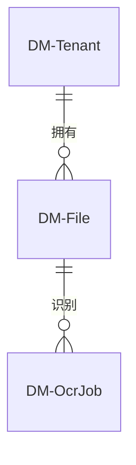

# 模板 — 数据模型规范

> 只定义**实体层**：实体、用途、存储位置、归属、关键关系与生命周期。**字段级结构以代码为唯一来源**（ORM 模型 + Alembic 迁移；jsonb 字段内的结构以服务端模型为准），文档中不写字段表（ADR-008、STD-004 规则 2）。

```markdown
---
doc_id: DM-NNN
title: "数据模型 — <领域>"
type: data-model
status: draft
version: 0.1.0
updated: YYYY-MM-DD
owner: <团队>
---

# 数据模型 — <领域>

> 本文件只描述实体层；字段级结构以代码为唯一来源。存储位置以 ADR-nnn 为准。

## 1. 实体关系概览
（只画实体与关系，不带属性）


## 2. 实体清单
| 实体 ID | 用途 | 存储 | 归属 | 关键关系 | 生命周期 |
|---------|------|------|------|----------|----------|
| `DM-<实体>` | … | PostgreSQL / PostgreSQL（jsonb） / GCS | 租户 / 用户 / 全局 | … | 状态 A → 状态 B |

## 3. 枚举
只列产品级枚举的取值名称。
| 枚举 | 取值 |
|------|------|
| DocumentType | PO、DELIVERY_NOTE、INVOICE、RECEIPT、CREDIT_NOTE、TAX_RECEIPT |

## 4. 数据保留与隐私
链接至 NFR-SEC / NFR-DATA。说明存储位置和加密方式。

## 版本历史
| 版本 | 日期 | 作者 | 变更 |
|------|------|------|------|
```

## 版本历史

| 版本 | 日期 | 作者 | 变更 |
|------|------|------|------|
| 1.2.0 | 2026-11-02 | Product Engineering | 存储取值按 ADR-008 改为 PostgreSQL / jsonb / GCS |
| 1.1.0 | 2026-10-30 | Product Engineering | 改为实体层模板：删除字段表示例，改为实体清单表、不带属性的 erDiagram 与枚举名称；字段以代码为唯一来源（ADR-007） |
| 1.0.2 | 2026-10-02 | Product Engineering | 完成模板面向读者内容的第二轮中文化 |
| 1.0.1 | 2026-10-02 | Product Engineering | 将人类可读内容翻译为简体中文 |
| 1.0.0 | 2026-09-10 | Product Engineering | 初始数据模型规范模板 |
