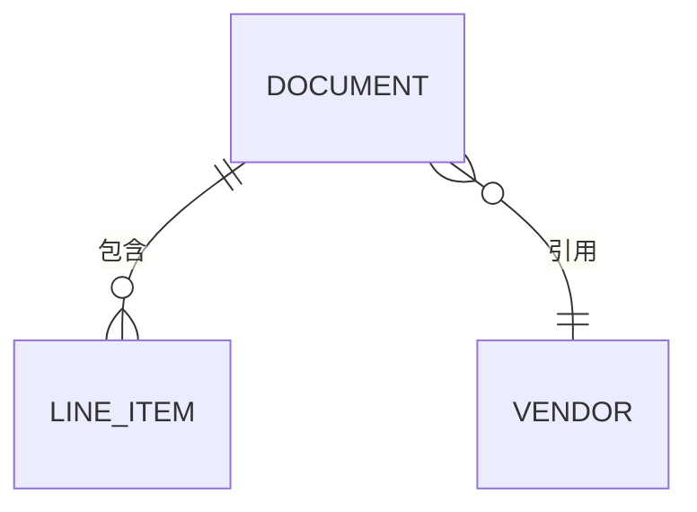

# 模板 — 数据模型规范

> 定义实体、字段、类型、约束和关系。这是数据的唯一事实来源；需求文档应链接至此，而不应重复定义字段。

```markdown
---
doc_id: DM-NNN
title: "数据模型 — <领域>"
type: data-model
status: draft
version: 0.1.0
updated: YYYY-MM-DD
owner: <团队>
---

# 数据模型 — <领域>

## 1. 实体关系概览


## 2. 实体：DM-<实体>
**用途：** …    **来源需求：** FR-…

| 字段 | 类型 | 必填 | 约束 | 示例 | 备注 |
|------|------|------|------|------|------|
| id | uuid | Y | PK | 3f9a… | |
| po_number | string | N | len ≤ 64 | PO-2026-001 | 来自 OCR |
| total_amount | decimal(14,2) | Y | ≥ 0 | 12500.00 | THB |

**索引 / 键：** …
**生命周期 / 状态：** draft → verified → archived

## 3. 枚举
| 枚举 | 值 |
|------|----|
| DocumentType | PO, DELIVERY_NOTE, INVOICE, RECEIPT, CREDIT_NOTE, TAX_RECEIPT |

## 4. 数据保留与隐私
链接至 NFR-SEC / NFR-DATA。说明存储位置和加密方式。

## 版本历史
| 版本 | 日期 | 作者 | 变更 |
|------|------|------|------|
```

## 版本历史

| 版本 | 日期 | 作者 | 变更 |
|------|------|------|------|
| 1.0.2 | 2026-10-02 | Product Engineering | 完成模板面向读者内容的第二轮中文化 |
| 1.0.1 | 2026-10-02 | Product Engineering | 将人类可读内容翻译为简体中文 |
| 1.0.0 | 2026-09-10 | Product Engineering | 初始数据模型规范模板 |
