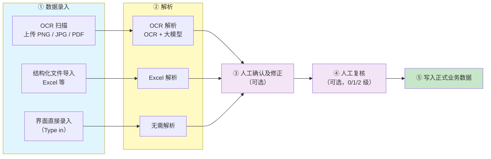
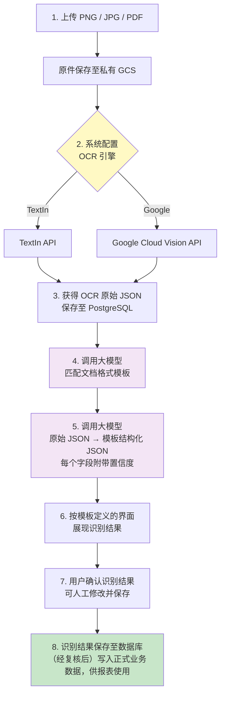
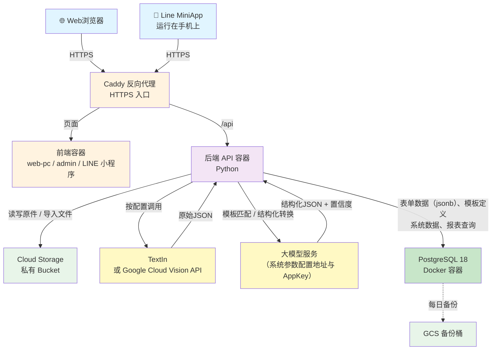

# SaiFlow — 泰国 SME 制造企业单据数字化录入系统

> **产品需求文档（PRD）。** 本文档是 SaiFlow 的权威性*为什么做*与*做什么*说明。v3.0.0 在 v2.2.2 的基础上重新梳理业务流程：数据入口从单一 OCR 扩展为 **OCR 扫描 / 结构化文件导入 / 界面直接录入** 三种方式，并细化基于大模型的 OCR 模板匹配与结构化转换链路。详细的原子化需求位于 `docs/20-requirements/`；技术设计位于 `docs/30-design/`。请先阅读 `AGENTS.md` 以了解导航方式。
>
> **同步说明：** v3.1.0 新增 §4.9 账户、租户与计费；v3.2.0 补充 §4.9 套餐规则（按 OCR 扫描次数计量、团队租户、成员人数上限、开通周期、免费额度、通知与提醒）；v3.3.0 按 `ADR-008` 改为 VPS + Docker 运行，表单数据改存 PostgreSQL（识别结果用 jsonb），对象仍存私有 GCS。v3.4.0 按负责人 2026-11-04 的决定，团队租户改称组织，取消原地升级（变更 `rebuild-tenant-rbac`）。产品级文档（`Glossary.md`、`Vision-Scope.md`、`Personas.md`、`NFR.md`、`Architecture.md`、`Data-Model.md`、`AGENTS.md`）已同步；相关 `EPIC-*`、`OCR-Pipeline.md` 与 `docs/40-acceptance/` 尚未同步，随重建步骤迁入 `openspec/specs/`（见第 8 节），冲突时以本 PRD 为准；与 v2.2.2 的差异见第 0 节，待确认事项见第 7 节。

---

## 0. 本版主要变更（相对 v2.2.2）

| # | 变更点 | v2.2.2 | v2 草案 |
|---|--------|--------|---------|
| C-1 | 数据入口 | 仅纸质单据拍照/扫描 + OCR | **OCR 扫描**、**结构化文件导入**（Excel 等）、**界面直接录入**三种入口 |
| C-2 | 统一业务流程 | 上传 → OCR → 核验 → 复核 → 归档 | **数据录入 → 解析 → 人工确认及修正（可选）→ 人工复核（可选）→ 写入正式业务数据** |
| C-3 | OCR 引擎 | TextIn（流程图中提及 Cloud Vision） | 按**系统配置**选择 **TextIn** 或 **Google Cloud Vision API** |
| C-4 | 模板匹配 | 按 `doc_type` 或自动分类结果匹配模板 | **调用大模型**，根据 OCR 原始 JSON 匹配对应的文档格式模板 |
| C-5 | 结构化转换 | Cloud Functions 按模板 JSONPath 映射 | **完全由大模型替代**：将 OCR 原始 JSON 转换为模板定义的结构化 JSON；每个字段可附带置信度（增强能力，不阻塞主流程） |
| C-6 | 结果展现 | 可视化识别结果 | 按**模板定义的界面**展现识别结果，用户可修改并保存 |
| C-7 | 批量确认 | 无 | 待确认队列提供 **“Confirm all”** 按钮，一次性确认所有字段置信度均不低于阈值的表单 |
| C-8 | 大模型接入 | 无 | 大模型可配置：系统参数配置**模型地址与 AppKey**；选择模型时由人工确认是否符合 PDPA |
| C-9 | Excel 导入 / 导出 | 仅 Excel 导出 | Excel 导入（P1，固定导入模板，xlsx/xls，不支持 csv）；**OCR 识别结果支持导出为 Excel** |
| C-10 | 数据存储边界 | 原始 JSON 存 Firestore，结构化/业务数据存 Cloud SQL | **全部表单数据与系统数据存 PostgreSQL**（运行于 VPS 的 Docker 中）：OCR 原始 JSON 与结构化 JSON 用 jsonb，结果版本、状态、核验与复核记录用普通字段；原件等对象存私有 GCS；报表直接查询 PostgreSQL（v3.3.0 按 `ADR-008` 修订，原为 Firestore + Cloud SQL） |
| C-11 | 自由格式（V1.0，2026-11-06 起；原为 P1） | 无 | 模板无法匹配时可选“自由格式”，由大模型生成“N 组表头 KV + N 张明细表”结构的数据，核验后同样进入复核 |

---

## 1. 项目概述 【必需】

### 1.1 项目背景

- **产品名称：** **SaiFlow**
- **一句话描述：** *“We turn paper into process — 将纸质单据流程数字化，使企业流程可监控、可跟踪、可统计、可分析。”*

泰国 SME 制造企业的上下游业务仍依赖纸张。单据通过电子邮件、LINE、照片或实体交付送达后，必须人工重新录入 ERP、Excel 或会计系统。与此同时，部分业务数据已存在于 Excel 等电子表格中，或需要由操作员直接录入。这会造成：

| 痛点 | 业务影响 |
|------|----------|
| 人工录入效率低 | 文员需花费数小时重复录入每份单据 |
| 单据丢失 | 纸质文件在流转中遗失 |
| 数据录入错误 | 错误的数量或金额会破坏对账 |
| 数据来源分散 | 纸质单据、Excel 表格、手工记录各自为政，无法统一统计 |
| 流转延迟 | 签字与审批需等待实体移动 |
| 归档混乱 | 无一致的归档方式，检索困难 |
| 对账困难 | 通过人工目视完成 3-way matching（PO ↔ DN ↔ Invoice） |

**审批理由 / 商业价值：** SaiFlow 将重复、不可见的单据处理转化为可审计的数字化过程。无论数据来自纸质单据、电子表格还是手工录入，都经过**统一的解析、确认、复核与入库流程**，最终沉淀为同一套规范的业务数据，支撑报表与业务流程对接。

### 1.2 产品定位

SaiFlow 是面向泰国 SME 制造企业的**单据流程数字化平台**：通过 OCR + 大模型、结构化文件导入和界面录入三种方式，将业务单据转换为符合文档格式模板的结构化数据，由流程节点操作员确认与修正，并以复核机制和报表支持管理层管控。系统支持按企业业务配置单据处理流程，但当前版本**不提供通用工作流引擎（Workflow Engine）**。

- **目标用户：** 流程节点操作员与管理层，详见 `docs/10-product/Personas.md`。
- **核心价值：** 多入口统一沉淀为可追踪的结构化业务数据；提供运营指标报表；在数据正式进入业务流程前提供可配置的确认与复核控制。
- **差异化：** 泰语+英语+中文混合语言 OCR、大模型驱动的模板匹配与字段级置信度、多入口统一流程、可配置处理与复核、服务端数据保护、低成本、简单 UX。

### 1.3 目标用户

| 用户群体 | 角色 |
|----------|------|
| **流程节点操作员** | 泰国 SME 制造企业的文员、财务人员、仓库管理员、采购专员；负责单据上传、文件导入、界面录入、识别结果确认与修正 |
| **管理层 / 复核人员** | 企业所有者、部门负责人或被授予复核权限的人员；负责查看运营报表和复核数据是否可正式进入业务流程 |
| **平台管理员（平台 admin）** | 维护系统的技术团队：审批建组织申请、停用/恢复组织、线下收款后为组织开通套餐并修改档位与有效期、企业认证审核、配置免费额度与各档成员人数上限、配置 OCR 引擎与大模型、预置文档格式模板（§4.9） |
| **租户所有者（owner）** | 租户内全部权限：成员与角色管理、复核层级配置、套餐与企业认证申请（§4.9） |
| **游客** | 免登录试用上传、识别与核验的潜在用户（§4.9） |
| **间接用户** | 上下游合作伙伴的业务协调员 |

**用户特征：** 不熟悉复杂系统；追求简单；没有专业 IT/运维团队；习惯纸质核验；要求数据私有、安全且可追溯。

### 1.4 项目目标与迭代规划

| 版本 | 核心目标 |
|------|----------|
| **V1.0** | 准确识别泰国本地单据（PO、Delivery Note、Invoice、Receipt）；可配置 OCR 引擎（TextIn / Google Cloud Vision API）；可配置大模型完成模板匹配与结构化转换；按模板界面人工确认与修正；可配置为无需复核、一级复核或二级复核；写入正式业务数据；私有 GCS 归档；基础数据导出 |
| **V2.0** | 结构化文件（Excel）导入；后端异步任务作为大模型结构化 JSON 的可选处理能力；对接 ERP / 管理系统；自动数据同步；单据比对；异常提醒；运营指标报表与应收应付跟踪 |
| **V3.0** | 智能单据分类、历史检索、流转可追溯性、设备维修流程与流程模板复用 |

> **初始启动版本 = V1.0 = 仅 P0 需求**（见第 3.5 节）。结构化文件（Excel）导入为 **P1**；文档格式模板配置为 **P1**；界面直接录入为 **P2**。
>
> V2.0 中“结构化文件导入”与“异步任务可选能力”的版本归属，为按 P1 / “下一个大版本”推定，待确认。

---

## 2. 行业与竞品分析 【必需】

### 2.1 泰国本地行业现状

- **单据流转：** 数字与实体混合；照片和扫描件通过电子邮件/LINE 发送；部分数据已在 Excel 中维护。
- **格式：** 各交易伙伴版式不标准且差异较大。
- **语言：** 单据内混合使用**泰语 / 英语 / 中文**。
- **数字化水平：** 较低；许多 SME 缺乏 IT 运维人员和 ERP 集成能力。
- **核心诉求：** 低成本、操作简单、本地保留数据。

### 2.2 竞品分析

现有泰国供应商提供支持 26+ 单据类型的灵活模板（“not fix template”）：

| 竞品 | 说明 | 链接 |
|------|------|------|
| ZTrus（泰国） | 灵活模板，支持多种单据类型 | https://www.ztrus.com/th/home_thai/ |
| TNS-AS | 单据自动化服务 | https://www.tns-as.com/ |

**差距 / 机会：** 现有厂商面向较大型企业和复杂的云端部署。SaiFlow 的差异化在于面向核心制造单据流的**多入口统一流程、大模型驱动的版式适配、服务端数据保护、SME 可负担性和零 IT 人员可用性**。

> 详细的功能可用性比较属于一项**开放问题**（见第 7 节）。

---

## 3. 总体需求说明 【必需】

### 3.1 统一业务流程（新）

所有业务数据，无论来源，都经过同一条五阶段处理流程，最终写入正式业务数据：

| 阶段 | 说明 | 是否必经 |
|------|------|----------|
| **① 数据录入** | 三种入口：**OCR 扫描**（上传 PNG/JPG/PDF）、**结构化文件导入**（Excel 等）、**界面直接录入**（按文档格式模板定义的表单录入） | 必经 |
| **② 解析** | OCR 扫描 → OCR 解析（见 3.2）；结构化文件 → Excel 解析，按模板映射为结构化数据；界面录入 → 数据已为结构化，**无需解析** | 按入口而定 |
| **③ 人工确认及修正** | 操作员在模板定义的界面中查看解析结果，可修改字段并保存、逐份确认；或在待确认队列中点击 **“Confirm all”**，一次性确认所有字段置信度均不低于阈值的表单（见 4.3） | **可选**（启用的配置粒度见 OQ-11） |
| **④ 人工复核** | 按每类单据处理流程配置 `0`（无需复核）、`1`（一级复核）或 `2`（二级复核）；最高二级 | **可选**（按配置） |
| **⑤ 写入正式业务数据** | 通过确认/复核的数据成为正式业务数据，供报表、订单跟踪与业务流程对接使用 | 必经 |

**流程规则：**

- 正式业务数据中只保存已完成全部已启用环节（确认、复核）的数据；未完成的数据处于处理中状态，不参与正式报表。
- 三种入口最终产出**同一结构**的数据——即对应文档格式模板定义的结构化 JSON，从而保证后续确认、复核、入库与报表口径一致。
- 不论入口为何，每份数据都须记录来源（入口类型、原始文件或录入人）、所用模板版本及每次修改，支持审计追溯。

### 3.2 OCR 扫描入口的细化流程（新）

| 步骤 | 动作 | 输入 | 输出 | 规则 |
|------|------|------|------|------|
| 1 | **上传单据** | 用户在 Web / LINE MiniApp 上传 | PNG / JPG / PDF 文件 | 原件保存至私有 GCS；支持批量上传与预处理（见 4.1） |
| 2 | **选择 OCR 引擎** | 系统配置 | 选定引擎 | 按系统配置调用 **TextIn** 或 **Google Cloud Vision API**；配置粒度见 OQ-12 |
| 3 | **获得 OCR 原始 JSON** | OCR 引擎响应 | 原始识别载荷 | 原样保存至 PostgreSQL（jsonb），并记录所用引擎；作为后续步骤与审计、重试的依据 |
| 4 | **大模型匹配模板** | 步骤 3 的原始 JSON + 已发布的文档格式模板清单 | 匹配到的模板（含版本） | 调用系统参数中配置的大模型，判断该单据对应哪一个文档格式模板；无法自动匹配时，按下方“模板匹配失败处理”由用户选择模板或“自由格式” |
| 5 | **大模型结构化转换** | 原始 JSON + 匹配模板的期望格式 | 符合模板结构的结构化 JSON | 调用大模型转换为模板定义的表头字段与明细行。提示词中须描述映射关系，并附上模板中配置的期望格式（见 4.2）。每个转换后的字段**可**附带置信度（0.0–1.0）——置信度为增强能力，**缺失时主流程仍可走通** |
| 6 | **按模板界面展现** | 结构化 JSON + 模板界面定义 | 识别结果页面 | 使用文档格式模板定义的界面展现结果，可对照原件预览；缺失必填字段须醒目标记；有置信度时，低于系统参数中配置阈值的字段须醒目标记 |
| 7 | **用户确认** | 操作员操作 | 已确认的结构化数据 | 用户可在界面上人工修改识别结果并保存后逐份确认，或通过 “Confirm all” 批量确认（见 4.3）；修改前后值与修改人记入变更日志 |
| 8 | **保存至数据库** | 已确认数据 | 数据库记录 | 识别结果保存至 PostgreSQL；按复核配置完成复核后成为正式业务数据，供后续报表使用；写入须幂等 |

**模板匹配失败处理（步骤 4）：**

| 情形 | 处理 |
|------|------|
| **无法自动匹配** | 没有已发布的模板、最高匹配度低于 70%、或自动转换缺少模板的主要字段时，结果**直接按“自由格式”显示**（界面称“通用结果”），不作为错误提示；用户仍可在“更换模板”中选择已发布模板（负责人 2026-11-06，变更 `ocr-ui-parity` D4） |
| **用户选择了某个模板** | 按所选模板执行步骤 5 的结构化转换。若所选模板与单据实际不对应，转换结果必然缺少模板定义的**主要字段**，该单据**识别失败**并提示用户 |
| **用户选择“自由格式”** | 不使用固定模板，由大模型根据原始内容自动分析，生成结构化数据并保存。规则见下方“自由格式规则”，未决细节见 OQ-26 |

**自由格式规则（V1.0，2026-11-06 起）：**

| 规则 | 说明 |
|------|------|
| **优先级** | **V1.0**（负责人 2026-11-06，变更 `ocr-scan-flow` D5）：沿用 main 已跑通的“通用结果”，模板选择框中提供“自由格式”，界面上称为“通用结果”。可以导出 Excel；是否计入报表随报表能力再定（OQ-26） |
| **数据结构** | 与模板单据同一套路：**N 组表头信息**（每组为一组 KV，例如“卖家信息”一组、“买家信息”一组）+ **N 张明细表**。分组名称、KV 键名与明细表列名均由大模型根据原始内容生成 |
| **界面展现** | 按上述结构通用展现：逐组显示表头 KV 信息，其下逐张显示明细表 |
| **人工修改（核验界面 Verify）** | 支持：修改数据内容；**新增 / 删除**表头 KV 对；**新增表头信息分组**；**新增 / 删除**明细表的行；**新增 / 删除**整张明细表。不支持：新增明细表的表头（列）。所有修改记入变更日志 |
| **复核** | 核验完成后，与模板单据一样按配置进入复核（复核在 B-4 实现），由其他人员复核表单内容；可配置为无需复核、一级复核或二级复核 |
| **数据存放** | 与模板单据相同，存放在 PostgreSQL（见“数据存储边界”） |
| **自由格式模板** | 若为自由格式指定一个模板，该模板没有固定字段；其包含的内容尚未确定（见 OQ-26） |

**数据存储边界（`ADR-008`）：** 原件与导入文件 → 私有 GCS，下载使用后端签发的有时效签名地址；**全部表单数据**（OCR 原始 JSON、模板结构化数据、自由格式数据、核验与复核过程数据、正式业务数据）与**文档模板定义**及系统数据（登录、权限、系统参数等）→ **PostgreSQL**，其中 OCR 原始 JSON 与结构化 JSON 用 jsonb，结果版本、状态、核验与复核记录用普通字段；报表直接查询 PostgreSQL，必要时在 PostgreSQL 内建立报表汇总表（见 4.7）。仅服务端可访问 OCR 引擎、大模型、GCS 与数据库凭据。单据内容会发送至所配置的大模型服务；**选择模型时由人工确认其是否符合 PDPA**（见 3.6）。

### 3.3 结构化文件导入与界面直接录入（新）

| 入口 | 流程 | 已确认范围 | 待确认 |
|------|------|-----------|--------|
| **结构化文件导入**（**P1**） | 下载模板对应的标准 Excel → 按格式填写 → 上传 → Excel 解析（按列名直接对应模板字段）→ 结构化 JSON → 人工确认及修正（可选）→ 人工复核（可选）→ 写入正式业务数据 | 支持 **xlsx / xls**（不支持 csv）；映射方式为**固定导入模板**（附录 A 方案 A）；版式与规则见下方“导入文件规则”；解析结果进入统一流程；优先级 P1，V1.0 不实现 | 无（OQ-16 已全部决议） |

**导入文件规则（结构化文件导入，P1）：**

| 规则 | 说明 |
|------|------|
| **文件格式** | 支持 `xlsx`、`xls`；**不支持 `csv`**（csv 为单一平面表，无法承载分组 KV 信息、多张明细表与多 Sheet） |
| **版式（尽量遵循纸质单据布局）** | 上方为若干组 **KV 信息**，例如“买方信息”分组下的 `buyer name: Rocky`、“卖方信息”分组下的 `seller name: xxx`；下方为**一张或多张明细表格**（如货品清单） |
| **多单据文件** | 一个文件可包含多张单据，**按 Sheet 分隔，每个 Sheet 一张单据**。系统识别每张单据的单据类型，并按对应单据类型分别保存 |
| **错误行处理** | 数据行有错误（如必填缺失、类型错误）时，**跳过该错误行**，其余行继续导入，并向用户提示被跳过的行及原因 |
| **主要字段（主键字段）** | 在文档格式模板配置时定义哪些字段为主要字段（见 4.8） |
| **表头 KV 校验** | 表头 KV 信息中，模板定义的**主要字段齐全**即认为该张单据（Sheet）可导入，其余字段的错误跳过并提示；文件中任一 Sheet 的**主要字段有任何缺失，则整个 Excel 文件导入失败**（所有 Sheet 均不导入），并提示缺失位置 |
| **隐藏模板标识** | 系统生成标准 Excel 时，在每个 Sheet 中写入隐藏的模板标识（模板 ID 与版本号）；导入时据此确定该 Sheet 的单据类型与所用模板 |
| **模板版本校验** | 隐藏模板标识中的版本不是当前已发布版本时，该 Excel **不再支持导入**；系统提示用户下载新版模板重新填写导入 |
| **界面直接录入**（**P2**） | 选择文档格式模板 → 在模板定义的界面中录入 → （无需解析）→ 人工确认及修正（可选）→ 人工复核（可选）→ 写入正式业务数据 | 支持在界面上按模板直接录入；录入数据无需解析 | 录入时的字段校验规则复用模板配置的范围（见 OQ-17） |

### 3.4 核心业务场景

#### 场景 1 — 企业作为**卖方**：生产与开票

1. **客户 PO 接收** — 客户通过电子邮件、上传门户或 API 发送 PO（JPG / PDF / PNG），或由操作员通过 Excel 导入 / 界面录入。
2. **解析** — OCR 入口按 3.2 节提取*客户名称、PO 编号、日期、交货日期、收货地址明细、行项目、总额*；处理不同客户的 PO 版式、多行/嵌套表格、复杂折扣结构。
3. **主数据映射** — 与*客户主数据、物料主数据、价目表、收货地址明细*匹配。新 SKU / 未匹配项目 → **标记以供核验**。
4. **业务逻辑校验** — 校验*价格与主价目表、折扣逻辑、最小订购量、客户特定逻辑*。
5. **确认、复核与入库** — 按配置完成人工确认与复核后写入正式业务数据；V2.0 起可在 ERP 中创建 SO 草稿。

**单据（卖方）：** 客户 PO、已签字 Delivery Note（用于 AR）、Invoice；实体工作流中可将上述文件合并为一个账单包（**Merge PDF**）发送给客户。

#### 场景 2 — 企业作为**买方**：收货与付款

1. **单据提交** — 用户通过 web app / LINE MiniApp 上传单据（JPG / PDF / PNG），或通过 Excel 导入 / 界面录入。
2. **解析** — 提取*Invoice 编号、PO 编号、日期、供应商明细、总金额、项目明细*。
3. **数据标准化与校验** — 标准化为模板结构；映射至主数据；必填字段检查、重复发票检测和税款计算校验。
4. **3-way matching 逻辑** — 匹配*INV 编号、PO 编号、供应商明细、金额*等，规则包括数量容差、价格容差、总额比对；不匹配 → 附带差异明细**标记以供核验**。
5. **确认、复核与入库** — 写入正式业务数据；V2.0 起推送 ERP。导出格式：**JSON、CSV、Excel 或直接 ERP API**。

**单据（买方）：** Delivery Note / Delivery Order、Invoice（须与 PO 和 Delivery Note 核验）、Purchase Order、Credit Note（从发票总额中扣减）、Tax Receipt / Withholding Tax（数字化归档，可针对税务要求检索）。

#### 场景 3 — 管理层报表与数据复核

1. **运营指标查看：** 管理层基于**正式业务数据**查看运营指标，用于监控、跟踪、统计和分析。报表查询方式见 4.7。
2. **数据复核：** 管理层或被授权复核人员复核流程节点操作员确认的数据，决定其是否可以写入正式业务数据。
3. **复核层级：** 每类处理流程可配置为无需复核、一级复核或二级复核；最高仅支持二级复核。
4. **非工作流引擎：** 当前版本不提供通用工作流引擎、任意审批流编排、条件分支编排或跨系统任务调度。复核仅作为数据写入正式业务数据前的轻量控制机制。

> 运营指标口径、报表维度及各流程的复核对象必须在对应 `FR-*` 需求中明确后才能实现。

#### 系统部署架构图

> 除 GCS、Vision API 与外部 OCR、大模型服务外，以上组件都运行在一台 LightNode VPS（曼谷机房）的 Docker Compose 中（`ADR-008`）。
>
> v2.2.2 中由 Cloud Functions 监听 Firestore 事件、按 JSONPath 映射写入 Cloud SQL 的链路，在本版中**完全由“大模型结构化转换 → 人工确认 → 写入数据库”替代**，V1.0 不再使用 JSONPath 映射。下一个大版本再考虑以后端异步任务作为生成大模型结构化 JSON 的可选能力。

### 3.5 需求优先级

| 优先级 | 范围 | 示例 |
|--------|------|------|
| **P0**（发布必需） | 核心 OCR 识别 → 确认 → 入库 → Excel 导出 | OCR 扫描入口完整链路（3.2 节步骤 1–8） |
| **P1**（迭代优化） | ERP 推送；结构化文件（Excel）导入 | 将正式业务数据推送/保存至 ERP；Excel 导入并映射到模板 |
| **P2**（长期规划） | 可扩展性、准确性、治理、端到端易用性 | — |
| P2.1（基础） | 审计跟踪、核验队列、基础校验（置信度评分已提前至 P1） | — |
| P2.2（扩展） | 模板管理、持续学习、更好的表格/行项目提取 | — |
| P2.3（企业就绪） | 搜索/检索、更广泛的集成、更强的安全/合规性、监控仪表板 | — |

> **初始启动版本仅实现 P0 核心需求。**
>
> - **字段置信度不阻塞主流程：** 没有置信度时，OCR 链路（步骤 1–8）仍可完整走通，只是无法使用低置信度标记与 “Confirm all” 批量确认，用户需逐份确认。**字段置信度为 P1**（由原 P2.1“置信度评分”提前）；依赖置信度的低置信度标记、置信度阈值参数与 “Confirm all” 批量确认随之为 **P1**。V1.0 只提供逐份确认。
> - **结构化文件（Excel）导入：P1。**
> - **文档格式模板配置：P1。** **界面直接录入：P2。**
> - **注意依赖：** V1.0 的 OCR 链路（P0）在大模型模板匹配与结构化转换时依赖已发布的文档格式模板，而模板配置功能为 P1。**V1.0 由实施人员预置首批模板**（覆盖 PO、Delivery Note、Invoice、Receipt），P1 起再由管理员通过模板配置界面维护。

### 3.6 业务约束与限制

- **合规：** 泰国本地合规；**PDPA**（个人数据保护法）。
- **数据存储：** 原始文档与导入文件存储在私有 GCS Bucket；全部表单数据、文档模板定义及登录、权限等系统数据存储在 PostgreSQL（运行于 VPS 的 Docker 中，`ADR-008`）。访问权限、保留与删除须符合 PDPA。
- **外部服务：** OCR 引擎（TextIn / Google Cloud Vision API）与大模型服务仅由服务端调用。
- **大模型 PDPA 合规：** 大模型可配置为任意服务；**选择或更换模型时，由人工确认该模型服务是否符合 PDPA**（系统不自动判定合规性）。
- **准确性：** 单据识别准确性标准（见 `NFR-PERF`）；字段置信度用于提示人工核验与批量确认，不是主流程的必要条件。
- **兼容性：** 主流泰国本地 SME ERP 版本；Windows/Mac。
- **多语言：** 泰语 / 英语 / 简体及繁体中文混合。
- **硬件：** 普通手机拍摄和家用扫描仪产生的图像应可识别。

---

## 4. 核心功能需求 【必需 — 核心产品设计模块】

**详细的原子化 `FR-*` 需求位于 `docs/20-requirements/functional/`；本节仅为能力摘要。** 标注“需更新”的 Epic 须在本 PRD 评审通过后同步修订。

| 能力 | Epic | 优先级（V1.0） | 摘要 |
|------|------|----------------|------|
| 数据录入（上传 / 导入 / 界面录入） | `EPIC-01`（需更新） | P0（上传）/ P1（Excel 导入）/ P2（界面录入） | 拍照/扫描上传 JPG/PNG/PDF；批量上传；预处理；Excel 等结构化文件导入；按模板界面录入 |
| OCR 识别与大模型结构化 | `EPIC-02`（需更新） | P0（字段置信度 P1） | 可配置 OCR 引擎；原始 JSON 保存；可配置大模型；大模型模板匹配与结构化转换；字段置信度（增强） |
| 人工确认、修正与复核 | `EPIC-03`（需更新） | P0（Confirm all、低置信度标记 P1） | 按模板界面展现；单字段编辑；逐份确认；Confirm all 批量确认；低置信度标记；0/1/2 级复核；变更日志 |
| 正式入库、导出与归档 | `EPIC-04`（需更新） | P0（入库/Excel/GCS）/ P1（ERP） | 写入正式业务数据；Excel 导出；私有 GCS 归档；ERP/管理系统对接 |
| 文档管理与检索 | `EPIC-05` | P1/P2 | 分类、按编号/日期/企业/类型搜索、预览、历史记录、关键词、去重 |
| 基础系统 | `EPIC-06`（需更新） | P0 | 操作日志、语言切换、系统参数配置（OCR 引擎、大模型、置信度阈值）、复核权限 |
| 账户、租户与计费 | `EPIC-06`（需更新） | P0 | 用户与租户、注册与登录、角色与权限点、套餐与月扫描配额、用量与到期提醒；见 §4.9 |
| 运营报表 | `EPIC-07` | P1 | 基于正式业务数据的运营指标 |
| 文档格式模板配置 | `EPIC-08`（需更新） | P1（V1.0 由实施人员预置首批模板） | 表单类型、字段定义、明细行、界面定义；作为大模型匹配与转换的依据 |

### 4.1 数据录入模块

- **OCR 扫描上传：** 拍照、扫描、本地图像导入；支持格式 **JPG / PNG / PDF**；批量上传；文档预处理（自动矫正、去阴影、降噪、裁剪）。
- **结构化文件导入（P1）：** 上传 xlsx / xls 文件（不支持 csv），采用**固定导入模板**：系统按每个文档格式模板生成可下载的标准 Excel（上方为分组 KV 信息，下方为一张或多张明细表格，字段与模板一致），用户按此格式填写后上传，系统按字段名直接解析，不调用大模型；一个文件可含多张单据，每个 Sheet 一张，按隐藏模板标识确定单据类型并分别入库；错误行跳过，模板定义的主要字段缺失则整个 Excel 文件导入失败；旧版模板的 Excel 拒绝导入并提示使用新版模板（规则见 3.3）。
- **界面直接录入（P2）：** 选择文档格式模板后，在模板定义的界面中录入数据，无需解析。

→ `EPIC-01`

### 4.2 OCR 识别与大模型结构化模块

按 3.2 节步骤 2–5 实现：

1. **OCR 引擎可配置：** 按系统配置调用 TextIn 或 Google Cloud Vision API；记录每份单据所用引擎。
2. **原始 JSON 留存：** OCR 原始 JSON 原样保存至 PostgreSQL（jsonb），支持审计、重试与版本追溯。
3. **大模型可配置：** 通过系统参数配置**模型地址**与 **AppKey** 即可接入或切换大模型；AppKey 仅服务端使用。选择模型时，由人工确认其是否符合 PDPA。
4. **大模型模板匹配：** 以原始 JSON 为输入，为已发布模板打出匹配度；最高匹配度达到 70% 时按该模板转换，否则（或没有模板、自动转换缺少主要字段时）直接使用 **“自由格式”**。用户可在“更换模板”中改选模板；用户**手动**选择的模板缺少主要字段时，提示所选模板与单据不符（见 3.2“模板匹配失败处理”）。
   - **自由格式（V1.0，界面称“通用结果”）：** 不使用固定模板，由大模型根据原始内容自动分析，生成“N 组表头 KV 信息 + N 张明细表”结构的数据，存放在 PostgreSQL（jsonb），核验后按配置复核（见 3.2“自由格式规则”）。
5. **大模型结构化转换：** 将原始 JSON 转换为模板定义的结构化 JSON（表头字段 + 明细行）。调用大模型的**提示词**须包含：
   - 原始 JSON 到模板字段的**映射关系描述**；
   - 文档格式模板中配置的**期望输出格式**（字段 key、数据类型、必填、标准化规则、明细行结构）；
   - OCR 原始 JSON。
6. **字段置信度（增强，不阻塞）：** 大模型可为每个字段输出置信度（0.0–1.0）；没有置信度时主流程照常运行。
7. **可重处理：** 同一原始载荷可按指定模板版本重新转换；重复转换不产生重复记录（幂等）。
8. **不使用 JSONPath 映射：** v2.2.2 的 JSONPath 映射链路完全由大模型替代。

各文档类型的必需识别字段：

| 文档类型 | 必需识别字段 |
|----------|-------------|
| **订单（PO）** | 订单编号、供应方与需求方企业名称、联系人、联系信息、产品名称、数量、单价、总价、订单日期、交货日期、签字信息、备注 |
| **账单（Bill）** | 账单编号、对账周期、金额、税费、结算方式、对账企业、签字确认、欠款备注 |
| **Delivery Note** | 送货单编号、关联订单编号、送货企业、收货企业、产品清单、送货数量、出库时间、物流信息、签字确认 |
| **Invoice** | 订单编号、供应方与需求方名称、联系人/联系信息、产品名称、数量、单价、总价、订单日期、交货日期、签字信息、备注 |
| **Credit Note** | 账单编号、对账周期、金额、税费、结算方式、对账企业、签字确认、欠款备注 |
| **Delivery Instruction** | 固定字段与自由文本混合：配送要求、产品特殊说明、售后备注、包装要求（非结构化） |

- 各类型的**准确性标准和字段容错规则**（见 `NFR-PERF`、`EPIC-02`）。
- Bill / Credit Note 的**金额纠错规则**（见 `EPIC-02`）。
- **多语言适配：** 泰语 / 英语 / 简体及繁体中文混合。

→ `EPIC-02`

### 4.3 人工确认、修正与复核模块

- **按模板界面展现：** 识别结果、导入结果、录入数据统一使用文档格式模板定义的界面展现；支持对照原件预览（OCR 入口）。
- **置信度提示：** 有置信度时，每个字段显示置信度；低于**系统参数中配置的置信度阈值**的字段醒目标记。缺失必填字段始终醒目标记。
- **人工修正：** 单字段修改、批量更正、保存草稿；记录每次修改的修改人、时间、修改前后值。
- **逐份确认：** 用户在单份表单界面确认后，数据进入复核或直接入库。
- **“Confirm all” 批量确认：** 待确认的 OCR 表单队列界面提供 “Confirm all” 按钮。点击后，系统将队列中**所有字段置信度均不低于置信度阈值**的表单一次性批量确认；有任一字段低于阈值或缺少置信度的表单仍留在队列中，等待逐份确认。批量确认须记录操作人与时间。
- **确认可选：** 是否启用确认环节按配置决定（配置粒度见 OQ-11）。
- **复核配置：** 对每类单据处理流程可配置 `0`（无需复核）、`1`（一级复核）或 `2`（二级复核）；不支持超过二级的复核。
- **进入正式业务数据：** 配置为无需复核时，确认后即写入正式业务数据；配置一级或二级复核时，须经最终复核通过后才写入。
- **复核不是工作流：** 不提供通用 Workflow Engine、任意审批流编排或条件路由。

→ `EPIC-03`

### 4.4 正式入库、导出与归档模块 【核心差异化功能】

| 渠道 | 规则 |
|------|------|
| **正式业务数据** | 通过确认/复核的数据幂等标记为正式业务数据；记录来源入口、模板版本与审计信息 |
| **Excel 自动导出** | 生成标准化 Excel 模板、一键填充、批量导出 |
| **OCR 识别结果导出为 Excel** | **已完成 OCR 扫描并已完成人工确认的成功单据**可导出为 Excel，单份或批量；未确认、识别失败的单据不可导出。导出版式**与导入模板格式一致**（上方分组 KV 信息 + 下方明细表格，按 Sheet 分隔单据，并写入隐藏模板标识），导出文件修改后可按 Excel 导入规则重新导入 |
| **私有 GCS 归档** | 双重存储（原始对象 + 识别数据/导出工件）、自动命名、按对象前缀分类、服务账号最小权限访问 |
| **本地 ERP 录入**（P1） | 接口对接、数据同步字段、手动/自动同步、兼容主流泰国本地 SME ERP 版本 |
| **企业管理系统录入**（P1） | 通用适配规则 + 自定义字段映射 |

→ `EPIC-04`

### 4.5 文档管理与检索模块
文档分类；按编号/日期/企业/文档类型检索；预览；历史查询；文档内关键词；重复识别与去重。 → `EPIC-05`

### 4.6 基础系统模块
操作日志；语言切换（客户端：英语（默认）/泰语/中文，负责人 2026-11-05；admin 后台：中文（默认）/英文，负责人 2026-11-06）；基础参数配置；复核权限与复核层级配置；确认环节启用配置（账户、登录与权限见 §4.9）。本版新增的系统参数（均由平台 admin 配置，全系统共用）：

| 系统参数 | 说明 |
|----------|------|
| OCR 引擎 | 首选与备用两个引擎（TextIn / Google Cloud Vision API）及优先级，由平台 admin 配置，全系统共用；默认首选 TextIn、备用 Google Cloud Vision API，备用可设为不使用，不能与首选相同 |
| 单据重试次数 | 单份单据在首选引擎上重试达到该次数仍失败时，该单据改用备用引擎；默认 **3 次**（负责人确认，2026-10-30），可设 1–10 |
| 全局切换阈值 | 首选引擎全局连续失败达到该阈值时，整体切换到备用引擎；默认 5 次，可设 1–100（B-5b 初始值，B-3 可按实测调整） |
| 首选引擎试探间隔 | 整体切换后按该间隔试探首选引擎，恢复后切回；默认 300 秒，可设 30–86400 秒（B-5b 初始值，B-3 可按实测调整）。以上三项只统计服务层面的失败（超时、服务报错、厂商余额不足等），不统计内容层面的失败（图片模糊、识别不出内容） |
| 大模型地址与模型名称 | 所接入大模型服务的调用地址（须以 https:// 开头）与模型名称；默认 `https://api.deepseek.com`、`deepseek-flash`；全系统一组，由平台 admin 配置 |
| 大模型 AppKey | 调用凭据；存放于服务器环境变量文件（`ADR-008`），仅服务端可读，界面不回显明文；全系统一组，由平台 admin 配置 |
| 免费额度 | 个人租户在用户注册时获赠的一次性免费额度，默认 100 次（§4.9） |
| 各档成员人数上限 | Starter / Intermediate / Advance 每个组织的成员人数上限，默认 2 / 5 / 不限；组织开通套餐前的成员人数上限默认 2；Kinder（个人租户）固定为 1，不可配置（§4.9） |
| 置信度阈值（P1） | 低置信度标记与 “Confirm all” 批量确认的判定阈值（0.0–1.0） |

→ `EPIC-06`

### 4.7 运营报表模块

管理层基于**正式业务数据**查看经配置的运营指标报表。具体指标、统计口径、时间粒度、筛选维度、导出需求及权限规则须在 `EPIC-07` 中拆解后实施。

**报表查询方式：**

| 方式 | 说明 | 实施顺序 |
|------|------|----------|
| **A. 直接查询 PostgreSQL** | 后端直接在 PostgreSQL 中查询、统计表单数据（含 jsonb）并生成报表 | **优先实现** |
| **B. 报表汇总表** | 在 PostgreSQL 内把正式业务数据整理为报表汇总表，再查询汇总表（v3.3.0 起取代 Dataflow ETL，`ADR-008`） | 后续实现（优先级与触发条件见 OQ-8） |

→ `EPIC-07`

### 4.8 文档格式模板配置模块

**目的：** 上下游合作伙伴使用各自版式的单据。文档格式模板定义每类单据的**结构化格式与展现界面**，是三种入口的统一数据契约：

- OCR 入口：作为**大模型模板匹配**的候选集合，以及**大模型结构化转换**的目标结构；
- 结构化文件导入：作为 Excel 解析的映射目标；
- 界面直接录入：作为录入表单的界面定义；
- 所有入口：作为确认、复核界面的展现依据与正式业务数据的字段来源。

**一个模板定义的内容：**

1. **表单类型（`doc_type`）** — 如 PO、Delivery Note、Invoice、Receipt、Credit Note、Tax Receipt 等。
2. **模板识别特征** — 供大模型匹配模板时参考的描述信息（如单据名称、发出方、版式特征）。具体内容待设计（见 OQ-13）。
3. **表头字段（Header Fields）** — 表单编号、表单日期、关联 PO 号、供应方名称、需求方名称、总金额、税额、签字人、备注等。每个字段须配置：
   - 字段 key（如 `po_number`、`invoice_date`）
   - 多语言显示名称
   - 数据类型：`string` / `number` / `date` / `boolean`
   - 是否必填
   - 是否为**主要字段**（主键字段）：用于校验——Excel 导入时任一主要字段缺失则整个文件导入失败；OCR 结构化转换后主要字段缺失则该单据识别失败
   - 标准化规则（如日期格式、金额精度、去空格）
   - 供大模型转换参考的字段说明（映射关系描述）；与上述类型、必填、标准化规则一起构成提示词中的**期望格式**
   - 本版不再配置 JSONPath
4. **明细表格（Line Items）** — 如 Delivery Note 的货品清单、Invoice 的项目明细；配置列字段（`product_name`、`quantity`、`unit_price`、`line_total`、`unit` 等）及每列的数据类型、必填规则、计算规则（如 `line_total = quantity × unit_price`）。
5. **界面定义** — 字段在确认/录入界面上的展现顺序与分组。

**版本规则：** 模板须版本化；每次转换记录所用模板版本与原始 JSON；模板变更仅影响新的转换任务，不重写历史数据。

**应用场景：**

- **订单跟踪：** 通过规范字段（PO 号、交货日期、货品清单）关联 PO → Delivery Note → Invoice，支持 3-way matching 和订单状态跟踪。
- **报表统计：** 按表单类型、供应商、月份、产品等维度统计单据数量、金额、处理时效和异常率。
- **业务流程对接：** 正式业务数据可直接导出为 Excel，或在 V2.0 推送至 ERP / 管理系统。

**非目标：**

- 不提供可视化工作流编排或任意审批流配置。
- 不提供通用业务规则引擎或自定义表达式执行。
- 不直接重写历史已转换数据。

→ `EPIC-08`

### 4.9 账户、租户与计费模块

本节为 V1.0（P0）的商业模型与账户体系，决定由负责人于 2026-10-30 确认。数据存储位置见 `docs/30-design/adr/ADR-007-v3-storage-boundary.md`。

#### 用户与租户

- 每份业务数据都归属一个**租户**。用户与租户为多对多关系：一个用户可以属于多个租户，一个租户可以有多个成员。
- 每个用户都永久拥有一个**个人租户**（注册或首次登录时自动创建）。个人租户**不能邀请成员**。个人租户中的数据永远属于个人租户，不会迁移到组织。
- **组织（organization）**：已注册用户提交组织资料（名称、联系电话必填，地址选填；执照照片在文件上传能力完成后补充）申请建立组织，平台 admin 审批通过后组织才成立，申请人成为 owner。一个用户可以拥有或加入多个组织。组织可以是几个人的松散小组，也可以是正式企业。不再有“原地升级”。
- 没有“数据浏览”权限的成员只能看到本人在该组织提交的单据。
- **owner 转让**：owner 可以把 owner 身份转让给本组织的其他成员，原 owner 改为默认角色；转让后原 owner 可以退出组织。暂不提供删除组织（平台 admin 可以停用组织）。
- **企业认证**（可选）：组织可在任何时候申请，由 owner 或持有“企业认证申请”权限的成员提交认证资料（法定名称、税号、注册地址），平台 admin 审核后开通，或由平台 admin 在后台直接开通。企业认证不影响组织的成立、成员与任何现有业务功能；通过后将来可解锁额外功能，具体功能以后设计。
- **游客**：保留免登录试用。游客进入时即建立一个临时租户，并开通一个月 Kinder 套餐；游客可使用上传、识别与核验，数据仅本人可见，不接收用量提醒与到期提醒。

#### 注册与登录

- **两个注册入口：** ① LINE OA 底部菜单的 `register` 按钮；② 游客试用到结果页点击“确认”时弹出注册。两者走**同一注册流程**：邮箱必填且须经验证，手机号选填，同时记录用户的 LINE 身份 ID。
- **web-pc 企业版不提供注册：** 未注册的用户用 LINE 登录 web-pc 后，只看到“请先在 LINE 中完成注册”，页面给出小程序注册入口的链接与二维码；注册完成后回到 web-pc 继续（负责人 2026-11-06，FR-SYS-091）。web-pc 没有游客试用。
- 注册成功后，当前游客名下的全部数据归入该用户的个人租户。
- **身份：** 系统内部以唯一的用户 ID 标识用户；LINE 身份 ID、邮箱、手机号以及将来的 Google / Facebook OAuth 均作为**关联身份**指向该用户 ID。之后用 LINE 登录时，按 LINE 身份 ID 找到对应用户。
- LINE OA、LIFF 小程序与 web-pc 的 LINE 登录必须建在**同一个 LINE Provider** 下，使同一用户在各入口得到相同的 LINE 身份 ID（NFR-COMPAT-008）。
- **登录方式：**

| 入口 | 登录方式 |
|------|----------|
| LINE 小程序 | LINE 登录（游客可免登录试用） |
| web-pc 企业版 | LINE 登录 |
| web-pc admin 后台 | 独立账号（用户名 + 密码），与客户账号隔离；接入短信平台后再增加短信 OTP（NFR-SEC-011） |

#### 角色与权限

- 只预设两个角色：
  - **平台 admin**：由维护系统的技术团队担任，跨租户工作——修改后台数据、审批建组织申请、停用/恢复组织、修改组织信息、线下收款后为组织开通套餐并修改档位与有效期、审核企业认证、配置免费额度与各档成员人数上限、配置 OCR 引擎与大模型。
  - **owner**：一个租户的所有者，拥有本租户全部权限，可为本租户定义角色并分配给成员。
- 其余角色由 owner 在**运行期自定义**，由下表的**权限点**组合而成；权限点在设计期确定。
- 每个组织有一个**默认角色**：成员加入组织后自动获得该角色；owner 可修改默认角色的权限。每个成员只有一个角色。
- **成员邀请**：持有“成员管理”权限的成员生成一次性邀请链接（7 天有效，可撤销），接受者须为已注册用户；未被接受的邀请计入成员人数上限。

| 权限点 | 说明 | owner | 默认角色（初始值，owner 可改） |
|--------|------|:-----:|:------------------------------:|
| 上传与识别 | OCR 扫描（P1 起含 Excel 导入） | ✓ | ✓ |
| 核验与确认 | 修改并确认本人提交的识别结果 | ✓ | ✓ |
| 核验他人单据 | 修改并确认本租户其他成员的单据 | ✓ | |
| 一级复核 | | ✓ | |
| 二级复核 | | ✓ | |
| 导出 | 导出 Excel | ✓ | ✓ |
| 数据浏览 | 浏览本租户全部结构化数据（web-pc 管理层主要用途） | ✓ | |
| 成员管理 | 邀请、移除成员 | ✓ | |
| 角色管理 | 定义角色、分配角色、修改默认角色 | ✓ | |
| 套餐申请 | 提交续费、升级申请 | ✓ | |
| 企业认证申请 | 提交企业认证材料 | ✓ | |
| 模板管理 | 文档格式模板配置（P1） | ✓ | |
| 报表查看 | 运营报表（P1） | ✓ | |

- 没有“数据浏览”权限的成员只能看到和处理本人提交的单据。
- 平台 admin 的能力属于平台层，不在租户权限点中，不能分配给租户内的角色。

#### 套餐与计量

- 四档**套餐**，唯一计量单位为 **OCR 扫描次数**（每识别一页计一次）；每档每月可用的次数为**月扫描配额**：

| 套餐 | 每月扫描次数 | 成员人数上限（默认） | 租户类型 |
|------|-------------:|:--------------------:|----------|
| Kinder | 1,000 | 1（固定） | 个人租户 |
| Starter | 5,000 | 2 | 组织 |
| Intermediate | 10,000 | 5 | 组织 |
| Advance | 100,000 | 不限 | 组织 |

- **成员人数上限**：Starter / Intermediate / Advance 由平台 admin 在后台参数中配置（§4.6），上表为默认值；Kinder 固定为 1，不可配置。达到上限的租户不能再邀请成员，未被接受的邀请计入人数；上限调低到现有人数以下时，现有成员保留，只是不能再邀请。
- **开通周期**：套餐可按月或按年开通。每档有按月价与按年价（泰铢），由平台 admin 在后台维护，初始值取 GTM 资料（Kinder 888/年；Starter 599/月、5,990/年；Intermediate 与 Advance 未设定，显示“联系我们”）；价格只用于展示，付款一律线下进行（负责人 2026-11-05，FR-SYS-030）。
- **免费额度**：用户注册时，其个人租户获赠**一次性免费额度**（单位为 OCR 扫描次数），默认 **100 次**，由平台 admin 在后台参数中配置（§4.6）。免费额度**归属租户**，每个租户只送一次。**组织**成立时另获赠一次性免费额度，自成立起 1 个月内有效，过期作废；过期或用完后需线下付费，由平台 admin 开通套餐。免费额度与下条自动开通的一个月 Kinder **叠加**；在本租户识别时**先扣免费额度**，用完后再扣月扫描配额（OQ-28）。套餐到期后免费额度随“到期即停”一起暂停，余量保留，续费后继续使用。
- 个人租户与游客临时租户只使用 Kinder，需要更多额度时建立组织；组织开通套餐时，由平台 admin 在线下收款后设定档位与有效期，自设定时起算。组织开通套餐前，成员人数上限为平台 admin 配置的参数（默认 2）。
- **月扫描配额**按泰国时区自然月统计，月底清零、不结转，套餐有效期内次月按档位重新发放；开通或升级当月发放全额；按年开通的套餐每个自然月按档位发放一次。失败或取消的识别不计入：新建识别时按页数一次性**预占**扫描次数（先用免费额度，不足的部分再用当月扫描配额），识别失败或被取消时退还；可用次数不足时整份拒绝并告知剩余次数（负责人 2026-11-05）。
- **到期即停**：套餐到期后不能新建识别，历史单据与结果仍可查看、导出。订阅有效但当月扫描配额用尽时同样不能新建识别。
- **线下续费与升级**：由 owner（个人租户为本人）提交续费或升级申请，线下收款后由平台 admin 修改有效期与档位。同档可续，续费的有效期接在当前结束时间之后，不吃掉剩余天数；套餐生效中不可降档；到期后可选择任意档位，但组织最低为 Starter。
- **通知渠道**：所有档位都有通知与提醒，渠道为站内通知、LINE OA 消息与邮件（有邮箱的已注册用户；B-2d 先做站内通知与邮件，LINE OA 消息在 OA 准备好后接入）；Intermediate 与 Advance 另加**短信**，只发给已提交并通过验证手机号的用户。短信渠道与手机号验证随短信平台接入提供，不在 B-2 首批范围（NFR-SEC-011）。
- **用量提醒**：当月剩余扫描配额不足 20% 时提醒一次；月末前 3 天（本月最后一天往前数 3 天的那一天）如仍有剩余配额，再提醒一次。用量提醒只按月扫描配额计算，不含免费额度，没有有效订阅时不发。组织发给 owner，个人租户发给本人（FR-SYS-035）。
- **到期提醒**：在到期前 7 天、3 天、1 天、到期当天与到期次日各提醒一次。已续上的订阅按续上后的结束时间计算。组织发给 owner，个人租户发给本人（FR-SYS-018）。
- **组织免费额度的到期提醒**：组织的免费额度在到期前 7 天、3 天、1 天与到期当天各提醒一次，只在还有余量时发送，发给 owner（FR-SYS-038）。
- 游客临时租户不收提醒。系统至少每 30 分钟检查一次；提醒都生成站内通知，已注册且有邮箱的用户另收邮件，邮件失败不影响站内通知（FR-SYS-037）。站内通知在通知中心查看，只有已读与未读，不能删除（FR-SYS-036）。
- 用量提醒与到期提醒在同一周期（用量提醒为自然月，到期提醒为订阅有效期）同一节点只发一次，错过的节点不补发。
- **其他档位差异**：GTM 套餐表中的模板（Fix / Limited / Adjustable / Customize）、看板、对接与应用差异只作记录，V1.0 不按档位实现，维持原规划（模板管理与报表 P1，对接 V2.0）。

#### 使用入口

| 入口 | 面向 | 职责 |
|------|------|------|
| LINE 小程序 | 一线员工、个人用户、游客 | 游客试用、上传、核验、确认、管理操作；底部导航为首页 / 历史 / 报表 / 我的，“报表”只对有效的 Starter 及以上档位、且持有“报表查看”的组织成员显示（FR-SYS-056） |
| web-pc 企业版 | 企业管理层 | 浏览结构化数据、管理操作 |
| web-pc admin 后台 | 平台 admin | 平台运营：组织申请审批与停用、企业认证审核、续费与开通申请审批、套餐档位、价格与有效期、免费额度与成员人数上限、OCR 引擎与大模型配置、查询用户、查看操作日志、修改本人口令；界面中文（默认）/英文（FR-SYS-060～073） |

- 成员与角色管理、复核等管理操作在 LINE 小程序与 web-pc 企业版两端都提供。
- V1.0 的 web-pc 企业版只做结构化数据浏览与管理操作；报表（`EPIC-07`，P1）、应收应付跟踪（V2.0）、单据比对与异常识别（V2.0）维持原规划。

→ `EPIC-06`（需更新）

---

## 5. 非功能需求 【必需】

以下为摘要；完整的原子化项目见 `docs/20-requirements/non-functional/NFR.md`。大模型调用相关约束已补充到 NFR（`NFR-SEC-012`、`NFR-REL-005`、`NFR-PERF-009`）。

| 分类 | 需求摘要 |
|------|----------|
| **性能** | 单份文档端到端处理时间（OCR + 模板匹配 + 结构化转换）；批量效率；准确性标准；系统响应；PostgreSQL 与 GCS 数据访问性能；基于 PostgreSQL 的报表查询性能 |
| **兼容性** | 浏览器与主流办公软件；多种分辨率；非标准泰国纸张格式；Excel 版本兼容 |
| **安全性** | GCS 静态加密，VPS 上数据库与备份的加密方式见 OQ-30；隔离权限；防篡改；可追溯日志；私有 GCS Bucket 与最小权限服务账号；OCR 引擎与大模型凭据（AppKey）仅存服务器环境变量文件且仅服务端使用；数据库每日备份，本地保留 7 天并复制到 GCS 备份桶 |
| **合规** | 大模型选择/更换时由人工确认 PDPA 合规，并记录确认人与确认时间（是否需要留痕待确认） |
| **可靠性** | OCR 引擎或大模型调用失败时可重试，不丢失原件与原始 JSON；转换幂等 |
| **成本** | OCR 与大模型调用成本可观测（单份单据成本基线见 OQ-20） |
| **易用性** | 泰国用户低操作门槛；流程简单直观；本地化语言；零基础快速上手 |

---

## 6. 样本文档

真实样本位于 `thai-sample-forms-for-ocr/`（来自不同供应商、格式和表头各异的 Delivery Note/Invoice）。系统须识别并提取相关信息，转换为模板结构化数据，并可导出为标准化 Excel。

| 文件 | 类型 |
|------|------|
| `..._ใบส่งของ รีกาลอส.pdf` | Delivery Note（Regalos） |
| `..._ใบส่งของ ช้าง.pdf` | Delivery Note（Chang） |
| `..._ใบส่งของ กูลิโกะ.pdf` | Delivery Note（Glico） |
| `doc-001.jpg` | 图像样本 |

---

## 7. 开放问题

### 7.1 沿用 v2.2.2

| # | 问题 | 负责人 | 是否阻塞？ |
|---|------|--------|-----------|
| OQ-1 | 各文档类型精确的 OCR 字段级准确性目标（基于经验）？ | Product/ML | 否（P0 设置基线） |
| OQ-2 | V2.0 必须优先集成哪些特定的泰国本地 ERP 系统？ | Product | V2.0 |
| OQ-3 | 详细的竞品功能可用性矩阵（ZTrus/TNS-AS）？ | Product | 否 |
| OQ-4 | 归档文档的 PDPA 数据保留期限和删除策略？ | Legal | 是（投产前） |
| OQ-5 | V2.0 运营报表必须提供哪些指标、统计口径、筛选维度与导出格式？ | Product / Management | 是（EPIC-07 实施前） |
| OQ-6 | 哪些单据处理流程默认采用无需复核、一级复核或二级复核？各级复核人员的权限如何配置？ | Product / Management | 是（EPIC-03 实施前；推迟到 B-4） |
| OQ-7 | TextIn **及 Google Cloud Vision API** 的区域、数据跨境处理依据、认证方式、限流、调用参数是否已通过安全与法务确认？GCS 业务桶与备份桶位于泰国境外（新加坡）是否可接受（`ADR-008`）？ | Product / Security / Legal | 是（投产前） |
| OQ-8 | 报表汇总表（报表方式 B）的优先级？在什么条件下（数据量、报表复杂度、3-way matching 关联查询）从直接查询切换或补充为汇总表？汇总的频率（准实时 / 定时批量）？ | Product / Engineering | 否（方式 A 先行） |
| OQ-9 | 模板审批、版本回滚和字段映射的默认治理规则是什么？ | Product / Management | 是（EPIC-08 实施前；推迟到 P1） |

### 7.2 本版新增

| # | 问题 | 负责人 | 是否阻塞？ |
|---|------|--------|-----------|
| OQ-11 | 除 “Confirm all” 外，确认环节本身是否可整体关闭？如可关闭，配置粒度是按单据类型、按模板还是按入口？ | Product | 是（EPIC-03 实施前；推迟到 B-4） |
| OQ-13 | 模板“识别特征”包含哪些内容？大模型返回多个候选模板时，是否也弹出选择框（候选优先排序）？ | Product / ML || 否（推迟到 B-3） |
| OQ-26 | “自由格式模板”包含什么内容（该模板没有固定字段）？自由格式单据是否计入报表、能否导出 Excel？ | Product | 部分决议（2026-11-06）：可以导出 Excel；是否计入报表随报表能力再定 |
| OQ-14 | 置信度阈值的默认值？“Confirm all” 的作用范围是当前筛选结果还是整个队列？是否只对 OCR 入口生效？ | Product | 否（阈值已确定在系统参数中配置；默认值推迟到 B-3） |
| OQ-17 | 界面直接录入是否复用模板中的必填、类型、标准化与计算规则做实时校验？ | Product | 是（录入功能实施前；推迟到 P2） |
| OQ-20 | 单份单据 OCR + 大模型调用的成本上限与性能目标？ | Product / Engineering | 否（P0 设置基线；推迟到 B-3） |
| OQ-23 | 人工确认大模型 PDPA 合规时，系统是否需要记录确认人、确认时间与确认依据？ | Product / Legal | 否 |
| OQ-29 | 集中日志与告警采用什么方案（当前只有 VPS 上的 Docker 日志，`ADR-008`）？ | Engineering | 是（投产前） |
| OQ-30 | VPS 上数据库与备份文件的静态加密方式？ | Engineering / Security | 是（投产前） |

### 7.3 本版已决议

| # | 原问题 | 决议（2026-10-20） |
|---|--------|-------------------|
| OQ-10（部分） | 置信度、Excel 导入的优先级 | 置信度**不阻塞主流程**，无置信度时主业务流程仍可走通；Excel 导入为 **P1** |
| OQ-10（部分） | 模板配置、界面直接录入的优先级 | 文档格式模板配置为 **P1**；界面直接录入为 **P2** |
| OQ-24（部分） | OCR 结果可导出的单据范围 | 已完成 OCR 扫描并已完成人工确认的成功单据可导出到 Excel |
| OQ-24（关闭） | 导出版式 | 导出的 Excel 与导入模板格式一致 |
| OQ-10（关闭） | 字段置信度优先级 | 字段置信度为 **P1**；低置信度标记与 “Confirm all” 随之为 P1 |
| OQ-13（部分） | 模板无法自动匹配时的处理 | 弹出模板选择框，用户在已有模板中选择；所选模板不对应导致主要字段缺失时识别失败；选择框另提供 **“自由格式”**——不使用固定模板，根据原始内容自动分析生成结构化数据并保存 |
| OQ-26（部分） | 自由格式的数据存放与界面 | 存放在 PostgreSQL（2026-11-02 按 `ADR-008` 修订，原为 Firestore）；结构为 N 组表头 KV 信息（如卖家信息、买家信息）+ N 张明细表，界面按此结构展现 |
| OQ-26（部分） | 自由格式的人工修改 | 核验界面（Verify）支持修改内容、新增/删除表头 KV 对、新增表头分组、新增/删除明细行、新增/删除整张明细表；不支持新增明细表的表头（列） |
| OQ-26（部分） | 自由格式的复核与优先级 | 核验后按配置进入无需复核 / 一级 / 二级复核，由其他人员复核；自由格式为 **P1** |
| — | 数据存储边界 | （2026-11-02 按 `ADR-008` 修订）**所有表单数据与系统数据都保存在 PostgreSQL**；识别结果（OCR 原始 JSON、结构化 JSON）用 jsonb，其余用普通字段；原为“表单数据存 Firestore” |
| OQ-27（部分） | 报表查询方式 | （2026-11-02 按 `ADR-008` 修订）两种方式：A. 直接在 PostgreSQL 中查询报表（**优先实现**）；B. 在 PostgreSQL 内建立报表汇总表后查询。原方案为直接查询 Firestore 与 Dataflow ETL |
| OQ-25（关闭） | V1.0 模板来源 | 由**实施人员预置首批模板**（PO、Delivery Note、Invoice、Receipt）；P1 起通过模板配置界面维护 |
| OQ-11（部分） | 确认环节如何简化 | 待确认队列提供 **“Confirm all”** 按钮，一次性批量确认所有字段置信度均不低于阈值的表单 |
| OQ-14（部分） | 置信度阈值 | 在**系统参数**中配置 |
| OQ-15 | 单据内容发送至大模型的 PDPA 合规 | **选择模型时由人工确认**是否符合 PDPA |
| OQ-18 | 大模型选型 | 大模型**可配置**：系统参数配置模型地址与 AppKey；提示词描述映射关系并附上模板期望格式 |
| OQ-16（部分） | Excel 导入映射到模板的方式 | 采用**固定导入模板**（附录 A 方案 A） |
| OQ-16（部分） | 导入文件格式、版式、多单据、模板版本 | 支持 xlsx / xls（csv 已于 draft.5 取消）；版式尽量遵循纸质单据——上方分组 KV 信息、下方一张或多张明细表格；一个文件多张单据时识别单据类型，按单据类型分别保存；模板修改后旧版 Excel 不支持导入，提示用户使用新版模板 |
| — | OCR 识别结果导出 | OCR 识别后的单据支持导出为 Excel |
| OQ-16（部分） | 错误行、多单据分隔、csv | 错误行跳过；单据按 Sheet 分隔；**不支持 csv 导入** |
| OQ-16（部分） | 单据类型识别、主要字段、表头 KV 校验 | 使用**隐藏模板标识**确定单据类型与模板版本；**主要字段**在表单模板配置时定义；表头 KV 中主要字段齐全即整张单据可导入，其余错误跳过 |
| OQ-16（关闭） | 主要字段缺失的处理范围 | 任一主要字段缺失，**整个 Excel 文件导入失败** |
| OQ-19 | JSONPath 映射链路是否保留 | **完全由大模型替代**；下一个大版本再考虑以后端异步任务作为大模型结构化 JSON 的可选能力（2026-11-02 由 Cloud Functions 改为异步任务，`ADR-008`） |
| OQ-12 | OCR 引擎选择的配置粒度与失败切换 | （2026-10-30）OCR 引擎**全系统共用**，由平台 admin 配置首选与备用两个引擎及优先级，所有租户遵循同一逻辑。切换规则结合两层：① 单份单据在首选引擎上重试达到次数仍失败，则该单据改用备用引擎；② 首选引擎全局连续失败达到阈值，则整体切到备用引擎，并按间隔试探首选引擎、恢复后切回。只统计服务层面的失败（超时、服务报错、厂商余额不足等），不统计内容层面的失败（图片模糊、识别不出内容）。重试次数、全局阈值、试探间隔为 admin 可配置参数（§4.6） |
| OQ-21 | 表单数据的状态模型 | （2026-10-30）待核验、待复核、正式业务数据为**同一份单据的状态字段**，不分开存放（2026-11-02 存储改为 PostgreSQL，结论不变） |
| OQ-22 | 大模型配置粒度 | （2026-10-30）大模型地址与 AppKey **全系统一组**，由平台 admin 在后台配置；V1.0 不按租户配置 |
| OQ-27（关闭） | 存储边界与既有约定的冲突 | （2026-10-30）以 `ADR-007` 记录 v3 存储边界（2026-11-02 由 `ADR-008` 取代），并同步修订 `AGENTS.md` 第 7 条与 `docs/30-design/Architecture.md`、`Data-Model.md` |
| OQ-28（关闭） | 注册免费额度的归属及与自动开通 Kinder 的关系 | （2026-10-30）免费额度**归属租户**：用户注册时其个人租户获赠一次（默认 100 次，可配置），原地升级为团队租户后余量延续、不补送（2026-11-04 起已取消原地升级，组织另获赠一次性免费额度，见 §4.9）；与自动开通的一个月 Kinder **叠加**；在本租户识别时**先扣免费额度**，用完后再扣月扫描配额；到期即停时一并暂停，续费后继续使用 |

---

## 附录 A. Excel 导入映射到模板 — 候选方案（P1，已决策：方案 A）

> **决议（2026-10-20）：采用方案 A“固定导入模板”。** 其余方案保留作为决策记录；方案 A 须写入 `EPIC-01` / `EPIC-08`。

| 方案 | 做法 | 优点 | 缺点 | 适用场景 |
|------|------|------|------|----------|
| **A. 固定导入模板** | 系统按每个文档格式模板生成可下载的标准 Excel（列 = 模板字段）；用户按此格式填写后上传，按列名直接解析 | 实现最简单、结果确定、无大模型成本 | 用户必须把现有表格转为系统格式，额外工作量大；无法直接导入合作伙伴或其他系统导出的表格 | 企业从零开始用 Excel 汇总数据 |
| **B. 手工列映射 + 保存映射方案** | 上传后，用户在界面上将 Excel 列逐一对应到模板字段（含表头行、明细起始行）；映射方案可命名保存，下次同来源文件自动套用 | 能导入任意版式；结果确定；可复用 | 首次配置门槛较高，对不熟悉系统的用户不友好；合并单元格、一表多单据等复杂版式处理困难 | 来源固定、版式稳定的表格（如某 ERP 的固定导出） |
| **C. 大模型映射（复用 OCR 链路）** | 将 Excel 解析为 JSON（单元格 + 位置），送入与 OCR 相同的“大模型模板匹配 → 大模型结构化转换”链路，输出模板结构化 JSON 与置信度 | 复用 V1.0 已建能力，开发量小；适应任意版式；可沿用 Confirm all | 结果不完全确定；大行数文件的 token 成本与长度限制；每次导入都调用大模型 | 版式多变、来源分散的表格 |
| **D. 混合：大模型推荐映射 + 人工确认 + 保存方案** | 首次导入某版式时，由大模型根据表头与样例行**推荐列映射**；用户在 B 的映射界面中确认或调整后保存；之后同版式文件直接按已保存映射解析，不再调用大模型 | 兼顾易用性与确定性；大模型只在首次调用，成本低；大文件也适用 | 需同时实现映射界面与推荐逻辑，开发量最大；需定义“同版式”的识别规则 | 大多数 SME 场景：来源有限但版式各异 |

**决策：方案 A。** 结果确定、实现简单、不产生大模型调用成本。已知代价：用户需先将现有表格整理为系统标准格式，不能直接导入合作伙伴或其他系统导出的原始表格。

---

## 8. 后续同步清单

须按 `AGENTS.md` 第 7 条“同步更新文档”完成以下工作（建议通过 OpenSpec 变更推进）：

- [x] `docs/10-product/Glossary.md`：新增或修订术语——数据录入入口（OCR 扫描 / 结构化文件导入 / 界面直接录入）、Google Cloud Vision API、大模型模板匹配、大模型结构化转换、字段置信度（字段级）、置信度阈值、Confirm all（批量确认）、正式业务数据、人工确认、主要字段（主键字段）、隐藏模板标识、自由格式；修订“原始识别载荷”使其不限于 TextIn；修订“文档格式模板”“JSONPath 映射”（本版不再使用 JSONPath）。
- [x] `docs/10-product/Vision-Scope.md`：更新范围内/范围外边界。
- [ ] `docs/20-requirements/functional/`：更新 `EPIC-01`、`EPIC-02`、`EPIC-03`、`EPIC-04`、`EPIC-06`、`EPIC-08`；随 B-2～B-4 迁入 `openspec/specs/`（ADR-006 §7）。
- [x] `docs/20-requirements/non-functional/NFR.md`：补充大模型调用的安全、可靠性与成本约束。
- [x] `docs/30-design/Architecture.md`、`Data-Model.md`：按新的数据存储边界（表单数据 → Firestore，系统数据 → Cloud SQL）重写，并新增 `ADR-007`。
- [ ] `docs/30-design/OCR-Pipeline.md`：按 3.2 节重绘链路；随 B-2～B-4 迁入 `openspec/specs/`（ADR-006 §7）。
- [x] `AGENTS.md` 第 7 条“云端数据边界”：同步修订为新的存储边界。
- [ ] `docs/40-acceptance/Acceptance-Criteria.md`：补充对应 AC；随 B-2～B-4 迁入 `openspec/specs/`（ADR-006 §7）。
- [x] v3.3.0（变更 `adopt-vps-docker`）：新增 `ADR-008`；ADR-001、ADR-007 标记取代；同步 `Architecture.md`、`Data-Model.md`、`OCR-Pipeline.md`、`NFR.md`、`Glossary.md`、`Vision-Scope.md`、`Personas.md`、相关 `EPIC-*`、`Acceptance-Criteria.md` 与 `AGENTS.md` 第 7 条中的运行环境与存储描述。

---

## 链接

- 上一版本：v2.2.2（见 git 历史）
- 愿景与范围：`docs/10-product/Vision-Scope.md`
- 术语表：`docs/10-product/Glossary.md`
- 用户画像：`docs/10-product/Personas.md`
- 需求索引：`docs/20-requirements/Requirements-Index.md`

## 版本历史

| 版本 | 日期 | 作者 | 变更 |
|------|------|------|------|
| 3.7.0 | 2026-11-05 | Product Engineering | B-5a（负责人 2026-11-05）：界面默认语言改为英语；套餐价格由平台 admin 维护并在套餐页显示；LINE 小程序底部导航与“报表”标签的显示条件 |
| 3.8.0 | 2026-11-06 | Product Engineering | B-5b（变更 `web-admin-console`）：admin 后台界面语言为中文（默认）/ 英文；OCR 与大模型参数的默认值；admin 后台增加查询用户、查看操作日志与修改本人口令 |
| 3.9.0 | 2026-11-06 | Product Engineering | B-5c（变更 `web-pc-account`）：web-pc 企业版不提供注册，未注册用户引导到 LINE 小程序注册；web-pc 没有游客 |
| 3.10.0 | 2026-11-06 | Product Engineering | B-3（变更 `ocr-scan-flow`，D5）：自由格式提前到 V1.0，沿用 main 的“通用结果”（§0 C-11、§3.2、§4.2）；自由格式结果可以导出 Excel（OQ-26 部分决议） |
| 3.11.0 | 2026-11-06 | Product Engineering | `ocr-ui-parity`（D4）：匹配不到模板（没有模板、匹配度低于 70%、自动转换缺主要字段）时直接用自由格式显示，不再弹出模板选择框；其他单据类型不预设模板 |
| 3.6.0 | 2026-11-05 | Product Engineering | §4.9 提醒与通知（负责人 2026-11-05，B-2d）：到期后的提醒在到期次日；月末前 3 天的日期；游客不提醒；组织免费额度的到期提醒；至少每 30 分钟检查；通知只有已读与未读、不能删除；补写同档续费顺延的规则 |
| 3.5.0 | 2026-11-05 | Product Engineering | §4.9 套餐与计量（负责人 2026-11-05）：个人租户只使用 Kinder；扫描次数在新建识别时预占、失败或取消时退还，不足时整份拒绝；通知先做站内与邮件，LINE OA 消息后接 |
| 3.4.0 | 2026-11-04 | Product Engineering | §4.9 租户模型（负责人 2026-11-04）：团队租户改称组织（organization）；取消原地升级，个人租户永久存在且其数据不迁移；组织由用户提交资料申请、平台 admin 审批后成立，一个用户可属于多个组织；组织成立时获赠 1 个月内有效的一次性免费额度；开通套餐前成员人数上限默认 2；owner 可转让；暂不提供删除组织；企业认证为组织的可选认证，解锁的功能以后设计；每个成员一个角色；一次性邀请链接 7 天有效 |
| 3.3.0 | 2026-11-02 | Product Engineering | 按 `ADR-008`：运行环境改为 LightNode VPS + Docker；表单数据由 Firestore 改存 PostgreSQL（OCR 原始 JSON 与结构化 JSON 用 jsonb）；对象仍存私有 GCS，下载用签名地址；凭据改存服务器环境变量文件；报表方式 A 直接查询 PostgreSQL、方式 B 改为 PostgreSQL 内汇总表（取消 Dataflow）；V2.0 可选能力由 Cloud Functions 改为后端异步任务；架构图更新；OQ-7 补充境外存储桶问题；新增 OQ-29（日志与告警）、OQ-30（VPS 静态加密） |
| 3.2.1 | 2026-10-30 | Product Engineering | §4.6 单据重试次数默认 3 次 |
| 3.2.0 | 2026-10-30 | Product Engineering | §4.9 套餐规则：计量单位改为 OCR 扫描次数（每页一次）、月扫描配额月底清零；“企业租户”改称团队租户，个人租户付费后原地升级为团队租户，企业认证改为可选且只影响身份显示；成员人数上限（后台可配）；按月/按年开通；一次性免费额度（归属租户，默认 100 次，后台可配）；Kinder 人数固定 1、超限只禁止新邀请；团队租户最低 Starter；到期提醒收件人；短信不在 B-2 首批；通知渠道与短信限制；用量提醒；§4.6 新增免费额度与成员人数上限参数；OQ-28（免费额度与 Kinder 叠加、先扣免费额度）新增并关闭 |
| 3.1.0 | 2026-10-30 | Product Engineering | §1.3 目标用户改为平台管理员、租户所有者与游客；§7 标注各开放问题的推迟去向；新增 §4.9 账户、租户与计费（11 项决定与权限点清单）；§4.6 OCR 双引擎切换参数；关闭 OQ-12/21/22/27 |
| 3.0.0 | 2026-10-21 | Product Engineering | 将 3.0.0-draft ~ draft.15 的设计变更合并为正式版：多入口统一五阶段流程；OCR 引擎可配置；大模型模板匹配与结构化转换（取代 JSONPath）；Excel 导入/导出规则；自由格式；字段置信度与 Confirm all（P1）；表单数据存 Firestore、模板定义与系统数据存 Cloud SQL；报表直接查询 Firestore（优先）+ Dataflow ETL（后续） |
| 3.0.0-draft.15 | 2026-10-21 | Product Engineering | 报表查询方式：直接查询 Firestore（优先）+ Dataflow ETL 至 Cloud SQL（后续）；明确模板定义存 Cloud SQL、扫描内容存 Firestore；架构图新增 Dataflow；更新 OQ-8、OQ-27 |
| 3.0.0-draft.14 | 2026-10-20 | Product Engineering | 存储边界调整：所有表单数据存 Firestore，Cloud SQL 只存系统数据；“正式业务表”改称“正式业务数据”；自由格式补充删除操作、新增表头分组、复核流程，定为 P1；新增 OQ-27 |
| 3.0.0-draft.13 | 2026-10-20 | Product Engineering | 自由格式：核验界面支持修改内容、新增 KV 对、明细行与明细表；更新 OQ-26 |
| 3.0.0-draft.12 | 2026-10-20 | Product Engineering | 自由格式：数据只存 Firestore；结构与界面为 N 组表头 KV + N 张明细表；更新 OQ-26 |
| 3.0.0-draft.11 | 2026-10-20 | Product Engineering | 模板无法自动匹配时弹出模板选择框；所选模板主要字段缺失则识别失败；新增“自由格式”选项；主要字段校验扩展到 OCR；新增 OQ-26 |
| 3.0.0-draft.10 | 2026-10-20 | Product Engineering | V1.0 首批模板由实施人员预置；关闭 OQ-25 |
| 3.0.0-draft.9 | 2026-10-20 | Product Engineering | 导出 Excel 与导入模板格式一致；字段置信度定为 P1（Confirm all、低置信度标记随之为 P1）；关闭 OQ-10、OQ-24 |
| 3.0.0-draft.8 | 2026-10-20 | Product Engineering | 模板配置定为 P1、界面直接录入定为 P2；OCR 结果导出限定为已确认的成功单据；新增 OQ-25（V1.0 模板来源） |
| 3.0.0-draft.7 | 2026-10-20 | Product Engineering | 明确主要字段缺失时整个 Excel 文件导入失败；关闭 OQ-16 |
| 3.0.0-draft.6 | 2026-10-20 | Product Engineering | Excel 导入：隐藏模板标识确定单据类型与版本；模板新增“主要字段”配置；表头 KV 主要字段齐全即可导入、缺失则该单据失败；更新 OQ-16 |
| 3.0.0-draft.5 | 2026-10-20 | Product Engineering | Excel 导入：错误行跳过、主键字段缺失整文件拒绝；单据按 Sheet 分隔；取消 csv 导入支持；更新 OQ-16 |
| 3.0.0-draft.4 | 2026-10-20 | Product Engineering | 补充 Excel 导入规则（xlsx/xls/csv、KV + 明细表版式、多单据按类型入库、旧版模板拒绝导入）；新增 OCR 识别结果导出 Excel；更新 OQ-16，新增 OQ-24 |
| 3.0.0-draft.3 | 2026-10-20 | Product Engineering | Excel 导入映射决议为方案 A（固定导入模板）；更新 3.3、4.1、OQ-16、附录 A |
| 3.0.0-draft.2 | 2026-10-20 | Product Engineering | 纳入评审决议：置信度不阻塞主流程；Excel 导入为 P1；JSONPath 映射完全由大模型替代（Cloud Functions 可选能力延至下一大版本）；新增 Confirm all 批量确认；大模型通过系统参数配置地址与 AppKey，提示词包含映射关系与模板期望格式；人工确认模型 PDPA 合规；置信度阈值在系统参数中配置；新增附录 A（Excel 映射候选方案）、OQ-22、OQ-23 |
| 3.0.0-draft | 2026-10-20 | Product Engineering | 重新梳理业务流程：新增结构化文件导入与界面直接录入入口；统一为“录入 → 解析 → 确认（可选）→ 复核（可选）→ 写入正式业务表”五阶段；细化 OCR 链路（可配置 TextIn / Google Cloud Vision API、大模型模板匹配、大模型结构化转换与字段级置信度、按模板界面确认）；新增 OQ-10 ~ OQ-21 |
| 2.2.2 | 2026-10-12 | Product Engineering | 扩展 4.8 文档格式模板配置模块 |
| 2.2.1 | 2026-10-07 | Product Engineering | 新增主要业务流程图 |
| 2.2.0 | 2026-10-07 | Product Engineering | 新增 TextIn → Firestore → Cloud Functions → Cloud SQL 数据处理链路与文档格式模板配置范围 |
| 2.1.0 | 2026-10-06 | Product Engineering | 更新为纸质流程数字化定位；新增管理报表与 0/1/2 级复核范围 |
| 2.0.1 | 2026-10-02 | Product Engineering | 将人类可读内容翻译为简体中文 |
| 2.0.0 | 2026-09-10 | Product Engineering | 将源 PRD v2（.docx）转换为 AI 就绪 Markdown |
