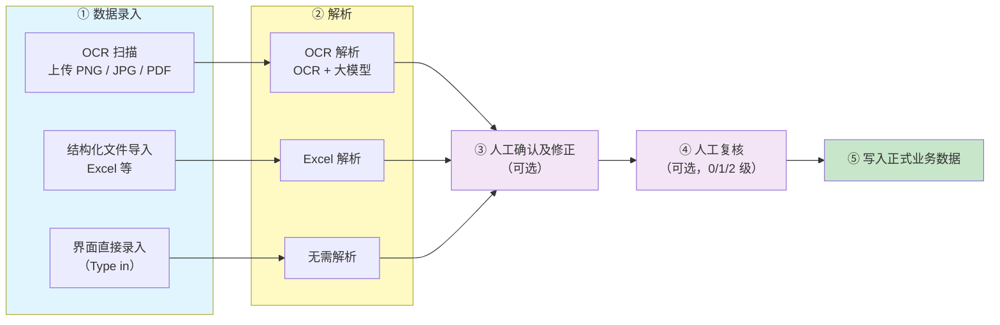
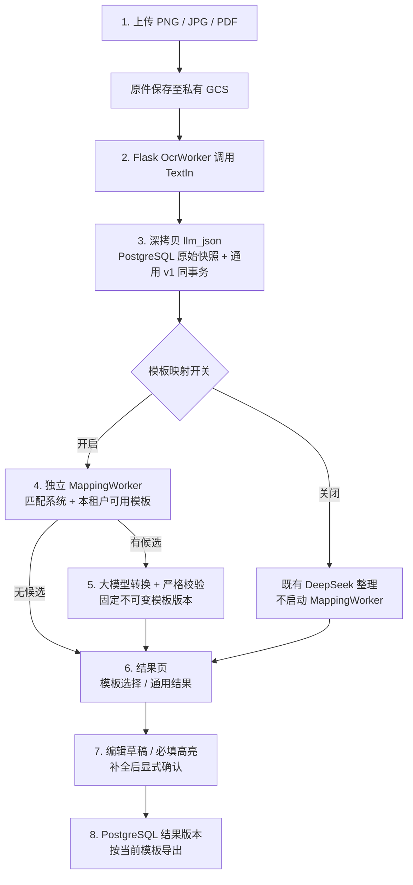
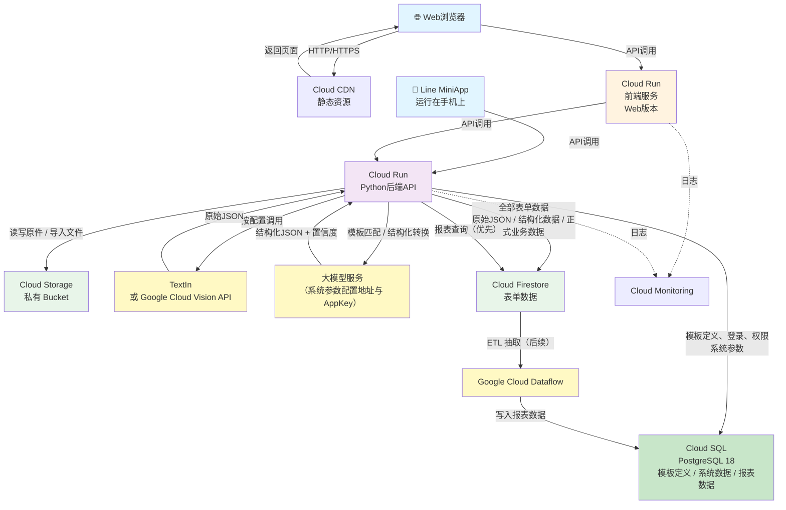

# SaiFlow — 泰国 SME 制造企业单据数字化录入系统

> **产品需求文档（PRD）。** 本文档是 SaiFlow 的权威性*为什么做*与*做什么*说明。v3.0.0 在 v2.2.2 的基础上重新梳理业务流程：数据入口从单一 OCR 扩展为 **OCR 扫描 / 结构化文件导入 / 界面直接录入** 三种方式，并细化基于大模型的 OCR 模板匹配与结构化转换链路。详细的原子化需求位于 `docs/20-requirements/`；技术设计位于 `docs/30-design/`。请先阅读 `AGENTS.md` 以了解导航方式。
>
> **同步说明（2026-10-31）：** 本版收尾对齐已批准 document-template-mapping v2 的 R1–R6：四类型、不可变原始快照、内部描述/公开视图、版本切回、删除中止、正式 JSON 导出、显式通用选择审计与 force 重试。第 0 节及第 7 节的旧决议保留为历史；凡与此次 P0 模板映射冲突者，以本版 §3.2/4.8、ADR-006/007 为准。隔离 SQLite/mock 后端 816 项通过，两种子获业务批准且正式 CLI validate 均通过；真实 LLM 质量/耗时/token 基线未运行，共享库 seed 与部署未授权。其余多入口、引擎配置、复核、报表、NFR/Architecture 的全面同步仍未完成，验证范围见 [汇总验收](../40-acceptance/Acceptance-Criteria.md)。

---

## 0. 本版主要变更（相对 v2.2.2）

| # | 变更点 | v2.2.2 | v2 草案 |
|---|--------|--------|---------|
| C-1 | 数据入口 | 仅纸质单据拍照/扫描 + OCR | **OCR 扫描**、**结构化文件导入**（Excel 等）、**界面直接录入**三种入口 |
| C-2 | 统一业务流程 | 上传 → OCR → 核验 → 复核 → 归档 | **数据录入 → 解析 → 人工确认及修正（可选）→ 人工复核（可选）→ 写入正式业务数据** |
| C-3 | OCR 引擎 | TextIn（流程图中提及 Cloud Vision） | 按**系统配置**选择 **TextIn** 或 **Google Cloud Vision API** |
| C-4 | 模板匹配 | 按 `doc_type` 或自动分类结果匹配模板 | **调用大模型**，根据 OCR 原始 JSON 匹配对应的文档格式模板 |
| C-5 | 结构化转换 | Cloud Functions 按模板 JSONPath 映射 | **完全由大模型替代**：将 OCR 原始 JSON 转换为模板定义的结构化 JSON；每个字段可附带置信度（增强能力，不阻塞主流程） |
| C-6 | 结果展现 | 可视化识别结果 | 按**模板定义的界面**展现识别结果，用户可修改并保存 |
| C-7 | 批量确认 | 无 | 待确认队列提供 **“Confirm all”** 按钮，一次性确认所有字段置信度均不低于阈值的表单 |
| C-8 | 大模型接入 | 无 | 大模型可配置：系统参数配置**模型地址与 AppKey**；选择模型时由人工确认是否符合 PDPA |
| C-9 | Excel 导入 / 导出 | 仅 Excel 导出 | Excel 导入（P1，固定导入模板，xlsx/xls，不支持 csv）；**OCR 识别结果支持导出为 Excel** |
| C-10 | 数据存储边界 | 原始 JSON 存 Firestore，结构化/业务数据存 Cloud SQL | **文档扫描内容（全部表单数据）存 Firestore**；**文档模板定义**及登录、权限等系统数据存 Cloud SQL PostgreSQL；报表优先直接查询 Firestore，后续可经 Dataflow ETL 抽取到 Cloud SQL 后查询 |
| C-11 | 自由格式（P1） | 无 | 模板无法匹配时可选“自由格式”，由大模型生成“N 组表头 KV + N 张明细表”结构的数据，核验后同样进入复核 |

---

## 1. 项目概述 【必需】

### 1.1 项目背景

- **产品名称：** **SaiFlow**
- **一句话描述：** *“We turn paper into process — 将纸质单据流程数字化，使企业流程可监控、可跟踪、可统计、可分析。”*

泰国 SME 制造企业的上下游业务仍依赖纸张。单据通过电子邮件、LINE、照片或实体交付送达后，必须人工重新录入 ERP、Excel 或会计系统。与此同时，部分业务数据已存在于 Excel 等电子表格中，或需要由操作员直接录入。这会造成：

| 痛点 | 业务影响 |
|------|----------|
| 人工录入效率低 | 文员需花费数小时重复录入每份单据 |
| 单据丢失 | 纸质文件在流转中遗失 |
| 数据录入错误 | 错误的数量或金额会破坏对账 |
| 数据来源分散 | 纸质单据、Excel 表格、手工记录各自为政，无法统一统计 |
| 流转延迟 | 签字与审批需等待实体移动 |
| 归档混乱 | 无一致的归档方式，检索困难 |
| 对账困难 | 通过人工目视完成 3-way matching（PO ↔ DN ↔ Invoice） |

**审批理由 / 商业价值：** SaiFlow 将重复、不可见的单据处理转化为可审计的数字化过程。无论数据来自纸质单据、电子表格还是手工录入，都经过**统一的解析、确认、复核与入库流程**，最终沉淀为同一套规范的业务数据，支撑报表与业务流程对接。

### 1.2 产品定位

SaiFlow 是面向泰国 SME 制造企业的**单据流程数字化平台**：通过 OCR + 大模型、结构化文件导入和界面录入三种方式，将业务单据转换为符合文档格式模板的结构化数据，由流程节点操作员确认与修正，并以复核机制和报表支持管理层管控。系统支持按企业业务配置单据处理流程，但当前版本**不提供通用工作流引擎（Workflow Engine）**。

- **目标用户：** 流程节点操作员与管理层，详见 `docs/10-product/Personas.md`。
- **核心价值：** 多入口统一沉淀为可追踪的结构化业务数据；提供运营指标报表；在数据正式进入业务流程前提供可配置的确认与复核控制。
- **差异化：** 泰语+英语+中文混合语言 OCR、大模型驱动的模板匹配与字段级置信度、多入口统一流程、可配置处理与复核、私有云端数据保护、低成本、简单 UX。

### 1.3 目标用户

| 用户群体 | 角色 |
|----------|------|
| **流程节点操作员** | 泰国 SME 制造企业的文员、财务人员、仓库管理员、采购专员；负责单据上传、文件导入、界面录入、识别结果确认与修正 |
| **管理层 / 复核人员** | 企业所有者、部门负责人或被授予复核权限的人员；负责查看运营报表和复核数据是否可正式进入业务流程 |
| **系统管理员** | 配置 OCR 引擎、文档格式模板、复核层级与账户权限 |
| **间接用户** | 上下游合作伙伴的业务协调员 |

**用户特征：** 不熟悉复杂系统；追求简单；没有专业 IT/运维团队；习惯纸质核验；要求数据私有、安全且可追溯。

### 1.4 项目目标与迭代规划

| 版本 | 核心目标 |
|------|----------|
| **V1.0** | 准确识别泰国本地单据（PO、Delivery Note、Invoice、Receipt）；可配置 OCR 引擎（TextIn / Google Cloud Vision API）；可配置大模型完成模板匹配与结构化转换；按模板界面人工确认与修正；可配置为无需复核、一级复核或二级复核；写入正式业务数据；私有 GCS 归档；基础数据导出 |
| **V2.0** | 结构化文件（Excel）导入；Cloud Functions 作为大模型结构化 JSON 的可选处理能力；对接 ERP / 管理系统；自动数据同步；单据比对；异常提醒；运营指标报表与应收应付跟踪 |
| **V3.0** | 智能单据分类、历史检索、流转可追溯性、设备维修流程与流程模板复用 |

> **初始启动版本 = V1.0 = 仅 P0 需求**（见第 3.5 节）。模板映射与后台 CLI 维护为 **P0**；模板管理界面、结构化文件（Excel）导入、自由格式为 **P1**；界面直接录入为 **P2**。
>
> V2.0 中“结构化文件导入”与“Cloud Functions 可选能力”的版本归属，为按 P1 / “下一个大版本”推定，待确认。

---

## 2. 行业与竞品分析 【必需】

### 2.1 泰国本地行业现状

- **单据流转：** 数字与实体混合；照片和扫描件通过电子邮件/LINE 发送；部分数据已在 Excel 中维护。
- **格式：** 各交易伙伴版式不标准且差异较大。
- **语言：** 单据内混合使用**泰语 / 英语 / 中文**。
- **数字化水平：** 较低；许多 SME 缺乏 IT 运维人员和 ERP 集成能力。
- **核心诉求：** 低成本、操作简单、本地保留数据。

### 2.2 竞品分析

现有泰国供应商提供支持 26+ 单据类型的灵活模板（“not fix template”）：

| 竞品 | 说明 | 链接 |
|------|------|------|
| ZTrus（泰国） | 灵活模板，支持多种单据类型 | https://www.ztrus.com/th/home_thai/ |
| TNS-AS | 单据自动化服务 | https://www.tns-as.com/ |

**差距 / 机会：** 现有厂商面向较大型企业和复杂的云端部署。SaiFlow 的差异化在于面向核心制造单据流的**多入口统一流程、大模型驱动的版式适配、私有云端数据保护、SME 可负担性和零 IT 人员可用性**。

> 详细的功能可用性比较属于一项**开放问题**（见第 7 节）。

---

## 3. 总体需求说明 【必需】

### 3.1 统一业务流程（新）

所有业务数据，无论来源，都经过同一条五阶段处理流程，最终写入正式业务数据：

| 阶段 | 说明 | 是否必经 |
|------|------|----------|
| **① 数据录入** | 三种入口：**OCR 扫描**（上传 PNG/JPG/PDF）、**结构化文件导入**（Excel 等）、**界面直接录入**（按文档格式模板定义的表单录入） | 必经 |
| **② 解析** | OCR 扫描 → OCR 解析（见 3.2）；结构化文件 → Excel 解析，按模板映射为结构化数据；界面录入 → 数据已为结构化，**无需解析** | 按入口而定 |
| **③ 人工确认及修正** | 操作员在模板定义的界面中查看解析结果，可修改字段并保存、逐份确认；或在待确认队列中点击 **“Confirm all”**，一次性确认所有字段置信度均不低于阈值的表单（见 4.3） | **可选**（启用的配置粒度见 OQ-11） |
| **④ 人工复核** | 按每类单据处理流程配置 `0`（无需复核）、`1`（一级复核）或 `2`（二级复核）；最高二级 | **可选**（按配置） |
| **⑤ 写入正式业务数据** | 本期 OCR 结果版本与模板映射存 PostgreSQL；既有确认流程不变。其他入口/复核/报表是后续目标，不在本变更实现（ADR-006） | 必经 |

**流程规则：**

- 正式业务数据中只保存已完成全部已启用环节（确认、复核）的数据；未完成的数据处于处理中状态，不参与正式报表。
- 三种入口最终产出**同一结构**的数据——即对应文档格式模板定义的结构化 JSON，从而保证后续确认、复核、入库与报表口径一致。
- 不论入口为何，每份数据都须记录来源（入口类型、原始文件或录入人）、所用模板版本及每次修改，支持审计追溯。

### 3.2 OCR 扫描入口的细化流程（2026-10-30 批准修订）

> 本节与 §4.8 落实 document-template-mapping v2 R1–R6。模板映射与后台 CLI 为 P0，默认开关关闭；不新增 OCR 引擎、模型供应商/密钥、字段置信度或复核流程。术语见 [Glossary](Glossary.md)，需求见 [EPIC-02](../20-requirements/functional/EPIC-02-ocr-recognition.md)、[EPIC-03](../20-requirements/functional/EPIC-03-data-verification.md)。

| 步骤 | 动作 | 输入 | 输出 | 规则 |
|------|------|------|------|------|
| 1 | 上传单据 | Web / LINE MiniApp 文件 | 原件及 OCR 任务 | 私有 GCS，既有上传与预处理不变 |
| 2 | OCR 提取 | 原件与既有 Prompt 参数 | TextIn llm_json | 当前 Flask OcrWorker/TextIn 路径；既有 FR-OCR-017 重试预算不变，不由模板管理配置供应商参数 |
| 3 | 保存 OCR 解析结果 | llm_json | raw_result_id 与通用 v1 | 整理/转换/编辑前深拷贝，与 v1 同事务保存 PostgreSQL ocr_raw_results，任何接口不能修改。开关关时 v1 沿用 DeepSeek 整理；开关开时 v1 直接为原始结果并跳过整理 |
| 4 | 自动匹配模板 | 原始结果、系统与本租户启用未删当前模板版本 | 固定模板版本、得分与 top-3 | 零候选不建映射；单候选直接选中、不调用匹配模型、得分 null；多候选调用现有 DeepSeek，白名单中最高合法得分必选。低于默认 0.7 仍套用，提示「匹配度较低，请确认模板」 |
| 5 | 模板结构化转换 | 原始结果与固定模板骨架、描述、四种类型 | 基于模板的解析结果 | 大模型仅抽取原文信息，不推算、不计算合计；缺失补 null，模型额外键丢弃计数，按 schema 严格校验及类型标准化。独立异步 MappingWorker，不使用路径规则或事件函数；映射成败不改变 OCR 状态 |
| 6 | 按模板展示与切换 | 当前结果、模板 schema、映射摘要 | 可核验页面 | 模板选择框默认当前模板，提供得分/推荐/已生成/预览与「不套用模板（通用结果）」；有未保存编辑先保存再切换。模板字段只能清空，模板外字段与表格行仍可增删 |
| 7 | 草稿保存与确认 | 编辑内容、expected_version | 新版本或显式确认 | 新版本 max(version)+1，继承当前映射；缺失结构补齐，用户额外数据保留。required 缺失不判 OCR 失败，保留并高亮；confirm=true 返回 422 路径错误且不写版本/不确认，补齐后可确认。通用结果不套用此门禁，认证/注册/租户规则保持原契约 |
| 8 | 读取与导出 | 当前已保存版本 | PostgreSQL 快照与导出文件 | 按固定模板顺序/显示名导出 XLSX/CSV，金额按 amount 类型显示；通用导出不变。正式 format=JSON 原样输出指定版本 structured，application/json MIME 与 .json 下载，保留类型/精度/顺序及已保存 extras；TXT 旧行为不变，不新增 Excel 导入或复核功能 |

**匹配与失败处理（R4/R5/R6）：**

| 情形 | 处理 |
|------|------|
| 无可用模板或历史无原始快照 | 显示暂无可用模板/使用通用结果；历史不回填，apply-template 对无快照返回 409 RAW_RESULT_MISSING |
| 低得分 | 仍套用最高合法得分模板，仅提示人工确认模板，不判 OCR 失败 |
| 匹配/转换失败 | 当前结果不变，提供重试、其他模板、通用结果；用户重试显式传 force=true 避免复用旧 READY。每阶段最多首次+1 次重试，默认每任务最多 5 次新映射（含自动/失败，READY 复用不计），不消耗月页额度 |
| 必填缺失 | 保留基于模板的解析结果并高亮，草稿可保存，补全后才能确认；不再使用「主要字段缺失即识别失败」规则 |
| 切回已生成映射或通用结果 | 只移动当前版本指针，恢复目标分支最新保存编辑，可返回旧号、不新增结果版本、不复制数据或调用模型；所有新版本仍取任务 max(version)+1。每次显式 use-generic 即使已通用也记录 template.generic_selected；已确认后所有模板/通用切换返回 409 |
| 映射迟到 | READY 生成版本，但仅 pending 仍是本映射、当前仍为创建时 base 版本且未确认才自动生效，不能覆盖期间编辑或切换；结果删除保留 job，同任务锁清理 raw/mappings/results 与指针，Worker 阶段重读关联检测中止，不迟到写回（已静态复核及隔离测试） |

**运行边界：** `TEMPLATE_MAPPING_ENABLED` 默认关闭；本地与线上共用数据库，本地必须保持关闭。开关关闭也保存并返回 raw_result_id，仅无历史快照时为空、不回填；关闭后不创建新映射，已有模板结果仍可读、可编辑、可导出。两种子已获业务批准、正式 CLI validate 均通过；共享库 seed、schema 变更、开关开启及部署未授权。2026-10-31 共享库仅 transaction_read_only=on 下 SELECT，重复当前版本任务数 0，无 DDL/写入；0.7 为初始阈值，真实 LLM 质量/耗时/token 基线未运行。

**自由格式规则（P1）：**

| 规则 | 说明 |
|------|------|
| **优先级** | **P1**。V1.0 的模板选择框中不提供“自由格式”选项 |
| **数据结构** | 与模板单据同一套路：**N 组表头信息**（每组为一组 KV，例如“卖家信息”一组、“买家信息”一组）+ **N 张明细表**。分组名称、KV 键名与明细表列名均由大模型根据原始内容生成 |
| **界面展现** | 按上述结构通用展现：逐组显示表头 KV 信息，其下逐张显示明细表 |
| **人工修改（核验界面 Verify）** | 支持：修改数据内容；**新增 / 删除**表头 KV 对；**新增表头信息分组**；**新增 / 删除**明细表的行；**新增 / 删除**整张明细表。不支持：新增明细表的表头（列）。所有修改记入变更日志 |
| **复核** | 核验完成后，与模板单据一样按配置进入复核，由其他人员复核表单内容；可配置为无需复核、一级复核或二级复核 |
| **数据存放** | 与模板单据相同，存放在 Firestore（见“数据存储边界”） |
| **自由格式模板** | 若为自由格式指定一个模板，该模板没有固定字段；其包含的内容尚未确定（见 OQ-26） |

**本期数据存储边界（ADR-006）：** 原件 → 私有 GCS；文档模板、不可变模板版本、OCR 解析结果 llm_json 快照、模板映射及核验结果版本 → Cloud SQL PostgreSQL 18.6（saiflow-dev / postgres.saiflow），使用 json 保留键顺序。既有 Firestore TextIn 完整原始识别载荷归档保持合法且不迁移，不用作新模板映射触发源。旧「全部表单数据存 Firestore」与 Dataflow 报表方案只保留为未实施目标；未来迁移须另有测量、法务与需求批准（OQ-27）。仅服务端访问凭据；模板映射复用现有 DeepSeek，人工 PDPA 合规确认约束不变。

### 3.3 结构化文件导入与界面直接录入（新）

| 入口 | 流程 | 已确认范围 | 待确认 |
|------|------|-----------|--------|
| **结构化文件导入**（**P1**） | 下载模板对应的标准 Excel → 按格式填写 → 上传 → Excel 解析（按列名直接对应模板字段）→ 结构化 JSON → 人工确认及修正（可选）→ 人工复核（可选）→ 写入正式业务数据 | 支持 **xlsx / xls**（不支持 csv）；映射方式为**固定导入模板**（附录 A 方案 A）；版式与规则见下方“导入文件规则”；解析结果进入统一流程；优先级 P1，V1.0 不实现 | 无（OQ-16 已全部决议） |

**导入文件规则（结构化文件导入，P1历史/未来目标）：**

> 本节主要字段、隐藏标识、Firestore分集合及旧版拒绝等只保留未来导入目标，尚无本期模板schema属性支持，不可据此扩展§4.8或承诺导出往返。实施前须单独批准导入schema/AC与存储边界；本次不实现。

| 规则 | 说明 |
|------|------|
| **文件格式** | 支持 `xlsx`、`xls`；**不支持 `csv`**（csv 为单一平面表，无法承载分组 KV 信息、多张明细表与多 Sheet） |
| **版式（尽量遵循纸质单据布局）** | 上方为若干组 **KV 信息**，例如“买方信息”分组下的 `buyer name: Rocky`、“卖方信息”分组下的 `seller name: xxx`；下方为**一张或多张明细表格**（如货品清单） |
| **多单据文件** | 一个文件可包含多张单据，**按 Sheet 分隔，每个 Sheet 一张单据**。系统识别每张单据的单据类型，并保存到 Firestore 中对应单据类型的集合 |
| **错误行处理** | 数据行有错误（如必填缺失、类型错误）时，**跳过该错误行**，其余行继续导入，并向用户提示被跳过的行及原因 |
| **主要字段（主键字段）** | 在文档格式模板配置时定义哪些字段为主要字段（见 4.8） |
| **表头 KV 校验** | 表头 KV 信息中，模板定义的**主要字段齐全**即认为该张单据（Sheet）可导入，其余字段的错误跳过并提示；文件中任一 Sheet 的**主要字段有任何缺失，则整个 Excel 文件导入失败**（所有 Sheet 均不导入），并提示缺失位置 |
| **隐藏模板标识** | 系统生成标准 Excel 时，在每个 Sheet 中写入隐藏的模板标识（模板 ID 与版本号）；导入时据此确定该 Sheet 的单据类型与所用模板 |
| **模板版本校验** | 隐藏模板标识中的版本不是当前已发布版本时，该 Excel **不再支持导入**；系统提示用户下载新版模板重新填写导入 |
| **界面直接录入**（**P2**） | 选择文档格式模板 → 在模板定义的界面中录入 → （无需解析）→ 人工确认及修正（可选）→ 人工复核（可选）→ 写入正式业务数据 | 支持在界面上按模板直接录入；录入数据无需解析 | 录入时的字段校验规则复用模板配置的范围（见 OQ-17） |

### 3.4 核心业务场景

#### 场景 1 — 企业作为**卖方**：生产与开票

1. **客户 PO 接收** — 客户通过电子邮件、上传门户或 API 发送 PO（JPG / PDF / PNG），或由操作员通过 Excel 导入 / 界面录入。
2. **解析** — OCR 入口按 3.2 节提取*客户名称、PO 编号、日期、交货日期、收货地址明细、行项目、总额*；处理不同客户的 PO 版式、多行/嵌套表格、复杂折扣结构。
3. **主数据映射** — 与*客户主数据、物料主数据、价目表、收货地址明细*匹配。新 SKU / 未匹配项目 → **标记以供核验**。
4. **业务逻辑校验** — 校验*价格与主价目表、折扣逻辑、最小订购量、客户特定逻辑*。
5. **确认、复核与入库** — 按配置完成人工确认与复核后写入正式业务数据；V2.0 起可在 ERP 中创建 SO 草稿。

**单据（卖方）：** 客户 PO、已签字 Delivery Note（用于 AR）、Invoice；实体工作流中可将上述文件合并为一个账单包（**Merge PDF**）发送给客户。

#### 场景 2 — 企业作为**买方**：收货与付款

1. **单据提交** — 用户通过 web app / LINE MiniApp 上传单据（JPG / PDF / PNG），或通过 Excel 导入 / 界面录入。
2. **解析** — 提取*Invoice 编号、PO 编号、日期、供应商明细、总金额、项目明细*。
3. **数据标准化与校验** — 标准化为模板结构；映射至主数据；必填字段检查、重复发票检测和税款计算校验。
4. **3-way matching 逻辑** — 匹配*INV 编号、PO 编号、供应商明细、金额*等，规则包括数量容差、价格容差、总额比对；不匹配 → 附带差异明细**标记以供核验**。
5. **确认、复核与入库** — 写入正式业务数据；V2.0 起推送 ERP。导出格式：**JSON、CSV、Excel 或直接 ERP API**。

**单据（买方）：** Delivery Note / Delivery Order、Invoice（须与 PO 和 Delivery Note 核验）、Purchase Order、Credit Note（从发票总额中扣减）、Tax Receipt / Withholding Tax（数字化归档，可针对税务要求检索）。

#### 场景 3 — 管理层报表与数据复核

1. **运营指标查看：** 管理层基于**正式业务数据**查看运营指标，用于监控、跟踪、统计和分析。报表查询方式见 4.7。
2. **数据复核：** 管理层或被授权复核人员复核流程节点操作员确认的数据，决定其是否可以写入正式业务数据。
3. **复核层级：** 每类处理流程可配置为无需复核、一级复核或二级复核；最高仅支持二级复核。
4. **非工作流引擎：** 当前版本不提供通用工作流引擎、任意审批流编排、条件分支编排或跨系统任务调度。复核仅作为数据写入正式业务数据前的轻量控制机制。

> 运营指标口径、报表维度及各流程的复核对象必须在对应 `FR-*` 需求中明确后才能实现。

#### 系统部署架构图（历史/未来目标，非本期部署拓扑）

> 下图保留3.0.0的引擎平台、全表单Firestore与报表ETL目标；本期实际Flask OcrWorker/MappingWorker和PostgreSQL模板/快照/结果边界以§3.2及ADR-006/007为准。图中字段置信度、可切换供应商、报表与ETL不属于此次交付。

> 本期不使用JSONPath或Cloud Functions；新链路为TextIn→关系型llm_json快照/通用v1→独立DeepSeek映射→核验→PostgreSQL结果版本。旧“大模型→确认→Firestore”仅为历史目标，不是本变更运行链路；既有完整TextIn响应Firestore归档仍合法保留。

### 3.5 需求优先级

| 优先级 | 范围 | 示例 |
|--------|------|------|
| **P0**（发布必需） | 核心 OCR 识别 → 确认 → 入库 → Excel 导出 | OCR 扫描入口完整链路（3.2 节步骤 1–8） |
| **P1**（迭代优化） | ERP 推送；结构化文件（Excel）导入 | 将正式业务数据推送/保存至 ERP；Excel 导入并映射到模板 |
| **P2**（长期规划） | 可扩展性、准确性、治理、端到端易用性 | — |
| P2.1（基础） | 审计跟踪、核验队列、基础校验（置信度评分已提前至 P1） | — |
| P2.2（扩展） | 模板管理、持续学习、更好的表格/行项目提取 | — |
| P2.3（企业就绪） | 搜索/检索、更广泛的集成、更强的安全/合规性、监控仪表板 | — |

> **初始启动版本仅实现 P0 核心需求。**
>
> - **字段置信度不阻塞主流程：** 没有置信度时，OCR 链路（步骤 1–8）仍可完整走通，只是无法使用低置信度标记与 “Confirm all” 批量确认，用户需逐份确认。**字段置信度为 P1**（由原 P2.1“置信度评分”提前）；依赖置信度的低置信度标记、置信度阈值参数与 “Confirm all” 批量确认随之为 **P1**。V1.0 只提供逐份确认。
> - **结构化文件（Excel）导入：P1。**
> - **模板映射与后台 CLI：P0；模板管理界面 FR-TEMPLATE-006：P1。** **界面直接录入：P2。**
> - **首批模板：** 两份系统模板 system.billing_note、system.tax_invoice（含合并送货单）已获业务批准、正式 CLI validate 均通过；共享库 seed 未授权。其他单据待样本补充，不宣称预置全类型。结果页选择框是 P0 核验能力，不是 P1 模板管理界面。

### 3.6 业务约束与限制

- **合规：** 泰国本地合规；**PDPA**（个人数据保护法）。
- **本期数据存储：** 原件存私有GCS；模板/不可变版本、llm_json快照、映射和核验版本存Cloud SQL PostgreSQL json；既有完整TextIn响应Firestore归档保留。Excel导入/报表Dataflow存储为未实施后续目标，不能混为本期权威结果库（ADR-006）。访问、保留与删除符合既有PDPA要求，未宣称法律或配置验收通过。
- **外部服务：** OCR 引擎（TextIn / Google Cloud Vision API）与大模型服务仅由服务端调用。
- **大模型 PDPA 合规：** 大模型可配置为任意服务；**选择或更换模型时，由人工确认该模型服务是否符合 PDPA**（系统不自动判定合规性）。
- **准确性：** 单据识别准确性标准（见 `NFR-PERF`）；字段置信度用于提示人工核验与批量确认，不是主流程的必要条件。
- **兼容性：** 主流泰国本地 SME ERP 版本；Windows/Mac。
- **多语言：** 泰语 / 英语 / 简体及繁体中文混合。
- **硬件：** 普通手机拍摄和家用扫描仪产生的图像应可识别。

---

## 4. 核心功能需求 【必需 — 核心产品设计模块】

**详细的原子化 `FR-*` 需求位于 `docs/20-requirements/functional/`；本节仅为能力摘要。** 标注“需更新”的 Epic 须在本 PRD 评审通过后同步修订。

| 能力 | Epic | 优先级（V1.0） | 摘要 |
|------|------|----------------|------|
| 数据录入（上传 / 导入 / 界面录入） | `EPIC-01`（需更新） | P0（上传）/ P1（Excel 导入）/ P2（界面录入） | 拍照/扫描上传 JPG/PNG/PDF；批量上传；预处理；Excel 等结构化文件导入；按模板界面录入 |
| OCR 识别与大模型结构化 | `EPIC-02`（需更新） | P0（字段置信度 P1） | 可配置 OCR 引擎；原始 JSON 保存；可配置大模型；大模型模板匹配与结构化转换；字段置信度（增强） |
| 人工确认、修正与复核 | `EPIC-03`（需更新） | P0（Confirm all、低置信度标记 P1） | 按模板界面展现；单字段编辑；逐份确认；Confirm all 批量确认；低置信度标记；0/1/2 级复核；变更日志 |
| 正式入库、导出与归档 | `EPIC-04`（需更新） | P0（入库/Excel/GCS）/ P1（ERP） | 写入正式业务数据；Excel 导出；私有 GCS 归档；ERP/管理系统对接 |
| 文档管理与检索 | `EPIC-05` | P1/P2 | 分类、按编号/日期/企业/类型搜索、预览、历史记录、关键词、去重 |
| 基础系统 | `EPIC-06`（需更新） | P0 | 账户/权限、登录/注册、操作日志、语言切换、OCR 引擎配置、大模型配置、置信度阈值、复核权限 |
| 运营报表 | `EPIC-07` | P1 | 基于正式业务数据的运营指标 |
| 文档格式模板配置 | `EPIC-08` | P0（CLI/结构/版本/隔离/审计）/ P1（管理 UI） | 有序分组 KV/表格、描述与四种类型；两份系统种子；作为匹配、核验与导出契约 |

### 4.1 数据录入模块

- **OCR 扫描上传：** 拍照、扫描、本地图像导入；支持格式 **JPG / PNG / PDF**；批量上传；文档预处理（自动矫正、去阴影、降噪、裁剪）。
- **结构化文件导入（P1）：** 上传 xlsx / xls 文件（不支持 csv），采用**固定导入模板**：系统按每个文档格式模板生成可下载的标准 Excel（上方为分组 KV 信息，下方为一张或多张明细表格，字段与模板一致），用户按此格式填写后上传，系统按字段名直接解析，不调用大模型；一个文件可含多张单据，每个 Sheet 一张，按隐藏模板标识确定单据类型并分别入库；错误行跳过，模板定义的主要字段缺失则整个 Excel 文件导入失败；旧版模板的 Excel 拒绝导入并提示使用新版模板（规则见 3.3）。
- **界面直接录入（P2）：** 选择文档格式模板后，在模板定义的界面中录入数据，无需解析。

→ `EPIC-01`

### 4.2 OCR 识别与大模型结构化模块

按 3.2 节步骤 2–5 实现：

1. **OCR 引擎可配置：** 按系统配置调用 TextIn 或 Google Cloud Vision API；记录每份单据所用引擎。
2. **原始结果留存：** llm_json 整理前深拷贝至 PostgreSQL，与 v1 同事务、不可变；返回 raw_result_id。历史 Firestore 完整响应归档不迁移。
3. **大模型：** 本期复用现有 DeepSeek 服务端配置，不新增供应商/密钥或按租户选模型；更换模型前人工确认 PDPA 合规。参数管理仍属原 EPIC-06 范围，不由此次实现。
4. **模板匹配：** 系统+本租户启用未删当前版本中取最高合法分，单候选免匹配调用、零候选通用；低分仍套用并提示。required 缺失保留高亮、补全后确认，不判 OCR 失败（§3.2）。
   - **自由格式（P1）：** 由大模型生成新结构，仍延后；本期「不套用模板（通用结果）」仅恢复未映射分支，不调用模型生成自由格式。
5. **大模型结构化转换：** 将原始 JSON 转换为模板定义的结构化 JSON（表头字段 + 明细行）。调用大模型的**提示词**须包含：
   - 原始 JSON 到模板字段的**映射关系描述**；
   - 文档格式模板中配置的**期望输出格式**（分组/字段/列 key、名称、描述、四种类型、required、表格结构；无计算或标准化规则配置）；
   - OCR 原始 JSON。
6. **字段置信度（增强，不阻塞）：** 大模型可为每个字段输出置信度（0.0–1.0）；没有置信度时主流程照常运行。
7. **可重处理：** 同一原始快照可按固定版本映射；已有READY非force则无模型调用复用，force新增尝试受每任务5次上限且不保证模型结果相同。版本不可覆盖、任务序列max+1。
8. **不使用 JSONPath 映射：** v2.2.2 的 JSONPath 映射链路完全由大模型替代。

各文档类型的必需识别字段：

| 文档类型 | 必需识别字段 |
|----------|-------------|
| **订单（PO）** | 订单编号、供应方与需求方企业名称、联系人、联系信息、产品名称、数量、单价、总价、订单日期、交货日期、签字信息、备注 |
| **账单（Bill）** | 账单编号、对账周期、金额、税费、结算方式、对账企业、签字确认、欠款备注 |
| **Delivery Note** | 送货单编号、关联订单编号、送货企业、收货企业、产品清单、送货数量、出库时间、物流信息、签字确认 |
| **Invoice** | 订单编号、供应方与需求方名称、联系人/联系信息、产品名称、数量、单价、总价、订单日期、交货日期、签字信息、备注 |
| **Credit Note** | 账单编号、对账周期、金额、税费、结算方式、对账企业、签字确认、欠款备注 |
| **Delivery Instruction** | 固定字段与自由文本混合：配送要求、产品特殊说明、售后备注、包装要求（非结构化） |

- 各类型的**准确性标准和字段容错规则**（见 `NFR-PERF`、`EPIC-02`）。
- Bill / Credit Note 的**金额纠错规则**（见 `EPIC-02`）。
- **多语言适配：** 泰语 / 英语 / 简体及繁体中文混合。

→ `EPIC-02`

### 4.3 人工确认、修正与复核模块

- **按模板界面展现：** 识别结果、导入结果、录入数据统一使用文档格式模板定义的界面展现；支持对照原件预览（OCR 入口）。
- **置信度提示：** 有置信度时，每个字段显示置信度；低于**系统参数中配置的置信度阈值**的字段醒目标记。缺失必填字段始终醒目标记。
- **人工修正：** 单字段修改、批量更正、保存草稿；记录每次修改的修改人、时间、修改前后值。
- **逐份确认：** 用户在单份表单界面确认后，数据进入复核或直接入库。
- **“Confirm all” 批量确认：** 待确认的 OCR 表单队列界面提供 “Confirm all” 按钮。点击后，系统将队列中**所有字段置信度均不低于置信度阈值**的表单一次性批量确认；有任一字段低于阈值或缺少置信度的表单仍留在队列中，等待逐份确认。批量确认须记录操作人与时间。
- **确认可选：** 是否启用确认环节按配置决定（配置粒度见 OQ-11）。
- **复核配置：** 对每类单据处理流程可配置 `0`（无需复核）、`1`（一级复核）或 `2`（二级复核）；不支持超过二级的复核。
- **进入正式业务数据：** 配置为无需复核时，确认后即写入正式业务数据；配置一级或二级复核时，须经最终复核通过后才写入。
- **复核不是工作流：** 不提供通用 Workflow Engine、任意审批流编排或条件路由。

→ `EPIC-03`

### 4.4 正式入库、导出与归档模块 【核心差异化功能】

| 渠道 | 规则 |
|------|------|
| **本期确认结果** | 既有确认流程保存PostgreSQL结果版本与模板历史引用/审计；正式复核/报表目标不在本变更新增，旧Firestore正式业务状态模型仍为后续目标 |
| **Excel 自动导出** | 保留已有标准化XLSX与批量能力目标，不新增Excel导入 |
| **模板驱动导出（FR-ENTRY-002）** | 模板XLSX/CSV按固定历史schema顺序、显示名、金额type导出，至少两位且超两位不舍入，extras追加，包含已保存编辑；单份XLSX保留一个Result工作表/既有样式与防公式规则；通用不变。正式JSON格式以application/json、.json下载原样structured，保留类型/精度/顺序及extras，不加信封或格式化金额，TXT旧行为不变。不新增隐藏模板标识或导入往返保证（API-Spec §4） |
| **私有 GCS 归档** | 双重存储（原始对象 + 识别数据/导出工件）、自动命名、按对象前缀分类、服务账号最小权限访问 |
| **本地 ERP 录入**（P1） | 接口对接、数据同步字段、手动/自动同步、兼容主流泰国本地 SME ERP 版本 |
| **企业管理系统录入**（P1） | 通用适配规则 + 自定义字段映射 |

→ `EPIC-04`

### 4.5 文档管理与检索模块
文档分类；按编号/日期/企业/文档类型检索；预览；历史查询；文档内关键词；重复识别与去重。 → `EPIC-05`

### 4.6 基础系统模块
账户权限；登录与注册；操作日志；语言切换（泰语/英语/中文）；基础参数配置；复核权限与复核层级配置；确认环节启用配置。本版新增的系统参数：

| 系统参数 | 说明 |
|----------|------|
| OCR 引擎 | TextIn / Google Cloud Vision API |
| 大模型地址 | 所接入大模型服务的调用地址 |
| 大模型 AppKey | 调用凭据；存放于 Secret Manager，仅服务端可读，界面不回显明文 |
| 置信度阈值（P1） | 低置信度标记与 “Confirm all” 批量确认的判定阈值（0.0–1.0） |

→ `EPIC-06`

### 4.7 运营报表模块

管理层基于**正式业务数据**查看经配置的运营指标报表。具体指标、统计口径、时间粒度、筛选维度、导出需求及权限规则须在 `EPIC-07` 中拆解后实施。

**报表查询方式：**

| 方式 | 说明 | 实施顺序 |
|------|------|----------|
| **A. 直接查询 Firestore** | 后端以代码方式直接在 Firestore 中查询、统计表单数据并生成报表 | **优先实现** |
| **B. Dataflow ETL → Cloud SQL** | OCR 结果保存到 Firestore 后，由 Google Cloud Dataflow 以 ETL 方式将数据抽取到 Cloud SQL PostgreSQL，再在 Cloud SQL 中查询报表 | 后续实现（优先级与触发条件见 OQ-8） |

→ `EPIC-07`

### 4.8 文档格式模板配置模块

**目的与本期优先级（R1/R6）：** 文档格式模板统一约束 OCR 模板映射、核验展示与导出；后台 CLI 维护为 P0，模板管理界面 FR-TEMPLATE-006 为 P1，本期 web-pc/line-mini 均无管理 UI，也无模板 REST 写接口。Excel 导入/自由格式仍 P1，界面直接录入仍 P2，不因模板契约提前实现。

**结构（R2/R3）：**

| 层级 | 属性与规则 |
|------|------------|
| 模板 | code（同作用域未删唯一）、name、description、至少一个有序 groups；不含 doc_type 分类或 TextIn 参数引用 |
| 分组 | key、name、description、有序 items，至少一项 |
| KV 字段 | kind=field、key、name（一个显示名称）、description、type、可选 required |
| 表格 | kind=table、key、name、description、有序 columns，至少一列 |
| 表格列 | key、name、description、type、可选 required，与 KV 相同 |
| 四种类型 | string（字符串）、integer（整型）、decimal（非整数）、amount（金额）；type 默认 string，required 默认 false；日期 string 原样保留，不做佛历转换 |

描述是匹配与转换的主要依据，仅模型使用；内部不可变快照保留完整 description，GET 版本对前端裁剪各层描述，没有公开 description 需求。四类型已在 API YAML 与 JSON 镜像对齐。多语言名称配置、主要字段、计算/标准化规则、字段置信度与日期类型不在本期；缺失值填 null、不计算合计。key/code 正则、作用域唯一性、分组/字段/列/描述上限以及结果标准化详见 [EPIC-08](../20-requirements/functional/EPIC-08-document-template-configuration.md) 与 [Data-Model](../30-design/Data-Model.md)，不定义第二套规则。

**版本与作用域：** 每次 import 对规范化名称、描述、分组计算 SHA-256；内容变则新增不可变版本，未变不写入。模板只有 ENABLED/DISABLED 与软删除，不设发布草稿。系统模板 tenant_id=null，全租户只读可用；租户模板仅本租户可用。新映射使用启用未删除的当前版本，已有映射固定引用旧版本，即使停用、软删或升版仍可读、编辑、确认与导出。

**后台维护：** `manage_templates.py` 提供 list/show/validate/import/export/enable/disable/delete/seed，写前完整校验、默认二次确认（--yes 可跳过），import/seed 支持 --dry-run，不输出凭据；实际写入有 cli 来源审计。首批仅 `system.billing_note`（Billing Note / ใบวางบิล）与 `system.tax_invoice`（Tax Invoice / ใบกำกับภาษี，含合并送货单），两种子已获业务批准、正式 CLI validate 均通过；共享库 seed 未授权，其他类型待样本补充，不宣称覆盖所有核心单据或已写入共享库。

**执行与非目标：** 当前 Flask MappingWorker 仅用现有 DeepSeek 做自动匹配与转换，严格 schema 校验；不采用规则快速路径、确定性源路径转换、事件函数或新供应商。模板与表单结果的关系型存储见 [ADR-006](../30-design/adr/ADR-006-relational-template-storage.md)，LLM-only 权衡见 [ADR-007](../30-design/adr/ADR-007-llm-only-template-mapping.md)。不做通用工作流/表达式引擎、不回溯重写历史任务。

→ [EPIC-08](../20-requirements/functional/EPIC-08-document-template-configuration.md)，对应 Gherkin 见 [Acceptance-Criteria §7](../40-acceptance/Acceptance-Criteria.md#7-epic-08--文档格式模板配置)。

---

## 5. 非功能需求 【必需】

以下为摘要；完整的原子化项目见 `docs/20-requirements/non-functional/NFR.md`。本版新增的大模型调用相关约束须在 NFR 中补充。

| 分类 | 需求摘要 |
|------|----------|
| **性能** | 单份文档端到端处理时间（OCR + 模板匹配 + 结构化转换）；批量效率；准确性标准；系统响应；Firestore/Cloud SQL/GCS 数据访问性能；基于 Firestore 的报表查询性能 |
| **兼容性** | 浏览器与主流办公软件；多种分辨率；非标准泰国纸张格式；Excel 版本兼容 |
| **安全性** | Firestore/Cloud SQL/GCS 静态加密；隔离权限；防篡改；可追溯日志；私有 GCS Bucket 与最小权限服务账号；OCR 引擎与大模型凭据（AppKey）仅存 Secret Manager 且仅服务端使用 |
| **合规** | 大模型选择/更换时由人工确认 PDPA 合规，并记录确认人与确认时间（是否需要留痕待确认） |
| **可靠性** | OCR 引擎或大模型调用失败时可重试，不丢失原件与原始 JSON；转换幂等 |
| **成本** | OCR 与大模型调用成本可观测（单份单据成本基线见 OQ-20） |
| **易用性** | 泰国用户低操作门槛；流程简单直观；本地化语言；零基础快速上手 |

---

## 6. 样本文档

真实样本位于 `thai-sample-forms-for-ocr/`（来自不同供应商、格式和表头各异的 Delivery Note/Invoice）。系统须识别并提取相关信息，转换为模板结构化数据，并可导出为标准化 Excel。

| 文件 | 类型 |
|------|------|
| `..._ใบส่งของ รีกาลอส.pdf` | Delivery Note（Regalos） |
| `..._ใบส่งของ ช้าง.pdf` | Delivery Note（Chang） |
| `..._ใบส่งของ กูลิโกะ.pdf` | Delivery Note（Glico） |
| `doc-001.jpg` | 图像样本 |

---

## 7. 开放问题

### 7.1 沿用 v2.2.2

| # | 问题 | 负责人 | 是否阻塞？ |
|---|------|--------|-----------|
| OQ-1 | 各文档类型精确的 OCR 字段级准确性目标（基于经验）？ | Product/ML | 否（P0 设置基线） |
| OQ-2 | V2.0 必须优先集成哪些特定的泰国本地 ERP 系统？ | Product | V2.0 |
| OQ-3 | 详细的竞品功能可用性矩阵（ZTrus/TNS-AS）？ | Product | 否 |
| OQ-4 | 归档文档的 PDPA 数据保留期限和删除策略？ | Legal | 是（SEC） |
| OQ-5 | V2.0 运营报表必须提供哪些指标、统计口径、筛选维度与导出格式？ | Product / Management | 是（EPIC-07 实施前） |
| OQ-6 | 哪些单据处理流程默认采用无需复核、一级复核或二级复核？各级复核人员的权限如何配置？ | Product / Management | 是（EPIC-03 实施前） |
| OQ-7 | TextIn **及 Google Cloud Vision API** 的区域、数据跨境处理依据、认证方式、限流、调用参数是否已通过安全与法务确认？ | Product / Security / Legal | 是（投产前） |
| OQ-8 | Dataflow ETL（报表方式 B）的优先级？在什么条件下（数据量、报表复杂度、3-way matching 关联查询）从直接查询 Firestore 切换或补充为 Dataflow → Cloud SQL？ETL 的频率（准实时 / 定时批量）？ | Product / Engineering | 否（方式 A 先行） |
| OQ-9 | 模板审批、版本回滚和字段映射的默认治理规则是什么？ | Product / Management | 是（EPIC-08 实施前） |

### 7.2 本版新增

| # | 问题 | 负责人 | 是否阻塞？ |
|---|------|--------|-----------|
| OQ-11 | 除 “Confirm all” 外，确认环节本身是否可整体关闭？如可关闭，配置粒度是按单据类型、按模板还是按入口？ | Product | 是（EPIC-03 实施前） |
| OQ-12 | OCR 引擎选择的配置粒度：全系统、按企业（租户），还是按单据类型？是否支持一个引擎失败后切换另一个？ | Product / Engineering | 是（EPIC-02 实施前） |
| OQ-13 | 模板“识别特征”包含哪些内容？大模型返回多个候选模板时，是否也弹出选择框（候选优先排序）？ | Product / ML | 否 |
| OQ-26 | “自由格式模板”包含什么内容（该模板没有固定字段）？自由格式单据是否计入报表、能否导出 Excel？ | Product | 是（P1 自由格式实施前） |
| OQ-27 | 本期已由ADR-006确定模板/快照/映射/结果使用PostgreSQL json，保留合法Firestore完整原文归档；未来迁移/报表投影触发条件与Architecture/NFR全面同步仍开放，不据此自动执行迁移 | Engineering | 本期存储决策已解决；未来迁移实施前须批准 |
| OQ-14 | 置信度阈值的默认值？“Confirm all” 的作用范围是当前筛选结果还是整个队列？是否只对 OCR 入口生效？ | Product | 否（阈值已确定在系统参数中配置） |
| OQ-17 | 界面直接录入是否复用模板中的必填、类型、标准化与计算规则做实时校验？ | Product | 是（录入功能实施前） |
| OQ-20 | 单份单据 OCR + 大模型调用的成本上限与性能目标？ | Product / Engineering | 否（P0 设置基线） |
| OQ-21 | Firestore 中表单数据的状态模型：待核验、待复核、正式业务数据是同一文档的状态字段，还是分集合存放？ | Engineering | 否（设计阶段决定） |
| OQ-22 | 大模型地址与 AppKey 是全系统一组，还是按企业（租户）配置？模板匹配与结构化转换是否可分别配置不同模型？ | Product / Engineering | 是（EPIC-06 实施前） |
| OQ-23 | 人工确认大模型 PDPA 合规时，系统是否需要记录确认人、确认时间与确认依据？ | Product / Legal | 否 |

### 7.3 本版已决议

| # | 原问题 | 决议（2026-10-20） |
|---|--------|-------------------|
| OQ-10（部分） | 置信度、Excel 导入的优先级 | 置信度**不阻塞主流程**，无置信度时主业务流程仍可走通；Excel 导入为 **P1** |
| OQ-10（部分） | 模板配置、界面直接录入的优先级 | 文档格式模板配置为 **P1**；界面直接录入为 **P2** |
| OQ-24（部分） | OCR 结果可导出的单据范围 | 已完成 OCR 扫描并已完成人工确认的成功单据可导出到 Excel |
| OQ-24（关闭） | 导出版式 | 导出的 Excel 与导入模板格式一致 |
| OQ-10（关闭） | 字段置信度优先级 | 字段置信度为 **P1**；低置信度标记与 “Confirm all” 随之为 P1 |
| OQ-13（部分） | 模板无法自动匹配时的处理 | 弹出模板选择框，用户在已有模板中选择；所选模板不对应导致主要字段缺失时识别失败；选择框另提供 **“自由格式”**——不使用固定模板，根据原始内容自动分析生成结构化数据并保存 |
| OQ-26（部分） | 自由格式的数据存放与界面 | 存放在 Firestore；结构为 N 组表头 KV 信息（如卖家信息、买家信息）+ N 张明细表，界面按此结构展现 |
| OQ-26（部分） | 自由格式的人工修改 | 核验界面（Verify）支持修改内容、新增/删除表头 KV 对、新增表头分组、新增/删除明细行、新增/删除整张明细表；不支持新增明细表的表头（列） |
| OQ-26（部分） | 自由格式的复核与优先级 | 核验后按配置进入无需复核 / 一级 / 二级复核，由其他人员复核；自由格式为 **P1** |
| — | 数据存储边界 | **所有表单数据保存在 Firestore**；PostgreSQL 目前只保存登录、权限、模板配置等非表单的系统数据 |
| OQ-27（部分） | 报表查询方式 | 两种方式：A. 以代码直接在 Firestore 中查询报表（**优先实现**）；B. OCR 结果存入 Firestore 后，由 Google Cloud Dataflow 以 ETL 方式抽取到 Cloud SQL PostgreSQL，再在 Cloud SQL 中查询。文档模板定义保存在 Cloud SQL，文档扫描内容保存在 Firestore |
| OQ-25（关闭） | V1.0 模板来源 | 由**实施人员预置首批模板**（PO、Delivery Note、Invoice、Receipt）；P1 起通过模板配置界面维护 |
| OQ-11（部分） | 确认环节如何简化 | 待确认队列提供 **“Confirm all”** 按钮，一次性批量确认所有字段置信度均不低于阈值的表单 |
| OQ-14（部分） | 置信度阈值 | 在**系统参数**中配置 |
| OQ-15 | 单据内容发送至大模型的 PDPA 合规 | **选择模型时由人工确认**是否符合 PDPA |
| OQ-18 | 大模型选型 | 大模型**可配置**：系统参数配置模型地址与 AppKey；提示词描述映射关系并附上模板期望格式 |
| OQ-16（部分） | Excel 导入映射到模板的方式 | 采用**固定导入模板**（附录 A 方案 A） |
| OQ-16（部分） | 导入文件格式、版式、多单据、模板版本 | 支持 xlsx / xls（csv 已于 draft.5 取消）；版式尽量遵循纸质单据——上方分组 KV 信息、下方一张或多张明细表格；一个文件多张单据时识别单据类型，分别保存到 Firestore 对应集合；模板修改后旧版 Excel 不支持导入，提示用户使用新版模板 |
| — | OCR 识别结果导出 | OCR 识别后的单据支持导出为 Excel |
| OQ-16（部分） | 错误行、多单据分隔、csv | 错误行跳过；单据按 Sheet 分隔；**不支持 csv 导入** |
| OQ-16（部分） | 单据类型识别、主要字段、表头 KV 校验 | 使用**隐藏模板标识**确定单据类型与模板版本；**主要字段**在表单模板配置时定义；表头 KV 中主要字段齐全即整张单据可导入，其余错误跳过 |
| OQ-16（关闭） | 主要字段缺失的处理范围 | 任一主要字段缺失，**整个 Excel 文件导入失败** |
| OQ-19 | JSONPath 映射链路是否保留 | **完全由大模型替代**；下一个大版本再考虑以 Cloud Functions 作为大模型结构化 JSON 的可选能力 |

---

## 附录 A. Excel 导入映射到模板 — 候选方案（P1，已决策：方案 A）

> **决议（2026-10-20）：采用方案 A“固定导入模板”。** 其余方案保留作为决策记录；方案 A 须写入 `EPIC-01` / `EPIC-08`。

| 方案 | 做法 | 优点 | 缺点 | 适用场景 |
|------|------|------|------|----------|
| **A. 固定导入模板** | 系统按每个文档格式模板生成可下载的标准 Excel（列 = 模板字段）；用户按此格式填写后上传，按列名直接解析 | 实现最简单、结果确定、无大模型成本 | 用户必须把现有表格转为系统格式，额外工作量大；无法直接导入合作伙伴或其他系统导出的表格 | 企业从零开始用 Excel 汇总数据 |
| **B. 手工列映射 + 保存映射方案** | 上传后，用户在界面上将 Excel 列逐一对应到模板字段（含表头行、明细起始行）；映射方案可命名保存，下次同来源文件自动套用 | 能导入任意版式；结果确定；可复用 | 首次配置门槛较高，对不熟悉系统的用户不友好；合并单元格、一表多单据等复杂版式处理困难 | 来源固定、版式稳定的表格（如某 ERP 的固定导出） |
| **C. 大模型映射（复用 OCR 链路）** | 将 Excel 解析为 JSON（单元格 + 位置），送入与 OCR 相同的“大模型模板匹配 → 大模型结构化转换”链路，输出模板结构化 JSON 与置信度 | 复用 V1.0 已建能力，开发量小；适应任意版式；可沿用 Confirm all | 结果不完全确定；大行数文件的 token 成本与长度限制；每次导入都调用大模型 | 版式多变、来源分散的表格 |
| **D. 混合：大模型推荐映射 + 人工确认 + 保存方案** | 首次导入某版式时，由大模型根据表头与样例行**推荐列映射**；用户在 B 的映射界面中确认或调整后保存；之后同版式文件直接按已保存映射解析，不再调用大模型 | 兼顾易用性与确定性；大模型只在首次调用，成本低；大文件也适用 | 需同时实现映射界面与推荐逻辑，开发量最大；需定义“同版式”的识别规则 | 大多数 SME 场景：来源有限但版式各异 |

**决策：方案 A。** 结果确定、实现简单、不产生大模型调用成本。已知代价：用户需先将现有表格整理为系统标准格式，不能直接导入合作伙伴或其他系统导出的原始表格。

---

## 8. 后续同步清单

2026-10-31模板映射相关FR、术语、设计、AC与ADR已收尾对齐，正式JSON导出与显式通用选择审计为本期契约。已确认验证与补测边界见[汇总验收](../40-acceptance/Acceptance-Criteria.md)。§7旧P1全部模板配置、全类型种子与全表单Firestore决议只保留历史，分别被本期P0 CLI/P1 UI、已批准两种子与ADR-006覆盖，不影响合法历史Firestore完整响应归档。

更广的3.0.0目标仍需按获批范围同步，不作为本期遗漏功能：

- [ ] 多入口、引擎配置、置信度/Confirm all、正式业务数据及P1自由格式的术语、Vision-Scope、相关FR与AC。
- [ ] NFR/Architecture中大模型安全、可靠性、成本及5秒性能目标、历史事件链路/业务投影的适用边界；本期关系型json边界以Data-Model/OCR-Pipeline及ADR-006/007为准。
- [ ] 真实LLM质量/耗时/token基线与0.7阈值校准；当前没有质量实测结论。
- [ ] 共享库seed、schema变更、开关开启及部署，须分别获得用户授权；两种子业务批准与正式CLI validate通过不等于已写库或已发布。

---

## 链接

- 上一版本：v2.2.2（见 git 历史）
- 愿景与范围：`docs/10-product/Vision-Scope.md`
- 术语表：`docs/10-product/Glossary.md`
- 用户画像：`docs/10-product/Personas.md`
- 需求索引：`docs/20-requirements/Requirements-Index.md`

## 版本历史

| 版本 | 日期 | 作者 | 变更 |
|------|------|------|------|
| 3.1.1 | 2026-10-31 | Product Engineering | 收尾对齐四类型、raw/公开描述、max+1及旧号切回、删除中止、正式JSON导出、通用选择审计与force重试；记录816隔离后端、两种子业务批准/正式validate及共享库只读证据，真实基线未运行、seed/部署未授权 |
| 3.1.0 | 2026-10-31 | Product Engineering | 同步批准document-template-mapping v2：§3.2/4.8、P0 CLI/P1 UI、关系型快照/独立Worker、schema/必填门禁/分支版本/导出及两种子；历史Firestore原文保留，旧全表单/报表目标范围化 |
| 3.0.0 | 2026-10-21 | Product Engineering | 将 3.0.0-draft ~ draft.15 的设计变更合并为正式版：多入口统一五阶段流程；OCR 引擎可配置；大模型模板匹配与结构化转换（取代 JSONPath）；Excel 导入/导出规则；自由格式；字段置信度与 Confirm all（P1）；表单数据存 Firestore、模板定义与系统数据存 Cloud SQL；报表直接查询 Firestore（优先）+ Dataflow ETL（后续） |
| 3.0.0-draft.15 | 2026-10-21 | Product Engineering | 报表查询方式：直接查询 Firestore（优先）+ Dataflow ETL 至 Cloud SQL（后续）；明确模板定义存 Cloud SQL、扫描内容存 Firestore；架构图新增 Dataflow；更新 OQ-8、OQ-27 |
| 3.0.0-draft.14 | 2026-10-20 | Product Engineering | 存储边界调整：所有表单数据存 Firestore，Cloud SQL 只存系统数据；“正式业务表”改称“正式业务数据”；自由格式补充删除操作、新增表头分组、复核流程，定为 P1；新增 OQ-27 |
| 3.0.0-draft.13 | 2026-10-20 | Product Engineering | 自由格式：核验界面支持修改内容、新增 KV 对、明细行与明细表；更新 OQ-26 |
| 3.0.0-draft.12 | 2026-10-20 | Product Engineering | 自由格式：数据只存 Firestore；结构与界面为 N 组表头 KV + N 张明细表；更新 OQ-26 |
| 3.0.0-draft.11 | 2026-10-20 | Product Engineering | 模板无法自动匹配时弹出模板选择框；所选模板主要字段缺失则识别失败；新增“自由格式”选项；主要字段校验扩展到 OCR；新增 OQ-26 |
| 3.0.0-draft.10 | 2026-10-20 | Product Engineering | V1.0 首批模板由实施人员预置；关闭 OQ-25 |
| 3.0.0-draft.9 | 2026-10-20 | Product Engineering | 导出 Excel 与导入模板格式一致；字段置信度定为 P1（Confirm all、低置信度标记随之为 P1）；关闭 OQ-10、OQ-24 |
| 3.0.0-draft.8 | 2026-10-20 | Product Engineering | 模板配置定为 P1、界面直接录入定为 P2；OCR 结果导出限定为已确认的成功单据；新增 OQ-25（V1.0 模板来源） |
| 3.0.0-draft.7 | 2026-10-20 | Product Engineering | 明确主要字段缺失时整个 Excel 文件导入失败；关闭 OQ-16 |
| 3.0.0-draft.6 | 2026-10-20 | Product Engineering | Excel 导入：隐藏模板标识确定单据类型与版本；模板新增“主要字段”配置；表头 KV 主要字段齐全即可导入、缺失则该单据失败；更新 OQ-16 |
| 3.0.0-draft.5 | 2026-10-20 | Product Engineering | Excel 导入：错误行跳过、主键字段缺失整文件拒绝；单据按 Sheet 分隔；取消 csv 导入支持；更新 OQ-16 |
| 3.0.0-draft.4 | 2026-10-20 | Product Engineering | 补充 Excel 导入规则（xlsx/xls/csv、KV + 明细表版式、多单据按类型入库、旧版模板拒绝导入）；新增 OCR 识别结果导出 Excel；更新 OQ-16，新增 OQ-24 |
| 3.0.0-draft.3 | 2026-10-20 | Product Engineering | Excel 导入映射决议为方案 A（固定导入模板）；更新 3.3、4.1、OQ-16、附录 A |
| 3.0.0-draft.2 | 2026-10-20 | Product Engineering | 纳入评审决议：置信度不阻塞主流程；Excel 导入为 P1；JSONPath 映射完全由大模型替代（Cloud Functions 可选能力延至下一大版本）；新增 Confirm all 批量确认；大模型通过系统参数配置地址与 AppKey，提示词包含映射关系与模板期望格式；人工确认模型 PDPA 合规；置信度阈值在系统参数中配置；新增附录 A（Excel 映射候选方案）、OQ-22、OQ-23 |
| 3.0.0-draft | 2026-10-20 | Product Engineering | 重新梳理业务流程：新增结构化文件导入与界面直接录入入口；统一为“录入 → 解析 → 确认（可选）→ 复核（可选）→ 写入正式业务表”五阶段；细化 OCR 链路（可配置 TextIn / Google Cloud Vision API、大模型模板匹配、大模型结构化转换与字段级置信度、按模板界面确认）；新增 OQ-10 ~ OQ-21 |
| 2.2.2 | 2026-10-12 | Product Engineering | 扩展 4.8 文档格式模板配置模块 |
| 2.2.1 | 2026-10-07 | Product Engineering | 新增主要业务流程图 |
| 2.2.0 | 2026-10-07 | Product Engineering | 新增 TextIn → Firestore → Cloud Functions → Cloud SQL 数据处理链路与文档格式模板配置范围 |
| 2.1.0 | 2026-10-06 | Product Engineering | 更新为纸质流程数字化定位；新增管理报表与 0/1/2 级复核范围 |
| 2.0.1 | 2026-10-02 | Product Engineering | 将人类可读内容翻译为简体中文 |
| 2.0.0 | 2026-09-10 | Product Engineering | 将源 PRD v2（.docx）转换为 AI 就绪 Markdown |
