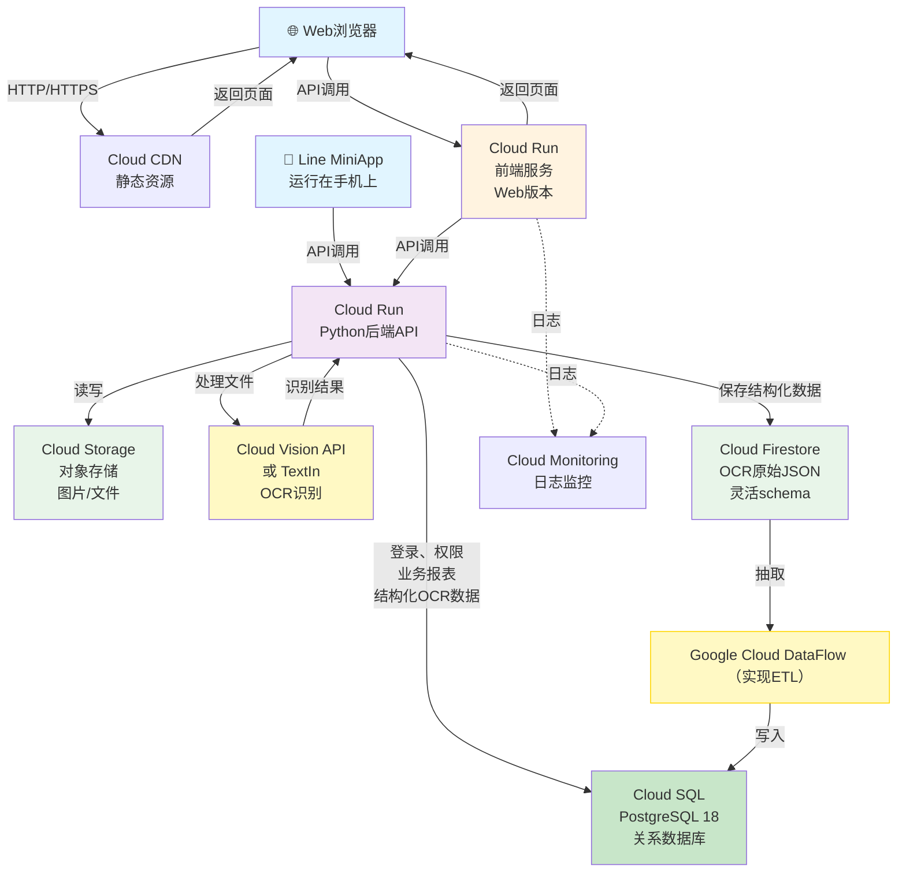

# SaiFlow — 泰国 SME 制造企业纸质单据 OCR 数字化录入系统

> **产品需求文档（PRD）。** 本文档是 SaiFlow 的权威性*为什么做*与*做什么*说明。详细的原子化需求位于 `docs/20-requirements/`；技术设计位于 `docs/30-design/`。请先阅读 `AGENTS.md` 以了解导航方式。

## 文档说明

本文档是面向泰国 SME 制造企业纸质单据的 OCR 识别、数字化录入与业务过程管理系统专用 PRD。它是创业团队进行产品设计、研发、测试和运营的统一标准。系统面向泰国制造企业上下游业务中的核心纸质单据流（订单、账单、送货单、送货指示单），以及发票、收据、贷项通知单和税务收据，重点关注**纸质单据 OCR 识别、数据核验、复核、过程可追踪与云端归档**。

- **适用场景：** 泰国 SME 制造企业将现有纸质单据流程数字化，并据此实现过程可监控、可跟踪、可统计、可分析。公司流程各节点操作员负责录入与处理；管理层通过报表查看运营指标，并通过复核决定已录入数据能否正式进入公司的业务流程。
- **模块规则：** 【必需】模块必须完整实现；【可选】模块按迭代阶段补充。初始启动版本优先满足核心刚性需求。

---

## 1. 项目概述 【必需】

### 1.1 项目背景

- **产品名称：** **SaiFlow**
- **一句话描述：** *“We turn paper into process — 将纸质单据流程数字化，使企业流程可监控、可跟踪、可统计、可分析。”*

泰国 SME 制造企业的上下游业务仍依赖纸张。单据通过电子邮件、LINE、照片或实体交付送达后，必须人工重新录入 ERP、Excel 或会计系统。这会造成：

| 痛点 | 业务影响 |
|------|----------|
| 人工录入效率低 | 文员需花费数小时重复录入每份单据 |
| 单据丢失 | 纸质文件在流转中遗失 |
| 数据录入错误 | 错误的数量或金额会破坏对账 |
| 流转延迟 | 签字与审批需等待实体移动 |
| 归档混乱 | 无一致的归档方式，检索困难 |
| 对账困难 | 通过人工目视完成 3-way matching（PO ↔ DN ↔ Invoice） |

**审批理由 / 商业价值：** SaiFlow 将重复、不可见的纸质单据处理转化为可审计的数字化过程，减少录入错误和处理延迟，并让管理层能够依据报表与复核结果管理运营，而无需为每个场景建设昂贵、复杂的 ERP 或工作流系统。

### 1.2 产品定位

SaiFlow 是面向泰国 SME 制造企业的**纸质流程数字化平台**：通过 OCR 将单据转换为结构化数据，由流程节点操作员处理，并以报表、过程追踪和复核机制支持管理层管控。系统支持按企业业务配置单据处理流程，但当前版本**不提供通用工作流引擎（Workflow Engine）**。

- **目标用户：** 流程节点操作员与管理层，详见 `docs/10-product/Personas.md`。
- **核心价值：** 将纸张转换为可追踪的结构化业务数据；提供运营指标报表；在数据正式进入业务流程前提供可配置的复核控制。
- **差异化：** 泰语+英语+中文混合语言 OCR、多业务单据流程、可配置处理与复核、私有云端数据保护、低成本、简单 UX。

### 1.3 目标用户

| 用户群体 | 角色 |
|----------|------|
| **流程节点操作员** | 泰国 SME 制造企业的文员、财务人员、仓库管理员、采购专员；负责单据上传、录入、核验和处理 |
| **管理层 / 复核人员** | 企业所有者、部门负责人或被授予复核权限的人员；负责查看运营报表和复核数据是否可正式进入业务流程 |
| **间接用户** | 上下游合作伙伴的业务协调员 |

**用户特征：** 不熟悉复杂系统；追求简单；没有专业 IT/运维团队；习惯纸质核验；要求数据私有、安全且可追溯。

### 1.4 项目目标与迭代规划

| 版本 | 核心目标 |
|------|----------|
| **V1.0** | 准确 OCR 识别泰国本地单据（PO、Delivery Note、Invoice、Receipt）；人工核验；可配置为无需复核、一级复核或二级复核；私有 GCS 归档；基础数据导出 |
| **V2.0** | 对接 ERP / 管理系统；自动数据同步；单据比对；异常提醒；运营指标报表与应收应付跟踪 |
| **V3.0** | 智能单据分类、历史检索、流转可追溯性、设备维修流程与流程模板复用 |

> **初始启动版本 = V1.0 = 仅 P0 需求**（见第 3.2 节）。

---

## 2. 行业与竞品分析 【必需】

### 2.1 泰国本地行业现状

- **单据流转：** 数字与实体混合；照片和扫描件通过电子邮件/LINE 发送。
- **格式：** 各交易伙伴版式不标准且差异较大。
- **语言：** 单据内混合使用**泰语 / 英语 / 中文**。
- **数字化水平：** 较低；许多 SME 缺乏 IT 运维人员和 ERP 集成能力。
- **核心诉求：** 低成本、操作简单、本地保留数据。

### 2.2 竞品分析

现有泰国供应商提供支持 26+ 单据类型的灵活模板（“not fix template”）：

| 竞品 | 说明 | 链接 |
|------|------|------|
| ZTrus（泰国） | 灵活模板，支持多种单据类型 | https://www.ztrus.com/th/home_thai/ |
| TNS-AS | 单据自动化服务 | https://www.tns-as.com/ |

**差距 / 机会：** 现有厂商面向较大型企业和复杂的云端部署。SaiFlow 的差异化在于面向核心制造单据流的**可配置数字化过程、私有云端数据保护、SME 可负担性和零 IT 人员可用性**。

> 详细的功能可用性比较属于一项**开放问题**（见第 7 节）。

---

## 3. 总体需求说明 【必需】

### 3.1 核心业务场景

#### 场景 1 — 企业作为**卖方**：生产与开票

**分步工作流（创建订单）：**

1. **客户 PO 接收** — 客户通过电子邮件、EDI 替代方式、上传门户或 API 发送 PO。支持格式：**JPG、PDF、PNG**。
2. **AI-OCR 数据提取** — 提取结构化数据：*客户名称、PO 编号、日期、交货日期、收货地址明细、行项目、总额*。处理不同客户的 PO 版式、多行/嵌套表格、复杂折扣结构。
3. **主数据映射** — 与*客户主数据、物料主数据、价目表、收货地址明细*匹配。新 SKU / 未匹配项目 → **标记以供核验**。
4. **业务逻辑校验** — 校验*价格与主价目表、折扣逻辑、最小订购量、客户特定逻辑*。
5. **自动创建销售订单** — 校验完成后，在 ERP 中创建 SO 草稿；通过 API 发送数据。

**单据（卖方）：**
- **客户 PO：** 识别明细 → 创建数据表 → 在系统中录入/归档或链接至 ERP。
- **已签字 Delivery Note：** 识别明细 → 创建数据表 → 录入/归档或链接至财务用于 AR。
- **Invoice：** 识别发票信息。
- **实体工作流：** 将上述文件合并为一个文件（**merge PDF**）作为账单包，并通过电子邮件发送给客户。

#### 场景 2 — 企业作为**买方**：收货与付款

**分步工作流：**

1. **收据与单据提交** — 用户通过 web app / 共享文件夹 / 电子邮件上传收据。支持：**JPG、PDF、PNG**。
2. **AI-OCR 数据提取** — 提取*Invoice 编号、PO 编号、日期、供应商明细、总金额、项目明细*；理解表格结构和多行项目格式。
3. **数据标准化与校验** — 标准化为结构化格式；将字段映射至 ERP 主数据（供应商主数据、物料主数据等）；执行业务逻辑校验、必填字段检查、重复发票检测和税款计算校验。
4. **3-way matching 逻辑** — 匹配*INV 编号、PO 编号、供应商明细、金额*等。规则包括数量容差、价格容差、总额比对。✔ 匹配 → 自动审批 / 可过账；✘ 不匹配 → 附带差异明细**标记以供核验**。
5. **ERP 集成** — 通过 API 推送数据；创建/准备*AP Invoice、匹配参考单据*。导出格式：**JSON、CSV、Excel 或直接 ERP API**。

**单据（买方）：**
- **Delivery Note / Delivery Order：** 识别仓库交货单据 → 同步库存系统。
- **Invoice：** 识别并与 PO 和 Delivery Note 核验（必须匹配）。
- **Purchase Order：** 拍摄/扫描已签字的纸质订单原件 → 识别 → 录入/归档。
- **Credit Note：** 从卖方扫描/识别 → 从发票总额中扣减以完成最终付款。
- **Tax Receipt / Withholding Tax：** 付款后卖方提供单据 → 数字化并归档 → 可针对税务要求检索。

#### 场景 3 — 管理层报表与数据复核

1. **运营指标查看：** 管理层通过报表功能查看企业运营指标，用于监控、跟踪、统计和分析数字化流程的运行情况。
2. **数据复核：** 管理层或被授权复核人员复核流程节点操作员录入的数据，并决定其是否可以正式进入企业业务流程。
3. **复核层级：** 企业可配置每类处理流程为无需复核、一级复核或二级复核；最高仅支持二级复核。
4. **非工作流引擎：** 当前版本不提供通用工作流引擎（Workflow Engine）、任意审批流编排、条件分支编排或跨系统任务调度。复核仅作为数据正式进入业务流程前的轻量控制机制。

> 运营指标口径、报表维度及各流程的复核对象必须在对应 `FR-*` 需求中明确后才能实现。

#### 主要业务流程图

### 3.2 需求优先级

| 优先级          | 范围                           | 示例                    |
| ------------ | ---------------------------- | --------------------- |
| **P0**（发布必需） | 核心 OCR → Excel               | 将 OCR 扫描文本录入 Excel 格式 |
| **P1**（迭代优化） | ERP 推送                       | 将提取的数据推送/保存至 ERP      |
| **P2**（长期规划） | 可扩展性、准确性、治理、端到端易用性           | —                     |
| P2.1（基础）     | 审计跟踪、核验队列、置信度评分、基础校验         | —                     |
| P2.2（扩展）     | 模板管理、持续学习、更好的表格/行项目提取        | —                     |
| P2.3（企业就绪）   | 搜索/检索、更广泛的集成、更强的安全/合规性、监控仪表板 | —                     |

> **初始启动版本仅实现 P0 核心需求。**

### 3.3 业务约束与限制

- **合规：** 泰国本地合规；**PDPA**（个人数据保护法）。
- **数据存储：** 原始文档对象存储在私有 GCS Bucket；TextIn 的原始识别 JSON 存储在 Firestore；经模板映射的关系型业务数据存储在 Cloud SQL PostgreSQL。访问权限、保留与删除须符合 PDPA。
- **准确性：** 单据识别准确性标准（见 `NFR-PERF`）。
- **兼容性：** 主流泰国本地 SME ERP 版本；Windows/Mac。
- **多语言：** 泰语 / 英语 / 简体及繁体中文混合。
- **硬件：** 普通手机拍摄和家用扫描仪产生的图像应可识别。

> 泰国的详细 OCR 业务约束/限制已记录为 `NFR-*` 项和一项针对经验准确性目标的**开放问题**（见第 7 节）。

---

## 4. 核心功能需求 【必需 — 核心产品设计模块】

这是核心模块。它细化每项功能的交互规则、权限和效果，以覆盖完整的单据生命周期。**详细的原子化 `FR-*` 需求位于 `docs/20-requirements/functional/`；本节仅为能力摘要。**

| 能力           | Epic      | 优先级（V1.0）              | 摘要                                         |
| ------------ | --------- | ---------------------- | ------------------------------------------ |
| 文档上传与预处理     | `EPIC-01` | P0                     | 拍照/扫描/导入；JPG/PNG/PDF；批量上传；自动矫正、去阴影、降噪、裁剪   |
| 多类型文档 OCR 识别 | `EPIC-02` | P0                     | 按文档类型提取字段；泰语/英语/中文混合语言                     |
| 数据人工核验、复核与修改 | `EPIC-03` | P0                     | 可视化结果、单字段编辑、错误标记、缺失字段提醒、核验、0/1/2 级复核、变更日志  |
| 多渠道录入与归档     | `EPIC-04` | P0（Excel/GCS）/ P1（ERP） | Excel 自动填充、私有 GCS 归档、ERP/管理系统对接            |
| 文档管理与检索      | `EPIC-05` | P1/P2                  | 分类、按编号/日期/企业/类型搜索、预览、历史记录、关键词、去重           |
| 基础系统         | `EPIC-06` | P0                     | 账户/权限、登录/注册、操作日志、语言切换、配置、复核权限              |
| 运营报表         | `EPIC-07` | P1                     | 管理层查看经配置的流程运营指标，用于监控、跟踪、统计和分析              |
| 文档格式模板配置     | `EPIC-08` | P1                     | 管理员配置表单类型、TextIn 解析模板、JSON 字段映射、字段校验与行项目映射 |

### 4.1 文档上传模块
上传方式（拍照、扫描、本地图像导入）；支持格式（**JPG/PNG/PDF**）；批量上传；文档预处理（自动矫正、去阴影、降噪、裁剪）。 → `EPIC-01`

### 4.2 核心多类型文档 OCR 识别模块
定义每种文档类型的识别字段、规则和语言适配。上传后的处理链路为：FastAPI 将预处理后的表单图片提交至 TextIn API；TextIn 返回的原始结构化 JSON 写入 Firestore；Firestore 创建事件触发 Cloud Functions，按已启用的文档格式模板将 JSON 映射、标准化并幂等写入 Cloud SQL PostgreSQL。Dataflow 仅作为未来批量回填或高吞吐重处理的可选实现，不替代默认的逐份事件处理。 → `EPIC-02`

| 文档类型                     | 必需识别字段                                                    |
| ------------------------ | --------------------------------------------------------- |
| **订单（PO）**               | 订单编号、供应方与需求方企业名称、联系人、联系信息、产品名称、数量、单价、总价、订单日期、交货日期、签字信息、备注 |
| **账单（Bill）**             | 账单编号、对账周期、金额、税费、结算方式、对账企业、签字确认、欠款备注                       |
| **Delivery Note**        | 送货单编号、关联订单编号、送货企业、收货企业、产品清单、送货数量、出库时间、物流信息、签字确认           |
| **Invoice**              | 订单编号、供应方与需求方名称、联系人/联系信息、产品名称、数量、单价、总价、订单日期、交货日期、签字信息、备注   |
| **Credit Note**          | 账单编号、对账周期、金额、税费、结算方式、对账企业、签字确认、欠款备注                       |
| **Delivery Instruction** | 固定字段与自由文本混合：配送要求、产品特殊说明、售后备注、包装要求（非结构化）                   |

- 各类型的**准确性标准和字段容错规则**（见 `NFR-PERF`、`EPIC-02`）。
- Bill / Credit Note 的**金额纠错规则**（见 `EPIC-02`）。
- **多语言适配：** 泰语 / 英语 / 简体及繁体中文混合。

### 4.3 数据人工核验、复核与修改模块

可视化显示识别结果；单字段人工修改；批量更正；错误红色标记；缺失字段提醒；核验确认机制；记录修改日志。

- **复核配置：** 对每类单据处理流程可配置 `0`（无需复核）、`1`（一级复核）或 `2`（二级复核）；不支持超过二级的复核。
- **进入业务流程：** 配置为无需复核时，核验确认后可进入业务流程；配置一级或二级复核时，须经最终复核通过后才可进入业务流程。
- **复核不是工作流：** 不提供通用 Workflow Engine、任意审批流编排或条件路由；只支持本节定义的固定复核层级控制。

→ `EPIC-03`

### 4.4 多渠道录入与归档模块 【核心差异化功能】

| 渠道 | 规则 |
|------|------|
| **本地 ERP 录入** | 接口对接、数据同步字段、手动/自动同步、兼容主流泰国本地 SME ERP 版本 |
| **企业管理系统录入** | 通用适配规则 + 自定义字段映射 |
| **Excel 自动录入** | 生成标准化 Excel 模板、一键填充、批量导出、自定义保存路径 |
| **私有 GCS 归档** | 双重存储（原始对象 + 识别数据/导出工件）、自动命名、按对象前缀分类、服务账号最小权限访问 |

→ `EPIC-04`

### 4.5 文档管理与检索模块
文档分类；按编号/日期/企业/文档类型检索；预览；历史查询；文档内关键词；重复识别与去重。 → `EPIC-05`

### 4.6 基础系统模块
账户权限；登录与注册；操作日志；语言切换（泰语/英语/中文）；基础参数配置；复核权限与复核层级配置。 → `EPIC-06`

### 4.7 运营报表模块

管理层可查看经配置的运营指标报表，以监控、跟踪、统计和分析公司数字化流程的运行情况。报表的具体指标、统计口径、时间粒度、筛选维度、导出需求及权限规则须在 `EPIC-07` 中拆解后实施。 → `EPIC-07`

### 4.8 文档格式模板配置模块

**目的：** 泰国 SME 制造企业的上下游合作伙伴使用各自版式的纸质单据。系统通过**文档格式模板**预先定义每种版式的结构化格式，使 OCR 识别后的原始 JSON 能够按模板映射为规范的业务数据，保存到数据库后支持后续**订单跟踪、报表统计和业务流程对接**。

**一个模板定义的内容：**

1. **表单类型（`doc_type`）**
   - 如 PO、Delivery Note、Invoice、Receipt、Credit Note、Tax Receipt 等。
   - 上传单据时，系统按 `doc_type` 或自动分类结果匹配已发布的模板。

2. **表头字段（Header Fields）**
   - 表单编号、表单日期、表单类型、关联 PO 号、供应方名称、需求方名称、总金额、税额、签字人、备注等。
   - 每个字段须配置：
     - 字段 key（如 `po_number`、`invoice_date`）
     - 多语言显示名称
     - 数据类型：`string` / `number` / `date` / `boolean`
     - 是否必填
     - 标准化规则（如日期格式、金额精度、去空格）
     - 从 TextIn 原始 JSON 提取的 JSONPath

3. **明细表格（Line Items）**
   - 用于包含清单的单据，例如 Delivery Note 的货品清单、Invoice 的项目明细。
   - 须配置：
     - 数组 JSONPath（如 `$.items[*]`）
     - 列字段映射：`product_name`、`quantity`、`unit_price`、`line_total`、`unit` 等
     - 每列的数据类型、必填规则、计算规则（如 `line_total = quantity × unit_price`）

**OCR 处理链路：**

1. 单据上传并预处理后，服务端调用 TextIn 获得原始结构化 JSON。
2. Cloud Functions 监听 Firestore 创建事件，按已发布模板中的 JSONPath 提取表头和明细字段。
3. 映射后的规范数据经校验（必填、类型、目标字段唯一性）后幂等写入 Cloud SQL。
4. 每次转换记录所使用的模板版本和原始 JSON，支持审计、重试与版本追溯。

**应用场景：**

- **订单跟踪：** 通过规范字段（PO 号、交货日期、货品清单）关联 PO → Delivery Note → Invoice，支持 3-way matching 和订单状态跟踪。
- **报表统计：** 按表单类型、供应商、月份、产品等维度统计单据数量、金额、处理时效和异常率。
- **业务流程对接：** 规范后的结构化数据可直接导出为 Excel，或在 V2.0 推送至 ERP / 管理系统。

**非目标：**

- 不提供可视化工作流编排或任意审批流配置。
- 不提供通用业务规则引擎或自定义表达式执行。
- 不直接重写历史已转换数据；模板变更仅影响新的转换任务。

→ `EPIC-08`

---

## 5. 非功能需求 【必需】

以下为摘要；完整的原子化项目见 `docs/20-requirements/non-functional/NFR.md`。

| 分类 | 需求摘要 |
|------|----------|
| **性能** | 单份文档识别时间；批量效率；准确性标准；系统响应；Cloud SQL/GCS 数据访问性能 |
| **兼容性** | 浏览器与主流办公软件；多种分辨率；非标准泰国纸张格式 |
| **安全性** | Cloud SQL/GCS 静态加密；隔离权限；防篡改；可追溯日志；私有 GCS Bucket 与最小权限服务账号 |
| **易用性** | 泰国用户低操作门槛；流程简单直观；本地化语言；零基础快速上手 |

---

## 6. 样本文档

真实样本位于 `thai-sample-forms-for-ocr/`（来自不同供应商、格式和表头各异的三份 Delivery Note/Invoice）。AI 必须解释并提取相关信息，并将其汇总至标准化 Excel 电子表格。

| 文件 | 类型 |
|------|------|
| `..._ใบส่งของ รีกาลอส.pdf` | Delivery Note（Regalos） |
| `..._ใบส่งของ ช้าง.pdf` | Delivery Note（Chang） |
| `..._ใบส่งของ กูลิโกะ.pdf` | Delivery Note（Glico） |
| `doc-001.jpg` | 图像样本 |

---

## 7. 开放问题

| # | 问题 | 负责人 | 是否阻塞？ |
|---|------|--------|-----------|
| OQ-1 | 各文档类型精确的 OCR 字段级准确性目标（基于经验）？ | Product/ML | 否（P0 设置基线） |
| OQ-2 | V2.0 必须优先集成哪些特定的泰国本地 ERP 系统？ | Product | V2.0 |
| OQ-3 | 详细的竞品功能可用性矩阵（ZTrus/TNS-AS）？ | Product | 否 |
| OQ-4 | 归档文档的 PDPA 数据保留期限和删除策略？ | Legal | 是（SEC） |
| OQ-5 | V2.0 运营报表必须提供哪些指标、统计口径、筛选维度与导出格式？ | Product / Management | 是（EPIC-07 实施前） |
| OQ-6 | 哪些单据处理流程默认采用无需复核、一级复核或二级复核？各级复核人员的权限如何配置？ | Product / Management | 是（EPIC-03 实施前） |
| OQ-7 | TextIn API 的区域、数据跨境处理依据、认证方式、限流、回调或同步调用参数是否已通过安全与法务确认？ | Product / Security / Legal | 是（TextIn 投产前） |
| OQ-8 | 哪些批量规模、延迟或重处理场景需要启用 Dataflow，而非默认 Cloud Functions 事件处理？ | Product / Engineering | 否（Dataflow 启用前） |
| OQ-9 | 模板审批、版本回滚和字段映射的默认治理规则是什么？ | Product / Management | 是（EPIC-08 实施前） |

---

## 链接

- 愿景与范围：`docs/10-product/Vision-Scope.md`
- 术语表：`docs/10-product/Glossary.md`
- 用户画像：`docs/10-product/Personas.md`
- 需求索引：`docs/20-requirements/Requirements-Index.md`

## 版本历史

| 版本 | 日期 | 作者 | 变更 |
|------|------|------|------|
| 2.2.2 | 2026-10-12 | Product Engineering | 扩展 4.8 文档格式模板配置模块：明确表头字段、明细表格、OCR 映射链路、订单跟踪与报表统计应用场景 |
| 2.2.1 | 2026-10-07 | Product Engineering | 新增 Web、Line MiniApp、Cloud Run、OCR、Firestore、Dataflow 和 Cloud SQL 的主要业务流程图 |
| 2.2.0 | 2026-10-07 | Product Engineering | 新增 TextIn → Firestore → Cloud Functions → Cloud SQL 数据处理链路与文档格式模板配置范围 |
| 2.1.0 | 2026-10-06 | Product Engineering | 更新为纸质流程数字化定位；新增管理报表与 0/1/2 级复核范围；明确不支持 Workflow Engine |
| 2.0.1 | 2026-10-02 | Product Engineering | 将人类可读内容翻译为简体中文 |
| 2.0.0 | 2026-09-10 | Product Engineering | 将源 PRD v2（.docx）转换为 AI 就绪 Markdown；将章节映射到 epics/NFRs |
