# SaiFlow — 系统架构

> SaiFlow 是运行于 Google Cloud 的云原生系统。React 前端和 Python/FastAPI API 作为独立 Cloud Run 服务运行；私有 GCS 保存文档对象；TextIn 提供外部 OCR 结构化识别；Firestore 保存不可变的原始识别 JSON；Cloud Functions 按已发布模板将 JSON 转换至 Cloud SQL PostgreSQL 18.6。决策理由见 `ADR-001-cloud-native-deployment.md`。

## 0. 技术基线

> 本节给出系统级技术栈概览。**具体版本号以各配置文件为唯一事实来源**：Python 依赖见 `services/api/pyproject.toml`；Node/pnpm 与 JS 依赖见根目录 `package.json`、`pnpm-workspace.yaml` 及各应用 `package.json`；容器与运行时见各 `Dockerfile`。

| 层级 | 技术选择 | 说明 / 约束 |
|------|----------|-------------|
| **PC Web 前端** | React + TypeScript + Vite + Ant Design | `apps/web-pc/`，面向桌面浏览器 |
| **Line MiniApp 前端** | React + TypeScript + Vite + Ant Design Mobile | `apps/line-mini/`，面向移动端 Line 内嵌浏览器 |
| **前端共享库** | `packages/ui/`（组件/主题）、`packages/api-client/`（OpenAPI 生成）、`packages/tsconfig/` | 禁止手写第二份 API 契约 |
| **包管理** | pnpm workspace | 仅扫描 `apps/*` 与 `packages/*`；`services/` 隔离 |
| **后端** | Python `>=3.12,<3.15` + FastAPI + Pydantic + pydantic-settings | `services/api/`，异步优先 |
| **ORM / 数据库驱动** | SQLAlchemy 2.x async + asyncpg | 通过 Cloud SQL Python Connector 或 IAM 连接 |
| **关系数据库** | Google Cloud SQL for PostgreSQL **18.6** | 事务、查询、审计、模板与关系化业务数据 |
| **对象存储** | 私有 Google Cloud Storage Bucket | 原件、派生文件、导出工件 |
| **原始 OCR JSON** | Google Cloud Firestore | 按载荷版本不可变 |
| **事件转换** | Google Cloud Functions（Firestore 触发） | 按模板将原始 JSON 幂等投影至 Cloud SQL |
| **外部 OCR** | TextIn API | 仅服务端调用；密钥存 Secret Manager |
| **密钥管理** | Google Secret Manager | 运行时注入；禁止写入源码/镜像 |
| **部署** | Docker 容器 → Google Cloud Run | 前端与后端为独立服务 |
| **代码质量** | Ruff（Python）、ESLint + Prettier（JS/TS） | 后端命令在 `services/api/` 内执行 |
| **测试** | pytest（后端）、Vitest + React Testing Library（前端） | 不得连接生产数据库；不得含真实密钥 |
| **数据库迁移** | Alembic | 模型变更必须新增迁移版本；禁止修改已合并迁移 |

## 1. 架构原则

1. **托管云服务** — Cloud Run、Firestore、Cloud Functions、Cloud SQL 和 GCS 尽量减少客户侧运维。
2. **关注点分离** — 浏览器、API、外部 OCR、原始 JSON、转换服务、关系型数据和对象数据具有边界明确的职责。
3. **原始数据与投影分离** — Firestore 保留 TextIn 原始 JSON；Cloud SQL 仅保存可查询、可核验的模板化关系数据。
4. **Human-in-the-loop** — OCR 输出在确认前始终进入可审计的核验状态。
5. **隐私保护设计** — 私有 Bucket、最小权限 IAM、HTTPS、加密存储和仅可追加的审计日志。
6. **配置优于硬编码** — 项目 ID、区域、Cloud SQL 实例、Bucket、模板映射、密钥和允许来源均为部署配置。

## 2. 组件概览

```mermaid
graph TB  
    WebBrowser["🌐 Web浏览器"]  
    LineMiniApp["💬 Line MiniApp<br/>运行在手机上"]  
      
    WebBrowser -->|HTTP/HTTPS| CDN["Cloud CDN<br/>静态资源"]  
    CDN -->|返回页面| WebBrowser  
      
    WebBrowser -->|API调用| FrontendCR["Cloud Run<br/>前端服务<br/>Web版本"]  
    FrontendCR -->|返回页面| WebBrowser  
      
    LineMiniApp -->|API调用| BackendAPI["Cloud Run<br/>Python后端API"]  
    FrontendCR -->|API调用| BackendAPI  
      
    BackendAPI -->|读写| GCS["Cloud Storage<br/>对象存储<br/>图片/文件"]  
    BackendAPI -->|处理文件| OCRService["Cloud Vision API<br/>或 TextIn <br/>OCR识别"]  
    OCRService -->|识别结果| BackendAPI  
      
    BackendAPI -->|保存结构化数据| Firestore["Cloud Firestore<br/>OCR原始JSON<br/>灵活schema"]  
      
    BackendAPI -->|登录、权限<br/>业务报表<br/>结构化OCR数据| PostgreSQL["Cloud SQL<br/>PostgreSQL 18<br/>关系数据库"]  
      
    Monitor["Cloud Monitoring<br/>日志监控"]  
    FrontendCR -.->|日志| Monitor  
    BackendAPI -.->|日志| Monitor  
      
    style WebBrowser fill:#e1f5ff  
    style LineMiniApp fill:#e1f5ff  
    style FrontendCR fill:#fff3e0  
    style BackendAPI fill:#f3e5f5  
    style GCS fill:#fce4ec  
    style Firestore fill:#fce4ec  
    style OCRService fill:#fff9c4  
    style PostgreSQL fill:#fce4ec
```



## 3. 组件与职责映射

| 组件                            | 职责                                                 | 实现内容                                    |
| ----------------------------- | -------------------------------------------------- | --------------------------------------- |
| **React web service**         | 上传/核验/管理/模板配置 UI、i18n、通过 HTTPS 调用 API              | EPIC-01、EPIC-03、EPIC-05、EPIC-06、EPIC-08 |
| **FastAPI service**           | 认证、RBAC、上传编排、TextIn 服务端调用、Firestore 写入、API 契约和审计日志 | API-1..10、EPIC-01..08                   |
| **TextIn API**                | 对预处理图像执行外部 OCR 与结构化解析，并返回原始 JSON                   | FR-OCR-017                              |
| **Firestore**                 | 保存按载荷版本不可变的 TextIn 原始 JSON 与其处理状态                  | `DM-ExtractionPayload`、FR-OCR-018       |
| **Cloud Functions**           | 监听 Firestore 创建事件，按已发布模板幂等转换 JSON 并写入 Cloud SQL    | `DM-ConversionJob`、FR-OCR-019/020       |
| **Cloud SQL PostgreSQL 18.6** | 文档、模板、字段、行项目、用户、角色、审计/变更/导出元数据                     | `DM-*` 实体                               |
| **Private GCS Bucket**        | 不可变的原始上传文件、派生文件、导出文件、归档数据工件                        | FR-UPLOAD-011、FR-ENTRY-005..008         |
| **Secret Manager**            | 数据库凭据、TextIn 密钥和仅部署使用的配置                           | NFR-SEC-003                             |
| **Cloud Logging / Audit**     | 运行遥测、转换失败和应用审计事件导出                                 | NFR-SEC-004/005                         |

## 4. 端到端数据流

```text
Browser upload → FastAPI format/size validation → private GCS original object
→ preprocessing → server-side TextIn request → Firestore immutable raw JSON payload
→ Firestore create event → Cloud Functions template conversion → Cloud SQL document/fields/line-items
→ human verification and append-only change log → export artifact to GCS
→ archive record references original, raw payload and structured/export objects
```

默认处理为逐份事件驱动。Dataflow 仅用于经批准的批量回填、高吞吐或重处理，且必须使用同一模板版本和幂等写入约束。浏览器通过经认证的 API 端点，或 API 签发的短期 signed URL 访问文档内容；浏览器不会获得 GCS、Firestore、Cloud SQL 或 TextIn 凭据。

## 5. 部署模型

| 方面 | 选择 | 需求 / 理由 |
|------|------|-------------|
| Web 前端 | 运行于 Cloud Run 的 React + Ant Design 容器 | 独立 UI 发布与自动扩缩 |
| 后端 | 运行于 Cloud Run 的 Python + FastAPI 容器 | API-1..10、服务端授权及 TextIn 调用 |
| 外部 OCR | TextIn API | 返回供应商原始结构化 JSON；仅由 FastAPI 服务端调用 |
| 原始识别数据 | Firestore | 保存不可变 JSON 载荷、处理状态和关联元数据 |
| 事件转换 | Cloud Functions（Firestore 触发） | 默认逐份模板转换与 Cloud SQL 幂等写入 |
| 批量转换 | Dataflow（可选） | 仅用于经批准的回填、重处理或高吞吐任务 |
| 关系型数据 | Cloud SQL for PostgreSQL **18.6** | 事务、查询、审计、模板与关系化业务数据 |
| 文档数据 | 私有 GCS Bucket | 对原件和工件进行持久的双重存储 |
| 数据库连接 | Cloud SQL Python Connector / IAM 启用的连接 | 不需要公开数据库端点 |
| 对象访问 | 专用 Cloud Run 服务账号 | 最小权限 GCS 对象访问 |
| 密钥 | 在运行时注入 Secret Manager | 源码或镜像中不包含密钥 |
| 区域 | 部署配置 | 必须为 PDPA/数据驻留需求确认 |

## 6. 安全性与可靠性

- **网络：** Cloud Run 服务使用 HTTPS；Cloud SQL、Firestore 和 Cloud Functions 不得向浏览器暴露管理凭据或公共写入权限。
- **身份：** API 在服务端校验用户身份和 RBAC；Cloud Run 与 Cloud Functions 使用职责分离的服务账号，并仅授予各自需要的 GCS、Firestore、Cloud SQL、Secret Manager 和 Logging 权限。
- **外部 OCR：** TextIn 密钥只存储在 Secret Manager；文件仅由服务端发送；上线前必须完成 OQ-7 的跨境与 PDPA 评估。
- **存储：** GCS Bucket 为私有且启用统一 Bucket 级访问；Firestore 原始载荷按版本不可变；Cloud SQL、GCS 和 Firestore 的静态加密是强制要求。
- **审计：** 改变状态的 API、模板和转换操作写入应用操作/变更日志；转换记录载荷版本和模板版本。
- **失败处理：** 单份文档失败相互隔离且可重试；Cloud Functions 和 Dataflow 使用幂等键，不得重复创建关系数据或破坏已归档记录。
- **可用性：** 云服务及 TextIn 调用需要网络访问；先前的 V1.0 离线需求已由 ADR-001 取代。

## 7. 架构决策

| ADR | 决策 | 状态 |
|-----|------|------|
| ADR-001 | Google Cloud：Cloud Run + Cloud SQL PostgreSQL 18.6 + 私有 GCS | accepted |
| ADR-002 | 在稳定接口后使用可插拔 OCR/提取引擎；V1.0 默认适配 TextIn | proposed |
| ADR-003 | ERP/管理系统集成采用适配器模式 | proposed |
| ADR-004 | Firestore 保存原始识别 JSON；Cloud Functions 事件驱动模板转换；Dataflow 仅用于批准的批量处理 | proposed |

## 链接

- ADR：`docs/30-design/ADR-001-cloud-native-deployment.md`
- 数据模型：`docs/30-design/Data-Model.md`
- API：`docs/30-design/API-Spec.md`
- NFR：`docs/20-requirements/non-functional/NFR.md`

## 版本历史

| 版本 | 日期 | 作者 | 变更 |
|------|------|------|------|
| 2.2.0 | 2026-10-12 | Product Engineering | 新增“0. 技术基线”章节，汇总前后端、数据库、云服务、外部服务与工程工具链；明确版本号以配置文件为唯一事实来源 |
| 2.1.0 | 2026-10-07 | Product Engineering | 新增 TextIn、Firestore、Cloud Functions 模板转换与可选 Dataflow 架构 |
| 2.0.1 | 2026-10-02 | Product Engineering | 将人类可读内容翻译为简体中文 |
| 2.0.0 | 2026-10-01 | Product Engineering | 按 ADR-001 采用 Google Cloud Cloud Run、Cloud SQL PostgreSQL 18.6 和私有 GCS 架构 |
| 1.0.0 | 2026-09-10 | Product Engineering | 根据 PRD 生成初始 local-first 架构 |
