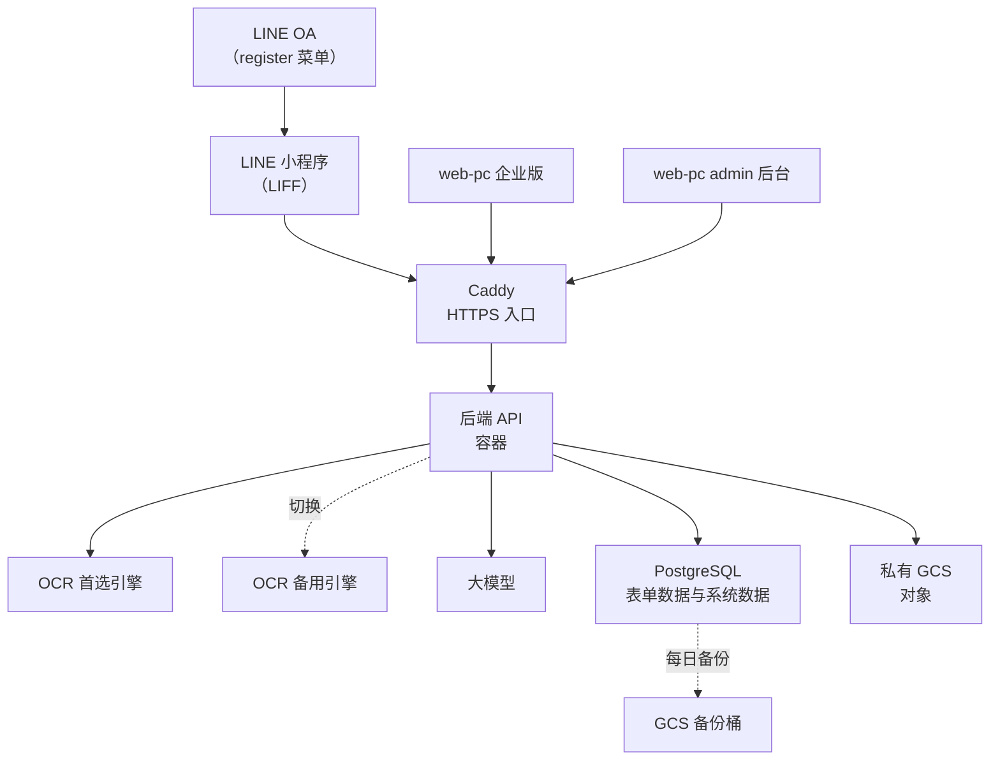

# SaiFlow — 系统架构

> SaiFlow v3 目标架构（原则层）。三个入口（LINE 小程序、web-pc 企业版、web-pc admin 后台）调用同一个后端 API；全部服务与 PostgreSQL 以 Docker Compose 运行在一台 VPS 上；后端在服务端调用 OCR 引擎（首选/备用）与大模型；原件等对象存私有 GCS，表单数据与系统数据都存 PostgreSQL（`adr/ADR-008-vps-docker-hosting.md`）。本文件不记录实现细节、测试与发布记录；v2 的实现细节见 git tag `legacy-v1` 中的版本。

## 0. 技术基线

> 只列技术选型。具体版本号以各配置文件为唯一来源（`services/api/pyproject.toml`、根 `package.json` 与各应用 `package.json`、各 `Dockerfile`）；目录与约定见 STD-005、STD-006。

| 层级 | 技术选择 |
|------|----------|
| 后端 | Python + FastAPI |
| web-pc 企业版 | React + TypeScript + Ant Design（`apps/web-pc`） |
| web-pc admin 后台 | React + TypeScript + Ant Design（`apps/web-admin`，独立应用） |
| LINE 小程序 | React + TypeScript + Ant Design Mobile，运行于 LINE LIFF；路由用 hash，会话用应用 Cookie，LIFF 只用于取得 LINE 身份令牌与分享邀请；当前租户与界面语言只存在本机（B-5a） |
| 运行平台 | LightNode VPS（曼谷机房），Docker Compose |
| 入口 | Caddy 反向代理（自动 HTTPS） |
| 数据库 | PostgreSQL（Docker 容器）：系统数据与表单数据；识别结果用 jsonb |
| 对象存储 | 私有 Google Cloud Storage Bucket（签名 URL 下载） |
| 密钥 | 服务器上的环境变量文件（仅管理员可读）；部署用值在 GitHub Secrets |
| 镜像与部署 | GHCR；GitHub Actions 手动触发，经 SSH 部署 |
| 身份与消息入口 | LINE Login、LINE LIFF、LINE Official Account |
| OCR 引擎 | TextIn、Google Cloud Vision API（首选/备用，可配置） |
| 大模型 | 可配置的大模型服务（地址与 AppKey 由平台 admin 配置） |

## 1. 架构原则

1. **低成本、少组件** — 一台 VPS 上用 Docker Compose 运行全部服务与数据库；只保留 GCS 与 OCR、大模型等必要的外部服务。
2. **关注点分离** — 入口、后端 API、外部 OCR 与大模型、表单数据、系统数据和对象数据边界明确。
3. **单一数据库** — 表单数据与系统数据都存 PostgreSQL；只有识别结果（OCR 原始 JSON、结构化 JSON）用 jsonb，状态、版本与记录用普通字段（ADR-008）。
4. **Human-in-the-loop** — 识别结果在成为正式业务数据前始终经过可审计的确认与（按配置的）复核。
5. **隐私保护设计** — 私有 Bucket 与签名 URL、最小权限服务账号、HTTPS、数据库不对公网开放、仅追加的操作日志；外部服务只由服务端调用。
6. **配置优于硬编码** — 数据库连接、Bucket、OCR 引擎与切换参数、大模型、阈值和允许来源均为配置。

## 2. 组件概览



## 3. 组件与职责映射

| 组件 | 职责 | 相关 PRD 章节 |
|------|------|---------------|
| LINE 小程序 | 游客试用、上传、核验、确认、管理操作（成员与角色、复核） | §3.1、§4.1、§4.3、§4.9 |
| web-pc 企业版 | 管理层浏览本租户结构化数据；管理操作（个人资料、租户切换、建组织申请、组织资料与成员、邀请链接与二维码、角色、owner 转让与退出、企业认证、套餐与续费申请、通知中心）；界面英语（默认）/泰语/中文；只用 LINE 网页登录（授权码方式，前端校验随机 `state`，回调地址 `/login`），没有游客与注册，未注册用户引导到小程序；history 路由，Cookie 会话，会话失效时回登录页并在登录后回到原页面 | §4.9 |
| web-pc admin 后台 | 平台运营：组织申请审批与停用、企业认证审核、续费与开通申请审批、套餐档位、价格与有效期、免费额度与成员人数上限、OCR 引擎与大模型配置、查询用户、查看操作日志、修改本人口令、首批模板预置；界面中文（默认）/英文，history 路由，Cookie 会话，会话失效时回登录页并在登录后回到原页面 | §4.6、§4.9 |
| 后端 API | 认证与会话、租户隔离与权限点校验、上传编排、OCR 调用与切换、大模型模板匹配与结构化转换、表单状态流转、导出、计量与到期判断、用量提醒与到期提醒（站内通知、LINE OA 消息、邮件；Intermediate / Advance 另加短信）、操作日志 | §3–§4 |
| OCR 引擎（首选/备用） | 对单据图像执行 OCR，返回原始 JSON | §3.2、§4.2、§4.6 |
| 大模型 | 模板匹配；按模板结构化转换并给出字段置信度 | §3.2、§4.2 |
| Caddy | HTTPS 入口；按域名或路径转发到前端与后端容器 | ADR-008 |
| PostgreSQL | 表单数据：原始识别载荷与结构化结果（jsonb）、单据的版本、状态、核验与复核记录；系统数据：用户与身份、租户与成员、角色、套餐与订阅、申请、通知、文件元数据、识别任务、模板、系统参数、操作日志、admin 账号 | ADR-008 |
| 私有 GCS | 原件、导入与导出文件、头像等对象；单独的数据库备份桶 | §4.4、ADR-008 |
| 服务器环境变量文件 | 数据库口令、OCR 引擎与大模型密钥、GCP 服务账号密钥 | §4.6、NFR-SEC-009 |

交互与等待反馈规范见 NFR-USAB-004。

## 4. 端到端数据流

按 PRD §3.1 的统一五阶段与 §3.2 的 OCR 链路：

```text
① 录入：入口上传 → 后端校验格式与大小 → 原件写入私有 GCS，登记文件元数据与识别任务
        → 校验套餐有效且当月扫描配额未用尽（到期即停）
② 解析：后端调用 OCR 首选引擎 → 失败按两层规则切换到备用引擎（NFR-REL-005）
        → 原始识别载荷写入 PostgreSQL（jsonb，按版本不可变）
        → 大模型模板匹配（无法匹配时由用户选择模板或自由格式）
        → 大模型结构化转换 → 建立单据并保存结构化结果（jsonb），状态为“待核验”；与识别任务状态在同一事务中写入
③ 确认（可选）：用户按模板界面核对、修改并确认；修改记录随单据保存
④ 复核（可选）：按配置进行一级 / 二级复核；状态为“待复核”，复核记录随单据保存
⑤ 正式业务数据：状态改为“正式业务数据”；可导出 Excel（导出文件存 GCS）；报表方式 A 直接查询
```

- 结构化文件导入（P1）跳过 ② 中的 OCR 与大模型，按字段名直接解析；界面直接录入（P2）跳过 ②。
- 识别任务的状态、页数与所用引擎记录在 PostgreSQL，作为月扫描配额计量（每页一次）与调用观测（NFR-PERF-009）的依据。
- 浏览器只通过经认证的 API 或 API 签发的短期链接访问内容，不持有 GCS、数据库、OCR 或大模型凭据；对象下载使用后端签发的有时效 V4 签名 URL。

## 5. 部署模型

| 方面 | 选择 |
|------|------|
| 服务器 | 一台 LightNode VPS（曼谷机房），唯一的 dev 环境；公网只开放 80/443 与 SSH（11022） |
| 后端 | 一个后端 API 容器 |
| 前端 | 三个前端容器，各用一个子域名：`saiflow-app.aibaba.asia`（web-pc 企业版）、`saiflow-admin.aibaba.asia`（admin 后台）、`saiflow-line2.aibaba.asia`（LINE 小程序）；每个子域名下的 `/api` 由 Caddy 转给后端，前后端同源 |
| 服务命名 | `saiflow-<be 或 fe>-<目录名>`：`saiflow-be-api`、`saiflow-fe-web-pc`、`saiflow-fe-web-admin`、`saiflow-fe-line-mini`；镜像与 Compose 服务同名 |
| 入口 | Caddy 容器，自动申请 HTTPS 证书 |
| 数据 | PostgreSQL 容器（数据在 Docker 数据卷，只在内部网络可达）；私有 GCS Bucket |
| 备份 | 每天导出数据库，本地保留 7 天，并立即复制到 GCS 备份桶（保留 30 天） |
| 密钥 | 服务器环境变量文件在运行时注入，不写入源码或镜像 |
| 发布 | GitHub Actions 手动触发：构建镜像推到 GHCR → SSH 登录 VPS → 数据库迁移 → `docker compose` 更新 → 健康检查（ADR-006 §6、ADR-008）；发布记录写入对应 change 的 `verification.md`，不写入本文件 |
| 数据驻留 | 服务器与数据库在泰国；GCS 桶在境外，须满足 OQ-7 评估 |

## 6. 安全性与可靠性

- **身份模型：** 内部以唯一用户 ID 标识用户；LINE 身份 ID、邮箱、手机号及将来的 OAuth 为指向它的关联身份。LINE OA、LIFF 小程序与 web-pc 的 LINE 登录属于同一个 LINE Provider（NFR-COMPAT-008）。
- **认证方式：** LINE 小程序与 web-pc 企业版使用 LINE 登录，游客可免登录试用；web-pc admin 后台使用与客户账号隔离的独立账号（NFR-SEC-011）。
- **租户隔离与授权：** 每次访问都在服务端按当前租户与权限点校验；没有“数据浏览”权限的成员只能访问本人提交的单据；平台 admin 能力不能分配给租户角色（PRD §4.9）。
- **密钥与外部服务：** 数据库、OCR、大模型与 GCP 服务账号凭据只在服务器环境变量文件与服务端；单据内容只由服务端发送给外部服务（NFR-SEC-009、NFR-SEC-012）。
- **存储：** 私有 Bucket，GCS 静态加密；原始载荷按版本不可变；VPS 上数据库与备份的加密方式待 OQ-30（NFR-SEC-001/002/010）。
- **审计：** 改变状态的操作（含 admin 写操作）写入仅追加的操作日志（NFR-SEC-004/005）。
- **可靠性：** 单份单据失败相互隔离且可重试；OCR 两层切换（NFR-REL-005）；单据结果与识别任务在同一事务中写入，重试按幂等键不产生重复结果（NFR-REL-003/004）。
- **单点：** 一台服务器承载全部服务与数据库，宕机即全部不可用；磁盘损坏时依赖 GCS 上的备份恢复。投产前重新评估。

## 7. 架构决策

| ADR | 决策 | 状态 |
|-----|------|------|
| ADR-001 | Google Cloud：Cloud Run + Cloud SQL PostgreSQL + 私有 GCS | superseded（ADR-008） |
| ADR-005 | 关系数据库迁移至自建 PostgreSQL | reverted；自建 PostgreSQL 由 ADR-008 定为正式方案 |
| ADR-006 | AI Native 开发模式；代码按模块重建，旧代码移入 `legacy/` | accepted |
| ADR-007 | v3 存储边界：表单数据存 Firestore，系统数据存 Cloud SQL；取消 Cloud Functions 关系投影 | superseded（ADR-008） |
| ADR-008 | 运行环境改为 VPS + Docker；表单数据存 PostgreSQL jsonb；对象保持私有 GCS | accepted |

v2 中列为 proposed 的 ADR-002（可插拔 OCR 引擎）已由 PRD §4.6 的首选/备用引擎配置覆盖；ADR-004（Cloud Functions 模板转换）已由 ADR-007 取代；ADR-003（ERP 适配器）随 V2.0 再议。

## 链接

- ADR：[`ADR-001-cloud-native-deployment.md`](./ADR-001-cloud-native-deployment.md)、[`ADR-005-self-hosted-postgresql.md`](./ADR-005-self-hosted-postgresql.md)、[`adr/ADR-006-ai-native-workflow.md`](./adr/ADR-006-ai-native-workflow.md)、[`adr/ADR-007-v3-storage-boundary.md`](./adr/ADR-007-v3-storage-boundary.md)、[`adr/ADR-008-vps-docker-hosting.md`](./adr/ADR-008-vps-docker-hosting.md)
- 数据模型：[`Data-Model.md`](./Data-Model.md)
- PRD：[`../10-product/PRD-SaiFlow.md`](../10-product/PRD-SaiFlow.md)
- NFR：[`../20-requirements/non-functional/NFR.md`](../20-requirements/non-functional/NFR.md)

## 版本历史

| 版本 | 日期 | 作者 | 变更 |
|------|------|------|------|
| 3.6.0 | 2026-11-06 | Product Engineering | B-5c：web-pc 企业版的职责与前端要点（LINE 网页登录、注册引导、三种语言） |
| 3.5.0 | 2026-11-06 | Product Engineering | B-5b：admin 后台的职责与前端要点（中文/英文、history 路由、会话失效回原页面）；OCR 与大模型密钥只在服务器环境变量文件中，后台只显示是否已配置 |
| 3.4.0 | 2026-11-05 | Product Engineering | B-5a：LINE 小程序的前端要点（hash 路由、Cookie 会话、LIFF 的用途、本机保存的偏好） |
| 3.3.0 | 2026-11-04 | Product Engineering | 按 PRD v3.4：团队租户改称组织，取消原地升级，组织由申请与审批建立 |
| 3.2.2 | 2026-11-03 | Product Engineering | §5 LINE 小程序子域名改为 `saiflow-line2.aibaba.asia`（负责人 2026-11-03） |
| 3.2.1 | 2026-11-03 | Product Engineering | B-1：§0 web-pc 拆为企业版与 admin 后台两个应用；§5 三个子域名与服务命名规则；部署说明见 `docs/deployment/README.md` |
| 3.2.0 | 2026-11-02 | Product Engineering | 按 ADR-008：运行平台改为 LightNode VPS + Docker Compose，入口 Caddy；Firestore 与 Cloud SQL 合并为一个 PostgreSQL（识别结果用 jsonb）；GCS 保持并用签名 URL 下载；Secret Manager 改为服务器环境变量文件；部署改为 GHCR + SSH；新增备份与单点说明；ADR-001、ADR-007 标记取代 |
| 3.1.0 | 2026-10-30 | Product Engineering | 按 PRD v3.2：月扫描配额计量；用量提醒与通知渠道；admin 后台职责含团队租户开通与成员人数上限 |
| 3.0.0 | 2026-10-30 | Product Engineering | 按 PRD v3.1 与 ADR-007 重写为 v3 目标架构（三个入口、OCR 首选/备用引擎、大模型、表单数据存 Firestore、系统数据存 Cloud SQL）；删除实现细节与发布记录；旧实现细节见 tag legacy-v1 |
| 2.5.1 | 2026-10-28 | Product Engineering | FR-SYS-001/011：记录 LIFF 有界 Promise、20 秒超时、安全分类、一次官方入口恢复与 sessionStorage 限制、Back/卸载请求失效；16 项隔离源码检查、25 项冻结构建浏览器、6 项模块及类型检查/生产构建通过；修复旧前端 workspaces/new API tenants 发布不匹配，新22版100%切流、真实域名7静态哈希一致，真实手机验收状态见 §5 |
| 2.5.0 | 2026-10-28 | Product Engineering | FR-SYS-012/013/015/017/018：§6 权益章节改写为租户订阅模型（归属只有 `tenant_id`，`subscriptions` 持久化默认一个月 Kinder、个人按 `tenants.created_at`、企业按 `enterprises.verified_at`，审批写有效期、同档续费允许、降档 409），到期硬停 402 `plan.expired` 且历史可读，唯一计量 OCR_PAGE 按泰国自然月统计 `ocr_jobs.page_count`；删除 FREE 档、赠送额度、`quota_ledger` 与 `free_tasks`/`paid_pages`/`OCR_TASK` 计量表述；新增到期提醒五节点（`uq_plan_reminder_stage` 幂等、不回补、游客不提醒、worker 低频扫描、`PLAN_REMINDERS_ENABLED`）与通知中心；FR-SYS-015 手机号改为个人中心可改可清空。本次为文档与已实现代码对齐，未新增线上发布证据 |
| 2.4.5 | 2026-10-27 | Product Engineering | FR-SYS-001/010..014/017、FR-VERIFY-016/017：记录 334 项隔离后端、21 项最终构建浏览器、6 项 OAuth 模块模拟与 9 项会话边界通过；退出失败锁壳及 Back/刷新撤销后回游客首页；新 API/前端 revision、镜像摘要与 100% 切流、静态哈希/健康/认证/原 Cloud SQL 与 SMTP 引用核验、标签移除及单次 ERROR 日志零条；无真实账户测试/schema 迁移，保留真实 LINE/收件箱/数据库并发/防猜码未验证边界 |
| 2.4.4 | 2026-10-27 | Product Engineering | FR-SYS-001/010..014/017：同步 Cookie/游客启动、显式 LINE 兑换、退出失败刷新撤销与 401 恢复；仅结果 Continue 的 auth/注册、pending 分离、取消保留权限与不自动确认；动态 DEFAULT Kinder、APPROVED 优先、独立赠送/月页计量、企业隔离及服务端注册门禁；保留 SMTP/行锁/环境安全边界；本轮仅契约待验证、不改代码或部署，既有 revision/发布记录仅作历史且不覆盖本轮 |
| 2.4.3 | 2026-10-27 | Product Engineering | FR-SYS-014：记录登录刷新注册状态并发保护、221 项隔离测试、SMTP 本地与最终镜像 Cloud Run 自测确认接收、Secret Manager 版本引用及 API/前端 100% 切流核验；临时标签/任务已清理，明确收件箱/真实 LINE/数据库并发与验证码防猜码机制未覆盖，不改变游客/个人中心业务 |
| 2.4.2 | 2026-10-27 | Product Engineering | FR-SYS-014：注册手机号可编辑且可选、邮箱默认取验证后的 LINE token；§6 纳入标准库 TLS SMTP 验证码及 MAIL_* 环境配置，发件人改用 Gmail，PASSWORD 仅 Secret Manager 注入；映射 AC-FR-SYS-014-04/05，明确本次验证与发布未完成；保留 §5 与既有版本发布事实，不扩展游客/个人中心/换邮箱业务规则 |
| 2.4.1 | 2026-10-27 | Product Engineering | §6 新增 FR-SYS-001 认证环境边界：生产真实 LINE、本地显式启用 dev、Cloud Run 禁用 dev、请求与旧会话拒绝及不回退；映射 AC-FR-SYS-001-04/05/06，配置 LINE/LIFF ID、升级 LIFF SDK 2.31.1 并记录线上发布核验；保留 FR-SYS-014/016 注册与发信范围及 2.4.0 Cloud SQL 回切内容 |
| 2.4.0 | 2026-10-27 | Product Engineering | 恢复 Cloud SQL PostgreSQL 18.6（saiflow-dev/postgres.saiflow）、Cloud Run Unix 套接字与本地 TLS TCP；记录 saiflow_api、Secret Manager 版本 1，并恢复 ADR-001 accepted、标记 ADR-005 reverted |
| 2.3.0 | 2026-10-26 | Product Engineering | 按 ADR-005 将关系数据库由 Cloud SQL PostgreSQL 18.6 切换为自建 PostgreSQL 17.6（odoo.saiflow）；更新技术基线与数据库连接方式 |
| 2.2.1 | 2026-10-18 | Product Engineering | 新增 §3.1 LINE Mini App 品牌等待设计：共享 BrandLoading.vue 四种 variant 与 label、品牌动效及 reduced-motion；映射 NFR-USAB-004 与已有 AC，不改变业务流程 |
| 2.2.0 | 2026-10-12 | Product Engineering | 新增“0. 技术基线”章节，汇总前后端、数据库、云服务、外部服务与工程工具链；明确版本号以配置文件为唯一事实来源 |
| 2.1.0 | 2026-10-07 | Product Engineering | 新增 TextIn、Firestore、Cloud Functions 模板转换与可选 Dataflow 架构 |
| 2.0.1 | 2026-10-02 | Product Engineering | 将人类可读内容翻译为简体中文 |
| 2.0.0 | 2026-10-01 | Product Engineering | 按 ADR-001 采用 Google Cloud Cloud Run、Cloud SQL PostgreSQL 18.6 和私有 GCS 架构 |
| 1.0.0 | 2026-09-10 | Product Engineering | 根据 PRD 生成初始 local-first 架构 |
