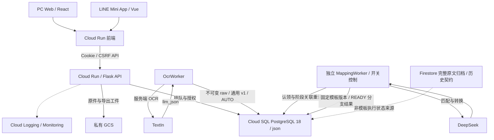

# SaiFlow — 系统架构

> SaiFlow 运行于 Google Cloud：当前后端为 Flask + Flask-SQLAlchemy，LINE Mini App 为 Vue，PC Web 的 React 定位保留；前后端独立部署于 Cloud Run，原件存私有 GCS，实际 OCR 实现为 TextIn。2026-10-31 已发布的模板 v2 路径由 OcrWorker 保存不可变 llm_json 快照，再由独立 MappingWorker 复用既有 DeepSeek 匹配/转换；raw、模板、版本、映射与 ResultVersion 的 JSON 内容存 Cloud SQL PostgreSQL 18.6 的 `json`，保留键及数组顺序，见 [ADR-006](adr/ADR-006-relational-template-storage.md)、[ADR-007](adr/ADR-007-llm-only-template-mapping.md)。历史 Firestore 完整 TextIn 原文归档仍合法，与 llm_json 快照不同，不是模板执行状态来源；Cloud Functions/Dataflow 仅属 ADR-004 旧方案或另行批准范围，不是新 FR-OCR-018..021 的依赖。云部署理由仍见 [ADR-001](ADR-001-cloud-native-deployment.md)。

## 0. 技术基线

> 本节给出系统级技术栈概览。**具体版本号以各配置文件为唯一事实来源**：Python 依赖见 `services/api/pyproject.toml`；Node/pnpm 与 JS 依赖见根目录 `package.json`、`pnpm-workspace.yaml` 及各应用 `package.json`；容器与运行时见各 `Dockerfile`。

| 层级 | 技术选择 | 说明 / 约束 |
|------|----------|-------------|
| **PC Web 前端** | React + TypeScript + Vite + Ant Design | `apps/web-pc/`，面向桌面浏览器 |
| **Line MiniApp 前端** | Vue 3 + TypeScript + Vite | `apps/line-mini/`，面向移动端 LINE 内嵌浏览器；本期模板核验/选择，不实现模板管理 UI |
| **前端共享库** | `packages/ui/`（组件/主题）、`packages/api-client/`（OpenAPI 生成）、`packages/tsconfig/` | 禁止手写第二份 API 契约 |
| **包管理** | pnpm workspace | 仅扫描 `apps/*` 与 `packages/*`；`services/` 隔离 |
| **后端** | Python + Flask + Flask-SQLAlchemy；模板校验使用 Pydantic | `services/api/`；模型调用在独立 MappingWorker，不阻塞 HTTP/OCR 线程；容器与本地测试版本见实际配置 |
| **ORM / 数据库驱动** | SQLAlchemy 2.x + psycopg 3 | Cloud Run 使用 Cloud SQL Unix 套接字；本地使用 TLS TCP（`PGSSLMODE=require`）；参数取 `PG*` 环境变量（ADR-001、ADR-005 回切记录） |
| **关系数据库** | Cloud SQL PostgreSQL **18.6**（实例 `saiflow-dev` / 库 `postgres` / schema `saiflow`） | 事务、查询、审计、模板与关系化业务数据；2026-10-27 已恢复原 Cloud SQL（ADR-001、ADR-005 回切记录） |
| **对象存储** | 私有 Google Cloud Storage Bucket | 原件、派生文件、导出工件 |
| **模板输入快照/结果** | Cloud SQL PostgreSQL `json` | 不可变 llm_json、模板版本与映射/结果归属；历史 Firestore 完整原文归档契约保留，非模板执行状态来源 |
| **模板匹配/转换** | 进程内独立 MappingWorker + DeepSeek | 本期 FR-OCR-018..021；Cloud Functions 事件投影为历史/另获批范围 |
| **外部 OCR** | TextIn API | 仅服务端调用；密钥存 Secret Manager |
| **密钥管理** | Google Secret Manager | 运行时注入；禁止写入源码/镜像 |
| **部署** | Docker 容器 → Google Cloud Run | 前端与后端为独立服务 |
| **代码质量** | Ruff（Python）、ESLint + Prettier（JS/TS） | 后端命令在 `services/api/` 内执行 |
| **测试** | pytest（后端）、离线 Vue/结构断言与全合成 API 浏览器 harness | 不连接共享数据库/供应商；真实模型/真机/多实例另验，实际证据见汇总 AC |
| **数据库迁移** | 当前 `_ensure_tables` / `_ADD_COLUMNS` 与纯迁移规划 | 增量可空列、缺表/索引才创建；不将隔离 SQLite/规划测试或只读检查视为真实 PostgreSQL DDL 验收 |

## 1. 架构原则

1. **托管云服务** — 本期 Cloud Run、Cloud SQL 和 GCS 减少客户侧运维；历史 Firestore 归档与 Cloud Functions 旧投影不作为新模板依赖。
2. **关注点分离** — 浏览器、API、OCR Worker、MappingWorker、不可变输入、核验结果和对象数据各有边界。
3. **原始数据与结果分离** — 本期 Cloud SQL 同时保存互不覆盖的不可变 llm_json、模板版本和可版本化核验结果；历史 Firestore 完整原文归档契约仍保留。
4. **Human-in-the-loop** — OCR 输出在确认前始终进入可审计的核验状态。
5. **隐私保护设计** — 私有 Bucket、最小权限 IAM、HTTPS、加密存储和仅可追加的审计日志。
6. **配置优于硬编码** — 项目 ID、区域、Cloud SQL 实例、Bucket、模板映射、密钥和允许来源均为部署配置。

## 2. 组件概览



## 3. 组件与职责映射

| 组件                            | 职责                                                 | 实现内容                                    |
| ----------------------------- | -------------------------------------------------- | --------------------------------------- |
| **前端服务** | Vue LINE Mini App 上传/核验/模板选择、i18n；PC React 定位保留，本期不实现模板管理 UI | EPIC-01/03/06；TEMPLATE-006 为 P1 |
| **Flask API / OcrWorker** | 认证/归属/租户、上传、TextIn 服务端调用、不可变 llm_json 与 v1、模板只读接口/切换/审计 | EPIC-01..08、FR-OCR-021 |
| **TextIn API** | 外部 OCR 与结构化解析 | FR-OCR-017 |
| **MappingWorker** | 条件认领、固定版本匹配/转换、受任务锁与生效门禁保护的 READY 分支结果 | FR-OCR-018/019/020 |
| **Firestore / Cloud Functions** | 历史完整原文归档与旧事件投影/另获批范围；不负责本期模板执行状态 | ADR-004 历史方案，ADR-006/007 本期决策 |
| **Cloud SQL PostgreSQL 18.6** | 文档、模板、字段、行项目、用户、角色、审计/变更/导出元数据                     | `DM-*` 实体                               |
| **Private GCS Bucket**        | 不可变的原始上传文件、派生文件、导出文件、归档数据工件                        | FR-UPLOAD-011、FR-ENTRY-005..008         |
| **Secret Manager**            | 数据库凭据、TextIn 密钥和仅部署使用的配置                           | NFR-SEC-003                             |
| **Cloud Logging / Audit**     | 运行遥测、转换失败和应用审计事件导出                                 | NFR-SEC-004/005                         |

### 3.1 LINE Mini App 品牌等待设计

- **共享呈现：** 按已确认方案复用 `BrandLoading.vue`，`variant` 支持 `splash`（启动）、`page`（页面/OCR 等待）、`inline`（局部请求）、`button`（按钮等待），`label` 接收本地化操作文案；统一 F＋圆点标志与 `saiflow` 字标。
- **动效与无障碍：** `scan` 扫描光线、`halo` 光环、`orbit` 环绕光点按布局适配，标志本身不旋转；`prefers-reduced-motion` 下关闭动画并隐藏扫描光线，保留可访问状态文字，不持续播报上传百分比，兼容窄屏与泰语文案。
- **状态边界：** 保留原有操作文案、上传百分比/进度条及 OCR 步骤；完成或失败后停止对应等待。组件仅呈现既有等待状态，不改变请求、认证、套餐分流、确认、防重复提交或禁用规则；套餐 `PENDING` 为审核状态，不作为网络加载。
- **追溯：** 横切约束见 [NFR-USAB-004](../20-requirements/non-functional/NFR.md)，验收复用 [AC-NFR-USAB-004-01/02/03](../40-acceptance/Acceptance-Criteria.md)，不另定义需求或验收场景。

## 4. 端到端数据流

```text
Browser upload → Flask validation → private GCS original → OcrWorker → TextIn llm_json
→ Cloud SQL immutable raw + generic v1（同事务）
→ 开关开启且有候选：AUTO pending → 独立 MappingWorker → DeepSeek match / convert
→ 固定模板版本的 READY ResultVersion → 条件自动生效 / 用户切换
→ human verification / required gate / audit → current-version export artifact
```

开关默认关闭：仍保存 raw，通用 v1 沿用既有整理，不创建自动映射或启动 MappingWorker。新版本为任务 max+1；切回仅移动当前指针，恢复分支最近保存内容，可返回旧版本号。删除结果保留 job，同任务锁清理 results/raw/mappings 与指针；Worker 各阶段重读关联，中止迟到写入。唯一详细契约见 [Data-Model](Data-Model.md)、[OCR-Pipeline](OCR-Pipeline.md)、[API-Spec](API-Spec.md)。

Firestore 完整原文归档契约与本期 raw 不可混同；Cloud Functions/Dataflow 仅属旧方案或另行批准范围，不是默认模板链路。浏览器只经授权 API/短期 signed URL 访问文档，不持有存储/数据库/TextIn/模型服务凭据。

## 5. 部署模型

| 方面 | 选择 | 需求 / 理由 |
|------|------|-------------|
| Web 前端 | 运行于 Cloud Run 的 React + Ant Design 容器 | 独立 UI 发布与自动扩缩 |
| 后端 | Cloud Run Flask API + OcrWorker + MappingWorker | 服务端授权与 TextIn；模板映射由 `TEMPLATE_MAPPING_ENABLED` 控制，2026-10-31 起生产开启（`saiflow-api-00052-fal`） |
| 外部 OCR | TextIn API | 仅后端调用，保留既有重试边界 |
| 模板输入与版本 | Cloud SQL PostgreSQL json | 不可变 llm_json 与模板快照、映射归属/结果；历史 Firestore 完整原文归档契约保留 |
| 模板转换 | 独立 MappingWorker（默认开关关闭） | 不依赖 Cloud Functions；本地共享库必须保持关闭 |
| 历史事件/批量投影 | Cloud Functions / Dataflow 旧方案 | 另经批准才进入实施范围，不作为本期已部署组件 |
| 关系型数据 | Cloud SQL PostgreSQL **18.6**（实例 `saiflow-dev` / 库 `postgres` / schema `saiflow`） | 事务、查询、审计、模板与关系化业务数据；ADR-001、ADR-005 回切记录 |
| 文档数据 | 私有 GCS Bucket | 对原件和工件进行持久的双重存储 |
| 数据库连接 | Cloud Run：Unix 套接字 `/cloudsql/saiflow-509205:asia-southeast1:saiflow-dev`，专用数据库用户 `saiflow_api`，口令经 Secret Manager `saiflow-cloudsql-password` **版本 1** 注入；本地：TLS TCP，`PGSSLMODE=require` | 最小权限数据库用户；未修改 `postgres` 旧密码；ADR-005 回切记录 |
| 对象访问 | 专用 Cloud Run 服务账号 | 最小权限 GCS 对象访问 |
| 后端并发容量 | `saiflow-api`：gunicorn `--workers 1 --threads 12`，Cloud Run `--concurrency 12`（二者必须相等），SQLAlchemy 连接池 `pool_size=5 + max_overflow=10 = 15` ≥ 12 请求线程 + 1 个 OCR worker + 1 个映射 worker（开启时）；`test_capacity.py` 守住仓库内约束 | NFR-PERF-005：原 `--threads 8` 对 `--concurrency 80` 时第 9 个起的请求只在进程内排队、不触发扩容；单进程保证每实例仅一个 OCR 轮询线程（认领为原子条件更新），最坏连接数（maxScale 20 × 15 = 300）与调整前相同 |
| 移动端上传通道 | 预检 POST、原字节 PUT 与完成 POST 均使用同源 XHR，沿用 Cookie/CSRF、120 秒阶段上限、原字节与单调进度；Files 多选（无 accept 过滤，上传前前端只放行 JPG/PNG/PDF）后逐文件串行复用通道，批次固定租户/会话并展示逐文件状态；成功文件进入首页 Pending（GET /files/pending），Process 单条/批量预览后才创建任务，单条/批量软删除（DELETE /files/{id}），Cancel all 与单文件取消中止 XHR 并清理会话 | FR-UPLOAD-001..005/010/013；普通文件失败不阻断其余文件，401/会话变更停止批次，不自动重发写请求；不新增批量处理 API；首页待处理为派生查询、无新表，不修改 GCS/TextIn/IAM；原生选择器菜单不由网页保证 |
| 前端读请求合并 | `refreshQuota()`：同会话进行中的 `/me/quota` 复用；成功结果 5 秒内且期间无任何写请求结束时复用；会话切换或任一写请求结束即失效，旧会话迟到响应不覆盖 | NFR-PERF-005：启动、登录与首页挂载原本在数秒内各发一次，跨境链路下每次一个完整往返 |
| 密钥 | 在运行时注入 Secret Manager | 源码或镜像中不包含密钥 |
| 区域 | 部署配置 | 必须为 PDPA/数据驻留需求确认 |

历史发布核验（2026-10-27 FR-SYS-001，仅保留，不覆盖本轮退出、结果认证/注册触发、默认 Kinder 权益与服务端确认门禁）：API 版本 `saiflow-api-line-auth-1793035194`、LINE Mini App 版本 `saiflow-line-mini-line-auth-1793035666` 均已承接 100% 流量，临时验证标签已移除。后端 `APP_ENV=production`、`AUTH_DEV_MODE=false`，Cloud SQL `postgres.saiflow` 与 Secret Manager 口令引用保持不变。54 项隔离后端测试、前端类型检查与生产构建通过；线上 API 健康与代理正常，dev 请求返回 400，无效 LINE token 返回 401，7 个前端静态文件 SHA-256 与本地构建一致；拦截应用 API 的浏览器检查确认无开发入口并跳向配置 LIFF ID 的授权地址，未创建真实测试账户，也未完成真实用户授权。`@line/liff` 2.31.1 运行依赖审计无告警；全量审计的 Vite 8.3.0 开发工具告警不在本次升级范围，生产 Nginx 运行镜像不含 Vite。该次认证发布时注册邮箱生产发信尚未实现，不宣称首次注册全流程已验收；后续 FR-SYS-014 SMTP 与注册资料变更的证据见 §6。

**本轮正式发布核验（2026-10-27，FR-SYS-001/010..014/017、FR-VERIFY-016/017）：** API `saiflow-api-confirmation-1793111348`（`sha256:31c3dbea6247e42b032f970ad337b99f7d1c976c7b3d21cbfbd39cdf52565911`）与前端 `saiflow-line-mini-confirmation-1793112260`（`sha256:af0d39addb1dd51714210055ca6448f668c243595d88927663d92fbd223f2e3c`）均已承接 100% 正式流量，API 先切、前端随后切；`confirmation-check` 临时标签已移除。公开 API 健康及前端代理为 200，dev 请求拒绝 400，无效 LINE token 与匿名会话/注册/验证码/退出/确认请求拒绝 401且无 Set-Cookie；7 个静态文件 SHA-256 与最终 `index-BUTDgRGj.js` 构建一致。生产认证开关、Cloud SQL `postgres.saiflow`、数据库与 Gmail SMTP Secret Manager 版本引用保持不变，无 schema 或历史数据迁移。

334 项隔离后端回归、9 项前端会话边界检查、最终构建的 21 项模拟浏览器场景及 6 项 OAuth 源模块模拟均通过；类型检查、Vite 构建、Python AST 与 OpenAPI 283 个内部引用校验通过。浏览器验证包含退出取消/成功/刷新/新页、503 与实际 10 秒超时后 Back 重试回游客首页、401 恢复、Continue 才认证/注册、取消保留草稿、注册后默认 Kinder 月页展示及显式再次 Continue 唯一确认、DEFAULT/APPROVED 与 pending 兼容。浏览器 HTTP/WebSocket 外网全部阻断、API 全 mock，隔离后端不连接数据库/网络/SMTP，未使用真实账户或创建生产业务记录。2026-10-27T14:51:43Z 开始的单次日志查询（窗口自 14:47:00Z，两新 revision，severity>=ERROR）均为 0，不代表长期可用性保证。真实 LINE 授权与 SDK token E2E、收件箱/完整真实注册、真实 PostgreSQL 并发及验证码防猜码仍未覆盖；本轮没有重复发送真实 SMTP 自测邮件，历史 SMTP 接收证据与边界见 §6。

**2026-10-28 LINE 登录兼容修复发布（FR-SYS-001/011）：** 手机出现 `Sign-in failed` 时，06:07/06:13 UTC 的 `/auth/line` 日志返回 200，但真实域名仍服务 `index-BUTDgRGj.js`；旧包认证成功后读取 `workspaces.find`，与新 API 返回 `tenants` 不兼容。前端已切到 `saiflow-line-mini-00022-dlx` 100% 流量，镜像 `sha256:ce5ab92e00493b8a375e552e49b467ce7e943b773f242030cbab0133fe39aaf2`，真实域名 `https://saiflow.zhpulan.cn/` 的 7 个静态文件逐一与本地 `index-Dq5WLJaK.js` 构建 SHA-256 一致；代理健康 200，匿名 session 401 且不发 Cookie。冻结构建的 25 项全 mock 浏览器、6 项真实 App/store/LIFF 源码模块模拟、16 项 LIFF 恢复/取消检查及类型检查/Vite 构建通过。桌面真实 SDK 进入配置 LIFF ID 的官方授权入口，应用 API 全拦截、OAuth 提交截断；未使用用户账号、未创建或删除真实记录、未部署后端或重建数据库。真实手机完整登录及重开 WebView 存储连续性仍由用户验收，不以桌面/模拟替代。生产依赖审计零告警；既有 Vite 开发工具告警不在 Nginx 运行镜像中，本次未升级开发工具。

**2026-10-29 并发对齐与请求合并发布（NFR-PERF-005）：** API `saiflow-api-00032-hvr`（`sha256:f4e018a8df8e3a7a005ac332aab7cf2a31fd4bdf234ccf7edd08aa27e573b799`，`containerConcurrency=12`、gthread）与前端 `saiflow-line-mini-00025-9q6`（`sha256:c0f68d1dd061f5a5abe9d02ae33d54df64a376cdf3d450183c889cb00cd9a967`）均以 `--no-traffic` 部署，经临时标签核验后 API 先切、前端随后切至 100%，临时标签已移除，latestCreated/latestReady/流量一致。切流前将线上 00029 的源码包与本次源码逐文件比对，仅 Dockerfile、config.py、.gcloudignore 与新增 test_capacity.py 不同；上传清单不含 Cookie 罐或 `.env`。标签与线上版本对相同匿名探针（session/plans/quota/dev/line）返回码一致；24 路并行健康检查全部 200。真实域名入口为 `index-6vHEALzW.js`，7 个静态文件 SHA-256 与本地构建一致，代理健康 200，匿名 session 401 且无 Set-Cookie，无效 LINE token 401；01:34Z 查询两新 revision 的 ERROR 级日志为 0。隔离验证：354 项后端回归 + 3 项容量约束、9 项 quota 合并/失效源码模拟、16 项 LIFF 恢复、25 项冻结构建浏览器与 6 项模块检查、类型检查与 Vite 构建通过；未使用真实账户、未写生产数据。上海反向代理跨境链路、gzip/缓存头与最小实例数不在本次范围，仍为主要延迟来源；真实手机体感由用户验收。

**2026-10-29 Cloud Run 直连入口修复发布（FR-SYS-001/011、FR-UPLOAD-001/010）：** 只读 LINE public context 返回已登记 Endpoint `https://saiflow-line-mini-920915040833.asia-southeast1.run.app/`，scope 为 `openid/profile`。旧实现从另一种 Cloud Run 域名或旧业务域名强制当前 URL 为 redirectUri，真实 SDK GET 授权探针复现 `/error400`；登记域名正常进入 LINE Login 200。修复使用默认 Endpoint OAuth，并在 LINE 内无 token/入口不匹配时保持一次官方恢复门禁，23 项隔离源码检查通过。图片上传截图 14:26（06:26Z）前后，session/jobs/notifications/quota 查询均 200，所查窗口内未见对应 POST uploads；13:41（05:41Z）已有一组三段上传 201/200/200。证据支持首先排查客户端上传通道，不支持归因 TextIn/GCS CORS 或断言真机断连原因。三段上传已统一为同源 XHR，增加 120 秒阶段上限、状态 0/异常响应有界失败，保留原始字节、Cookie/CSRF/单调进度，不自动重复写入；14 项源码和 2 项 Chromium 上传检查通过。应用 API 全 mock、真实 SDK 只读 GET 授权入口未提交账号；未修改 LINE 控制台、GCS/IAM、API/数据库或真实业务数据。

本次仅发布前端 `saiflow-line-mini-00036-zij`，镜像 `sha256:3ab6ed3c3c54c805735a8b0d52aefd71a0f0ebcced4ced3a44e0943fd7497ad2`；`--no-traffic` 创建候选，标签核验后于 07:34Z 开始显式切流，已核实 latestCreated/latestReady/100% traffic 一致，`liff-upload-check` 标签已移除。后端仍为 `saiflow-api-00032-hvr` 100% 流量、并发 12，未重部署。候选标签、登记区域域名、Cloud Run 别名及旧业务域名的 7 个静态文件均与冻结构建 `index-z3xqQWTr.js` 一致（入口 JS SHA-256 `9f5c111a122b4bec5596a9787de805efd1f0ae8d2e7d279e6c7db7c6c849cdc3`），各入口代理健康 200、匿名 session 401 且无 Set-Cookie。上传清单 58 个文件哈希固定、不含 `.env` 或 Cookie 罐；类型检查/生产构建、25 项冻结构建浏览器、6 项源模块、9 项 quota 回归通过。最终冻结构建的真实 SDK 只读探针再次确认：登记域名默认 OAuth 无 redirectUri 覆盖并进入 LINE Login 200；另两域名只进入无查询参数的官方 LIFF 恢复入口。07:28:00Z 至 07:40:18Z 对前端新 revision 与既有 API revision 的 ERROR 级日志查询为 0，不代表长期可用性保证。本地核验代理曾间歇断开 TLS，静态 GET 经有界重试通过；未关闭 TLS 校验、未对上传写请求增加自动重试。未使用真实账号、未执行生产上传/OCR；真实 iPhone/LINE WebView 完整授权、存储连续性及同一原图上传仍待用户验收，Chromium UA 模拟与代码审查不替代真机证据。

**2026-10-29 新增字段确认完整性修复发布（FR-VERIFY-015）：** 核验页新增表单原先只保存在 `StructuredDataView.newFields`，未点击小「+」就 Continue 时，父页面只发送 `draft`，因而漏掉已填写输入；并非后端过滤自定义字段。组件现公开 `commitPendingFields()`/`hasPendingFields`，ResultPage 在所有认证/订阅分支及保存/确认之前同步校验并纳入新增输入；任一空名/重名保留所有表单并聚焦提示，不部分提交、不导航。完全未填写或已取消的输入不额外保存，Reset 包含尚未提交的表单输入；新增表单采用有界 grid，避免小屏两个操作按钮被裁。沿用 `addFieldAt` 与现有类型推断、PATCH `structured`/`expected_version`/`confirm`、JSON 快照和最终页重读，不更改后端运行代码、数据库模型、认证/订阅资格，也不补写历史任务。12 项新增隔离后端参数用例验证自定义数字/前导零文本/泰文字段在草稿与确认、GET 重读、真实 XLSX 构造中保留且旧快照不变；完整隔离认证/结果与容量回归 366 项通过，禁用真实数据库/网络/SMTP，未导入 app.py。前端类型检查/构建通过；冻结 `index-DyunDzNw.js`（SHA-256 `e1a0a1eb11ca95698fbcfb1e5e70808474c5866aac02ad6b1010cf466405b5c8`）的 25 项新增字段浏览器场景、25 项原有认证/注册/订阅浏览器回归及 6 项源模块模拟全部通过。截图实际核验 375px 未点小「+」的 `kkk=123` 在最终只读页仍显示，320/375/430px 两按钮均完整可见可点击；覆盖多分区原子校验、en/th 空名/重名、草稿分流、Reset/取消与 503 后显式手动重试。浏览器 API 全合成、外部 HTTP/WebSocket 全阻断，未验证真实 iOS 或生产持久化；后端的真实 XLSX 构造测试同样使用合成快照，不是生产导出。两轮先前 harness 失败证据保留，最终仅修正多输入等待定位与语言 fixture，未改模块 mock、原产品断言或构建。

用户授权后，仅前端 `saiflow-line-mini-00039-xuz` 已发布，镜像 `sha256:848e9bf3e436519ace9b82a68802bb744d08d995d8fd7507ba89e651032a7094`。以 `--no-traffic` 创建候选，`field-check` 标签核验通过后显式切至 100%，最终 latestCreated/latestReady/traffic 一致，临时标签已移除。候选标签、登记区域域名、Cloud Run 别名及旧业务域名的 7 个静态文件均与上述冻结构建逐一 SHA-256 一致，代理健康均 200、匿名 session 均 401 且无 Set-Cookie；58 个白名单上传文件哈希保持不变，不含 `.env` 或 Cookie 罐。后端仍为 `saiflow-api-00032-hvr` 100% 流量、并发 12，未重部署，未修改数据库或真实业务数据。13:09:00Z 至 13:19:19Z 对前端新 revision 与既有 API revision 的 ERROR 级以上日志限定查询为 0，不代表长期可用性保证。真实 iPhone/LINE WebView 新增字段后完整确认及生产持久化仍待用户验收；未恢复历史已丢失字段，本次发布与既有 00036 记录分开。

**2026-10-31 模板 v2 开发边界：** 代码与隔离验证见 [汇总 AC](../40-acceptance/Acceptance-Criteria.md) 和 [变更任务](../../openspec/changes/document-template-mapping/tasks.md)。两份系统种子已获业务批准且离线 validate 通过，但共享库未 seed、未迁移或部署、未开启开关；只读 SELECT 的重复当前版本数 0 不是索引创建证据。真实 LLM 质量/耗时/token、LINE 真机/供应商端到端与 PostgreSQL 多实例另验。此记录不覆盖或撤销上面的既有已发布 revision 历史。

**2026-10-31 模板映射正式发布（FR-OCR-018..021、FR-TEMPLATE-001..006）：** 用户授权全量发布。本地无连接共享库的后端进程，未终止用户进程；只读确认 `saiflow_api` 为表属主且有 schema CREATE、重复当前结果版本 0。发布前发现后端 Dockerfile 模块白名单漏拷 `doc_templates/`、`mapping_worker.py`、`manage_templates.py`、`templates_seed/`，补 COPY 并新增 `test_capacity.py` 镜像模块可达性守卫（旧 Dockerfile 下失败），823 项隔离后端回归通过。

- **后端（开关关闭）：** `saiflow-api-00049-pux`（`sha256:84c12cff347bfa0a9a8ab6ff7d8e074d6e63c9313f2dcd8a76c1398ae6f12b4b`，并发 12）以 `TEMPLATE_MAPPING_ENABLED=false`、`--no-traffic` 部署；启动迁移在 `postgres.saiflow` 建出 `document_templates`、`document_template_versions`、`ocr_raw_results`、`template_mappings`，`ocr_jobs.current_mapping_id/pending_mapping_id`、`result_versions.mapping_id` 及 `uq_result_versions_job_current`、`uq_document_templates_scope_code` 等索引，启动无 WARNING/ERROR；标签与线上匿名探针一致后手动切 100%。该镜像同时包含此前未发布的 FR-OCR-017 TextIn 有界重试。
- **系统模板：** 本地 CLI `seed --dry-run` 后 `seed --yes` 写入 `system.billing_note`（6 组/22 项）与 `system.tax_invoice`（7 组/34 项），系统作用域、ENABLED、版本 1，审计 `template.created` 2 条；复跑 dry-run 均 unchanged。
- **前端：** `saiflow-line-mini-00043-wuh`（`sha256:d0b58a20273dffdb7ade6064c8c8b21f757c9ff0f3c854854c7ff9016ca3b5f2`，入口 `index-B70dHnIx.js`，SHA-256 `1f290bc9146ea126897f574e8bc009f5013788a9a96bc06703712ebe51e70eec`）。前端 `.gcloudignore` 不排除 `.env*`，故从 `temp/` 白名单暂存目录（57 文件，不含 `.env*`/Cookie 罐）上传；`--no-traffic` 标签核验后切 100%。登记区域域名、Cloud Run 别名、`saiflow.zhpulan.cn` 7/7 静态文件 SHA-256 一致，匿名 session 401 无 Set-Cookie，dev 400，无效 LINE token 401。`/healthz` 在 Cloud Run 上为保留路径，新旧 revision 均 404，不作为健康依据。
- **开关开启：** 同一镜像以 `TEMPLATE_MAPPING_ENABLED=true` 创建 `saiflow-api-00052-fal`，`--no-traffic` 核验后切 100%，临时标签均已移除，latestCreated/latestReady/traffic 一致。02:00Z–02:45Z 三个新 revision 的 ERROR 级日志与 Traceback 查询为 0，不代表长期可用性。回滚：`--update-env-vars TEMPLATE_MAPPING_ENABLED=false`（新 revision）或切回 `00049-pux`；新表与列为增量，旧代码可忽略。
- **未覆盖：** 未使用真实账号、未执行生产上传/OCR/映射；真实 DeepSeek 匹配与字段准确率、耗时/token 基线、LINE 真机端到端及 PostgreSQL 多实例并发仍待用户验收（tasks 9.3/9.4）。

## 6. 安全性与可靠性

- **网络：** Cloud Run 服务使用 HTTPS；Cloud SQL、Firestore 和 Cloud Functions 不得向浏览器暴露管理凭据或公共写入权限。
- **身份：** API 在服务端校验用户身份和 RBAC；Cloud Run 与 Cloud Functions 使用职责分离的服务账号，并仅授予各自需要的 GCS、Firestore、Cloud SQL、Secret Manager 和 Logging 权限。
- **认证环境边界（FR-SYS-001）：** 线上仅使用真实 LINE 联合认证，Developer sign-in 仅用于明确启用的本地开发；环境由运行配置判定，不由数据库实例名称判定。
  - 前端开发入口同时要求 `import.meta.env.DEV` 为真且 `VITE_AUTO_DEV_LOGIN` 为 `true`；生产构建即使配置后者为 `true` 也不显示开发入口。`VITE_DEV_BYPASS` 已移除。所有环境的 `Login/Register with LINE` 按钮只走真实 LINE OAuth/LIFF 流程，永不发送 `dev_id` 替代真实认证，也不生成模拟 LINE 身份。
  - 后端 `APP_ENV` 默认 `production`，`AUTH_DEV_MODE` 默认 `false`；仅当 `APP_ENV=development`、显式 `AUTH_DEV_MODE=true` 且未检测到 Cloud Run 的 `K_SERVICE` 时允许 dev 认证。生产即使误设 `AUTH_DEV_MODE=true`，或 Cloud Run 同时配置两个开发开关，均不得绕过此边界。
  - 不满足上述本地条件时，含 `dev_id` 的认证请求（即使同时携带有效 LINE `id_token`）必须在任何数据库访问前返回 `400 INVALID_ARGUMENT`，消息键 `auth.id_token_required`；不创建用户、会话、配额或业务数据，不触发游客数据归集。生产鉴权拒绝旧 `dev:` 身份的会话，但保留历史用户及业务数据，不批量清理或迁移；明确启用的本地开发仍可使用这些 dev 身份与未过期、未撤销的旧会话。
  - 真实 LINE `id_token` 由服务端验证 issuer（`iss`）、audience（`aud`，匹配配置的 LINE Channel ID）及 expiry（`exp`）；验证失败、LINE 不可用或配置缺失均不得回退至 dev 登录。
  - 本轮 [FR-SYS-001/010/011/014](../20-requirements/functional/EPIC-06-system-base.md) 调整启动/退出及注册触发，不改变生产/本地认证环境边界。启动仅以有效应用 Cookie 或游客会话进入主壳；LIFF SDK 的残留登录态不等于应用登录，绝不自动兑换 token。只有显式 LINE 按钮意图及其 OAuth 回跳可兑换 token，失败不自动 LINE、不回退 dev。
  - **LIFF 初始化恢复（FR-SYS-001/011，AC-FR-SYS-001-07）：** `liff.ts` 缓存同一初始化 Promise，最多等待 20 秒；只缓存初始化、不缓存 token，超时后迟到成功不复活缓存。失败仅返回 `init/session/timeout` 安全分类。登录按钮显式意图下才可用不带当前查询参数的官方 LIFF 入口重开，`sessionStorage.saiflow_liff_reopen` 按 LIFF ID 防止同一上下文重复恢复，仅取得 SDK token 或外部浏览器位于已登记 Endpoint 下可继续 OAuth 时清标记；无存储则停止。LINE 内初始化成功但无 token 时不调用外部浏览器 `liff.login`，只显式恢复官方入口一次；另一种 Cloud Run 域名或错误路径同样先从官方入口重开，不在错源启动 PKCE。可用的外部 OAuth 调用 `liff.login()` 不覆盖 redirectUri，默认回跳 LINE 已登记 Endpoint，不转发当前 URL 查询参数；旧域名 Cookie、游客草稿与 sessionStorage 不保证跨源续接。重开前保留原 `pendingAuth/pendingJob`，不转发 OAuth code/token、不修改草稿或调用开发认证。登录页以请求代次使 Back/卸载后的 SDK 结果失效；已发出的服务端认证不保证撤回，但取消后不再自动导航。此恢复不能证明真实 iOS 根因已消除，手机重开可能切换 WebView，存储连续性与完整授权仍需真实设备验收。
  - 注册框仅 `route=auth && needsRegistration` 时显示；首页、上传与开始 OCR 不弹。结果核验 Continue 中游客/未注册者仅 dirty 时先 PATCH `confirm:false` 保存后进入 auth，已认证未注册者显示注册框，不进入 plans。`pendingAuth` 显式意图与 `pendingJob` 任务上下文分离，`sessionStorage` 仅存非凭据续接上下文，禁止 token/Cookie/CSRF。认证成功但仍需注册保留任务；注册完成且导航成功后才清任务，保存或恢复异常保留重试上下文、不得误跳 plans。取消登录/注册清显式意图及自动续接标记、返回 result 并保留已归集任务权限、服务端草稿与 LINE/应用会话；用户可在结果页手动继续，不自动恢复或确认。
  - 认证/注册成功重新读取任务，仅返回 result；原已 COMPLETED 才可 final，不自动 confirm 或跳订阅页。运行中试用界面 401 清理失效应用身份并恢复游客首页；认证窗口中的 401 保留可重试入口，不自动 LINE。
  - 退出确认后先写 `localStorage` 非凭据 `logout-pending` 标记，再以 10 秒超时调用 `POST /api/v1/auth/logout` 撤销旧会话与应用 Cookie；清身份、工作空间、CSRF 与待续意图，最佳努力清 LIFF SDK 态。成功清标记并恢复游客首页；失败/超时保留标记并锁定主壳、提示重试，禁止复用正式 Cookie。刷新或点击 Back 重试均先读取旧会话仅取得撤销用 CSRF，不应用旧身份，再撤销旧会话并恢复游客 scan 首页，不保留旧 My 路由；撤销成功前不恢复旧身份，绝不静默复登。取消退出确认不建立标记或撤销会话。
  - 服务端 `confirm:true` 的所有路径必须 `_registered`：guest 401，已认证未注册 403 `PERMISSION_DENIED` / `registration.required`，在结果版本写入、当前版本切换与完成状态写入前拒绝。`confirm:false` 仍允许试用并沿用任务访问权限。legacy VERIFIED 仅由已注册且任务权益 ACTIVE 的用户显式完成，不批量转换。
  - 注册资料与 SMTP 边界保留：手机号默认取服务端验证的 LINE 返回值（若有），可编辑、手填或留空且保存提交值；邮箱默认只取验证后的 LINE token 的 email（需 email scope/用户授权），可编辑/手填且必填。FR-SYS-015 手机号现为个人中心可改可清空（`PATCH /me { phone }`，原「只读」表述作废），FR-SYS-016 换邮箱规则及登录刷新/注册行锁后重读保护不变。
  - 认证验收仍见 [AC-FR-SYS-001-04/05/06](../40-acceptance/Acceptance-Criteria.md)；已配置正式 LINE Channel ID `2012285578` 与 LIFF ID `2012285578-gUEaV9U1`（2026-11-02 起替换开发渠道 `2011688528` / `2011688528-9VP8cr3o`；后端 `LINE_CHANNEL_ID` 与前端构建期 `VITE_LIFF_ID` 必须属于同一渠道，否则 `aud` 校验失败）；认证 SDK `@line/liff` 升级至官方安全修复版 `2.31.1`（[LINE 发布说明](https://developers.line.biz/en/docs/liff/release-notes/#liff-v2-31-1)），对应 FR-SYS-001。真实 LINE 最终联调仍需核验渠道的 `openid`/`email` scope、Endpoint URL，并由用户完成授权，不视为已测试通过。
- **租户订阅与到期（FR-SYS-012/013/017/018）：** 归属只有 `tenant_id`；个人用户（含游客）与每家企业各一行 `tenants`，`enterprises` 为企业租户的 1:1 扩展。权益由 `subscriptions` 持久化（一租户一行），不再由 `registered_at` 动态推导：个人租户自 `tenants.created_at`、企业租户自 `enterprises.verified_at` 起算 **Kinder 一个月**，企业未认证时不开通（`status=NONE`）。线下人工审批写入有效期起止（`source=APPROVED`），同档续费允许、降档 409；pending 申请独立保留，不阻挡当前订阅的显式确认。
  - **到期硬停：** 订阅非 `ACTIVE` 时新建/重跑 OCR 返回 `402 PLAN_EXPIRED` / `plan.expired`；历史任务、结果与导出仍可读。唯一计量单位为 `OCR_PAGE`：按 `Asia/Bangkok` 自然月实时 `SUM(ocr_jobs.page_count)`（`FAILED` / `CANCELLED` 不计），用尽返回 `402 QUOTA_EXCEEDED` / `quota.exceeded`。FREE 档位、赠送任务、额度流水（`quota_ledger`）与 `free_tasks` / `paid_pages` / `OCR_TASK` 计量全部删除，响应不再返回这些字段。企业租户天然汇总全体成员页数，与个人租户隔离。字段唯一语义见 Data-Model §2.13，验证目标见 AC-FR-SYS-012/013/017。
  - **套餐配置（FR-SYS-019）：** 套餐目录、价格展示、月页数、席位、卡片主题、泰英双语文案、档位排序、启停、默认套餐、`trial_months` 与 `approved_period_months` 存于 `plans` 表；`plans.py` 为唯一读取入口（进程内 60 秒 TTL 缓存、读失败缓存 10 秒，使用独立连接不影响请求会话；表为空或读库失败回退 `plans_seed.json`）。启动时 `plans.seed_if_empty()` 仅在空表时播种，不覆盖已有配置。修改对所有租户（含存量订阅）在缓存窗口内生效、不做快照；停用套餐不在 `GET /plans` 返回、不可新申请，但存量订阅仍按配置解析，未知 code 回退默认套餐并告警。维护只经 CLI `services/api/manage_plans.py`（list/show/export/validate/import/set/enable/disable/set-default/seed，写操作支持 dry-run、需确认或 `--yes`，写前校验整份目录并写审计 `plan_config.*`）；当前无管理 REST 接口，PC 管理端后续实现。多实例下各实例缓存独立，最长 60 秒不一致。
  - **到期提醒：** `reminders.py` 在 `D7 / D3 / D1 / D0 / EXPIRED` 五个节点各发一次站内通知（`notifications`，首页铃铛读 `GET /me/notifications`）并向已注册且有邮箱的用户发提醒邮件；幂等键为 `plan_reminders (tenant_id, period_end, stage)` 唯一约束，错过的节点**不回补**，游客不提醒，邮件失败只影响 `plan_reminders.email_sent`，不影响站内通知与幂等记录。扫描由进程内 worker 低频触发（按泰国自然日当天只跑一次），可用 `PLAN_REMINDERS_ENABLED` 关闭。通知中心只返回账户变动类通知（到期、升级申请、个人/公司账户开通、加入公司）；开通通知在 `subscriptions.ensure_subscription` 首次建订阅行时随同事务写入，OCR worker 不再写完成通知。
- **注册验证码 SMTP（FR-SYS-014；复用 FR-SYS-016 发送接口）：** 既有设计采用 Python 标准库 `smtplib`、`email` 与 `ssl`，服务端实际发送 6 位数字码，不以写日志或写库代替发送。仅允许 `SMTP_SSL`（`ssl`）或 `SMTP` 后执行 `STARTTLS`（`starttls`），使用验证证书/主机名的 TLS 上下文，认证前须完成 TLS，禁止降级为明文。
  - 仅后端读取以下环境配置，不暴露给前端、不硬编码发信账号或凭据：

    | 环境变量 | 用途 / 约束 |
    |----------|-------------|
    | `MAIL_SMTP_HOST` | SMTP 主机；当前 Gmail 发件方案为 `smtp.gmail.com` |
    | `MAIL_SMTP_PORT` | SMTP 端口；Gmail 使用 `465`（ssl）或 `587`（starttls） |
    | `MAIL_SMTP_SECURITY` | 仅允许 `ssl` 或 `starttls`，与端口匹配 |
    | `MAIL_SMTP_USERNAME` | SMTP 认证账号；当前发件账号为 `fj168104@gmail.com` |
    | `MAIL_SMTP_PASSWORD` | 仅由 Secret Manager 在运行时注入；不得将值写入文档、源码、配置文件、镜像、日志或仓库 |
    | `MAIL_FROM` | 邮件发件人；当前为 `fj168104@gmail.com`，须为服务商允许的发件地址 |
    | `MAIL_SMTP_TIMEOUT_SECONDS` | 连接/发送超时秒数，须为正数；超时按发送失败处理 |

  - Gmail 不接受以普通账号密码替代应用专用密码；需符合账号条件的应用专用密码或 OAuth。当前标准库 SMTP 方案采用应用专用密码认证并仅经 Secret Manager 注入，不在本次扩展 OAuth token 获取/刷新实现，也不在仓库记录任何凭据。
  - 10 分钟 TTL 与 60 秒重发间隔复用既有验证码模型；只有 SMTP 确认发送成功后才记录有效新码，成功重发后旧码失效。未配置或连接、TLS、认证、发送、超时失败均返回 `503 EMAIL_SERVICE_UNAVAILABLE`，不记录有效新码、不完成注册。按当前用户与邮箱校验，错误/过期/已用拒绝；注册成功事务同时消费验证码并保存资料、设置 `registered_at`。仅 FR-SYS-001 明确启用的本地开发沿用不实际发信、不校验的例外，不得据此放宽生产规则。
  - 验收目标见 [AC-FR-SYS-014-01/02/03/04/05](../40-acceptance/Acceptance-Criteria.md)。本轮退出、认证/注册触发、默认 Kinder 与确认门禁已实现，隔离验证及正式发布证据见 §5；真实 LINE/SMTP 收件箱全流程不因模拟测试而视为验收。以下 SMTP 证据为历史事实，不替代本轮验证：此前 221 项隔离后端测试、5 项模拟浏览器测试、前端类型检查/构建及 OpenAPI YAML 校验通过，Dockerfile 已包含 SMTP 模块。Gmail 应用专用密码仅存 Secret Manager `saiflow-smtp-password` 版本 1，并在该 secret 上授予现有 API 服务账号读取权限；本地自测及 Cloud Run 同区域/服务账号的独立任务向 `fj168104@gmail.com` 自身实发邮件均获 SMTP 确认接收，任务无数据库配置、不导入应用，不创建用户/会话/验证码或业务记录，运行后已删除。尚未独立核验收件箱、真实 LINE 渠道 email scope/用户授权及注册全流程，不宣称上述完整 AC 已验收。
  - **历史发布记录（2026-10-27 注册/SMTP，仅保留，不覆盖本轮退出、注册触发、默认权益或确认门禁）：** API `saiflow-api-registration-1793105470`（镜像摘要 `sha256:721820f619e706abfeb6ad53578d5743123b11f93c0690871f81d478a58cb371`）与前端 `saiflow-line-mini-registration-1793104858`（`sha256:d7d2e3e8c6a8e08e3025e4cfa712aa7b9bde0249d11e0e32cd308f9e19bf828d`）均已承接 100% 流量，API 先切流、前端随后切流；临时 `registration-check` 标签与 SMTP 测试任务已删除。最终 API 镜像的独立 Cloud Run Gmail 实发自测获 SMTP 确认接收；公开地址切流后健康与 API 代理返回 200，dev 请求返回 400，无效 LINE token 与匿名注册/验证码请求返回 401且不创建会话，7 个前端静态文件 SHA-256 与本地构建完全一致。`APP_ENV=production`、`AUTH_DEV_MODE=false`、Cloud SQL `postgres.saiflow` 与数据库 secret 版本引用保持不变；SMTP 使用 `ssl:465`，超时 30 秒，密码仅引用 `saiflow-smtp-password:1`。221 项隔离回归（含锁后注册状态重读）、5 项模拟浏览器测试通过；发布后查询新 API/前端 revision 的 `ERROR` 及以上日志，两者均未发现服务器错误（单次查询证据，非长期可用性保证）。这些证据不覆盖真实 LINE 授权、收件箱/完整注册验收及真实数据库并发。
  - **并发与剩余安全边界：** 发送、注册与换邮箱按用户行锁串行；LINE 登录刷新已有用户前也锁定并重新读取 `registered_at`，避免初查旧状态覆盖已提交资料。隔离用例模拟锁后状态变化，但不代替真实 PostgreSQL 并发测试。本次未新增验证码校验失败次数上限或账号/IP 级防猜码机制，60 秒仅限制成功发码后的重发，不限制猜码；此安全加固需另行确认策略并变更，不能视为已通过防暴力猜码验收。
- **外部 OCR：** TextIn 密钥只存储在 Secret Manager；文件仅由服务端发送；上线前必须完成 OQ-7 的跨境与 PDPA 评估。
- **存储：** GCS 私有；历史 Firestore 原文与本期 PostgreSQL raw/模板版本不可变（依法删除例外）；全部存储强制静态加密，新映射不覆盖原始快照或人工分支编辑。
- **审计：** 实际 CLI 写入、模板应用/切换/失败/确认反馈可追溯至任务/raw/固定模板版本；合法显式通用选择即使已通用也审计而不新增结果版本。日志不记录模型输入的单据内容。
- **失败处理：** 单份失败隔离；本期条件认领、任务锁、关联阶段重读与卡住恢复保护结果，失败重试 force=true 但不绕过上限；Cloud Functions/Dataflow 幂等要求仅适用旧方案/另获批范围。
- **可用性：** 云服务及 TextIn 调用需要网络访问；先前的 V1.0 离线需求已由 ADR-001 取代。

## 7. 架构决策

| ADR | 决策 | 状态 |
|-----|------|------|
| ADR-001 | Google Cloud：Cloud Run + Cloud SQL PostgreSQL 18.6 + 私有 GCS | accepted（2026-10-27 已恢复原 Cloud SQL，数据库条目不再被 ADR-005 取代） |
| ADR-002 | 在稳定接口后使用可插拔 OCR/提取引擎；V1.0 默认适配 TextIn | proposed |
| ADR-003 | ERP/管理系统集成采用适配器模式 | proposed |
| ADR-004 | Firestore 原文归档与历史事件投影/Dataflow 方案 | proposed（旧方案/另获批范围；非本期模板执行链路） |
| ADR-005 | 关系数据库迁移至自建 PostgreSQL 17（122.51.11.112 / odoo.saiflow） | reverted（2026-10-27 回切至 saiflow-dev/postgres.saiflow；自建库只读归档） |
| [ADR-006](adr/ADR-006-relational-template-storage.md) | PostgreSQL json 存模板、不可变输入与映射/结果 | accepted（2026-10-31 已发布） |
| [ADR-007](adr/ADR-007-llm-only-template-mapping.md) | 只用模型匹配/转换，不引入路径规则 | accepted（真实质量/性能基线未运行） |

## 链接

- ADR：`docs/30-design/ADR-001-cloud-native-deployment.md`、`docs/30-design/ADR-005-self-hosted-postgresql.md`
- 数据模型：`docs/30-design/Data-Model.md`
- API：`docs/30-design/API-Spec.md`
- NFR：`docs/20-requirements/non-functional/NFR.md`

## 版本历史

| 版本 | 日期 | 作者 | 变更 |
|------|------|------|------|
| 2.8.1 | 2026-11-04 | Product Engineering | FR-UPLOAD-003/005：LINE 首页移除 Photos，Files 去掉 accept 过滤、前端上传前只放行 JPG/PNG/PDF；后端校验与云配置不变 |
| 2.8.0 | 2026-11-04 | Product Engineering | FR-UPLOAD-013：首页 Pending（派生查询）、预览后单条/批量开始处理、软删除 DELETE /files/{id}、Cancel all 与单文件取消；无新表/DDL，不改云配置 |
| 2.7.3 | 2026-11-04 | Product Engineering | FR-UPLOAD-002/003/005/010：LINE Photos 图片限定和 Photos/Files 多选逐文件串行上传、会话与租户固定、多文件确认；不增加待处理区/批量开始 API、不改后端或云配置；原生菜单由宿主控制 |
| 2.7.2 | 2026-11-03 | Product Engineering | FR-ENTRY-015：Android LINE 内置浏览器导出改为 `POST /exports/{id}/download-ticket` 换取 60 秒 HMAC 签名票据（SECRET_KEY，绑定导出/用户/会话，不落库、无新表），经 `liff.openWindow({external:true})` 在系统浏览器打开 `GET /export-downloads/{ticket}`；安全中间件仅对 GET/HEAD 且完整匹配票据格式放行，路由内重新校验会话、账号与任务归属；iOS/桌面仍用 Cookie 下载 |
| 2.7.1 | 2026-11-02 | Product Engineering | FR-SYS-001：LINE 渠道由开发渠道 `2011688528` 切换为正式渠道 `2012285578`（LIFF ID `2012285578-gUEaV9U1`）；后端 saiflow-api-00059-zew（镜像不变，仅 `LINE_CHANNEL_ID` 变更）、前端 saiflow-line-mini-00051-fig（bundle index-BOcc99x7.js，与上一版仅 LIFF ID 不同），资源按用户确认采用 2 CPU / 4Gi + CPU throttling（并发 12 不变）；no-traffic + tag 核验 /api/health 200、无效 token 登录 401 `auth.line_token_invalid`→前后端连续切 100%→移除标签，切流后无 ERROR/5xx；旧渠道 LINE userId 不跨渠道通用，未用真实账号做端到端登录核验 |
| 2.7.0 | 2026-11-01 | Product Engineering | FR-SYS-019：套餐改为 `plans` 表配置 + `plans.py` 仓储缓存（60 秒 TTL、种子回退、空表启动播种）+ `manage_plans.py` CLI 维护，后端镜像新增 `manage_plans.py`、`plans_seed.json`；无管理 REST 接口，PC 管理端延后；863 项隔离后端测试通过，2026-11-01 正式发布：后端 saiflow-api-00056-ril、前端 saiflow-line-mini-00048-max（bundle index-SFvaHz8q.js）no-traffic 部署→tag 核验 /api/health 200、未登录接口 401、bundle 哈希一致→只读核验共享库自动建表并播种 4 个套餐（属主 saiflow_api，与种子一致）→手动切 100%，环境变量（22 项）与并发 12 与上一版一致；未建游客会话、未用真实账号做端到端核验 |
| 2.6.2 | 2026-10-31 | Product Engineering | FR-SYS-018：通知中心收敛为账户变动类，新增个人/公司账户开通通知，worker 去掉 OCR 完成通知；2026-10-31 正式发布：后端 saiflow-api-00054-mol、前端 saiflow-line-mini-00046-god（bundle index-IPu3DEpl.js）no-traffic 部署→tag 核验 /api/health 200、通知接口未登录 401→手动切 100%，环境变量与并发 12 与上一版一致，切流后 15 分钟内无 5xx；含同日 TEMPLATE_MATCHING 三步流程；未用真实账号做端到端核验 |
| 2.6.1 | 2026-10-31 | Product Engineering | 模板映射正式发布：Dockerfile 补拷模板模块并加守卫测试；后端 00049（开关关）迁移建表→seed 两个系统模板→前端 00043→后端 00052 开关开启；记录镜像、哈希、核验与未覆盖边界 |
| 2.6.0 | 2026-10-31 | Product Engineering | 同步实际Flask/Vue/OcrWorker/MappingWorker与PostgreSQL json模板路径、组件图/数据流/审计/删除关联中止及ADR006/007；范围化旧Firestore事件投影而保留合法原文归档，明确本轮未seed/迁移/部署及真实基线待验 |
| 2.5.4 | 2026-10-29 | Product Engineering | FR-VERIFY-015：Continue 校验并纳入尚在新增表单中的字段，Reset 包含输入，小屏控件完整可见；不改 API/JSON 或认证订阅资格，366 项隔离后端及 50 项浏览器/6 项源模块通过；仅前端 00039 100% 切流、标签移除、四入口资产/健康/匿名边界核验通过，镜像摘要及真机未验收边界见 §5 |
| 2.5.3 | 2026-10-29 | Product Engineering | FR-SYS-001/011：Endpoint 同源/路径检查、默认 OAuth 与 LINE 内无 token 的一次恢复；FR-UPLOAD-001/010：三段同源 XHR、原字节/Cookie/CSRF/进度与有界失败；仅前端 00036 100% 切流、临时标签移除，四入口资产/健康/匿名边界核验通过；最终构建回归、真实 SDK 只读入口探针、镜像摘要及真机未验收边界见 §5，后端/数据库未变 |
| 2.5.2 | 2026-10-29 | Product Engineering | NFR-PERF-005：后端 gunicorn `--threads 12` 与 Cloud Run `--concurrency 12` 对齐（单 worker、连接池 15 显式固定、`test_capacity.py` 约束）；前端 `/me/quota` 同会话同写代次请求合并与 5 秒复用；`.gcloudignore` 排除本地 Cookie 罐（NFR-SEC）；API 00032、前端 00025 100% 切流，发布证据见 §5 |
| 2.5.1 | 2026-10-28 | Product Engineering | FR-SYS-001/011：记录 LIFF 有界 Promise、20 秒超时、安全分类、一次官方入口恢复与 sessionStorage 限制、Back/卸载请求失效；16 项隔离源码检查、25 项冻结构建浏览器、6 项模块及类型检查/生产构建通过；修复旧前端 workspaces/new API tenants 发布不匹配，新22版100%切流、真实域名7静态哈希一致，真实手机验收状态见 §5 |
| 2.5.0 | 2026-10-28 | Product Engineering | FR-SYS-012/013/015/017/018：§6 权益章节改写为租户订阅模型（归属只有 `tenant_id`，`subscriptions` 持久化默认一个月 Kinder、个人按 `tenants.created_at`、企业按 `enterprises.verified_at`，审批写有效期、同档续费允许、降档 409），到期硬停 402 `plan.expired` 且历史可读，唯一计量 OCR_PAGE 按泰国自然月统计 `ocr_jobs.page_count`；删除 FREE 档、赠送额度、`quota_ledger` 与 `free_tasks`/`paid_pages`/`OCR_TASK` 计量表述；新增到期提醒五节点（`uq_plan_reminder_stage` 幂等、不回补、游客不提醒、worker 低频扫描、`PLAN_REMINDERS_ENABLED`）与通知中心；FR-SYS-015 手机号改为个人中心可改可清空。本次为文档与已实现代码对齐，未新增线上发布证据 |
| 2.4.5 | 2026-10-27 | Product Engineering | FR-SYS-001/010..014/017、FR-VERIFY-016/017：记录 334 项隔离后端、21 项最终构建浏览器、6 项 OAuth 模块模拟与 9 项会话边界通过；退出失败锁壳及 Back/刷新撤销后回游客首页；新 API/前端 revision、镜像摘要与 100% 切流、静态哈希/健康/认证/原 Cloud SQL 与 SMTP 引用核验、标签移除及单次 ERROR 日志零条；无真实账户测试/schema 迁移，保留真实 LINE/收件箱/数据库并发/防猜码未验证边界 |
| 2.4.4 | 2026-10-27 | Product Engineering | FR-SYS-001/010..014/017：同步 Cookie/游客启动、显式 LINE 兑换、退出失败刷新撤销与 401 恢复；仅结果 Continue 的 auth/注册、pending 分离、取消保留权限与不自动确认；动态 DEFAULT Kinder、APPROVED 优先、独立赠送/月页计量、企业隔离及服务端注册门禁；保留 SMTP/行锁/环境安全边界；本轮仅契约待验证、不改代码或部署，既有 revision/发布记录仅作历史且不覆盖本轮 |
| 2.4.3 | 2026-10-27 | Product Engineering | FR-SYS-014：记录登录刷新注册状态并发保护、221 项隔离测试、SMTP 本地与最终镜像 Cloud Run 自测确认接收、Secret Manager 版本引用及 API/前端 100% 切流核验；临时标签/任务已清理，明确收件箱/真实 LINE/数据库并发与验证码防猜码机制未覆盖，不改变游客/个人中心业务 |
| 2.4.2 | 2026-10-27 | Product Engineering | FR-SYS-014：注册手机号可编辑且可选、邮箱默认取验证后的 LINE token；§6 纳入标准库 TLS SMTP 验证码及 MAIL_* 环境配置，发件人改用 Gmail，PASSWORD 仅 Secret Manager 注入；映射 AC-FR-SYS-014-04/05，明确本次验证与发布未完成；保留 §5 与既有版本发布事实，不扩展游客/个人中心/换邮箱业务规则 |
| 2.4.1 | 2026-10-27 | Product Engineering | §6 新增 FR-SYS-001 认证环境边界：生产真实 LINE、本地显式启用 dev、Cloud Run 禁用 dev、请求与旧会话拒绝及不回退；映射 AC-FR-SYS-001-04/05/06，配置 LINE/LIFF ID、升级 LIFF SDK 2.31.1 并记录线上发布核验；保留 FR-SYS-014/016 注册与发信范围及 2.4.0 Cloud SQL 回切内容 |
| 2.4.0 | 2026-10-27 | Product Engineering | 恢复 Cloud SQL PostgreSQL 18.6（saiflow-dev/postgres.saiflow）、Cloud Run Unix 套接字与本地 TLS TCP；记录 saiflow_api、Secret Manager 版本 1，并恢复 ADR-001 accepted、标记 ADR-005 reverted |
| 2.3.0 | 2026-10-26 | Product Engineering | 按 ADR-005 将关系数据库由 Cloud SQL PostgreSQL 18.6 切换为自建 PostgreSQL 17.6（odoo.saiflow）；更新技术基线与数据库连接方式 |
| 2.2.1 | 2026-10-18 | Product Engineering | 新增 §3.1 LINE Mini App 品牌等待设计：共享 BrandLoading.vue 四种 variant 与 label、品牌动效及 reduced-motion；映射 NFR-USAB-004 与已有 AC，不改变业务流程 |
| 2.2.0 | 2026-10-12 | Product Engineering | 新增“0. 技术基线”章节，汇总前后端、数据库、云服务、外部服务与工程工具链；明确版本号以配置文件为唯一事实来源 |
| 2.1.0 | 2026-10-07 | Product Engineering | 新增 TextIn、Firestore、Cloud Functions 模板转换与可选 Dataflow 架构 |
| 2.0.1 | 2026-10-02 | Product Engineering | 将人类可读内容翻译为简体中文 |
| 2.0.0 | 2026-10-01 | Product Engineering | 按 ADR-001 采用 Google Cloud Cloud Run、Cloud SQL PostgreSQL 18.6 和私有 GCS 架构 |
| 1.0.0 | 2026-09-10 | Product Engineering | 根据 PRD 生成初始 local-first 架构 |
