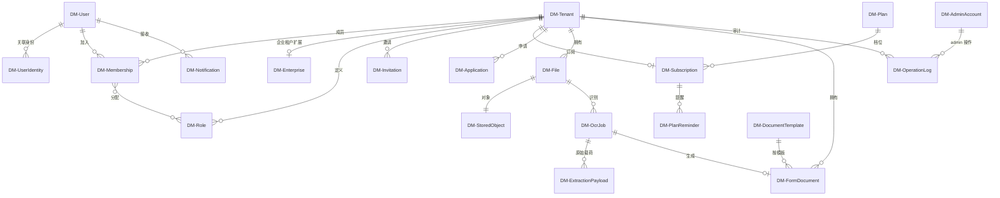

# SaiFlow — 数据模型

> **本文件只描述实体层**：实体、用途、存储位置、归属、关键关系与生命周期。**字段级结构以代码为唯一来源**（Cloud SQL：ORM 模型 + Alembic 迁移；Firestore：服务端文档模型），不在文档中重复（ADR-007、STD-004 规则 2）。存储位置以 [`adr/ADR-007-v3-storage-boundary.md`](./adr/ADR-007-v3-storage-boundary.md) 为准。v1 的字段级内容见 git tag `legacy-v1` 中的版本。
>
> 本文件仅在新增实体、实体更换存储位置、关系或生命周期变化时更新。

## 1. 实体关系概览

`DM-SystemSetting` 为全系统配置，不与租户关联，图中省略。

## 2. 实体清单

| 实体 ID | 用途 | 存储 | 归属 | 关键关系 | 生命周期 |
|---------|------|------|------|----------|----------|
| `DM-User` | 用户；内部唯一用户 ID | Cloud SQL | 全局 | 1:N 关联身份、成员关系、通知 | 游客 → 已注册；游客注册后数据归入个人租户 |
| `DM-UserIdentity` | 关联身份：LINE 身份 ID、邮箱、手机号、将来的 OAuth | Cloud SQL | 用户 | N:1 用户；同类身份全局唯一 | 绑定 → 验证（邮箱）→ 解绑 |
| `DM-Tenant` | 租户：业务数据的归属单位 | Cloud SQL | — | 1:N 成员关系、文件、表单文档；0..1 企业、订阅 | 游客临时 / 个人 / 企业；开通 → 关闭（平台 admin） |
| `DM-Enterprise` | 企业租户的企业信息与认证 | Cloud SQL | 租户（1:1） | 1:1 企业租户 | 未认证 → 已认证（审核开通或 admin 直接开通） |
| `DM-Membership` | 用户在租户中的成员关系 | Cloud SQL | 租户 | N:1 用户、N:1 租户、N:M 角色 | 加入 → 移除；个人租户只有本人 |
| `DM-Role` | 角色：owner、默认角色与 owner 自定义角色，由权限点组合 | Cloud SQL | 租户 | N:M 成员关系 | 创建 → 修改权限点 → 删除（owner 与默认角色不可删除） |
| `DM-Invitation` | 企业租户的成员邀请 | Cloud SQL | 租户 | N:1 企业租户 | 待接受 → 已接受 / 已过期 / 已撤销 |
| `DM-Plan` | 套餐目录：四档及每月页数 | Cloud SQL | 全局 | 1:N 订阅 | 由平台维护 |
| `DM-Subscription` | 租户当前订阅：档位与有效期 | Cloud SQL | 租户（一租户一个） | N:1 套餐；1:N 到期提醒 | 未开通 → 有效 → 已到期；续费/升级后重新有效 |
| `DM-Application` | 续费/升级申请、企业认证申请 | Cloud SQL | 租户 | N:1 目标租户 | 已提交 → 处理中 / 需补充 → 已批准 / 已拒绝 |
| `DM-PlanReminder` | 到期提醒发送记录（同一周期同一节点只一次） | Cloud SQL | 租户 | N:1 订阅 | 仅追加 |
| `DM-Notification` | 站内通知 | Cloud SQL | 用户 | N:1 用户 | 未读 → 已读 |
| `DM-File` | 文件元数据：原件、导入、导出、头像 | Cloud SQL | 租户 | 1:1 GCS 对象；1:N 识别任务 | 上传 → 删除（按保留策略） |
| `DM-OcrJob` | 识别任务：状态、页数、所用引擎；月页计量与调用观测的依据 | Cloud SQL | 租户 | N:1 文件；1:N 原始载荷；0..1 表单文档 | 排队 → 识别中 → 完成 / 失败 / 取消 |
| `DM-DocumentTemplate` | 文档格式模板及其版本 | Cloud SQL | 全局（V1.0 由实施人员预置） | 1:N 表单文档 | 草稿 → 已发布 → 停用；发布后版本不可变 |
| `DM-SystemSetting` | 系统参数：OCR 首选/备用引擎与切换参数、大模型配置引用、置信度阈值 | Cloud SQL | 全局（平台 admin 配置） | — | 修改时写操作日志；密钥本体在 Secret Manager |
| `DM-OperationLog` | 操作日志（审计） | Cloud SQL | 租户或平台 | N:1 操作者（用户或 admin 账号） | 仅追加 |
| `DM-AdminAccount` | 平台 admin 账号 | Cloud SQL（与客户账号分表隔离） | 平台 | 1:N 操作日志 | 启用 → 锁定 / 停用 |
| `DM-FormDocument` | 表单数据：每份单据一个文档，含结构化结果、结果版本、状态、核验修改记录与复核记录 | Firestore | 租户 | N:1 识别任务、模板版本 | 待核验 → 待复核 → 正式业务数据（同一文档的状态字段，OQ-21） |
| `DM-ExtractionPayload` | 原始识别载荷：OCR 引擎原始 JSON | Firestore | 租户 | N:1 识别任务 | 按载荷版本不可变 |
| `DM-StoredObject` | 对象：原始单据、导入文件、导出文件、头像 | 私有 GCS | 租户 | 1:1 文件元数据 | 原件不可变；按保留策略删除 |

- 登录会话、邮箱验证码等短期技术数据不作为实体登记，在 B-2 的 `plan.md` 中设计。
- 报表数据（方式 B，经 Dataflow ETL 进入 Cloud SQL）为后续能力（OQ-8），实现时再登记实体。

### 2.1 v1 实体去向

`OCR-Pipeline.md`、`API-Spec.md` 与 `EPIC-*` 仍可能引用 v1 实体 ID，对照如下：

| v1 实体 | v3 去向 |
|---------|---------|
| `DM-Document` | `DM-File`（元数据）+ `DM-FormDocument`（表单数据） |
| `DM-ExtractionPayload` | 保留，仍在 Firestore |
| `DM-ConversionJob` | 取消（不再有 Cloud SQL 关系投影）；处理状态见 `DM-OcrJob` |
| `DM-TemplateFieldMapping` | 取消（JSONPath 映射由大模型结构化转换取代） |
| `DM-ExtractedField`、`DM-LineItem`、`DM-ResultVersion`、`DM-ChangeLog`、`DM-ReviewRecord` | 并入 `DM-FormDocument` |
| `DM-ReviewPolicy`、`DM-Settings` | `DM-SystemSetting`（复核配置的具体形式在 B-4 确定） |
| `DM-ArchiveRecord`、`DM-ExportJob` | `DM-File` + `DM-StoredObject`（导出文件） |
| `DM-User`、`DM-Role`、`DM-OperationLog`、`DM-DocumentTemplate` | 保留 |

## 3. 枚举

只列产品级枚举的取值名称；代码中的取值以代码为准。

| 枚举 | 取值 |
|------|------|
| `DocumentType` | PO、DELIVERY_NOTE、DELIVERY_INSTRUCTION、INVOICE、RECEIPT、CREDIT_NOTE、TAX_RECEIPT、BILL |
| 表单状态 | 待核验、待复核（一级 / 二级）、正式业务数据 |
| 租户类型 | 游客、个人、企业 |
| 订阅状态 | 未开通（企业未认证）、有效、已到期 |
| 套餐档位 | Kinder < Starter < Intermediate < Advance |
| 权限点 | 上传与识别、核验与确认、核验他人单据、一级复核、二级复核、导出、数据浏览、成员管理、角色管理、套餐申请、企业认证申请、模板管理（P1）、报表查看（P1）——见 PRD §4.9 |

## 4. 数据保留与隐私

- Cloud SQL、Firestore 和私有 GCS 对象均启用静态加密。
- 原始识别载荷是可追溯的原始记录；转换、核验和重试均不得覆盖它。
- 保留/删除策略可配置（NFR-DATA-003；PRD OQ-4 / PDPA）；删除须同时协调 GCS、Firestore 和 Cloud SQL，并记录操作日志。
- 原件在 GCS 中不可变；浏览器客户端永远不会获得 GCS、Firestore、Cloud SQL、OCR 引擎或大模型凭据。

## 链接

- 存储边界：[`adr/ADR-007-v3-storage-boundary.md`](./adr/ADR-007-v3-storage-boundary.md)
- 架构：[`Architecture.md`](./Architecture.md)
- PRD：[`../10-product/PRD-SaiFlow.md`](../10-product/PRD-SaiFlow.md)
- 术语：[`../10-product/Glossary.md`](../10-product/Glossary.md)

## 版本历史

| 版本 | 日期 | 作者 | 变更 |
|------|------|------|------|
| 2.0.0 | 2026-10-30 | Product Engineering | 改为实体层（字段以代码为唯一来源）；按 ADR-007 的 v3 存储边界重列 21 个实体并给出 v1 实体去向；枚举只保留产品级取值；旧字段级内容见 tag legacy-v1 |
| 1.6.0 | 2026-10-28 | Product Engineering | 归属改为单一 `tenant_id`：新增 `tenants` 表与 `enterprises.tenant_id` / `verified_at`，files/ocr_jobs/memberships/invitations 改挂 `tenant_id`、applications 改为 `target_tenant_id`，保留 `error.invalid_workspace` / `error.enterprise_access_revoked` 等旧 message_key；新增 `subscriptions`（一租户一行，默认一个月 Kinder、月末夹取、审批惰性续期）与 `plan_reminders`（`uq_plan_reminder_stage` 幂等、不回补节点）；删除 `quota_ledger` 与赠送任务额度、取消 FREE 档与 `free_tasks`/`paid_pages`/`OCR_TASK` 计量，改为按泰国自然月实时统计 `ocr_jobs.page_count`；`users.phone` 在个人中心可改（原「只读」表述作废）；补记无 Alembic、ADD COLUMN 与 `setup_db.py` 重建的 schema 落地方式。未运行测试 |
| 1.5.8 | 2026-10-27 | Product Engineering | FR-SYS-001/010..014/017、FR-VERIFY-016/017：更新为已真实实现、隔离验证通过并正式发布，334 项后端、final index-BUTDgRGj.js 的 21 项全 mock 浏览器、6 项 OAuth 源码模拟、9 项会话边界及类型检查/Vite 构建/OpenAPI 283 个内部引用通过；registered_at 动态默认 Kinder 每泰国月 1,000 页，无新增 schema/默认申请/付款/历史迁移；发布引用 Architecture §5/§6，历史 221/5 与 SMTP 接收非本轮证据，SMTP 模块/秘密版本引用不变、本轮未实发邮件，隔离不连接数据库/真实 LINE/SMTP、不创建生产账户；真实 LINE/收件箱/数据库并发/防猜码仍未验证，原业务规则不变 |
| 1.5.7 | 2026-10-27 | Product Engineering | FR-SYS-010..014/017、FR-VERIFY-016/017：补充动态 DEFAULT ACTIVE KINDER 与 APPROVED 优先、pending 独立、OCR_PAGE/月 paid_pages 和 OCR_TASK 赠送隔离；企业不继承个人默认；确认注册门禁须在版本/完成状态写入前拒绝，认证成功仅回 result、取消保留归集权限、legacy VERIFIED 显式完成；无新增字段或 schema 迁移，本轮待验证，SMTP/锁历史证据不覆盖本轮 |
| 1.5.6 | 2026-10-27 | Product Engineering | FR-SYS-014：补充登录刷新已有用户时的注册状态锁定/重读，与注册串行避免资料覆盖；221 项隔离测试及 SMTP 自测接收已核验，发布和真实 LINE/数据库并发、防猜码验证边界见 Architecture §6；无模型字段或 schema 变更 |
| 1.5.5 | 2026-10-27 | Product Engineering | FR-SYS-014：phone 注册时可编辑/手填保存且仍可选，个人中心只读；email 默认取服务端验证的 LINE token（email scope/用户授权），可编辑且必填；明确注册/换邮箱验证码共用模型及 SMTP 成功后记有效码、TTL/重发/消费/失败规则；本次验证与发布未完成，保留历史 |
| 1.5.4 | 2026-10-18 | Product Engineering | FR-VERIFY-002/015 修复说明：structured 标量数组按索引编辑，保留数组、顺序、长度及未编辑元素，不转为拼接字符串或覆盖旧快照 |
| 1.5.3 | 2026-10-18 | Product Engineering | 补充 LINE 客户端确认前认证/工作空间订阅检查、仅变更草稿保存与显式完成规则；恢复未完成任务返回结果页，保留历史 VERIFIED；不新增服务端授权或改变 API 契约（FR-VERIFY-016/017、FR-SYS-011/012） |
| 1.5.2 | 2026-10-18 | Product Engineering | 游客归集后删除游客 `users` 行，配额流水随任务改挂正式用户（FR-SYS-010） |
| 1.5.1 | 2026-10-18 | Product Engineering | DM-User 新增 avatar_path：上传头像存 Firebase Storage，avatar_url 仅存外部 https URL |
| 1.5.0 | 2026-10-17 | Product Engineering | DM-User 新增 phone、email、registered_at，avatar_url 改为 text；新增 DM-EmailVerificationCode（FR-SYS-014/015/016） |
| 1.4.0 | 2026-10-17 | Product Engineering | 新增结果版本快照实体与游客会话字段，明确游客数据归集 |
| 1.3.0 | 2026-10-07 | Product Engineering | 新增 Firestore 原始载荷、转换任务、文档模板和 JSON 映射实体及状态 |
| 1.2.0 | 2026-10-06 | Product Engineering | 新增固定层级复核策略/记录实体及复核状态；不引入 Workflow Engine 数据模型 |
| 1.1.1 | 2026-10-02 | Product Engineering | 将人类可读内容翻译为简体中文 |
| 1.1.0 | 2026-10-01 | Product Engineering | 将对象存储字段改为私有 GCS URI，并明确 Cloud SQL/GCS 隐私边界 |
| 1.0.0 | 2026-09-10 | Product Engineering | 文档、字段、行项目、归档和用户的初始数据模型 |
