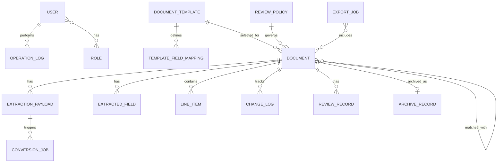

# SaiFlow — 数据模型

> 实体和字段的唯一事实来源。Cloud SQL 保存关系型业务投影；Firestore 保存不可变的 TextIn 原始 JSON 载荷。金额使用 `decimal(14,2)`（NFR-DATA-004）；时间戳使用 ISO-8601 UTC 或带偏移量的本地时间。

## 1. 实体关系概览

## 2. 实体

### 2.1 `DM-Document`

**用途：** 一份已上传的文档（或多页 PDF 的一页）的 Cloud SQL 关系记录。

| 字段 | 类型 | 必填 | 约束 | 示例 | 说明 |
|------|------|:----:|------|------|------|
| id | uuid | Y | PK | 3f9a… | |
| doc_type | enum DocumentType | Y | 见第 3 节 | DELIVERY_NOTE | FR-OCR-001 |
| status | enum DocStatus | Y | 见第 3 节 | in_review | 生命周期 |
| original_file_uri | string | Y | 不可变 GCS URI | gs://<bucket>/documents/…/original/… | 双重存储 |
| derivative_file_uri | string | N | GCS URI | gs://<bucket>/documents/…/derived/… | 预处理图像 |
| source_channel | enum | Y | camera/scan/file/email/portal/api | camera | |
| upload_user_id | uuid | Y | FK→User | | |
| template_id | uuid | N | FK→DocumentTemplate | | 转换所选模板 |
| template_version | integer | N | ≥ 1 | 3 | 固定用于该文档的模板版本 |
| enterprise_name | string | N | | ACME Co. | 交易对手 |
| doc_number | string | N | len ≤ 64 | INV-2026-001 | 特定类型编号 |
| doc_date | date | N | | 2026-09-10 | 已标准化 |
| total_amount | decimal(14,2) | N | ≥ 0 | 12500.00 | THB |
| amount_mismatch | boolean | Y | 默认 false | false | FR-OCR-013 |
| needs_review | boolean | Y | 默认 false | true | FR-OCR-015 |
| confidence_avg | decimal(3,2) | N | 0.00–1.00 | 0.91 | 汇总值 |
| created_at / updated_at | timestamptz | Y | | | |

**状态（`DocStatus`）：** `uploaded → preprocessed → extraction_requested → payload_stored → converting → extracted → in_review → verified → pending_review_level_1 → pending_review_level_2 → approved_for_business → entered → archived`（另有 `failed`）。复核策略为 `0` 时，核验确认后直接进入 `approved_for_business`；复核策略为 `1` 或 `2` 时，必须经最终复核通过。

### 2.2 `DM-ExtractionPayload`

**用途：** Firestore `extraction_payloads/{payload_id}` 中的原始 TextIn 响应及其关联元数据（FR-OCR-018）。这不是 Cloud SQL 关系表；其字段定义在此处以维持跨存储一致性。

| 字段 | 类型 | 必填 | 约束 | 说明 |
|------|------|:----:|------|------|
| id | uuid | Y | Firestore 文档 ID | 载荷唯一标识 |
| document_id | uuid | Y | 对应 `DM-Document.id` | 关联文档 |
| payload_version | integer | Y | 每文档递增，≥ 1 | 幂等键的一部分 |
| provider | string | Y | `textin` | OCR 服务提供方 |
| provider_request_id | string | N | 供应商请求/任务标识 | 排障与审计 |
| template_id / template_version | uuid / integer | Y | 已发布模板版本 | 固定映射版本 |
| raw_json | map | Y | 完整原始响应 | 不得由转换过程修改 |
| status | enum ExtractionPayloadStatus | Y | 见第 3 节 | 载荷处理状态 |
| error_code / error_message | string | N | 本地化前的技术错误 | 失败诊断 |
| created_at / processed_at | timestamptz | Y / N | | 创建与完成时间 |

### 2.3 `DM-ConversionJob`

**用途：** Cloud SQL 中记录一次原始载荷到关系投影的转换、重试和幂等结果（FR-OCR-019/020）。

| 字段 | 类型 | 必填 | 约束 | 说明 |
|------|------|:----:|------|------|
| id | uuid | Y | PK | |
| document_id | uuid | Y | FK→Document | |
| payload_id | uuid | Y | Firestore 载荷 ID | |
| payload_version | integer | Y | 与载荷匹配 | |
| template_id / template_version | uuid / integer | Y | 固定版本 | |
| idempotency_key | string | Y | unique；`document_id:payload_version` | 防止重复投影 |
| status | enum ConversionStatus | Y | 见第 3 节 | |
| attempt_count | integer | Y | 默认 0，≥ 0 | |
| error_code / error_message | string | N | | 失败诊断 |
| started_at / completed_at | timestamptz | N | | |
| created_at / updated_at | timestamptz | Y | | |

### 2.4 `DM-DocumentTemplate`

**用途：** 管理员维护的文档格式模板版本（FR-TEMPLATE-001、002、005、006）。

| 字段 | 类型 | 必填 | 约束 | 说明 |
|------|------|:----:|------|------|
| id | uuid | Y | PK | 模板族标识 |
| version | integer | Y | 每个 `id` 递增，≥ 1 | 不可变版本 |
| name | string | Y | len ≤ 128 | 管理界面显示名称 |
| doc_type | enum DocumentType | Y | | 适用表单类型 |
| textin_template_ref | string | N | 不含密钥 | TextIn 解析模板/服务参数引用 |
| status | enum TemplateStatus | Y | draft/published/disabled | |
| created_by / published_by | uuid | Y / N | FK→User | |
| created_at / published_at | timestamptz | Y / N | | |

> 发布后不能原地修改 `doc_type`、`version` 或映射；变更须创建新的草稿版本。一个 `doc_type` 可有多个已发布模板，但每次转换必须明确选择其具体版本。

### 2.5 `DM-TemplateFieldMapping`

**用途：** 模板的单字段或行项目 JSON 映射（FR-TEMPLATE-003/004）。

| 字段 | 类型 | 必填 | 约束 | 说明 |
|------|------|:----:|------|------|
| id | uuid | Y | PK | |
| template_id / template_version | uuid / integer | Y | FK→DocumentTemplate 版本 | |
| mapping_scope | enum | Y | document / line_item | 映射范围 |
| array_json_path | string | N | 仅 `line_item` 必填 | 行项目数组路径 |
| source_json_path | string | Y | 受支持 JSONPath | 源字段路径 |
| target_field_key | string | Y | 规范字段或行项目列 | 目标字段 |
| data_type | enum | Y | string/decimal/date/boolean | 目标转换类型 |
| required | boolean | Y | 默认 false | 必填校验 |
| normalization_rule | string | N | 受支持规则标识 | 日期、数字、货币等 |
| position | integer | Y | ≥ 1 | 稳定排序 |

### 2.6 `DM-ExtractedField`

**用途：** 单个已识别字段及其来源和置信度。

| 字段 | 类型 | 必填 | 约束 | 示例 |
|------|------|:----:|------|------|
| id | uuid | Y | PK | |
| document_id | uuid | Y | FK→Document | |
| field_key | string | Y | 见 EPIC-02 第 3 节 | receiving_enterprise |
| value | string | N | 已标准化 | "บริษัท เอบีซี จำกัด" |
| raw_text | string | N | 原始文字系统 | "บจก.เอบีซี" |
| confidence | decimal(3,2) | Y | 0.00–1.00 | 0.87 |
| source_bbox | json | N | {x,y,w,h} | {"x":120,"y":40,"w":300,"h":24} |
| needs_review | boolean | Y | 默认 false | false |
| verified | boolean | Y | 默认 false | true |

### 2.7 `DM-LineItem`

**用途：** 文档项目表中的一行（FR-OCR-010）。

| 字段 | 类型 | 必填 | 约束 | 示例 |
|------|------|:----:|------|------|
| id | uuid | Y | PK | |
| document_id | uuid | Y | FK→Document | |
| line_no | integer | Y | ≥ 1 | 1 |
| product_name | string | N | | "Widget A" |
| product_code | string | N | | SKU-1001 |
| quantity | decimal(12,3) | N | ≥ 0 | 10.000 |
| unit_price | decimal(14,2) | N | ≥ 0 | 100.00 |
| line_total | decimal(14,2) | N | 计算值 | 1000.00 |
| discount | decimal(14,2) | N | ≥ 0 | 0.00 |
| tax_amount | decimal(14,2) | N | ≥ 0 | 70.00 |
| confidence | decimal(3,2) | Y | 0.00–1.00 | 0.93 |

### 2.8 `DM-ChangeLog`

**用途：** 对每个字段修改的仅可追加审计记录（FR-VERIFY-007）。

| 字段 | 类型 | 必填 | 说明 |
|------|------|:----:|------|
| id | uuid | Y | PK |
| document_id | uuid | Y | FK→Document |
| field_key | string | Y | 已变更的字段 |
| old_value / new_value | string | Y | 修改前/后 |
| user_id | uuid | Y | FK→User |
| timestamp | timestamptz | Y | |
| reason | string | N | 可选 |
| integrity_hash | string | Y | 防篡改证据 |

### 2.9 `DM-ReviewPolicy`

**用途：** 定义某类单据处理流程在数据正式进入业务流程前所需的固定复核级别（FR-VERIFY-010）。

| 字段 | 类型 | 必填 | 说明 |
|------|------|:----:|------|
| id | uuid | Y | PK |
| process_key | string | Y | 单据处理流程标识，例如 invoice_entry |
| review_level | smallint | Y | 仅允许 0、1 或 2 |
| scope | json | N | 适用单据类型、企业或业务范围 |
| configured_by | uuid | Y | FK→User；需要配置权限 |
| updated_at | timestamptz | Y | |

### 2.10 `DM-ReviewRecord`

**用途：** 记录一次固定层级复核决定（FR-VERIFY-011..013）。

| 字段 | 类型 | 必填 | 说明 |
|------|------|:----:|------|
| id | uuid | Y | PK |
| document_id | uuid | Y | FK→Document |
| review_level | smallint | Y | 仅允许 1 或 2 |
| reviewer_id | uuid | Y | FK→User |
| decision | enum | Y | approved / rejected |
| comment | string | N | 复核意见 |
| reviewed_at | timestamptz | Y | |
| integrity_hash | string | Y | 防篡改证据 |

### 2.11 `DM-ArchiveRecord`

**用途：** 双重存储归档的结果（FR-ENTRY-005..008）。

| 字段 | 类型 | 必填 | 说明 |
|------|------|:----:|------|
| id | uuid | Y | PK |
| document_id | uuid | Y | FK→Document |
| original_uri | string | Y | 不可变原始对象的 GCS URI |
| data_uri | string | Y | 结构化数据或导出工件的 GCS URI |
| archive_prefix | string | Y | 分类 GCS 对象前缀 |
| file_name | string | Y | 按命名规则 |
| storage_mode | enum | Y | gcs |
| archived_at | timestamptz | Y | |

### 2.12 `DM-ExportJob`

**用途：** 一次导出/录入至 Excel/CSV/JSON/ERP 的操作（EPIC-04）。

| 字段 | 类型 | 必填 | 说明 |
|------|------|:----:|------|
| id | uuid | Y | PK |
| format | enum | Y | xlsx/csv/json/erp_api |
| document_ids | uuid[] | Y | 包含的文档 |
| template_id | string | N | 所用 Excel 模板 |
| save_path | string | N | 自定义路径 |
| status | enum | Y | pending/running/done/failed |
| created_by | uuid | Y | FK→User |

### 2.13 `DM-User`、`DM-Role`、`DM-OperationLog`、`DM-Settings`（EPIC-06）

| 实体 | 关键字段 |
|------|----------|
| `DM-User` | id、username、password_hash、status(active/locked)、line_provider(line/guest)、display_name（取自 LINE，可改）、avatar_url（text：仅外部 https 头像 URL，如 LINE）、avatar_path（Firebase Storage 头像对象名 `avatars/<user_id>/<name>.<ext>`，优先于 avatar_url；图片不入库）、phone（取自 LINE，只读）、email（取自 LINE 或注册时录入，经验证码更换）、registered_at（null = 未完成注册信息录入）、prefs(json)、created_at |
| `DM-EmailVerificationCode` | id、user_id、email（目标新邮箱）、code_hash（sha256）、expires_at（10 分钟）、consumed_at、created_at |
| `DM-Role` | id、name(clerk/finance/warehouse/reviewer/viewer/admin)、permissions(json) |
| `DM-OperationLog` | id、user_id、action、target_type、target_id、result、timestamp |
| `DM-Settings` | key、value(json)、scope(system/user)、updated_by、updated_at |

> `line_provider = guest` 表示游客试用会话，不是正式角色；登录/注册后其名下全部关联记录（含配额消耗/返还流水）改挂正式用户，游客的首登赠送流水、会话、验证码与 `users` 行在同一事务内删除。

### 2.14 `DM-ResultVersion`（结果版本快照）

**用途：** 保存一次识别任务的结构化结果快照，供核验编辑、最终结果查看与 Excel 导出（FR-VERIFY-015、FR-ENTRY-015）。

| 字段 | 类型 | 必填 | 约束 | 说明 |
|------|------|:----:|------|------|
| id | uuid | Y | PK | |
| job_id | uuid | Y | FK→识别任务 | 同一任务内版本唯一 |
| version | integer | Y | ≥ 1；`(job_id, version)` 唯一 | 乐观并发版本号 |
| is_current | boolean | Y | 每任务仅一条为 true | 当前版本标记 |
| structured | json | N | ≤ 2 MB | Prompt 模式结构化字段/表格 |
| created_by_user_id | uuid | N | FK→User | 游客编辑时可为游客用户 |
| created_at | timestamptz | Y | | |

> 每次结构化结果保存都会新增一个 `DM-ResultVersion`，旧版本 `is_current = false` 但保留为历史快照；逐页任务的页面结果按版本归属保存，编辑不覆盖原始识别输出。

**结构化数组编辑（FR-VERIFY-002/015）：** `structured` 中电话号码等标量数组叶字段（含表格单元格）保留 JSON 数组类型。数组元素按原字段路径追加索引（`path + [index]`）接收 `string` 编辑值，仅替换对应元素；数组顺序、长度及所有未编辑元素保持不变，不转成逗号或换行分隔字符串，不修改旧版本快照。单一字符串电话号码仍按标量字段编辑，确认锁定后只读；本修复不改变确认、认证或订阅流程。

**LINE 客户端确认前流转（FR-VERIFY-016/017、FR-SYS-011/012）：** 结果页 `Continue` 先检查认证、注册完成状态与任务所属工作空间的订阅。游客或未完成注册者进入 `auth`；已注册 Free/NONE 用户进入 `plans`；无已开通付费套餐的 PENDING 用户进入 `plan-pending`，均不提交确认。重定向前仅在结构化内容有未保存变更时，以现有 PATCH 结果操作的 `confirm: false` 保存新版本；无变更不保存，不锁定结果、不记录 `ocr_jobs.completed_at`，未确认任务保持 `VERIFYING`。仅已注册且订阅 ACTIVE 的用户（含另有更高档升级申请处理中）可在结果页显式提交 `confirm: true`，成功后进入最终结果页。登录/注册或套餐可用性恢复后，ACTIVE 的未完成任务须返回结果页等待显式确认，只有已为 `COMPLETED` 的任务可直接进入最终结果页。历史 `VERIFIED` 表示已确认但 `completed_at` 为空，继续兼容且不批量转换；仅已注册付费用户可在结果页显式继续完成。此规则限定 LINE 客户端流转，不新增服务端授权规则或改变 API 契约。

## 3. 枚举

| 枚举 | 值 |
|------|----|
| `DocumentType` | PO、DELIVERY_NOTE、DELIVERY_INSTRUCTION、INVOICE、RECEIPT、CREDIT_NOTE、TAX_RECEIPT、BILL |
| `DocStatus` | uploaded、preprocessed、extraction_requested、payload_stored、converting、extracted、in_review、verified、pending_review_level_1、pending_review_level_2、approved_for_business、entered、archived、failed |
| `ExtractionPayloadStatus` | stored、conversion_pending、converted、failed |
| `ConversionStatus` | pending、running、succeeded、failed、retrying |
| `TemplateStatus` | draft、published、disabled |
| `MappingScope` | document、line_item |
| `ReviewDecision` | approved、rejected |
| `StorageMode` | gcs |
| `ExportFormat` | xlsx、csv、json、erp_api |
| `Role` | clerk、finance、warehouse、reviewer、viewer、admin |

## 4. 字段到文档类型的映射

每种文档类型的规范 `field_key` 值列于 `EPIC-02` 第 3 节，并作为 `DM-ExtractedField.field_key` 存储。模板仅将外部 JSON 映射至这些既定规范字段；新字段须先经需求与数据模型变更，不得由模板任意创建。

## 5. 数据保留与隐私

- Cloud SQL、Firestore 和私有 GCS 对象采用静态加密。
- Firestore `raw_json` 是可追溯原始记录；转换、核验和重试均不得覆盖它。
- 保留/删除策略可配置（NFR-DATA-003；PRD OQ-4 / PDPA）；删除须同时协调 GCS、Firestore 和 Cloud SQL，并记录审计日志。
- `original_file_uri` 指向 GCS 中不可变的原始字节；浏览器客户端永远不会获得 GCS、Firestore、Cloud SQL 或 TextIn 凭据。

## 链接

- OCR 需求：`docs/20-requirements/functional/EPIC-02-ocr-recognition.md`
- 模板需求：`docs/20-requirements/functional/EPIC-08-document-template-configuration.md`
- API：`docs/30-design/API-Spec.md`

## 版本历史

| 版本 | 日期 | 作者 | 变更 |
|------|------|------|------|
| 1.5.4 | 2026-10-18 | Product Engineering | FR-VERIFY-002/015 修复说明：structured 标量数组按索引编辑，保留数组、顺序、长度及未编辑元素，不转为拼接字符串或覆盖旧快照 |
| 1.5.3 | 2026-10-18 | Product Engineering | 补充 LINE 客户端确认前认证/工作空间订阅检查、仅变更草稿保存与显式完成规则；恢复未完成任务返回结果页，保留历史 VERIFIED；不新增服务端授权或改变 API 契约（FR-VERIFY-016/017、FR-SYS-011/012） |
| 1.5.2 | 2026-10-18 | Product Engineering | 游客归集后删除游客 `users` 行，配额流水随任务改挂正式用户（FR-SYS-010） |
| 1.5.1 | 2026-10-18 | Product Engineering | DM-User 新增 avatar_path：上传头像存 Firebase Storage，avatar_url 仅存外部 https URL |
| 1.5.0 | 2026-10-17 | Product Engineering | DM-User 新增 phone、email、registered_at，avatar_url 改为 text；新增 DM-EmailVerificationCode（FR-SYS-014/015/016） |
| 1.4.0 | 2026-10-17 | Product Engineering | 新增结果版本快照实体与游客会话字段，明确游客数据归集 |
| 1.3.0 | 2026-10-07 | Product Engineering | 新增 Firestore 原始载荷、转换任务、文档模板和 JSON 映射实体及状态 |
| 1.2.0 | 2026-10-06 | Product Engineering | 新增固定层级复核策略/记录实体及复核状态；不引入 Workflow Engine 数据模型 |
| 1.1.1 | 2026-10-02 | Product Engineering | 将人类可读内容翻译为简体中文 |
| 1.1.0 | 2026-10-01 | Product Engineering | 将对象存储字段改为私有 GCS URI，并明确 Cloud SQL/GCS 隐私边界 |
| 1.0.0 | 2026-09-10 | Product Engineering | 文档、字段、行项目、归档和用户的初始数据模型 |
