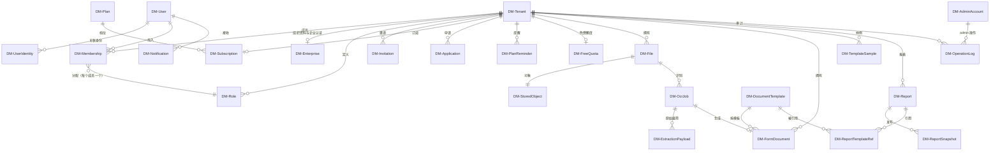

# SaiFlow — 数据模型

> **本文件只描述实体层**：实体、用途、存储位置、归属、关键关系与生命周期。**字段级结构以代码为唯一来源**（ORM 模型 + Alembic 迁移；jsonb 字段内的结构以服务端模型为准），不在文档中重复（ADR-008、STD-004 规则 2）。存储位置以 [`adr/ADR-008-vps-docker-hosting.md`](./adr/ADR-008-vps-docker-hosting.md) 为准。v1 的字段级内容见 git tag `legacy-v1` 中的版本。
>
> 本文件仅在新增实体、实体更换存储位置、关系或生命周期变化时更新。

## 1. 实体关系概览

`DM-SystemSetting` 为全系统配置，不与租户关联，图中省略。

## 2. 实体清单

| 实体 ID | 用途 | 存储 | 归属 | 关键关系 | 生命周期 |
|---------|------|------|------|----------|----------|
| `DM-User` | 用户；内部唯一用户 ID | PostgreSQL | 全局 | 1:N 关联身份、成员关系、通知 | 游客 → 已注册；游客注册后数据归入个人租户 |
| `DM-UserIdentity` | 关联身份：LINE 身份 ID、邮箱、手机号、将来的 OAuth | PostgreSQL | 用户 | N:1 用户；同类身份全局唯一 | 绑定 → 验证（邮箱）→ 解绑 |
| `DM-Tenant` | 租户：业务数据的归属单位 | PostgreSQL | — | 1:N 成员关系、文件、表单文档；0..1 企业认证、订阅 | 游客临时 / 个人 / 组织；个人租户永久存在，数据不迁移；组织：建组织申请 → 平台 admin 批准后成立；启用 ↔ 停用（平台 admin） |
| `DM-Enterprise` | 组织的资料（名称、联系电话、地址）与企业认证（可选；法定名称、税号、注册地址；解锁的功能以后设计）；建组织申请与企业认证申请为其申请记录 | PostgreSQL | 租户（1:1） | 1:1 组织 | 认证：未认证 → 审核中 → 已认证 / 已驳回（admin 也可直接设定） |
| `DM-Membership` | 用户在租户中的成员关系 | PostgreSQL | 租户 | N:1 用户、N:1 租户、N:M 角色 | 加入 → 移除；个人租户只有本人 |
| `DM-Role` | 角色：owner、默认角色与 owner 自定义角色，由权限点组合 | PostgreSQL | 租户 | N:M 成员关系 | 创建 → 修改权限点 → 删除（owner 与默认角色不可删除） |
| `DM-Invitation` | 组织的一次性成员邀请（7 天有效，凭据只存摘要；受成员人数上限约束） | PostgreSQL | 租户 | N:1 组织 | 待接受 → 已接受 / 已过期 / 已撤销 |
| `DM-Plan` | 套餐目录：四档、每月扫描配额与成员人数上限（Kinder 固定 1）、按月价与按年价（泰铢，未设定 = 联系我们）、适用的租户类型 | PostgreSQL | 全局 | 1:N 订阅 | 四档固定；数值由平台 admin 修改，立即对已有订阅生效 |
| `DM-Subscription` | 订阅：档位、开通周期（按月 / 按年）、开始与结束时间、来源（自动开通 / admin 设定 / 批准申请）；每次变化留一段记录，当前订阅为正在生效或最近的一段 | PostgreSQL | 租户 | N:1 套餐；0..1 申请 | 个人与游客：建立时自动开通一个月 Kinder；组织：admin 开通；到期即停 |
| `DM-Application` | 续费与开通申请、建组织申请、企业认证申请（各有自己的记录） | PostgreSQL | 租户或用户 | N:1 目标租户 | 待审批 → 已批准 / 已驳回（同一对象同时最多一条待审批） |
| `DM-PlanReminder` | 提醒的发送记录：到期提醒、用量提醒、组织免费额度到期提醒；记录租户、类型与节点、对应的到期时间或自然月、收件人、时间与邮件结果（同一租户、类型、周期、节点只一次） | PostgreSQL | 租户 | N:1 租户、收件用户；1:1 站内通知 | 发送时写入；只回写邮件结果 |
| `DM-FreeQuota` | 一次性免费额度及其余量（OCR 扫描次数） | PostgreSQL | 租户（每个租户至多一份，个人租户在用户注册时发放；数量取系统参数；识别时先于月扫描配额扣减，PRD OQ-28） | 1:1 租户 | 个人：注册时发放，不过期，订阅到期期间暂停；组织：成立时发放，1 个月后作废 |
| `DM-Notification` | 站内通知：收件用户、所属租户、类型、相关数据、生成时间、已读时间 | PostgreSQL | 用户 | N:1 用户、N:1 租户 | 未读 → 已读；不删除 |
| `DM-File` | 文件元数据：原件、导入、导出、头像 | PostgreSQL | 租户 | 1:1 GCS 对象；1:N 识别任务 | 上传 → 删除（按保留策略） |
| `DM-OcrJob` | 识别任务：状态、页数、所用引擎；月扫描配额计量与调用观测的依据 | PostgreSQL | 租户 | N:1 文件；1:N 原始载荷；0..1 表单文档 | 排队 → 识别中 → 完成 / 失败 / 取消 |
| `DM-DocumentTemplate` | 文档格式模板及其版本；系统模板的可用范围由授权对象（套餐档位或点名租户/用户）决定 | PostgreSQL | 系统（平台 admin）、个人租户或组织租户 | 1:N 表单文档；1:N 授权对象；N:M 报表（引用） | 可编辑草稿（修订号）→ 生效为新的不可变版本 → 停用；被报表或识别结果引用时不可删除 |
| `DM-SystemSetting` | 系统参数：OCR 首选/备用引擎与切换参数、大模型配置引用、免费额度、各档成员人数上限、置信度阈值 | PostgreSQL | 全局（平台 admin 配置） | — | 修改时写操作日志；密钥本体在服务器环境变量文件中 |
| `DM-OperationLog` | 操作日志（审计） | PostgreSQL | 租户或平台 | N:1 操作者（用户或 admin 账号） | 仅追加 |
| `DM-AdminAccount` | 平台 admin 账号 | PostgreSQL（与客户账号分表隔离） | 平台 | 1:N 操作日志 | 启用 → 锁定 / 停用 |
| `DM-FormDocument` | 表单数据：每份单据一条，含结构化结果、结果版本、状态、核验修改记录与复核记录 | PostgreSQL：结构化结果（大模型按模板转换后的 JSON）用 jsonb，每个结果版本一份；结果版本、状态、核验与复核记录用普通字段与表 | 租户 | N:1 识别任务、模板版本 | 待核验 → 待复核 → 正式业务数据（同一单据的状态字段，OQ-21） |
| `DM-ExtractionPayload` | 原始识别载荷：OCR 引擎原始 JSON | PostgreSQL（jsonb） | 租户 | N:1 识别任务 | 按载荷版本不可变 |
| `DM-StoredObject` | 对象：原始单据、导入文件、导出文件、头像 | 私有 GCS | 租户 | 1:1 文件元数据 | 原件不可变；按保留策略删除 |
| `DM-TemplateMapping` | 一次模板匹配或结构化转换：所用模板版本（或通用结果）、来源（自动 / 用户选择）、状态、失败原因 | PostgreSQL | 租户 | N:1 识别任务、模板版本；1:0..1 结果版本 | 等待 → 匹配中 / 转换中 → 完成 / 失败；每份单据最多 5 次 |
| `DM-Export` | 一次 Excel 导出：所导出的结果版本、对象位置、到期时间（24 小时） | PostgreSQL + 私有 GCS（文件） | 租户 | N:1 识别任务、结果版本 | 生成 → 可下载 → 过期 |
| `DM-OcrEngineHealth` | 各 OCR 引擎的健康状态：连续失败次数、是否已切换到备用引擎、下次试探首选引擎的时间 | PostgreSQL | 全局 | — | 由识别服务更新；首选引擎恢复后切回 |
| `DM-TemplateSample` | 模板样例：从上传样例或已有识别结果生成模板定义的一次过程（进度、计量、候选定义）；敏感内容最长保留 7 天 | PostgreSQL + 私有 GCS（样例原件） | 租户或平台 admin（恰有一方） | N:0..1 识别任务（来源）；生成的定义保存为 `DM-DocumentTemplate` 草稿 | 排队 → 识别中 → 生成中 → 就绪 / 失败 / 取消；主动删除或 7 天到期清理原件与载荷 |
| `DM-Report` | 组织运营报表：可不完整的设计草稿（网格卡片配置）、修订号、当前发布指针；只存配置，不存统计结果 | PostgreSQL（配置为 jsonb） | 组织租户 | 1:N 发布快照；N:M 模板版本（引用） | 草稿 → 已发布（可再改草稿、再发布）→ 撤销发布 / 删除（软删除） |
| `DM-ReportSnapshot` | 报表发布快照：一次发布的不可变整页配置与版本号 | PostgreSQL（jsonb） | 组织租户（随报表） | N:1 报表 | 发布时写入，不可修改；新草稿不影响旧快照 |
| `DM-ReportTemplateRef` | 报表卡片对模板版本的引用（草稿 / 已发布两类），用于模板删除保护和原卡片历史授权延续；无卡片标识的兼容引用仅保护删除，不授予新绑定 | PostgreSQL | 组织租户（随报表） | N:1 报表、模板、模板版本 | 随保存草稿 / 发布重写；撤销发布、删除时移除 |

- 登录会话、邮箱验证码等短期技术数据不作为实体登记，设计见 B-2a 的 `openspec/changes/archive/2026-11-03-rebuild-identity/plan.md`。
- **`ocr-ui-parity`：** `DM-DocumentTemplate` 的字段与明细列可带“角色”（数量、单价、行金额、合计、税额等），供金额校验使用（迁移 0011 为两个系统模板写入新版本）；`DM-TemplateMapping` 保存每个模板的匹配度，自动匹配低于 70% 时记为“没有合适的模板”，结果按自由格式显示；按链接导入的文件与上传的文件同为 `DM-File`。
- **B-3 已实现（`ocr-scan-flow`）：** `DM-File`（上传的原件，24 小时内未完成的上传自动清理；同一文件同时只能有一个识别任务）、`DM-OcrJob`（状态与阶段：识别中、识别失败、模板匹配中、待核验、已确认）、`DM-ExtractionPayload`（原始识别载荷只可追加，应用账号不能修改或删除）、`DM-DocumentTemplate` 及其版本（两份系统模板 Tax Invoice 与 Billing Note 由迁移写入，字段名带英、泰、中三种语言）、`DM-TemplateMapping`、`DM-Export`、`DM-OcrEngineHealth`。`DM-FormDocument` 在 B-3 只实现结果版本（每次保存一个版本，确认后不可再改）；核验修改记录与复核随 B-4。原件、页面预览与导出文件存在私有 GCS 桶，由后端代为读取。
- **B-4 已实现（`review-flow`）：** 识别任务的复核状态增加待一级复核、待二级复核，“已确认”即正式业务数据（记录成为正式业务数据的时间）；`DM-ReviewPolicy` → 复核层级（组织 × 模板，“通用结果”单独一条，未设置为 0）与组织的“邮件通知复核人”开关；`DM-ReviewRecord` → 复核轮次（每次需要复核的确认一轮，记录层级、确认人、当前级别与一级复核人）与复核记录（每次通过或退回一条，不可修改）；`DM-ChangeLog` → 修改记录（每次保存一行，全部字段改动以 jsonb 保存；更换模板一行）；新增复核通知记录（每位收件人一条，记录邮件是否发送成功）。删除任务结果时，修改记录、复核轮次与复核记录一并删除。
- **B-5b 已实现（`web-admin-console`）：** `DM-SystemSetting` 增加 OCR 与大模型配置七项（首选引擎、备用引擎、单据重试次数、全局切换阈值、首选引擎试探间隔、大模型地址、模型名称），由迁移写入默认值，B-3 读取；修改时每项写一条操作日志；密钥（TextIn 两项、大模型）与 Document AI 的项目和处理器配置不入库（Document AI 使用 GCS 服务账号；`docai-backup-engine` 取代原 Google Cloud Vision 密钥），只在服务器环境变量文件中。
- **B-2d 已实现（`rebuild-notifications`）：** `DM-Notification` 与 `DM-PlanReminder`；提醒由独立的提醒进程定时产生，不写操作日志；两者都不随游客数据归集（游客不收提醒）。
- **B-2c 已实现（`rebuild-plans-metering`）：** `DM-Plan`、`DM-Subscription`（保留历史）、`DM-FreeQuota`、续费与开通申请；扫描次数的预占记录（所属租户、关联识别、次数、来自免费额度与月配额的拆分、预占与退还时间）按记录逐笔计算用量，不另记操作日志；这些记录都不随游客数据归集。`DM-PlanReminder` 随 B-2d（见上）。
- **B-2b 已实现（`rebuild-tenant-rbac`）：** `DM-Tenant` 增加组织；组织资料与企业认证存在组织上，建组织申请与企业认证申请各自留有申请记录；`DM-Membership` 每个成员一个角色，owner 不持有角色、拥有全部权限点，每个组织恰好一名 owner（可转让）；`DM-Role` 每个组织一个默认角色；`DM-Invitation` 只存凭据摘要；`DM-SystemSetting` 先有“组织开通套餐前的成员人数上限”一项。这些记录都不随游客数据归集。
- **B-2a 已实现（`rebuild-identity`）：** `DM-User`（LINE 身份 ID 与邮箱作为唯一的关联身份直接存在用户上，邮箱统一小写；手机号不要求唯一）；`DM-Tenant` 只有个人租户与游客临时租户两类（组织随 B-2b）；`DM-OperationLog` 仅可追加（数据库触发器禁止修改与删除），每条记录带前一条的校验值，服务器命令 `audit-verify` 检查是否被改动；`DM-AdminAccount` 口令为 argon2id 哈希，连续 5 次错误锁定 5 分钟（`line-result-table-admin-lock`，原 15 分钟）。`DM-UserIdentity` 在接入第三种身份（如 Google）时再拆成独立的表。
- **`template-report-management` 已实现：** 模板（迁移 0014、0016）——`DM-DocumentTemplate` 增加归属（系统 / 个人 / 组织）、可编辑草稿与修订号（保存与生效分离，生效生成新的不可变版本）、系统模板授权对象（`template_grant_targets`）；`DM-TemplateSample` 记录样例生成过程，客户样例按页计量，平台 admin 样例不扣客户配额；样例原件与载荷最长 7 天，不进入长期备份。报表（迁移 0015、0017）——`DM-Report`、`DM-ReportSnapshot`、`DM-ReportTemplateRef`；报表只存配置，每次打开或手动刷新都按发布快照对正式业务数据（已确认结果版本）在数据库内实时聚合，不保存统计结果、不跨用户缓存；CSV 下载凭证为签名令牌，不落库。
- 报表采用方式 A（实时查询正式业务数据）；方式 B 的报表汇总表（OQ-8）未实现，不登记实体。
- **`admin-impersonate-user`（迁移 0018）：** 平台 admin 以用户身份进入 web-pc 用的一次性票据（`impersonation_tickets`：只存摘要、60 秒、单次）与登录会话上的代登录标记（`customer_sessions.impersonated_by_admin_id`；闲置 30 分钟、最长 2 小时、管理员停用即失效）。二者同属短期技术数据，不登记实体；签发与进入记入 `DM-OperationLog`。
- **`customer-email-login`（迁移 0019）：** `DM-User` 增加可选的密码（argon2 哈希；8–64 位、至少一个字母和一个数字）、连续输错次数与锁定截止时间（错 5 次锁 5 分钟，锁定不影响邮箱验证码登录）；邮箱验证码增加用途（验证邮箱 / 登录 / 重置密码），不同用途的验证码互不通用。邮箱验证码仍属短期技术数据，不登记实体；密码登录、验证码登录、重置密码与锁定记入 `DM-OperationLog`。
- **`line-register-prefill`（无迁移）：** 未注册用户的 `DM-User.phone` 在 LINE 登录时取服务端验证的 LINE token 中的 `phone_number`（仅 LINE 批准的频道会下发），作为注册页手机号预填；token 未带手机号时保留原值，注册后不再被 LINE 覆盖。邮箱预填仍为 `line_email`（需频道 Email 权限与 LIFF `email` scope）。（VPS 本地 7 天、GCS 备份桶 30 天）是运维数据，不作为实体登记（ADR-008）。

### 2.1 v1 实体去向

`OCR-Pipeline.md`、`API-Spec.md` 与 `EPIC-*` 仍可能引用 v1 实体 ID，对照如下：

| v1 实体 | v3 去向 |
|---------|---------|
| `DM-Document` | `DM-File`（元数据）+ `DM-FormDocument`（表单数据） |
| `DM-ExtractionPayload` | 保留，改存 PostgreSQL jsonb（ADR-008） |
| `DM-ConversionJob` | 取消（不再有关系投影）；处理状态见 `DM-OcrJob` |
| `DM-TemplateFieldMapping` | 取消（JSONPath 映射由大模型结构化转换取代） |
| `DM-ExtractedField`、`DM-LineItem`、`DM-ResultVersion`、`DM-ChangeLog`、`DM-ReviewRecord` | 并入 `DM-FormDocument` |
| `DM-ReviewPolicy` | 复核层级（B-4，`review-flow`） |
| `DM-Settings` | `DM-SystemSetting` |
| `DM-ArchiveRecord`、`DM-ExportJob` | `DM-File` + `DM-StoredObject`（导出文件） |
| `DM-User`、`DM-Role`、`DM-OperationLog`、`DM-DocumentTemplate` | 保留 |

## 3. 枚举

只列产品级枚举的取值名称；代码中的取值以代码为准。

| 枚举 | 取值 |
|------|------|
| `DocumentType` | PO、DELIVERY_NOTE、DELIVERY_INSTRUCTION、INVOICE、RECEIPT、CREDIT_NOTE、TAX_RECEIPT、BILL |
| 表单状态 | 待核验、待复核（一级 / 二级）、正式业务数据 |
| 租户类型 | 游客、个人、团队 |
| 订阅状态 | 有效、已到期 |
| 开通周期 | 按月、按年 |
| 套餐档位 | Kinder < Starter < Intermediate < Advance |
| 权限点 | 上传与识别、核验与确认、核验他人单据、一级复核、二级复核、导出、数据浏览、成员管理、角色管理、套餐申请、企业认证申请、模板管理、报表管理、报表查看——见 PRD §4.9 与 FR-SYS-002 |

## 4. 数据保留与隐私

- 私有 GCS 对象启用静态加密；VPS 上数据库与备份文件的加密方式待 OQ-30（投产前关闭）。
- 原始识别载荷是可追溯的原始记录；转换、核验和重试均不得覆盖它。
- 保留/删除策略可配置（NFR-DATA-003；PRD OQ-4 / PDPA）；删除须同时协调 GCS 对象与数据库记录（含 GCS 备份桶中的旧备份按保留期自然过期），并记录操作日志。
- 原件在 GCS 中不可变；浏览器客户端永远不会获得 GCS、数据库、OCR 引擎或大模型凭据；对象下载只用后端签发的有时效签名 URL。

## 5. 数据库账号与权限

- schema `saiflow_v3` 及其中所有对象归迁移账号所有，结构只由迁移变更。
- 应用运行账号只有各表的读、插入、修改、删除权限；对操作日志只能读取与追加，不能修改、删除、清空，也不能停用或删除其防改动保护（NFR-SEC-003、NFR-SEC-004，AC-FR-SYS-003-06）。
- 账号的名称与建立方式见 `docs/deployment/README.md` §3.1。

## 链接

- 存储边界：[`adr/ADR-008-vps-docker-hosting.md`](./adr/ADR-008-vps-docker-hosting.md)（取代 [`ADR-007`](./adr/ADR-007-v3-storage-boundary.md)）
- 架构：[`Architecture.md`](./Architecture.md)
- PRD：[`../10-product/PRD-SaiFlow.md`](../10-product/PRD-SaiFlow.md)
- 术语：[`../10-product/Glossary.md`](../10-product/Glossary.md)

## 版本历史

| 版本 | 日期 | 作者 | 变更 |
|------|------|------|------|
| 2.16.0 | 2026-11-15 | Product Engineering | `docai-backup-engine`：`DM-SystemSetting` 的 Vision 密钥改为 Document AI 配置；迁移 0020 把已保存的引擎 google_vision 改为 google_docai，任务与原始载荷的 google_vision 历史记录保留，`DM-OcrEngineHealth` 只跟踪 textin、google_docai |
| 2.15.2 | 2026-11-13 | Product Engineering | `line-register-prefill`：未注册 `DM-User.phone` 预填取自服务端验证的 LINE `phone_number`（结构不变） |
| 2.15.1 | 2026-11-13 | Product Engineering | `line-result-table-admin-lock`：`DM-AdminAccount` 连续 5 次错误锁定改为 5 分钟（与客户账号相同；结构不变） |
| 2.15.0 | 2026-11-13 | Product Engineering | `customer-email-login`：用户密码、错误次数与锁定；邮箱验证码用途（迁移 0019） |
| 2.14.0 | 2026-11-12 | Product Engineering | `admin-impersonate-user`：代登录票据与会话代登录标记（短期技术数据，不登记实体） |
| 2.13.0 | 2026-11-11 | Product Engineering | `template-report-management`：模板归属、草稿与修订号、系统模板授权、`DM-TemplateSample`；报表 `DM-Report`、`DM-ReportSnapshot`、`DM-ReportTemplateRef`（只存配置，实时查询正式业务数据） |
| 2.12.0 | 2026-11-07 | Product Engineering | `review-flow`：复核层级、复核轮次与记录、修改记录（jsonb）、复核通知记录；识别任务的复核状态与正式业务数据时间 |
| 2.11.0 | 2026-11-06 | Product Engineering | `ocr-ui-parity`：模板字段角色（金额校验）、匹配度与“没有合适的模板”、按链接导入 |
| 2.10.0 | 2026-11-06 | Product Engineering | 按 B-3：新增 `DM-TemplateMapping`、`DM-Export`、`DM-OcrEngineHealth`；记录 B-3 已实现的范围（文件、识别任务、原始载荷、模板、结果版本） |
| 2.9.0 | 2026-11-06 | Product Engineering | 按 B-5b：`DM-SystemSetting` 的 OCR 与大模型配置七项；密钥只在服务器环境变量文件中 |
| 2.8.0 | 2026-11-05 | Product Engineering | 按 B-5a：`DM-Plan` 增加按月价与按年价 |
| 2.7.0 | 2026-11-05 | Product Engineering | 按 B-2d：`DM-PlanReminder` 覆盖三类提醒并改为归属租户；`DM-Notification` 不删除；记录 B-2d 已实现的范围 |
| 2.6.0 | 2026-11-05 | Product Engineering | 按 B-2c：套餐、订阅（含历史）、免费额度（个人与组织）、申请与预占记录；记录 B-2c 已实现的范围 |
| 2.5.0 | 2026-11-04 | Product Engineering | 按 PRD v3.4：团队租户改称组织，取消原地升级；`DM-Enterprise` 改为组织资料与企业认证；每个成员一个角色；记录 B-2b 已实现的实体范围 |
| 2.4.0 | 2026-11-04 | Product Engineering | 新增 §5 数据库账号与权限：结构归迁移账号，应用账号最小权限 |
| 2.3.0 | 2026-11-03 | Product Engineering | §2 记录 B-2a 已实现的实体范围：用户与关联身份、个人与游客租户、操作日志校验链、平台 admin 账号 |
| 2.2.0 | 2026-11-02 | Product Engineering | 按 ADR-008：Cloud SQL 与 Firestore 合并为 PostgreSQL；DM-ExtractionPayload 与 DM-FormDocument 的结构化结果用 jsonb，版本、状态、核验与复核记录用普通字段；报表方式 B 改为 PostgreSQL 内汇总表；静态加密与删除协调改写；实体数不变（22） |
| 2.1.0 | 2026-10-30 | Product Engineering | 按 PRD v3.2：企业租户改称团队租户、企业认证改为可选；新增 DM-FreeQuota（归属租户；共 22 个实体）；个人租户原地升级为团队租户；订阅状态去掉“未开通”；订阅含开通周期；提醒记录含用量提醒；系统参数含成员人数上限 |
| 2.0.0 | 2026-10-30 | Product Engineering | 改为实体层（字段以代码为唯一来源）；按 ADR-007 的 v3 存储边界重列 21 个实体并给出 v1 实体去向；枚举只保留产品级取值；旧字段级内容见 tag legacy-v1 |
| 1.6.0 | 2026-10-28 | Product Engineering | 归属改为单一 `tenant_id`：新增 `tenants` 表与 `enterprises.tenant_id` / `verified_at`，files/ocr_jobs/memberships/invitations 改挂 `tenant_id`、applications 改为 `target_tenant_id`，保留 `error.invalid_workspace` / `error.enterprise_access_revoked` 等旧 message_key；新增 `subscriptions`（一租户一行，默认一个月 Kinder、月末夹取、审批惰性续期）与 `plan_reminders`（`uq_plan_reminder_stage` 幂等、不回补节点）；删除 `quota_ledger` 与赠送任务额度、取消 FREE 档与 `free_tasks`/`paid_pages`/`OCR_TASK` 计量，改为按泰国自然月实时统计 `ocr_jobs.page_count`；`users.phone` 在个人中心可改（原「只读」表述作废）；补记无 Alembic、ADD COLUMN 与 `setup_db.py` 重建的 schema 落地方式。未运行测试 |
| 1.5.8 | 2026-10-27 | Product Engineering | FR-SYS-001/010..014/017、FR-VERIFY-016/017：更新为已真实实现、隔离验证通过并正式发布，334 项后端、final index-BUTDgRGj.js 的 21 项全 mock 浏览器、6 项 OAuth 源码模拟、9 项会话边界及类型检查/Vite 构建/OpenAPI 283 个内部引用通过；registered_at 动态默认 Kinder 每泰国月 1,000 页，无新增 schema/默认申请/付款/历史迁移；发布引用 Architecture §5/§6，历史 221/5 与 SMTP 接收非本轮证据，SMTP 模块/秘密版本引用不变、本轮未实发邮件，隔离不连接数据库/真实 LINE/SMTP、不创建生产账户；真实 LINE/收件箱/数据库并发/防猜码仍未验证，原业务规则不变 |
| 1.5.7 | 2026-10-27 | Product Engineering | FR-SYS-010..014/017、FR-VERIFY-016/017：补充动态 DEFAULT ACTIVE KINDER 与 APPROVED 优先、pending 独立、OCR_PAGE/月 paid_pages 和 OCR_TASK 赠送隔离；企业不继承个人默认；确认注册门禁须在版本/完成状态写入前拒绝，认证成功仅回 result、取消保留归集权限、legacy VERIFIED 显式完成；无新增字段或 schema 迁移，本轮待验证，SMTP/锁历史证据不覆盖本轮 |
| 1.5.6 | 2026-10-27 | Product Engineering | FR-SYS-014：补充登录刷新已有用户时的注册状态锁定/重读，与注册串行避免资料覆盖；221 项隔离测试及 SMTP 自测接收已核验，发布和真实 LINE/数据库并发、防猜码验证边界见 Architecture §6；无模型字段或 schema 变更 |
| 1.5.5 | 2026-10-27 | Product Engineering | FR-SYS-014：phone 注册时可编辑/手填保存且仍可选，个人中心只读；email 默认取服务端验证的 LINE token（email scope/用户授权），可编辑且必填；明确注册/换邮箱验证码共用模型及 SMTP 成功后记有效码、TTL/重发/消费/失败规则；本次验证与发布未完成，保留历史 |
| 1.5.4 | 2026-10-18 | Product Engineering | FR-VERIFY-002/015 修复说明：structured 标量数组按索引编辑，保留数组、顺序、长度及未编辑元素，不转为拼接字符串或覆盖旧快照 |
| 1.5.3 | 2026-10-18 | Product Engineering | 补充 LINE 客户端确认前认证/工作空间订阅检查、仅变更草稿保存与显式完成规则；恢复未完成任务返回结果页，保留历史 VERIFIED；不新增服务端授权或改变 API 契约（FR-VERIFY-016/017、FR-SYS-011/012） |
| 1.5.2 | 2026-10-18 | Product Engineering | 游客归集后删除游客 `users` 行，配额流水随任务改挂正式用户（FR-SYS-010） |
| 1.5.1 | 2026-10-18 | Product Engineering | DM-User 新增 avatar_path：上传头像存 Firebase Storage，avatar_url 仅存外部 https URL |
| 1.5.0 | 2026-10-17 | Product Engineering | DM-User 新增 phone、email、registered_at，avatar_url 改为 text；新增 DM-EmailVerificationCode（FR-SYS-014/015/016） |
| 1.4.0 | 2026-10-17 | Product Engineering | 新增结果版本快照实体与游客会话字段，明确游客数据归集 |
| 1.3.0 | 2026-10-07 | Product Engineering | 新增 Firestore 原始载荷、转换任务、文档模板和 JSON 映射实体及状态 |
| 1.2.0 | 2026-10-06 | Product Engineering | 新增固定层级复核策略/记录实体及复核状态；不引入 Workflow Engine 数据模型 |
| 1.1.1 | 2026-10-02 | Product Engineering | 将人类可读内容翻译为简体中文 |
| 1.1.0 | 2026-10-01 | Product Engineering | 将对象存储字段改为私有 GCS URI，并明确 Cloud SQL/GCS 隐私边界 |
| 1.0.0 | 2026-09-10 | Product Engineering | 文档、字段、行项目、归档和用户的初始数据模型 |
