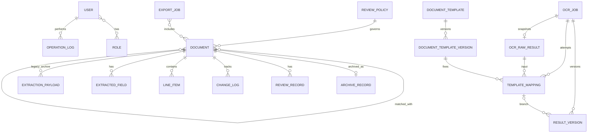

# SaiFlow — 数据模型

> 本期模板映射实体依据已批准 document-template-mapping v2（R1–R6），见 §2.4/2.5/2.14 与 [ADR-006](adr/ADR-006-relational-template-storage.md)。Flask-SQLAlchemy 使用 Cloud SQL PostgreSQL 18.6（saiflow-dev / postgres.saiflow）的 json，非 jsonb，保留键顺序。既有 Firestore 完整 TextIn 响应归档仍合法，与新增 llm_json 关系型快照不同；其余文档/业务投影实体是历史目标设计，不表示当前 ORM 全部落地。旧 decimal(14,2) 约束不覆盖新模板 decimal/amount 字符串（不舍入）；NFR 适用边界仍需同步。当前 ORM 时间戳为无时区 timestamp、写 UTC，对外 ISO-8601。2026-10-31 共享库仅 transaction_read_only=on 下 SELECT，重复当前版本任务数 0，无 DDL/写入；隔离后端验证及未运行的真实基线见 [汇总验收](../40-acceptance/Acceptance-Criteria.md)。本地与线上共享数据库，TEMPLATE_MAPPING_ENABLED 默认关闭且本地保持关闭；共享库 seed 与部署未授权。

## 1. 实体关系概览

## 2. 实体

### 2.1 `DM-Document`

**用途：** 一份已上传的文档（或多页 PDF 的一页）的 Cloud SQL 关系记录。

| 字段 | 类型 | 必填 | 约束 | 示例 | 说明 |
|------|------|:----:|------|------|------|
| id | uuid | Y | PK | 3f9a… | |
| doc_type | enum DocumentType | Y | 见第 3 节 | DELIVERY_NOTE | FR-OCR-001 |
| status | enum DocStatus | Y | 见第 3 节 | in_review | 生命周期 |
| original_file_uri | string | Y | 不可变 GCS URI | gs://<bucket>/documents/…/original/… | 双重存储 |
| derivative_file_uri | string | N | GCS URI | gs://<bucket>/documents/…/derived/… | 预处理图像 |
| source_channel | enum | Y | camera/scan/file/email/portal/api | camera | |
| upload_user_id | uuid | Y | FK→User | | |
| template_id | uuid | N | FK→DocumentTemplate | | 转换所选模板 |
| template_version | integer | N | ≥ 1 | 3 | 固定用于该文档的模板版本 |
| enterprise_name | string | N | | ACME Co. | 交易对手 |
| doc_number | string | N | len ≤ 64 | INV-2026-001 | 特定类型编号 |
| doc_date | date | N | | 2026-09-10 | 已标准化 |
| total_amount | decimal(14,2) | N | ≥ 0 | 12500.00 | THB |
| amount_mismatch | boolean | Y | 默认 false | false | FR-OCR-013 |
| needs_review | boolean | Y | 默认 false | true | FR-OCR-015 |
| confidence_avg | decimal(3,2) | N | 0.00–1.00 | 0.91 | 汇总值 |
| created_at / updated_at | timestamptz | Y | | | |

**状态（`DocStatus`）：** `uploaded → preprocessed → extraction_requested → payload_stored → converting → extracted → in_review → verified → pending_review_level_1 → pending_review_level_2 → approved_for_business → entered → archived`（另有 `failed`）。复核策略为 `0` 时，核验确认后直接进入 `approved_for_business`；复核策略为 `1` 或 `2` 时，必须经最终复核通过。

### 2.2 `DM-ExtractionPayload`

**用途：** 保留历史 Firestore `extraction_payloads/{payload_id}` 完整 TextIn 响应归档定义；不是 Cloud SQL 表，也不是新 FR-OCR-018 的自动匹配输入/触发源。旧字段及已发布模板关联只描述历史设计。新 FR-OCR-021 的 llm_json 快照见 §2.5，不迁移或全局删除历史归档。

| 字段 | 类型 | 必填 | 约束 | 说明 |
|------|------|:----:|------|------|
| id | uuid | Y | Firestore 文档 ID | 载荷唯一标识 |
| document_id | uuid | Y | 对应 `DM-Document.id` | 关联文档 |
| payload_version | integer | Y | 每文档递增，≥ 1 | 幂等键的一部分 |
| provider | string | Y | `textin` | OCR 服务提供方 |
| provider_request_id | string | N | 供应商请求/任务标识 | 排障与审计 |
| template_id / template_version | uuid / integer | Y | 已发布模板版本 | 固定映射版本 |
| raw_json | map | Y | 完整原始响应 | 不得由转换过程修改 |
| status | enum ExtractionPayloadStatus | Y | 见第 3 节 | 载荷处理状态 |
| error_code / error_message | string | N | 本地化前的技术错误 | 失败诊断 |
| created_at / processed_at | timestamptz | Y / N | | 创建与完成时间 |

### 2.3 `DM-ConversionJob`（历史设计）

旧事件投影设计曾使用载荷版本幂等键及 Cloud Functions 转换任务；不作为新 FR-OCR-018..021 的实体。本期映射尝试使用 §2.5 `template_mappings`，不引入事件函数或 Firestore 迁移。

### 2.4 `DM-DocumentTemplate` 与不可变版本

**用途：** 后台 CLI 维护模板族及 append-only 内容版本（FR-TEMPLATE-001..005、007；管理 UI 006 为 P1）。以下是当前 Flask-SQLAlchemy 列定义的设计映射，不表示共享数据库已建表或验收。

| `document_templates` 字段 | SQL 类型 | 约束/含义 |
|---|---|---|
| id | bigint | 自增 PK |
| tenant_id | bigint nullable | FK→tenants.id；NULL=系统模板，非空=租户模板 |
| code | varchar(64) | `^[a-z0-9][a-z0-9._-]{0,63}$` |
| name | varchar(100) | 当前列表显示名快照 |
| status | varchar(16) | ENABLED / DISABLED |
| current_version_id | bigint nullable | 当前版本逻辑引用；不设 FK 以避免循环 |
| deleted_at | timestamp nullable | 软删除 |
| created_at / updated_at | timestamp | UTC |

未删除的同作用域 code 唯一：`(COALESCE(tenant_id,0), code) WHERE deleted_at IS NULL`。系统模板供所有租户只读使用；租户模板仅本租户可用。新选择仅使用启用、未删除模板的当前版本；已有映射保留历史版本。

| `document_template_versions` 字段 | SQL 类型 | 约束/含义 |
|---|---|---|
| id | bigint | 自增 PK |
| template_id | bigint | FK→document_templates.id |
| version | integer | ≥1；`(template_id,version)` 唯一 |
| name / description | varchar(100) / text | 一个显示名；模板描述 ≤1000 字符 |
| groups | json | 有序分组、字段、表格及列的完整描述快照 |
| content_hash | varchar(64) | 规范化 name+description+groups 的 SHA-256 |
| created_at | timestamp | UTC |

版本只增不改，无 draft/publish。重复导入哈希不变时无数据变更、版本或审计；变化时追加版本并更新 current_version_id。停用/删除/升版不改写已引用版本。内部快照保留各层完整 description，仅模型匹配/转换使用；GET 版本对前端裁剪描述，没有公开 description 需求，不改变数据库快照。字段/列的四类型已在 API YAML 与 JSON 镜像对齐。初始种子仅 system.billing_note 和 system.tax_invoice（含税务发票/送货单合并），已获业务批准并经正式 CLI validate 均通过；共享库 seed 未授权。

### 2.5 模板 schema、`DM-OcrRawResult` 与 `DM-TemplateMapping`

模板文件 `{code,name,description,groups}`；每组 `{key,name,description,items}`。field 项 `{kind:"field",key,name,description,type,required?}`；table 项 `{kind:"table",key,name,description,columns}`；列 `{key,name,description,type,required?}`。数组顺序就是显示/导出顺序。type 仅 string / integer / decimal / amount，默认 string；required 默认 false。日期仍为字符串，不做佛历转换。无 doc_type、供应商参数、源路径、计算规则、可配置标准化规则或主要字段。

key 匹配 `^[a-z][a-z0-9_]{0,63}$`：组在模板内唯一，字段/表格在组内共享命名空间，列在表内唯一。至少一组、每组一项、每表一列；最多20组、字段+列200、表格10；各级 name ≤100、description ≤500（模板级1000）。校验一次返回所有带路径错误，写库前失败（FR-TEMPLATE-003..005）。

| `ocr_raw_results` 字段 | SQL 类型 | 约束/含义 |
|---|---|---|
| id | varchar(36) | UUID hex PK，即 raw_result_id |
| job_id | varchar(36) | FK→ocr_jobs.id，非空且唯一，每任务一行 |
| payload | json nullable | 整理/映射/编辑前深拷贝的 TextIn llm_json |
| created_at | timestamp | UTC |

与 v1 在同一最终事务写入，业务上只写一次，无修改 API。开关关闭仍保存，无历史回填；没有快照的旧任务只能用通用结果。这里无新增数据库大小上限；60,000字符是送模型前的 compact JSON 上限，PATCH 的2,000,000 UTF-8字节是编辑 API 上限，不能混为一谈（FR-OCR-021）。

| `template_mappings` 字段 | SQL 类型 | 约束/含义 |
|---|---|---|
| id / job_id | varchar(36) | UUID hex PK / FK→ocr_jobs.id，job_id 带索引 |
| raw_result_id | varchar(36) | 非空 FK→ocr_raw_results.id，须属于同任务 |
| template_id / template_version_id | bigint nullable | FK→模板/不可变版本；AUTO 匹配前为空 |
| source / status | varchar(16) | AUTO / MANUAL；PENDING / MATCHING / CONVERTING / READY / FAILED |
| created_by_user_id | bigint nullable | FK→users.id；自动为空 |
| base_version_id / result_version_id | varchar(36) nullable | 创建时当前版本/生成版本的逻辑引用，无 FK 避免循环 |
| match_score / match_reason | float nullable / varchar(255) | 0–1；单候选/手动为 null，不代表字段准确率 |
| candidates / warnings | json nullable | top-3 候选 / 路径+警告码 |
| dropped_keys | integer | 模型输出被丢弃的额外键数 |
| error_code / error_message | varchar(64) / varchar(512) | 错误诊断，不含单据内容 |
| llm_calls / prompt_tokens / completion_tokens | integer | 调用和用量统计 |
| model / prompt_version | varchar(64) / varchar(32) | 现有 DeepSeek / match-v1、convert-v1 |
| duration_ms | bigint | 映射耗时 |
| started_at / finished_at | timestamp nullable | 认领/结束 UTC |
| created_at / updated_at | timestamp | UTC |

AUTO：PENDING→MATCHING→CONVERTING→READY/FAILED；MANUAL 指定版本则跳过 MATCHING。READY 可复用，FAILED 保留。每任务默认最多5个新映射（含AUTO/FAILED），复用不计、不消耗 OCR 月页额度（FR-OCR-018..020）。业务关联一致性及无FK指针由任务锁、归属校验、删除事务保障，而非宣称全由数据库 FK 强制。

### 2.6 `DM-ExtractedField`

**用途：** 单个已识别字段及其来源和置信度。

| 字段 | 类型 | 必填 | 约束 | 示例 |
|------|------|:----:|------|------|
| id | uuid | Y | PK | |
| document_id | uuid | Y | FK→Document | |
| field_key | string | Y | 见 EPIC-02 第 3 节 | receiving_enterprise |
| value | string | N | 已标准化 | "บริษัท เอบีซี จำกัด" |
| raw_text | string | N | 原始文字系统 | "บจก.เอบีซี" |
| confidence | decimal(3,2) | Y | 0.00–1.00 | 0.87 |
| source_bbox | json | N | {x,y,w,h} | {"x":120,"y":40,"w":300,"h":24} |
| needs_review | boolean | Y | 默认 false | false |
| verified | boolean | Y | 默认 false | true |

### 2.7 `DM-LineItem`

**用途：** 文档项目表中的一行（FR-OCR-010）。

| 字段 | 类型 | 必填 | 约束 | 示例 |
|------|------|:----:|------|------|
| id | uuid | Y | PK | |
| document_id | uuid | Y | FK→Document | |
| line_no | integer | Y | ≥ 1 | 1 |
| product_name | string | N | | "Widget A" |
| product_code | string | N | | SKU-1001 |
| quantity | decimal(12,3) | N | ≥ 0 | 10.000 |
| unit_price | decimal(14,2) | N | ≥ 0 | 100.00 |
| line_total | decimal(14,2) | N | 计算值 | 1000.00 |
| discount | decimal(14,2) | N | ≥ 0 | 0.00 |
| tax_amount | decimal(14,2) | N | ≥ 0 | 70.00 |
| confidence | decimal(3,2) | Y | 0.00–1.00 | 0.93 |

### 2.8 `DM-ChangeLog`

**用途：** 对每个字段修改的仅可追加审计记录（FR-VERIFY-007）。

| 字段 | 类型 | 必填 | 说明 |
|------|------|:----:|------|
| id | uuid | Y | PK |
| document_id | uuid | Y | FK→Document |
| field_key | string | Y | 已变更的字段 |
| old_value / new_value | string | Y | 修改前/后 |
| user_id | uuid | Y | FK→User |
| timestamp | timestamptz | Y | |
| reason | string | N | 可选 |
| integrity_hash | string | Y | 防篡改证据 |

### 2.9 `DM-ReviewPolicy`

**用途：** 定义某类单据处理流程在数据正式进入业务流程前所需的固定复核级别（FR-VERIFY-010）。

| 字段 | 类型 | 必填 | 说明 |
|------|------|:----:|------|
| id | uuid | Y | PK |
| process_key | string | Y | 单据处理流程标识，例如 invoice_entry |
| review_level | smallint | Y | 仅允许 0、1 或 2 |
| scope | json | N | 适用单据类型、企业或业务范围 |
| configured_by | uuid | Y | FK→User；需要配置权限 |
| updated_at | timestamptz | Y | |

### 2.10 `DM-ReviewRecord`

**用途：** 记录一次固定层级复核决定（FR-VERIFY-011..013）。

| 字段 | 类型 | 必填 | 说明 |
|------|------|:----:|------|
| id | uuid | Y | PK |
| document_id | uuid | Y | FK→Document |
| review_level | smallint | Y | 仅允许 1 或 2 |
| reviewer_id | uuid | Y | FK→User |
| decision | enum | Y | approved / rejected |
| comment | string | N | 复核意见 |
| reviewed_at | timestamptz | Y | |
| integrity_hash | string | Y | 防篡改证据 |

### 2.11 `DM-ArchiveRecord`

**用途：** 双重存储归档的结果（FR-ENTRY-005..008）。

| 字段 | 类型 | 必填 | 说明 |
|------|------|:----:|------|
| id | uuid | Y | PK |
| document_id | uuid | Y | FK→Document |
| original_uri | string | Y | 不可变原始对象的 GCS URI |
| data_uri | string | Y | 结构化数据或导出工件的 GCS URI |
| archive_prefix | string | Y | 分类 GCS 对象前缀 |
| file_name | string | Y | 按命名规则 |
| storage_mode | enum | Y | gcs |
| archived_at | timestamptz | Y | |

### 2.12 `DM-ExportJob`

**用途：** 一次导出/录入操作（EPIC-04）。下表为历史业务投影设计，ERP 仍为后续目标；本期 API 导出格式为 XLSX/CSV/TXT/JSON。JSON 正式以 application/json、.json 下载原样输出指定结果版本 structured，保留键顺序、类型、精度与人工 extras，不改变 TXT 旧行为（FR-ENTRY-002）。

| 字段 | 类型 | 必填 | 说明 |
|------|------|:----:|------|
| id | uuid | Y | PK |
| format | enum | Y | xlsx/csv/json/erp_api |
| document_ids | uuid[] | Y | 包含的文档 |
| template_id | string | N | 所用 Excel 模板 |
| save_path | string | N | 自定义路径 |
| status | enum | Y | pending/running/done/failed |
| created_by | uuid | Y | FK→User |

### 2.13 `DM-User`、`DM-Role`、`DM-OperationLog`、`DM-Settings`（EPIC-06）

| 实体 | 关键字段 |
|------|----------|
| `DM-User` | id、username、password_hash、status(active/locked)、line_provider(line/guest)、display_name（取自 LINE，可改）、avatar_url（text：仅外部 https 头像 URL，如 LINE）、avatar_path（Firebase Storage 头像对象名 `avatars/<user_id>/<name>.<ext>`，优先于 avatar_url；图片不入库）、phone（可选：默认取服务端验证的 LINE 返回值，LINE 不保证提供；注册时可编辑或手填并保存，也可留空；注册后在个人中心经 `PATCH /me` 可改可清空，见下文手机号校验）、email（注册必填：默认取服务端验证的 LINE id_token 的 email 声明，需 email scope/用户授权，可编辑或手填并凭验证码确认；注册后经验证码更换）、registered_at（null = 未完成注册信息录入）、prefs(json)、created_at |
| `DM-EmailVerificationCode` | id、user_id、email（注册时的当前邮箱或更换邮箱时的目标新邮箱）、code_hash（6 位数字码的 sha256）、expires_at（10 分钟 TTL）、consumed_at（非空 = 已用/失效）、created_at（用于 60 秒重发间隔） |
| `DM-Role` | id、name(clerk/finance/warehouse/reviewer/viewer/admin)、permissions(json) |
| `DM-OperationLog` | id、user_id、action、target_type、target_id、result、timestamp |
| `DM-Settings` | key、value(json)、scope(system/user)、updated_by、updated_at |

> 注册/换邮箱验证码共用 `email_verification_codes`（FR-SYS-014/016），按当前用户与目标邮箱校验；注册邮箱默认值只取服务端验证后的 LINE token，不信任客户端声明。TLS SMTP 发送成功后才记录有效新码与 10 分钟有效期；60 秒内重发拒绝，成功重发使该用户此前的验证码失效。未配置或发送失败返回 `503 EMAIL_SERVICE_UNAVAILABLE`，不记录有效新码、不完成注册；错误、过期、已用或目标邮箱不匹配均拒绝。注册成功时在同一事务中消费验证码、保存用户提交的可选手机号与必填邮箱并设置 `registered_at`；换邮箱沿用消费验证码后更新邮箱的规则。本地开发例外仅按 FR-SYS-001 明确启用，见 EPIC-06 §4；本次不扩展换邮箱业务规则，SMTP 设计见 Architecture §6。登录刷新已有用户前仍须锁定并重新读取注册状态，与注册提交串行，避免旧状态覆盖用户保存值。
>
> **本轮实现、验证与发布（2026-10-27，权益部分已于 2026-10-28 被租户/订阅模型取代，仅作历史保留）：** 启动/认证、退出、注册触发、默认 Kinder 与服务端确认门禁已真实实现并正式发布，不再仅为契约/待验证目标。334 项隔离后端回归、最终生产构建 `index-BUTDgRGj.js` 的 21 项全 mock 浏览器场景、6 项 OAuth 源码模块模拟与 9 项前端会话边界测试均通过，类型检查、Vite 构建及 OpenAPI 283 个内部引用校验通过。当时的默认 Kinder 由既有 `registered_at` 动态推导（现已改为 `subscriptions` 持久化行，见 §2.13「租户、订阅与到期提醒」）。正式发布、生产只读核验及单次日志审查（非长期保证）见 [Architecture §5](Architecture.md#5-部署模型) / [§6](Architecture.md#6-安全性与可靠性) 本轮记录；Cloud SQL `postgres.saiflow`、SMTP 模块及 Secret Manager 版本引用未改变，本轮未发送真实测试邮件。隔离测试从未连接数据库、真实 LINE 或 SMTP，也未创建生产账户记录；不宣称真实 LINE OAuth/完整注册、收件箱、真实数据库并发或验证码防猜码已验证。
>
> **历史证据（仅保留，不作为本轮证据）：** SMTP/资料代码的 221 项后端与 5 项模拟浏览器测试曾通过，隔离用例不连接真实数据库或 SMTP；历史本地/Cloud Run Gmail 自测获 SMTP 确认接收，未独立核验收件箱、真实 LINE 注册或真实数据库并发。这些历史测试、SMTP 自测与历史发布不覆盖本轮；既有 phone/email、TLS SMTP、资料锁后重读与换邮箱规则及未验证边界保留。个人中心手机号只读的旧约束已作废（见 §2.13 手机号校验）。

> `line_provider = guest` 表示游客试用会话，不是正式角色；显式登录/注册后其名下全部关联记录改挂正式用户，游客的会话、验证码、游客个人租户上的 `subscriptions` / `plan_reminders` 行与 `users` 行在同一事务内删除，游客提交过的 `applications.target_tenant_id` 改指向正式用户的个人租户。取消注册不回滚已归集任务、不撤销正式会话。游客与正式用户一样在创建个人租户时获得一个月默认 Kinder 订阅，但不接收到期提醒邮件与站内提醒。

### 2.13.1 租户、订阅与到期提醒（EPIC-06）

**归属主体只有 `tenant_id`。** 不再有 `workspace_type` + `enterprise_id` 组合键；个人用户（含游客）与企业各自对应一行 `tenants`，所有业务行只带一个 `tenant_id` 外键。

#### `tenants`（租户，归属唯一入口）

| 字段 | 类型 | 必填 | 约束 | 说明 |
|------|------|:----:|------|------|
| id | bigint | Y | PK，自增 | 租户 ID |
| tenant_type | varchar(16) | Y | PERSONAL / ENTERPRISE | 个人租户含游客 |
| owner_user_id | bigint | N | FK→users.id；唯一约束 `uq_tenants_owner_user` | 个人租户与 user 严格 1:1；企业租户为 NULL（PostgreSQL 唯一约束不约束 NULL） |
| display_name | varchar(255) | Y | 默认空串 | 个人=昵称快照 / 企业=法定名称 |
| status | varchar(16) | Y | ACTIVE / SUSPENDED / DISABLED | 只表达「该租户是否还能用」；企业审核语义仍在 `enterprises.status` |
| created_at / updated_at | timestamp | Y | UTC | 个人租户的默认订阅自 `created_at` 起算 |

#### `enterprises`（企业租户的 1:1 扩展）

在原有字段（`code`、`country`、`legal_name`、`registration_no`、`contact_phone`、`cert_file_id`、`status`）之外新增：

| 字段 | 类型 | 必填 | 约束 | 说明 |
|------|------|:----:|------|------|
| tenant_id | bigint | Y | FK→tenants.id，唯一 | 对应的企业租户；企业的业务归属一律用它，`enterprises.id` 只用于标识企业档案本身（路径参数 `/enterprises/{enterprise_id}` 保持不变） |
| verified_at | timestamp | N | UTC | 认证通过时间；`status` 首次被读到为 `VERIFIED` 时由服务端补填。企业默认订阅自此起算；为 NULL 表示尚未认证，该租户没有订阅行 |

#### 归属列改挂 `tenant_id`

| 表 | 原字段 | 现字段 | 约束 |
|----|--------|--------|------|
| `files` | workspace_type + enterprise_id | `tenant_id` | FK→tenants.id，NOT NULL，带索引 |
| `ocr_jobs` | workspace_type + enterprise_id | `tenant_id` | FK→tenants.id，NOT NULL，带索引；与源文件同租户 |
| `memberships` | enterprise_id | `tenant_id` | FK→tenants.id，NOT NULL；唯一约束 `uq_membership_tenant_user(tenant_id, user_id)` |
| `invitations` | enterprise_id | `tenant_id` | FK→tenants.id，NOT NULL（邀请加入的企业租户） |
| `applications` | target_enterprise_id | `target_tenant_id` | FK→tenants.id，NOT NULL；个人套餐申请指向本人个人租户，入企/企业套餐申请指向企业租户 |

**租户解析与错误语义（沿用旧 message_key，便于前端不改文案）：** 请求省略或传空 `tenant_id` 时落到调用者本人的个人租户；无法转成整数、租户不存在、或类型不是 `ENTERPRISE` 却按企业路径访问 → `400 INVALID_ARGUMENT` / `error.invalid_workspace`；指向他人的个人租户 → `403 PERMISSION_DENIED`；本人个人租户非 ACTIVE → `403 ACCOUNT_DISABLED`；成员关系非 ACTIVE、企业非 VERIFIED 或租户非 ACTIVE → `403 ENTERPRISE_ACCESS_REVOKED` / `error.enterprise_access_revoked`。

#### `subscriptions`（租户订阅，一租户一行）

| 字段 | 类型 | 必填 | 约束 | 说明 |
|------|------|:----:|------|------|
| id | bigint | Y | PK，自增 | |
| tenant_id | bigint | Y | FK→tenants.id，**唯一** | 唯一约束即幂等开通的保证：并发插入由 IntegrityError 回滚后重读 |
| plan_code | varchar(32) | Y | → `plans.code`（逻辑引用，不加外键） | 开通时取 `plans` 中的默认套餐（当前 KINDER）；**无 FREE 档** |
| source | varchar(16) | Y | 默认 DEFAULT | DEFAULT=系统默认开通（时长取默认套餐的 `trial_months`，当前 1 个月）/ APPROVED=人工审批续费开通 |
| starts_at | timestamp | Y | UTC | 个人租户取 `tenants.created_at`；企业租户取 `enterprises.verified_at` |
| expires_at | timestamp | Y | UTC | 按自然月推进并做月末夹取（2026-01-31 + 1 月 = 2026-02-28）；过期即不允许新建 OCR 任务 |
| application_id | bigint | N | FK→applications.id | 最近一次据以续期的申请；默认开通为 NULL，用于保证同一申请只生效一次 |
| created_at / updated_at | timestamp | Y | UTC | |

**语义：** 企业未通过认证时没有订阅行，订阅状态为 `NONE`；有行时 `expires_at > now` 为 `ACTIVE`，否则 `EXPIRED`。续费为线下流程：运营批准 `PLAN_UPGRADE` 申请并在 `form` 写 `valid_from` / `valid_to`（或 `period_months`，1~120，缺省取目标套餐的 `plans.approved_period_months`，当前 12），读取订阅时据 `application_id` 惰性同步一次；未给 `valid_from` 时新周期从 `max(now, 当前 expires_at)` 起算，即未到期时顺延而非截断。`days_remaining` 按泰国时区（UTC+7）日历日计算，0 = 当天到期，负数 = 已过期。

#### `plans`（套餐配置，FR-SYS-019）

套餐目录、价格展示、月页额度、席位及默认开通/续期规则的唯一来源，取代原 `plans.py` 内的硬编码目录。由 `services/api/manage_plans.py` 命令行维护（PC 管理端延后）；后端经进程内 60 秒缓存读取，修改对所有租户（含存量订阅）在一个缓存窗口内生效，**不做订阅快照**。

| 字段 | 类型 | 必填 | 约束 | 说明 |
|------|------|:----:|------|------|
| id | bigint | Y | PK，自增 | |
| code | varchar(32) | Y | **唯一**；`^[A-Z][A-Z0-9_]{1,31}$` | 订阅（`subscriptions.plan_code`）与申请（`applications.form.plan_code`）按此逻辑引用，不加外键；创建后不改 |
| sort_order | int | Y | 目录内唯一 | 展示与档位顺序（升序）；`ACTIVE` 时只允许申请不低于当前档位 |
| status | varchar(16) | Y | ENABLED / DISABLED，默认 ENABLED | DISABLED：不在目录展示、不可新申请，存量订阅照常按其配置计量；只停用不删除 |
| name | json | Y | `{en, th}` 非空 | 显示名称 |
| price_display | json | Y | `{en, th}` 非空 | 价格展示文案（如 `THB 888 / year`、`Contact us`） |
| monthly_thb / yearly_thb | int | N | ≥0 | 月付/年付价（泰铢）；均为 NULL = 无标价（面议） |
| quota_pages_per_month | int | Y | ≥1 | 每自然月 `OCR_PAGE` 额度 |
| seats | int | Y | ≥1，默认 1 | 席位数（P0 仅展示，不强制） |
| features | json | Y | `{en: [...], th: [...]}`，两语条数一致，≤10 条 | 卖点列表（保留顺序） |
| theme | varchar(16) | Y | DEFAULT / DARK，默认 DEFAULT | 卡片样式 |
| is_default | boolean | Y | 默认 false；启用套餐中**恰好一个**，且须 ENABLED | 新个人租户/企业认证后自动开通的套餐 |
| trial_months | int | Y | 1~120，默认 1 | 作为默认套餐时的开通月数 |
| approved_period_months | int | Y | 1~120，默认 12 | 审批未写 `valid_to` / `period_months` 时的缺省续期月数 |
| created_at / updated_at | timestamp | Y | UTC | |

**初始化与兜底：** 后端启动时（`_ensure_tables` 建表之后）若表为空，从 `services/api/plans_seed.json` 写入 4 个套餐（与原硬编码目录一致：KINDER 默认 / 1 个月 / 1,000 页、STARTER 5,000、INTERMEDIATE 10,000、ADVANCE 100,000，审批缺省均 12 个月）；多实例并发写入的唯一键冲突被吸收。数据库读取失败时退回种子文件，失败结果缓存 10 秒。订阅引用了不存在的 code（不应发生）时按默认套餐计量并记警告日志。目录级约束（code / sort_order 唯一、默认套餐唯一且启用）由写入方（CLI）在写库前对合并后的完整目录校验，数据库只强制 `code` 唯一。

#### `plan_reminders`（到期提醒发送记录）

| 字段 | 类型 | 必填 | 约束 | 说明 |
|------|------|:----:|------|------|
| id | bigint | Y | PK，自增 | |
| tenant_id | bigint | Y | FK→tenants.id，带索引 | |
| period_end | timestamp | Y | UTC | 本条提醒对应的 `subscriptions.expires_at` |
| stage | varchar(16) | Y | D7 / D3 / D1 / D0 / EXPIRED | 到期前 7/3/1 天、到期当天、已到期 |
| email_sent | boolean | Y | 默认 false | 站内通知先落库提交，邮件结果只回写这一列 |
| created_at | timestamp | Y | UTC | 发送时间 |

唯一约束 `uq_plan_reminder_stage(tenant_id, period_end, stage)` 即幂等键：同一周期同一节点只发一次；续费后 `period_end` 变化，新周期重新按节点提醒。扫描只在命中 D7/D3/D1/D0/EXPIRED 节点当天写入，**不回补**已错过的节点。站内通知类型为 `PLAN_EXPIRING`（D7/D3/D1/D0）与 `PLAN_EXPIRED`。

`notifications.type`（varchar(32)，列默认值仍为 `INFO`）对通知中心可见的取值只有 8 种账户变动类：`PLAN_EXPIRING`、`PLAN_EXPIRED`、`PLAN_UPGRADE_SUBMITTED`、`PLAN_UPGRADE_APPROVED`、`PLAN_UPGRADE_REJECTED`、`ACCOUNT_ACTIVATED`（个人租户首次写入订阅行）、`COMPANY_ACTIVATED`（企业租户认证后首次写入订阅行，与订阅同一事务提交）、`MEMBERSHIP_ACTIVE`（FR-SYS-018）。白名单在 API 查询层过滤，不加 CHECK 约束；历史 `OCR_DONE` / `INFO` 行保留但不返回、不计未读，OCR 完成不再写通知。

#### 计量：无账本，实时统计

`quota_ledger` 表与模型已删除，赠送任务流水（首登 1,000 次、企业认证 1,000 次）一并取消。唯一计量单位为 `OCR_PAGE`：按泰国时区（UTC+7）自然月实时 `SUM(ocr_jobs.page_count)`，`FAILED` 与 `CANCELLED` 的任务不计（因此取消任务天然不计入，没有返还步骤）。各档每月页数实时取 `plans.quota_pages_per_month`（当前 KINDER 1,000 / STARTER 5,000 / INTERMEDIATE 10,000 / ADVANCE 100,000），修改后存量订阅即按新值计量。新建或重跑 OCR 任务时先判订阅：非 `ACTIVE` → `402 PLAN_EXPIRED` / `plan.expired`；`ACTIVE` 但本月页数已用尽 → `402 QUOTA_EXCEEDED` / `quota.exceeded`。查询历史任务与结果不受订阅状态影响。

#### 手机号校验（`users.phone`）

`PATCH /me` 接受 `phone`：空串表示清空；长度 ≤ 32；只允许 `+`、数字、空格、`(`、`)`、`.`、`-`；剔除非数字后须为 6–15 位数字。不合法返回 `400 INVALID_ARGUMENT` 且 `field_errors = [{field: "phone", message_key: "error.phone_invalid"}]`；游客返回 `403 PERMISSION_DENIED`。

#### schema 落地方式（无 Alembic）

项目没有迁移框架：启动时 `app.py::_ensure_tables` 建缺失表，`_patch_columns` 只能 **ADD COLUMN**（`enterprises.verified_at` 走这条路径）。`tenant_id` 这类 NOT NULL 外键无法用 ADD COLUMN 补齐，必须用 `setup_db.py` 整库重建；重建时 `LEGACY_TABLES = ("quota_ledger",)` 会显式 `DROP TABLE IF EXISTS ... CASCADE`——因为该表已不在 `models.py`，自动建表逻辑不会再清理它。

**工作空间有效权益视图已废止。** 原按 `registered_at` 动态推导默认 Kinder、`free_tasks` / `paid_pages` 双计量、`OCR_TASK` 计量单位与赠送账本的那张表整体删除，相关响应字段（`free_tasks`、`paid_pages`、`free_unit`、`paid_unit`）不再返回。

### 2.14 `DM-ResultVersion`（结果版本快照）

**用途：** `result_versions` 保存通用、映射及人工编辑分支快照（FR-VERIFY-015、018..020、FR-ENTRY-002/015）。

| 字段 | SQL 类型 | 约束/含义 |
|---|---|---|
| id / job_id | varchar(36) | UUID hex PK / FK→ocr_jobs.id |
| version | integer | ≥1；`uq_result_version_job_version(job_id,version)` |
| is_current | boolean | 每任务最多一个当前版本 |
| structured | json nullable | 有序结构；2,000,000 UTF-8字节仅为 PATCH 请求限制 |
| mapping_id | varchar(36) nullable | 逻辑引用→template_mappings.id，带索引但无FK；NULL=通用分支 |
| created_by_user_id | bigint nullable | FK→users.id；系统生成为NULL |
| created_at | timestamp | UTC |

`ocr_jobs.current_mapping_id` / `pending_mapping_id` 为 varchar(36) 可空逻辑引用，无FK避免循环。新建映射、切换、READY 生效及PATCH在任务行 `FOR UPDATE` 锁下串行；所有新结果版本都取任务 `max(version)+1`，不能用当前版本+1。PATCH继承当前mapping_id，保留历史内容。切换只将目标分支最近保存的版本设为is_current并更新指针/计数、清pending；不复制数据、不调用模型、不新增结果版本，可返回旧版本号并恢复该分支上次编辑。每次显式use-generic即使已通用也记录template.generic_selected，不升版。 `pending_mapping_id` 非空且任务成功未确认时，任务摘要 `stage` 推导为 `TEMPLATE_MATCHING`（模板匹配中，FR-VERIFY-017），历史 `?stage=` 筛选使用同一 SQL 条件；无新增列或 DDL。

READY总生成版本，但仅pending仍指向它、当前仍为base_version_id且未确认时自动生效；不覆盖新编辑/切换/新pending。只清理仍属于本映射的pending。确认后apply/switch/use-generic返回409 results.already_confirmed。模板草稿补齐字段/列保留extras；confirm:true缺必填返回422 INVALID_ARGUMENT/results.required_missing，field_errors为structured路径+required，无新版本或确认副作用；已有行逐行检查必填列，空表不虚造行，通用结果/草稿不受此门禁，类型警告不拦（FR-VERIFY-020）。

部分唯一索引 `uq_result_versions_job_current(job_id) WHERE is_current` 为设计约束；旧库补建前须检查重复当前版本。2026-10-31 共享库在 transaction_read_only=on 下仅 SELECT，重复当前版本任务数 0，无 DDL/写入；只读检查不表示索引已补建。

**结构化数组编辑（FR-VERIFY-002/015）：** `structured` 中电话号码等标量数组叶字段（含表格单元格）保留 JSON 数组类型。数组元素按原字段路径追加索引（`path + [index]`）接收 `string` 编辑值，仅替换对应元素；数组顺序、长度及所有未编辑元素保持不变，不转成逗号或换行分隔字符串，不修改旧版本快照。单一字符串电话号码仍按标量字段编辑，确认锁定后只读；本修复不改变确认、认证或订阅流程。

**结果确认与版本写入边界（FR-VERIFY-016/017、FR-SYS-011/012）：** 仅结果核验 `Continue` 检查认证/注册；游客或未注册者有 dirty 变更时先 PATCH `confirm:false` 保存，无变更不保存，随后到 `auth`，不跳 `plans`。草稿保存不锁定、不记录 `ocr_jobs.completed_at`，`VERIFYING` 保持未完成。服务端所有 `confirm:true` 路径强制 `_registered`，guest 401、已认证未注册 403 `PERMISSION_DENIED` / `registration.required`；拒绝在新增 `DM-ResultVersion`、旧版本 `is_current` 切换及完成状态写入之前，无版本/状态副作用。`confirm:false` 仍可试用，沿用既有任务权限与校验。

订阅为 `ACTIVE` 的租户（默认一个月 Kinder 或已批套餐）均可显式确认，独立 `pending` 申请不拦；企业租户在通过认证后才有订阅行，未认证时为 `NONE`，仅在用户显式 Continue 时保留 plans/plan-pending 分流。认证/注册成功重新读取任务仅返回 result；原已 COMPLETED 才可 final，不自动确认。注册成功与导航完成后才清 pendingJob；取消保留已归集任务权限与服务端草稿并回 result，清 pendingAuth/pendingJob 续接标记，不撤销 LINE/应用会话或自动续接；续接与退出存储边界见 Architecture §6。历史 VERIFIED（completed_at 为空）保留兼容，不批量转换；已注册且任务所属租户订阅为 `ACTIVE`（包括默认 Kinder）者显式完成才记录 completed_at。

## 3. 枚举

| 枚举 | 值 |
|------|----|
| `DocumentType` | PO、DELIVERY_NOTE、DELIVERY_INSTRUCTION、INVOICE、RECEIPT、CREDIT_NOTE、TAX_RECEIPT、BILL |
| `DocStatus` | uploaded、preprocessed、extraction_requested、payload_stored、converting、extracted、in_review、verified、pending_review_level_1、pending_review_level_2、approved_for_business、entered、archived、failed |
| `ExtractionPayloadStatus` | stored、conversion_pending、converted、failed |
| `ConversionStatus` | pending、running、succeeded、failed、retrying |
| `TemplateStatus` | ENABLED、DISABLED（另有 deleted_at 软删除） |
| `TemplateFieldType` | string、integer、decimal、amount |
| `MappingSource` | AUTO、MANUAL |
| `MappingStatus` | PENDING、MATCHING、CONVERTING、READY、FAILED |
| `ReviewDecision` | approved、rejected |
| `StorageMode` | gcs |
| `ExportFormat` | xlsx、csv、json、erp_api |
| `Role` | clerk、finance、warehouse、reviewer、viewer、admin |

## 4. 字段到文档类型的映射

EPIC-02 第3节的规范字段属于历史分类/业务投影设计，不限制本期模板 key。新模型结果严格提取为 `{group_key:{field_key:scalar,table_key:[{col_key:scalar}]}}`；模型额外键丢弃并计数，缺项补 null。人工草稿则补齐模板字段/列并保留用户新增字段、组、列、行。integer 为安全 JSON 整数（绝对值≤2^53−1），decimal 为规范字符串不舍入，amount 至少两位、超过两位保留并告警；无效转换保留原文/type_mismatch，null 非类型错误（FR-OCR-019、FR-VERIFY-019）。

## 5. 数据保留与隐私

- Cloud SQL、Firestore 和私有 GCS 对象采用静态加密。
- Firestore `raw_json` 与 PostgreSQL `ocr_raw_results.payload` 是不同的不可变原始记录；转换、核验和重试均不得覆盖。删除结果保留任务行，在同任务锁事务内清理结果版本、映射、快照及指针；Worker 阶段前后重读任务与 raw/mapping/base 关联，关联被清理则中止、不迟到写回，不以任务行不存在为唯一判据。该路径已静态复核并有隔离测试，最终契约核对见 [API-Spec §4](API-Spec.md#4-尚未对齐的契约差异)。
- 保留/删除策略可配置（NFR-DATA-003；PRD OQ-4 / PDPA）；删除须同时协调 GCS、Firestore 和 Cloud SQL，并记录审计日志。
- `original_file_uri` 指向 GCS 中不可变的原始字节；浏览器客户端永远不会获得 GCS、Firestore、Cloud SQL 或 TextIn 凭据。

## 链接

- OCR 需求：`docs/20-requirements/functional/EPIC-02-ocr-recognition.md`
- 模板需求：`docs/20-requirements/functional/EPIC-08-document-template-configuration.md`
- API：`docs/30-design/API-Spec.md`

## 版本历史

| 版本 | 日期 | 作者 | 变更 |
|------|------|------|------|
| 1.8.0 | 2026-11-01 | Product Engineering | 新增 `plans` 套餐配置表（FR-SYS-019）：泰英双语名称/价格文案/特性、月/年价、月页额度、席位、主题、档位、启停与默认开通/试用月数/审批缺省续期月数；`subscriptions.plan_code` 改为逻辑引用 `plans.code`；启动时空表自动从 `plans_seed.json` 写入；DDL 仅新增表（`_ensure_tables`） |
| 1.7.3 | 2026-10-31 | Product Engineering | `notifications.type` 账户变动类 8 值白名单（新增 ACCOUNT_ACTIVATED / COMPANY_ACTIVATED），OCR_DONE 不再写入（FR-SYS-018）；无 DDL |
| 1.7.2 | 2026-10-31 | Product Engineering | 记录 `pending_mapping_id` 驱动的任务阶段 `TEMPLATE_MATCHING`（FR-VERIFY-017）；仅推导规则变化，无 DDL |
| 1.7.1 | 2026-10-31 | Product Engineering | 收尾对齐内部description/公开裁剪、旧号切回/通用审计、同锁删除及Worker中止、正式JSON/TXT兼容；记录两种子批准/validate与共享库只读重复数0，无DDL/写入或索引补建声明 |
| 1.7.0 | 2026-10-31 | Product Engineering | 同步四张关系型json表、模板schema/不可变版本/作用域、raw快照、mapping状态和结果指针/锁/max+1/422；历史Firestore完整原文保留，明确旧业务投影与NFR范围 |
| 1.6.0 | 2026-10-28 | Product Engineering | 归属改为单一 `tenant_id`：新增 `tenants` 表与 `enterprises.tenant_id` / `verified_at`，files/ocr_jobs/memberships/invitations 改挂 `tenant_id`、applications 改为 `target_tenant_id`，保留 `error.invalid_workspace` / `error.enterprise_access_revoked` 等旧 message_key；新增 `subscriptions`（一租户一行，默认一个月 Kinder、月末夹取、审批惰性续期）与 `plan_reminders`（`uq_plan_reminder_stage` 幂等、不回补节点）；删除 `quota_ledger` 与赠送任务额度、取消 FREE 档与 `free_tasks`/`paid_pages`/`OCR_TASK` 计量，改为按泰国自然月实时统计 `ocr_jobs.page_count`；`users.phone` 在个人中心可改（原「只读」表述作废）；补记无 Alembic、ADD COLUMN 与 `setup_db.py` 重建的 schema 落地方式。未运行测试 |
| 1.5.8 | 2026-10-27 | Product Engineering | FR-SYS-001/010..014/017、FR-VERIFY-016/017：更新为已真实实现、隔离验证通过并正式发布，334 项后端、final index-BUTDgRGj.js 的 21 项全 mock 浏览器、6 项 OAuth 源码模拟、9 项会话边界及类型检查/Vite 构建/OpenAPI 283 个内部引用通过；registered_at 动态默认 Kinder 每泰国月 1,000 页，无新增 schema/默认申请/付款/历史迁移；发布引用 Architecture §5/§6，历史 221/5 与 SMTP 接收非本轮证据，SMTP 模块/秘密版本引用不变、本轮未实发邮件，隔离不连接数据库/真实 LINE/SMTP、不创建生产账户；真实 LINE/收件箱/数据库并发/防猜码仍未验证，原业务规则不变 |
| 1.5.7 | 2026-10-27 | Product Engineering | FR-SYS-010..014/017、FR-VERIFY-016/017：补充动态 DEFAULT ACTIVE KINDER 与 APPROVED 优先、pending 独立、OCR_PAGE/月 paid_pages 和 OCR_TASK 赠送隔离；企业不继承个人默认；确认注册门禁须在版本/完成状态写入前拒绝，认证成功仅回 result、取消保留归集权限、legacy VERIFIED 显式完成；无新增字段或 schema 迁移，本轮待验证，SMTP/锁历史证据不覆盖本轮 |
| 1.5.6 | 2026-10-27 | Product Engineering | FR-SYS-014：补充登录刷新已有用户时的注册状态锁定/重读，与注册串行避免资料覆盖；221 项隔离测试及 SMTP 自测接收已核验，发布和真实 LINE/数据库并发、防猜码验证边界见 Architecture §6；无模型字段或 schema 变更 |
| 1.5.5 | 2026-10-27 | Product Engineering | FR-SYS-014：phone 注册时可编辑/手填保存且仍可选，个人中心只读；email 默认取服务端验证的 LINE token（email scope/用户授权），可编辑且必填；明确注册/换邮箱验证码共用模型及 SMTP 成功后记有效码、TTL/重发/消费/失败规则；本次验证与发布未完成，保留历史 |
| 1.5.4 | 2026-10-18 | Product Engineering | FR-VERIFY-002/015 修复说明：structured 标量数组按索引编辑，保留数组、顺序、长度及未编辑元素，不转为拼接字符串或覆盖旧快照 |
| 1.5.3 | 2026-10-18 | Product Engineering | 补充 LINE 客户端确认前认证/工作空间订阅检查、仅变更草稿保存与显式完成规则；恢复未完成任务返回结果页，保留历史 VERIFIED；不新增服务端授权或改变 API 契约（FR-VERIFY-016/017、FR-SYS-011/012） |
| 1.5.2 | 2026-10-18 | Product Engineering | 游客归集后删除游客 `users` 行，配额流水随任务改挂正式用户（FR-SYS-010） |
| 1.5.1 | 2026-10-18 | Product Engineering | DM-User 新增 avatar_path：上传头像存 Firebase Storage，avatar_url 仅存外部 https URL |
| 1.5.0 | 2026-10-17 | Product Engineering | DM-User 新增 phone、email、registered_at，avatar_url 改为 text；新增 DM-EmailVerificationCode（FR-SYS-014/015/016） |
| 1.4.0 | 2026-10-17 | Product Engineering | 新增结果版本快照实体与游客会话字段，明确游客数据归集 |
| 1.3.0 | 2026-10-07 | Product Engineering | 新增 Firestore 原始载荷、转换任务、文档模板和 JSON 映射实体及状态 |
| 1.2.0 | 2026-10-06 | Product Engineering | 新增固定层级复核策略/记录实体及复核状态；不引入 Workflow Engine 数据模型 |
| 1.1.1 | 2026-10-02 | Product Engineering | 将人类可读内容翻译为简体中文 |
| 1.1.0 | 2026-10-01 | Product Engineering | 将对象存储字段改为私有 GCS URI，并明确 Cloud SQL/GCS 隐私边界 |
| 1.0.0 | 2026-09-10 | Product Engineering | 文档、字段、行项目、归档和用户的初始数据模型 |
