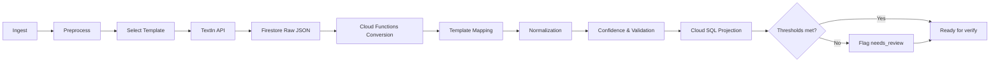

# SaiFlow — OCR 与提取流水线

> 本设计将上传文件经 TextIn 转换为原始结构化 JSON，保存于 Firestore，并由 Cloud Functions 按已发布的文档格式模板转换为 Cloud SQL 的可核验关系数据。实现 EPIC-01、EPIC-02 与 EPIC-08。

## 1. 流水线阶段



| 阶段 | 用途 | 实现内容 |
|------|------|----------|
| **接收（Ingest）** | 接收文件、记录原件、创建 `DM-Document` | FR-UPLOAD-001..003、011 |
| **预处理（Preprocess）** | 矫正、倾斜校正、去阴影、降噪、裁剪 | FR-UPLOAD-006..009 |
| **模板选择** | 根据表单类型和已发布状态确定模板及其 TextIn 参数 | FR-TEMPLATE-006、FR-OCR-017 |
| **TextIn 调用** | 服务端提交预处理文件，获得供应商原始结构化 JSON | FR-OCR-017 |
| **原始载荷保存** | Firestore 以不可变版本保存 JSON、关联信息及处理状态 | FR-OCR-018 |
| **事件转换** | Firestore 创建事件触发 Cloud Functions；创建或更新转换任务 | FR-OCR-019/020 |
| **模板映射** | 使用 JSONPath 将载荷映射至规范字段和行项目 | FR-TEMPLATE-003/004 |
| **标准化** | 日期（含佛历）、数字、THB 货币 | FR-OCR-016、NFR-I18N-002 |
| **置信度与校验** | 每字段评分、必填检查、金额重算 | FR-OCR-012、013、015 |
| **关系投影** | 幂等写入 `DM-Document`、`DM-ExtractedField`、`DM-LineItem` 至 Cloud SQL | FR-OCR-019/020 |

## 2. 输入、输出与存储边界

| 层 | 存储 | 内容 | 变更规则 |
|----|------|------|----------|
| 原件 | 私有 GCS | 上传原件及预处理派生文件 | 原件不可变 |
| 原始识别载荷 | Firestore | TextIn 全量 JSON、供应商请求标识、`document_id`、模板版本、处理状态 | 按载荷版本不可变 |
| 关系投影 | Cloud SQL | 文档、字段、行项目、转换任务、模板及核验数据 | 仅由幂等转换或授权核验操作写入 |

Firestore 不作为业务查询的权威关系库；Cloud SQL 不覆盖或修改原始 TextIn JSON。所有层均以 `document_id` 关联。

## 3. TextIn 调用与原始载荷（FR-OCR-017/018）

1. FastAPI 在服务器端从 Secret Manager 读取 TextIn 凭据和端点配置。
2. 系统选择已发布且启用的 `DM-DocumentTemplate`，取得其 TextIn 解析模板或服务参数引用。
3. FastAPI 将预处理后的文档提交至 TextIn，并在请求中记录 `document_id`、模板标识和请求时间。
4. 收到响应后，FastAPI 在 Firestore `extraction_payloads/{payload_id}` 创建新载荷；载荷包括完整 `raw_json`、`document_id`、`template_id`、`template_version`、`provider_request_id`、状态与时间戳。
5. 供应商错误、超时或无效响应不得创建成功载荷；系统记录失败状态并允许按 `NFR-REL` 重试。

浏览器不直接调用 TextIn，也不获取其凭据。TextIn 的数据跨境和区域合规须在 OQ-7 关闭后才可上线。

## 4. 模板映射与转换（FR-OCR-019/020、FR-TEMPLATE-003..006）

Cloud Functions 监听 Firestore 新建载荷事件。函数加载载荷记录的已发布模板版本，而不是读取“当前最新”模板，以确保重试和审计结果确定。

| 映射类型 | 规则 | 输出 |
|----------|------|------|
| 文档字段 | JSONPath → 规范 `field_key`，应用数据类型、必填与标准化规则 | `DM-Document` 与 `DM-ExtractedField` |
| 行项目 | 数组 JSONPath → 每个元素的列 JSONPath | 有序 `DM-LineItem` |
| 原始文本 | 保留 TextIn 返回的原始字符串 | `raw_text` |
| 置信度 | 使用供应商字段评分；无字段评分时标记为缺失并触发核验规则 | `confidence`、`needs_review` |

转换使用 `(document_id, payload_version)` 作为幂等键，并持久化 `DM-ConversionJob`。同一载荷的事件重放或重试只能更新同一个转换任务和该文档的投影结果，不能新增重复字段或行项目。模板校验仅允许受支持的 JSONPath、类型转换和标准化规则；不得执行用户提供的脚本、SQL 或网络请求。

## 5. 多语言、标准化与校验

### 5.1 多语言（FR-OCR-011、NFR-I18N-001）

- TextIn 请求必须启用模板所需的泰语、英语和简体/繁体中文识别能力。
- 原始文字系统保留在 `raw_text`；标准化后的业务值保留在 `value`。
- 模板映射不得因文字系统不同改变规范字段名称。

### 5.2 标准化（FR-OCR-016）

| 数据 | 规则 |
|------|------|
| 日期 | 解析泰国佛历（พ.ศ.）和公历；输出 ISO-8601 `YYYY-MM-DD` |
| 数字 | 移除泰语千位分隔符；输出规范 decimal |
| 货币 | THB；`decimal(14,2)`；不得出现浮点漂移（NFR-DATA-004） |
| 文本 | 去除首尾空白；在 `raw_text` 中保留原文 |

### 5.3 置信度与金额校验（FR-OCR-012、013、015）

- 默认核验阈值：`confidence < 0.85` → `needs_review = true`；阈值可按文档类型和字段配置。
- `line_total = quantity × unit_price`，容差为 ±0.01 THB。
- `document_total = Σ line_total + tax − discount`；超出容差时设置 `amount_mismatch = true` 并标记核验。
- 必填字段缺失、无可用模板、模板映射失败或供应商未返回置信度时，文档必须进入核验或失败状态，不得静默猜测。

## 6. 重试、重处理与批量处理

- 单份处理失败不会中止批次；失败载荷或转换任务记录错误代码和可重试状态。
- Cloud Functions 对瞬时错误可重试；重复 Firestore 事件必须保持幂等。
- 管理员发起重处理时，系统创建新的载荷版本或显式转换任务，不覆盖历史原始 JSON、模板版本或审计记录。
- Dataflow 不是默认路径，仅可用于获批的批量回填、高吞吐或重处理；必须使用同一映射组件、版本固定和幂等约束。

## 7. 性能目标（来自 NFR-PERF）

| 指标 | 目标 |
|------|------|
| 每张图像预处理 | ≤ 1 s（p95） |
| 单份文档端到端识别与转换 | ≤ 5 s（p95；不含人工核验） |
| 批量吞吐量 | ≥ 200 份文档/小时 |
| 字段准确率（V1.0 基线） | 样本集上 ≥ 85% |

## 8. 引擎抽象（ADR-002）

外部提取供应商位于稳定接口之后。默认适配器为 TextIn；替换供应商不应改变 Firestore 载荷边界、模板映射契约或 Cloud SQL 关系模型。

```text
interface ExtractionProvider {
  extract(file, templateParameters) -> RawExtractionPayload
}

interface ConversionService {
  convert(payloadId, templateVersion) -> ConversionResult
}
```

## 链接

- 需求：`docs/20-requirements/functional/EPIC-02-ocr-recognition.md`
- 模板配置：`docs/20-requirements/functional/EPIC-08-document-template-configuration.md`
- 数据模型：`docs/30-design/Data-Model.md`
- 测试样本：`thai-sample-forms-for-ocr/`

## 版本历史

| 版本 | 日期 | 作者 | 变更 |
|------|------|------|------|
| 1.1.0 | 2026-10-07 | Product Engineering | 改为 TextIn → Firestore → Cloud Functions → Cloud SQL 的模板化转换流水线 |
| 1.0.1 | 2026-10-02 | Product Engineering | 将人类可读内容翻译为简体中文 |
| 1.0.0 | 2026-09-10 | Product Engineering | 初始 OCR/提取流水线设计 |
