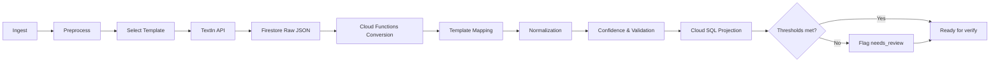

# SaiFlow — OCR 与提取流水线

> 本设计将上传文件经 TextIn 转换为原始结构化 JSON，保存于 Firestore，并由 Cloud Functions 按已发布的文档格式模板转换为 Cloud SQL 的可核验关系数据。实现 EPIC-01、EPIC-02 与 EPIC-08。

## 1. 流水线阶段



| 阶段 | 用途 | 实现内容 |
|------|------|----------|
| **接收（Ingest）** | 接收文件、记录原件、创建 `DM-Document` | FR-UPLOAD-001..003、011 |
| **预处理（Preprocess）** | 矫正、倾斜校正、去阴影、降噪、裁剪 | FR-UPLOAD-006..009 |
| **模板选择** | 根据表单类型和已发布状态确定模板及其 TextIn 参数 | FR-TEMPLATE-006、FR-OCR-017 |
| **TextIn 调用** | 服务端提交预处理文件，获得供应商原始结构化 JSON | FR-OCR-017 |
| **原始载荷保存** | Firestore 以不可变版本保存 JSON、关联信息及处理状态 | FR-OCR-018 |
| **事件转换** | Firestore 创建事件触发 Cloud Functions；创建或更新转换任务 | FR-OCR-019/020 |
| **模板映射** | 使用 JSONPath 将载荷映射至规范字段和行项目 | FR-TEMPLATE-003/004 |
| **标准化** | 日期（含佛历）、数字、THB 货币 | FR-OCR-016、NFR-I18N-002 |
| **置信度与校验** | 每字段评分、必填检查、金额重算 | FR-OCR-012、013、015 |
| **关系投影** | 幂等写入 `DM-Document`、`DM-ExtractedField`、`DM-LineItem` 至 Cloud SQL | FR-OCR-019/020 |

### 接收阶段的客户端进度（FR-UPLOAD-010）

LINE Mini App 的上传为预检、内容传输、完成确认三段。内容传输使用 `XMLHttpRequest.upload.onprogress` 获取已发送字节比例；预检和后端存储、校验期间按文件大小与耗时估算，进度不回退且最多到 95%。完成确认成功才报告 100%；成功或失败都清除估算定时器。请求仍使用同源会话 Cookie、CSRF 请求头和统一 API 错误处理。

## 2. 输入、输出与存储边界

| 层 | 存储 | 内容 | 变更规则 |
|----|------|------|----------|
| 原件 | 私有 GCS | 上传原件及预处理派生文件 | 原件不可变 |
| 原始识别载荷 | Firestore | TextIn 全量 JSON、供应商请求标识、`document_id`、模板版本、处理状态 | 按载荷版本不可变 |
| 关系投影 | Cloud SQL | 文档、字段、行项目、转换任务、模板及核验数据 | 仅由幂等转换或授权核验操作写入 |

Firestore 不作为业务查询的权威关系库；Cloud SQL 不覆盖或修改原始 TextIn JSON。所有层均以 `document_id` 关联。

## 3. TextIn 调用与原始载荷（FR-OCR-017/018）

1. FastAPI 在服务器端从 Secret Manager 读取 TextIn 凭据和端点配置。
2. 系统选择已发布且启用的 `DM-DocumentTemplate`，取得其 TextIn 解析模板或服务参数引用。
3. FastAPI 将预处理后的文档提交至 TextIn，并在请求中记录 `document_id`、模板标识和请求时间。
4. 收到响应后，FastAPI 在 Firestore `extraction_payloads/{payload_id}` 创建新载荷；载荷包括完整 `raw_json`、`document_id`、`template_id`、`template_version`、`provider_request_id`、状态与时间戳。
5. 供应商错误、超时或无效响应不得创建成功载荷；系统记录失败状态并允许按 `NFR-REL` 重试。

浏览器不直接调用 TextIn，也不获取其凭据。TextIn 的数据跨境和区域合规须在 OQ-7 关闭后才可上线。

### 3.1 当前 Flask / OcrWorker / Prompt v2 调用路径

上文 FastAPI / Firestore / Cloud Functions 为保留的历史架构段；本次 FR-OCR-017 自动重试契约落实于当前 Flask 后端，不以重写历史架构为前提。实际路径为 `services/api/worker.py` 的 `OcrWorker` → `services/api/textin/adapter.py::run_extraction` → `services/api/textin/client.py::extract_with_prompt` → TextIn `POST /ai/service/v2/entity_extraction`。

- Worker 读取已有原件字节与任务参数；Prompt v2 请求体为 base64 文件与 `EXTRACT_PROMPT`，查询参数为 `file_name`、`page_start`（0 基）与 `page_count`。自动重试固定同一原件、文件名、页参数与 Prompt，不重新执行上传或创建任务。
- 适配器从 `result.llm_json` 取得结构化字段和行项目；可接受对象、数组或解析后为对象/数组的 JSON 字符串。无效响应 JSON、缺失或无效 `llm_json` 属于供应商无效输出（`-1`），不是可泛化重试的本地程序异常。
- HTTP 状态与响应业务 `code` 必须分离：HTTP 失败即使响应体 `code=200` 也不得返回成功，按 HTTP 错误分类且明确永久业务错误优先停止；仅 HTTP 成功（2xx）、业务 `code=200` 且 `llm_json` 有效时才是调用成功。HTTP 成功但业务 `code` 失败，仍按业务错误处理；具体可重试分类见 §6.1。
- 重试仅在 Worker 包围 TextIn 调用的单一层执行；HTTP 客户端及适配器不另加重试。成功即退出循环，之后仅一次结果持久化及后处理（现有 `ResultVersion`、审计副本与完成通知路径），失败尝试不进入这些步骤，不改变 DeepSeek 行为。

**本轮已实现并隔离验证，尚未发布。** Worker 使用 `range(MAX_VENDOR_RETRIES + 1)`（额外重试上限 3），以 2/4/8 秒退避，每次调用前刷新取消/终态；客户端保留 HTTP 状态与业务 `code`，不把 HTTP 失败且 `code=200` 当成功。`test_textin_retries.py` 的 284 项新增回归与 `test_auth_modes.py`/`test_capacity.py` 的 366 项既有回归联合运行，650 项通过（2026-10-29，37.98 秒）。新增测试执行真实 `_process_inner`、TextInClient、适配器与 httpx.MockTransport，覆盖四次上限、早成功、固定请求、各类短暂/永久错误、GBK/无效 JSON/llm_json、取消/终态、最后错误、单次持久化与审计/通知；恢复的条件更新及锁行刷新参数也有隔离断言。全部文件/账号/响应合成，网络/真实 DB/SMTP、app.py 导入、Worker 启动与实际 sleep 被禁止；数据库使用替身，未验证真实 PostgreSQL 多实例竞争或供应商 POST 去重/扣费。此前 30203 被测试按初始白名单设为不可重试，核对厂商 v2 文档明确“基础服务故障，请稍后重试”后同步修正契约及测试，保留初始失败日志，不更改产品逻辑以迎合旧断言。

## 4. 模板映射与转换（FR-OCR-019/020、FR-TEMPLATE-003..006）

Cloud Functions 监听 Firestore 新建载荷事件。函数加载载荷记录的已发布模板版本，而不是读取“当前最新”模板，以确保重试和审计结果确定。

| 映射类型 | 规则 | 输出 |
|----------|------|------|
| 文档字段 | JSONPath → 规范 `field_key`，应用数据类型、必填与标准化规则 | `DM-Document` 与 `DM-ExtractedField` |
| 行项目 | 数组 JSONPath → 每个元素的列 JSONPath | 有序 `DM-LineItem` |
| 原始文本 | 保留 TextIn 返回的原始字符串 | `raw_text` |
| 置信度 | 使用供应商字段评分；无字段评分时标记为缺失并触发核验规则 | `confidence`、`needs_review` |

转换使用 `(document_id, payload_version)` 作为幂等键，并持久化 `DM-ConversionJob`。同一载荷的事件重放或重试只能更新同一个转换任务和该文档的投影结果，不能新增重复字段或行项目。模板校验仅允许受支持的 JSONPath、类型转换和标准化规则；不得执行用户提供的脚本、SQL 或网络请求。

## 5. 多语言、标准化与校验

### 5.1 多语言（FR-OCR-011、NFR-I18N-001）

- TextIn 请求必须启用模板所需的泰语、英语和简体/繁体中文识别能力。
- 原始文字系统保留在 `raw_text`；标准化后的业务值保留在 `value`。
- 模板映射不得因文字系统不同改变规范字段名称。

### 5.2 标准化（FR-OCR-016）

| 数据 | 规则 |
|------|------|
| 日期 | 解析泰国佛历（พ.ศ.）和公历；输出 ISO-8601 `YYYY-MM-DD` |
| 数字 | 移除泰语千位分隔符；输出规范 decimal |
| 货币 | THB；`decimal(14,2)`；不得出现浮点漂移（NFR-DATA-004） |
| 文本 | 去除首尾空白；在 `raw_text` 中保留原文 |

### 5.3 置信度与金额校验（FR-OCR-012、013、015）

- 默认核验阈值：`confidence < 0.85` → `needs_review = true`；阈值可按文档类型和字段配置。
- `line_total = quantity × unit_price`，容差为 ±0.01 THB。
- `document_total = Σ line_total + tax − discount`；超出容差时设置 `amount_mismatch = true` 并标记核验。
- 必填字段缺失、无可用模板、模板映射失败或供应商未返回置信度时，文档必须进入核验或失败状态，不得静默猜测。

## 6. 重试、重处理与批量处理

- 单份处理失败不会中止批次；失败载荷或转换任务记录错误代码和可重试状态。
- Cloud Functions 对瞬时错误可重试；重复 Firestore 事件必须保持幂等。
- 管理员发起重处理时，系统创建新的载荷版本或显式转换任务，不覆盖历史原始 JSON、模板版本或审计记录。
- Dataflow 不是默认路径，仅可用于获批的批量回填、高吞吐或重处理；必须使用同一映射组件、版本固定和幂等约束。

### 6.1 当前 Worker 的 TextIn 单层自动重试契约（FR-OCR-017）

- 仅重试 §3.1 的 TextIn 提取调用，不重跑上传、创建任务、结果持久化或后处理。首次 1 次 + 额外最多 3 次 = 最多 4 次调用；重试前依次等待 2/4/8 秒，成功立即退出，不再调用供应商。HTTP 客户端及适配器不做独立重试，避免次数相乘。
- 每次调用复用同一 job、原件字节、文件名、页参数与 Prompt。每次调用前以 `populate_existing=True` 重新读取取消及既有终态；退避期间已取消或被另一实例终结则不再调用 TextIn，不写成功结果或发完成通知。成功返回后仍检查状态；状态推进与结果持久化事务使用 `with_for_update=True` 锁行刷新，已 CANCEL_REQUESTED 则取消，已落终态则回滚释放锁、不覆盖。
- `_recover_stale_jobs()` 在启动时以状态及 `updated_at` 条件更新：只有超过 10 分钟无进展的 PREPROCESSING 恢复 QUEUED；PROCESSING/POSTPROCESSING 保守置 FAILED/VENDOR_UNCERTAIN，不重置供应商重试预算。CANCEL_REQUESTED 条件落 CANCELLED，其他终态不变。长调用尚未完成也可能触发保守失败，由用户显式 Retry；10 分钟不是供应商墙钟超时。此规则修正原先所有中间阶段一律重新入队的重复调用风险，不通过扩大 stale 阈值声称去重保证。

| 错误层 / 类型 | 处理规则 |
|---------------|----------|
| 网络 / 超时 | 可重试供应商传输错误与超时；不将本地程序异常当作网络错误 |
| HTTP 失败 | 408、429、5xx 可重试；余额不足 `40003`、鉴权/权限/参数等明确永久错误优先不重试，不被 HTTP 5xx 覆盖；响应体 `code=200` 不得覆盖 HTTP 失败 |
| HTTP 成功但业务失败 | 业务限流 `429`、`458`、`459`、`40306`、基础服务故障 `30203` 及业务 `500..599` 可重试；余额不足 `40003`、鉴权/权限/参数等明确永久错误不重试 |
| 供应商无效输出 | 无效响应 JSON、缺失或无效 `llm_json`（`-1`）可重试；HTTP 失败仍按 HTTP 类型分类，明确永久错误优先停止 |
| 本地程序异常 | 不重试；禁止仅凭泛捕获异常或错误消息含限流词重试 |

- 额外 3 次重试耗尽，只将同一 job 标记 `FAILED` 并保留最后错误代码和消息；不可重试错误立即失败。不为失败尝试创建新 job/result、原始识别载荷或完成通知；调用成功后仅一次结果持久化/后处理。复用同一任务的页数，不因调用次数额外累计 SaiFlow 月页额度，既有失败/取消不计月页消耗的规则不变。
- 用户显式 Retry/rerun 仍按 AC-FR-OCR-020-02 创建新任务（`parent_job_id` 关联原任务），与同一 job 内自动重试不同；历史 Cloud Functions 幂等转换和管理员重处理不是本次供应商调用的额外重试层。本轮不改 API、数据库、认证、DeepSeek、手动 rerun 或部署。
- **供应商幂等与扣费边界：** POST 超时不能判定 TextIn 是否已经受理或扣费；当前调用未观察到供应商幂等键。重发可能造成重复受理/扣费，不承诺供应商只扣一次；保证仅限本应用自动重试不重复生成结果或额外累计 SaiFlow 月页额度，不等同于供应商侧幂等。
- **等待边界：** `services/api/textin/config.py` 的 Prompt v2 默认 `prompt_timeout_seconds=180`。按每次 180 秒的等待预算估算，最多 `180 × 4 + (2 + 4 + 8) = 734` 秒（12 分 14 秒）；只含供应商调用等待与退避，不含排队、读取文件、预处理、结果持久化和后处理。现有 `httpx.Timeout` 是分阶段/网络等待超时，并非整个 POST 的严格墙钟截止，因此 734 秒不是已实现的端到端硬上限，也不替代 §7 的正常路径 p95 性能目标。

验收见 [EPIC-02 的 AC-FR-OCR-017-02](../20-requirements/functional/EPIC-02-ocr-recognition.md#5-代表性验收标准p0) 与 [汇总验收标准 EPIC-02 区](../40-acceptance/Acceptance-Criteria.md#2-epic-02--ocr-识别)。本轮 650 项隔离回归通过且未发布，验证及限制见 §3.1，历史部署证据不作为本次上线证据。错误码依据为 [TextIn 旧版 v2 智能抽取文档](https://www.textin.com/document/legacy/open_kie_vlm_engine)（30203：基础服务故障，请稍后重试；40306：qps 超过限制；40003：余额不足；500：内部错误）；未从 v3 文档推断 v2 的幂等保证。超时语义依据 [HTTPX 分阶段超时说明](https://www.python-httpx.org/advanced/timeouts/)。

## 7. 性能目标（来自 NFR-PERF）

| 指标 | 目标 |
|------|------|
| 每张图像预处理 | ≤ 1 s（p95） |
| 单份文档端到端识别与转换 | ≤ 5 s（p95；不含人工核验） |
| 批量吞吐量 | ≥ 200 份文档/小时 |
| 字段准确率（V1.0 基线） | 样本集上 ≥ 85% |

## 8. 引擎抽象（ADR-002）

外部提取供应商位于稳定接口之后。默认适配器为 TextIn；替换供应商不应改变 Firestore 载荷边界、模板映射契约或 Cloud SQL 关系模型。

```text
interface ExtractionProvider {
  extract(file, templateParameters) -> RawExtractionPayload
}

interface ConversionService {
  convert(payloadId, templateVersion) -> ConversionResult
}
```

## 链接

- 需求：`docs/20-requirements/functional/EPIC-02-ocr-recognition.md`
- 模板配置：`docs/20-requirements/functional/EPIC-08-document-template-configuration.md`
- 数据模型：`docs/30-design/Data-Model.md`
- 测试样本：`thai-sample-forms-for-ocr/`

## 版本历史

| 版本 | 日期 | 作者 | 变更 |
|------|------|------|------|
| 1.1.2 | 2026-10-29 | Product Engineering | FR-OCR-017：当前 Flask OcrWorker / Prompt v2 的最多 4 次调用与 2/4/8 秒退避、HTTP/业务错误、取消/终态、保守恢复及锁行刷新、结果唯一与供应商扣费边界；284 项新增+366 项既有隔离回归通过，未发布；真实供应商及 PostgreSQL 多实例并发未验收，180×4+14 秒仅估算，见 §3.1/6.1 |
| 1.1.1 | 2026-10-18 | Product Engineering | 补充接收阶段上传进度：实际字节反馈与文件大小估算，完成确认后才报告 100%（FR-UPLOAD-010） |
| 1.1.0 | 2026-10-07 | Product Engineering | 改为 TextIn → Firestore → Cloud Functions → Cloud SQL 的模板化转换流水线 |
| 1.0.1 | 2026-10-02 | Product Engineering | 将人类可读内容翻译为简体中文 |
| 1.0.0 | 2026-09-10 | Product Engineering | 初始 OCR/提取流水线设计 |
