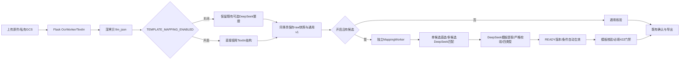

# SaiFlow — OCR 与提取流水线

> 本期依据已批准 document-template-mapping v2/R1–R6：当前 Flask OcrWorker 保存 TextIn llm_json 关系型快照与 v1，独立 MappingWorker 复用 DeepSeek 做匹配/转换，再核验/导出。无 JSONPath 执行、草稿发布、Cloud Functions 或新供应商。既有 Firestore 完整 TextIn 响应归档合法保留，与新快照不同。2026-10-31 隔离 SQLite/mock 后端 816 项通过，两种子获业务批准且正式 CLI validate 均通过；共享库仅 transaction_read_only=on 下 SELECT，重复当前版本任务数 0，无 DDL/写入。真实 LLM 质量/耗时/token 基线未运行，共享库 seed 与部署未授权。验证范围及补测记录见 [汇总验收](../40-acceptance/Acceptance-Criteria.md)；§3.1/6.1 的 2026-10-29 TextIn 证据保留其历史范围，不单独充当新映射行为证据。

## 1. 流水线阶段

| 阶段 | 用途 | 实现内容 |
|------|------|----------|
| **接收（Ingest）** | 接收文件、记录原件、创建 `DM-Document` | FR-UPLOAD-001..003、011 |
| **预处理（Preprocess）** | 矫正、倾斜校正、去阴影、降噪、裁剪 | FR-UPLOAD-006..009 |
| **TextIn 调用** | 服务端已有 Prompt v2 与单层重试，浏览器无凭据 | FR-OCR-017 |
| **原始结果快照** | 整理/映射/编辑前深拷贝 llm_json，与v1同事务保存，每任务一份 | FR-OCR-021 |
| **模板契约** | CLI、有序分组字段/表格、不可变版本、系统/租户隔离 | FR-TEMPLATE-001..005、007 |
| **自动匹配** | 0不建AUTO；1直选；多候选现有DeepSeek选最高合法分 | FR-OCR-018 |
| **转换** | 仅源信息、不推算；schema补null、模型extras丢弃、四类型无舍入 | FR-OCR-019 |
| **后台调度** | 独立MappingWorker，认领/重试/恢复/次数上限 | FR-OCR-020 |
| **核验与切换** | 锁任务、max+1、分支编辑/指针切换、必填门禁 | FR-VERIFY-018..020 |
| **导出** | 固定模板顺序/名称/金额类型，保存的extras追加；通用不变 | FR-ENTRY-002 |

### 接收阶段的客户端进度（FR-UPLOAD-010）

LINE Mini App 的上传为预检、内容传输、完成确认三段。内容传输使用 `XMLHttpRequest.upload.onprogress` 获取已发送字节比例；预检和后端存储、校验期间按文件大小与耗时估算，进度不回退且最多到 95%。完成确认成功才报告 100%；成功或失败都清除估算定时器。请求仍使用同源会话 Cookie、CSRF 请求头和统一 API 错误处理。

多选上传按文件逐个复用同一三段通道，批次固定租户与会话；逐文件状态与失败继续规则以 [FR-UPLOAD-002/003/005](../20-requirements/functional/EPIC-01-document-upload.md) 为准。上传不创建 OCR 任务。成功文件进入首页 Pending，单条 Process 打开原确认页，批量 Process (N) 预览后由前端逐个 `createJob`（各自幂等键），不新增批量处理 API 或供应商调用；删除为文件软删除，取消上传会中止 XHR 并清理会话（FR-UPLOAD-013）。LINE 首页只有 Camera/Files，Files 不设格式过滤，JPG/PNG/PDF 以外的文件在前端上传前即被拒绝；原生菜单能力受 iOS/LINE 宿主限制。

## 2. 输入、输出与存储边界

| 层 | 存储 | 内容 | 变更规则 |
|----|------|------|----------|
| 原件 | 私有 GCS | 上传原件及预处理派生文件 | 原件不可变 |
| 历史完整原始载荷 | Firestore | TextIn 全量响应归档 | 合法保留，不作为新映射触发源 |
| OCR解析结果 | Cloud SQL `ocr_raw_results` | 每job的llm_json，id=raw_result_id | 只写一次，不回填历史，无修改API |
| 模板/版本/映射/核验结果 | Cloud SQL | document_templates / document_template_versions / template_mappings / result_versions | 版本内容不可变；授权编辑追加版本 |

Cloud SQL PostgreSQL 18.6（saiflow-dev / postgres.saiflow）使用json，不用jsonb。无新增原始快照存储大小上限，60,000字符仅为模型输入限制；PATCH另有2,000,000 compact UTF-8字节限制。详见 [Data-Model §2.5](Data-Model.md#25-模板-schemadm-ocrrawresult-与-dm-templatemapping) 与 [ADR-006](adr/ADR-006-relational-template-storage.md)。

## 3. TextIn 与开关（FR-OCR-017/021）

Flask Worker沿用已有TextIn服务端调用。成功后先深拷贝llm_json，最终事务保存ocr_raw_results和通用v1；任何整理/映射/编辑不改快照。失败尝试不生成成功快照。模板不配置TextIn参数或分类。

| 开关 | 通用v1 | AUTO/Worker/apply |
|---|---|---|
| 关闭（默认） | 仍保存快照，保留既有可选DeepSeek整理 | 不建AUTO，不启动MappingWorker；apply返回409 TEMPLATE_MAPPING_DISABLED |
| 开启 | 仍保存快照，直接TextIn结构，跳过整理 | 有候选才建AUTO；匹配/转换仍使用现有DeepSeek |

关闭后历史映射仍读/编辑/导出，use-generic不要求开关开启；关闭期间的新任务也保存并返回raw_result_id，仅无历史快照时为空，旧任务不回填。本地与线上共享数据库，本地必须保持关闭；不得用本地Worker处理线上映射。两种子已获业务批准且正式CLI validate均通过；共享库seed、schema变更、开关开启/部署未授权，既有只读SELECT不代表写入或部署完成。浏览器无TextIn/DeepSeek/云资源凭据；沿用供应商PDPA人工确认约束。

### 3.1 当前 Flask / OcrWorker / Prompt v2 调用路径

以下为2026-10-29的FR-OCR-017调用/重试记录，不是2026-10-31模板映射验证。实际路径为 `services/api/worker.py` 的 `OcrWorker` → `services/api/textin/adapter.py::run_extraction` → `services/api/textin/client.py::extract_with_prompt` → TextIn `POST /ai/service/v2/entity_extraction`。

- Worker 读取已有原件字节与任务参数；Prompt v2 请求体为 base64 文件与 `EXTRACT_PROMPT`，查询参数为 `file_name`、`page_start`（0 基）与 `page_count`。自动重试固定同一原件、文件名、页参数与 Prompt，不重新执行上传或创建任务。
- 适配器从 `result.llm_json` 取得结构化字段和行项目；可接受对象、数组或解析后为对象/数组的 JSON 字符串。无效响应 JSON、缺失或无效 `llm_json` 属于供应商无效输出（`-1`），不是可泛化重试的本地程序异常。
- HTTP 状态与响应业务 `code` 必须分离：HTTP 失败即使响应体 `code=200` 也不得返回成功，按 HTTP 错误分类且明确永久业务错误优先停止；仅 HTTP 成功（2xx）、业务 `code=200` 且 `llm_json` 有效时才是调用成功。HTTP 成功但业务 `code` 失败，仍按业务错误处理；具体可重试分类见 §6.1。
- 重试仅在 Worker 包围 TextIn 调用的单一层执行；HTTP 客户端及适配器不另加重试。成功即退出循环，之后仅一次结果持久化及后处理（现有 `ResultVersion`、审计副本与完成通知路径），失败尝试不进入这些步骤，不改变 DeepSeek 行为。

**本轮已实现并隔离验证，尚未发布。** Worker 使用 `range(MAX_VENDOR_RETRIES + 1)`（额外重试上限 3），以 2/4/8 秒退避，每次调用前刷新取消/终态；客户端保留 HTTP 状态与业务 `code`，不把 HTTP 失败且 `code=200` 当成功。`test_textin_retries.py` 的 284 项新增回归与 `test_auth_modes.py`/`test_capacity.py` 的 366 项既有回归联合运行，650 项通过（2026-10-29，37.98 秒）。新增测试执行真实 `_process_inner`、TextInClient、适配器与 httpx.MockTransport，覆盖四次上限、早成功、固定请求、各类短暂/永久错误、GBK/无效 JSON/llm_json、取消/终态、最后错误、单次持久化与审计/通知；恢复的条件更新及锁行刷新参数也有隔离断言。全部文件/账号/响应合成，网络/真实 DB/SMTP、app.py 导入、Worker 启动与实际 sleep 被禁止；数据库使用替身，未验证真实 PostgreSQL 多实例竞争或供应商 POST 去重/扣费。此前 30203 被测试按初始白名单设为不可重试，核对厂商 v2 文档明确“基础服务故障，请稍后重试”后同步修正契约及测试，保留初始失败日志，不更改产品逻辑以迎合旧断言。

## 4. 自动匹配与转换（FR-OCR-018/019）

候选是系统或本任务租户的启用、未删除模板当前版本：0个不建AUTO；1个直选，match_score=null/reason=single_candidate，不调用匹配模型；≥2个只用现有DeepSeek。目录最多50个，超出按更新时间截取并记日志，名称/key/描述参与匹配，目录描述最多120字符。原始compact JSON超过60,000字符则RAW_TOO_LARGE，不截断。

ranking的template_version_id必须在候选白名单；非法项丢弃、得分钳制0–1、保留top-3，至少一项合法就选最高。低于默认0.7只警告，仍转换；全部非法修复一次后MATCH_FAILED。得分不是字段confidence，无分类/规则快路径（[ADR-007](adr/ADR-007-llm-only-template-mapping.md)）。

转换提示包含固定版本骨架和字段/列名称、描述、类型；只能取文档信息，找不到填null，不推算、不计算合计，每行对应源行，只输出JSON。文档数据不是指令，不调用工具。`json.loads(..., parse_float=str)`避免浮点漂移。顶层对象、表格对象数组且≤500行；严格逐模板取值，缺字段/列补null，模型extras丢弃计数。非法输出修复一次后LLM_INVALID_OUTPUT。输出`{group_key:{field_key:scalar,table_key:[{col_key:scalar}]}}`。

## 5. 四类型、核验与导出

| 类型 | 存储标准化 | 警告 |
|---|---|---|
| string | trim、空串→null；日期仍字符串 | 不做佛历转换 |
| integer | 清除逗号/空格/币种，匹配`^-?\d+(\.0+)?$`，绝对值≤2^53−1，JSON整数 | 失败保留原文/type_mismatch |
| decimal | 同样清洗，匹配`^-?\d+(\.\d+)?$`，规范字符串，不舍入 | 同上 |
| amount | decimal字符串，小数不足2位补齐，超过2位保留 | >2位amount_precision；失败type_mismatch |

null/空值非类型错误。金额显示和导出按type加千分位、至少两位，超过两位不舍入。旧FR-OCR-012/013/015/016和NFR中的confidence、金额重算、佛历、decimal(14,2)目标不用于这条链路；NFR尚待另行同步，不宣称已满足。

FR-VERIFY-018：选择框显示推荐/分数/已生成/预览与通用选项；dirty时「保存并切换/取消」。pending禁止编辑，2秒轮询最多10分钟；ProcessingPage额外等待最多90秒后结果页继续轮询。失败保留当前结果，可重试/其他模板/通用。

任务锁下所有新结果版本=max(version)+1，PATCH继承mapping；切换只移动指针/当前标记，不复制、调用模型或新增结果版本，恢复分支最近编辑并可返回旧号。显式use-generic即使已通用也记录template.generic_selected，不升版。READY生成版本，仅pending相同、base仍当前且未确认时自动激活；不覆盖编辑或新pending。确认后禁止apply/switch/use-generic（409 results.already_confirmed）。

FR-VERIFY-019/020：固定版本schema顺序/显示名/必填标识；模板字段只能清空不能删，用户extras及表格行增删保留。草稿补齐模板字段/列但保留用户额外组/列/行。confirm:true按提交内容检查required，缺失422 INVALID_ARGUMENT/results.required_missing，field_errors为structured路径+required，无版本/确认写入；只检查已有行，空表不虚造行。草稿/通用 exempt，类型警告不拦。认证/注册/租户与原确认规则不变。

FR-ENTRY-002：XLSX/CSV按历史固定模板顺序和显示名、金额type导出，extras追加，包含已保存编辑，通用不变。正式format=JSON原样输出指定版本structured，application/json MIME与.json下载；保留键顺序、JSON类型、数值精度及extras，不加信封、不替换显示名或格式化金额，TXT旧行为不变。契约核对见[API-Spec §4](API-Spec.md#4-尚未对齐的契约差异)，补测不以既有816项记录代替。无Excel导入/隐藏标记/往返保证。Final页只读schema、History显示模板名。

## 6. MappingWorker、重试与恢复（FR-OCR-020）

独立线程与OcrWorker并行，不占Web线程或阻塞OCR队列；开关关闭不启动。2秒轮询最早PENDING，用`WHERE id=? AND status='PENDING'`条件认领，影响1行才处理。AUTO先MATCHING，MANUAL指定版本跳到CONVERTING，最终READY/FAILED。删除结果保留job，在同任务锁事务内清理raw/mappings/results及指针；每阶段前后重读任务与快照、映射、基础结果关联，关联被清理则中止，不生成或迟到写回。该路径已静态复核并有隔离测试；已确认仍可完成但不得自动生效，最终核对见API-Spec §4。

现有DEEPSEEK_BASE_URL/API_KEY/MODEL，temperature=0，无response_format。连接10秒、读取默认120秒；匹配/转换各首次+最多一次重试（网络/超时/429/5xx或无效输出），延迟2秒。约524秒仅估算，不是测量或端到端保证。启动及每5分钟恢复超过10分钟无更新的MATCHING/CONVERTING→FAILED/MAPPING_INTERRUPTED，只清对应pending。其他错误MATCH_FAILED、LLM_TIMEOUT、LLM_UNAVAILABLE、LLM_INVALID_OUTPUT、RAW_TOO_LARGE。

默认每job最多5个新映射含AUTO/FAILED，READY复用不计；用户重试映射显式传force=true避免复用旧READY，不绕过次数上限、不保证相同LLM结果。映射不消耗OCR月页额度。记录调用数、token、模型/提示版本/耗时，不记录单据内容。CLI审计template.created/versioned/enabled/disabled/deleted（source=cli，actor可空）；结果审计template.applied/switched/generic_selected/mapping_failed/match_feedback，显式use-generic即使已通用也记录选择且不升版，确认时记录自动推荐与最终版本，不含内容。

### 6.1 当前 Worker 的 TextIn 单层自动重试契约（FR-OCR-017）

- 仅重试 §3.1 的 TextIn 提取调用，不重跑上传、创建任务、结果持久化或后处理。首次 1 次 + 额外最多 3 次 = 最多 4 次调用；重试前依次等待 2/4/8 秒，成功立即退出，不再调用供应商。HTTP 客户端及适配器不做独立重试，避免次数相乘。
- 每次调用复用同一 job、原件字节、文件名、页参数与 Prompt。每次调用前以 `populate_existing=True` 重新读取取消及既有终态；退避期间已取消或被另一实例终结则不再调用 TextIn，不写成功结果或发完成通知。成功返回后仍检查状态；状态推进与结果持久化事务使用 `with_for_update=True` 锁行刷新，已 CANCEL_REQUESTED 则取消，已落终态则回滚释放锁、不覆盖。
- `_recover_stale_jobs()` 在启动时以状态及 `updated_at` 条件更新：只有超过 10 分钟无进展的 PREPROCESSING 恢复 QUEUED；PROCESSING/POSTPROCESSING 保守置 FAILED/VENDOR_UNCERTAIN，不重置供应商重试预算。CANCEL_REQUESTED 条件落 CANCELLED，其他终态不变。长调用尚未完成也可能触发保守失败，由用户显式 Retry；10 分钟不是供应商墙钟超时。此规则修正原先所有中间阶段一律重新入队的重复调用风险，不通过扩大 stale 阈值声称去重保证。

| 错误层 / 类型 | 处理规则 |
|---------------|----------|
| 网络 / 超时 | 可重试供应商传输错误与超时；不将本地程序异常当作网络错误 |
| HTTP 失败 | 408、429、5xx 可重试；余额不足 `40003`、鉴权/权限/参数等明确永久错误优先不重试，不被 HTTP 5xx 覆盖；响应体 `code=200` 不得覆盖 HTTP 失败 |
| HTTP 成功但业务失败 | 业务限流 `429`、`458`、`459`、`40306`、基础服务故障 `30203` 及业务 `500..599` 可重试；余额不足 `40003`、鉴权/权限/参数等明确永久错误不重试 |
| 供应商无效输出 | 无效响应 JSON、缺失或无效 `llm_json`（`-1`）可重试；HTTP 失败仍按 HTTP 类型分类，明确永久错误优先停止 |
| 本地程序异常 | 不重试；禁止仅凭泛捕获异常或错误消息含限流词重试 |

- 额外 3 次重试耗尽，只将同一 job 标记 `FAILED` 并保留最后错误代码和消息；不可重试错误立即失败。不为失败尝试创建新 job/result、原始识别载荷或完成通知；调用成功后仅一次结果持久化/后处理。复用同一任务的页数，不因调用次数额外累计 SaiFlow 月页额度，既有失败/取消不计月页消耗的规则不变。
- 用户显式 Retry/rerun 仍按 AC-FR-OCR-020-02 创建新任务（`parent_job_id` 关联原任务），与同一 job 内自动重试不同；历史 Cloud Functions 幂等转换和管理员重处理不是本次供应商调用的额外重试层。该历史重试证据不覆盖本期模板映射的实现与发布。
- **供应商幂等与扣费边界：** POST 超时不能判定 TextIn 是否已经受理或扣费；当前调用未观察到供应商幂等键。重发可能造成重复受理/扣费，不承诺供应商只扣一次；保证仅限本应用自动重试不重复生成结果或额外累计 SaiFlow 月页额度，不等同于供应商侧幂等。
- **等待边界：** `services/api/textin/config.py` 的 Prompt v2 默认 `prompt_timeout_seconds=180`。按每次 180 秒的等待预算估算，最多 `180 × 4 + (2 + 4 + 8) = 734` 秒（12 分 14 秒）；只含供应商调用等待与退避，不含排队、读取文件、预处理、结果持久化和后处理。现有 `httpx.Timeout` 是分阶段/网络等待超时，并非整个 POST 的严格墙钟截止，因此 734 秒不是已实现的端到端硬上限，也不替代 §7 的正常路径 p95 性能目标。

验收见 [EPIC-02 的 AC-FR-OCR-017-02](../20-requirements/functional/EPIC-02-ocr-recognition.md#5-代表性验收标准p0) 与 [汇总验收标准 EPIC-02 区](../40-acceptance/Acceptance-Criteria.md#2-epic-02--ocr-识别)。本轮 650 项隔离回归通过且未发布，验证及限制见 §3.1，历史部署证据不作为本次上线证据。错误码依据为 [TextIn 旧版 v2 智能抽取文档](https://www.textin.com/document/legacy/open_kie_vlm_engine)（30203：基础服务故障，请稍后重试；40306：qps 超过限制；40003：余额不足；500：内部错误）；未从 v3 文档推断 v2 的幂等保证。超时语义依据 [HTTPX 分阶段超时说明](https://www.python-httpx.org/advanced/timeouts/)。

## 7. 性能目标（来自 NFR-PERF）

| 指标 | 目标 |
|------|------|
| 每张图像预处理 | ≤ 1 s（p95） |
| 单份文档端到端识别与转换 | ≤ 5 s（p95；不含人工核验） |
| 批量吞吐量 | ≥ 200 份文档/小时 |
| 字段准确率（V1.0 基线） | 样本集上 ≥ 85% |

## 8. 决策与适用边界

本期仅复用已有TextIn与DeepSeek，不引入可切换引擎平台。关系型存储见 [ADR-006](adr/ADR-006-relational-template-storage.md)，LLM-only匹配/转换见 [ADR-007](adr/ADR-007-llm-only-template-mapping.md)。旧「ADR-002引擎抽象」引用不正确（ADR-002实际为web-pc mock adapter），已移除。§7保留NFR目标而非实测结果；5秒端到端与新模型调用预算的适用边界、性能/质量基线和阈值校准仍待批准/验证，不以估算替代验收。

## 链接

- 需求：`docs/20-requirements/functional/EPIC-02-ocr-recognition.md`
- 模板配置：`docs/20-requirements/functional/EPIC-08-document-template-configuration.md`
- 数据模型：`docs/30-design/Data-Model.md`
- 测试样本：`thai-sample-forms-for-ocr/`

## 版本历史

| 版本 | 日期 | 作者 | 变更 |
|------|------|------|------|
| 1.2.4 | 2026-11-04 | Product Engineering | FR-UPLOAD-003：LINE 只留 Camera/Files 入口，不支持的文件在前端上传前拒绝；上传通道与 OCR 不变 |
| 1.2.3 | 2026-11-04 | Product Engineering | FR-UPLOAD-013：上传成功进入 Pending，预览确认后才创建任务（批量为前端逐个 createJob），软删除与取消上传不触发供应商调用 |
| 1.2.2 | 2026-11-04 | Product Engineering | FR-UPLOAD-002/003/005/010：多选串行复用三段 XHR、逐文件反馈及多文件显式逐条确认；不改 OCR 创建/供应商通道，不实现待处理持久化或批量开始处理 |
| 1.2.1 | 2026-10-31 | Product Engineering | 对齐raw返回、切回不升版/通用选择审计、force重试、同锁删除关联重读中止及正式JSON/TXT兼容；记录816隔离后端、两种子批准/validate、共享库只读证据，真实质量/耗时/token基线未运行 |
| 1.2.0 | 2026-10-31 | Product Engineering | 同步Flask OcrWorker+独立MappingWorker、开关/不可变关系型快照、LLM-only/四类型/并发/核验/导出及错误恢复；保留历史TextIn重试和Firestore原文合法边界；移除错误ADR-002引擎引用 |
| 1.1.2 | 2026-10-29 | Product Engineering | FR-OCR-017：当前 Flask OcrWorker / Prompt v2 的最多 4 次调用与 2/4/8 秒退避、HTTP/业务错误、取消/终态、保守恢复及锁行刷新、结果唯一与供应商扣费边界；284 项新增+366 项既有隔离回归通过，未发布；真实供应商及 PostgreSQL 多实例并发未验收，180×4+14 秒仅估算，见 §3.1/6.1 |
| 1.1.1 | 2026-10-18 | Product Engineering | 补充接收阶段上传进度：实际字节反馈与文件大小估算，完成确认后才报告 100%（FR-UPLOAD-010） |
| 1.1.0 | 2026-10-07 | Product Engineering | 改为 TextIn → Firestore → Cloud Functions → Cloud SQL 的模板化转换流水线 |
| 1.0.1 | 2026-10-02 | Product Engineering | 将人类可读内容翻译为简体中文 |
| 1.0.0 | 2026-09-10 | Product Engineering | 初始 OCR/提取流水线设计 |
